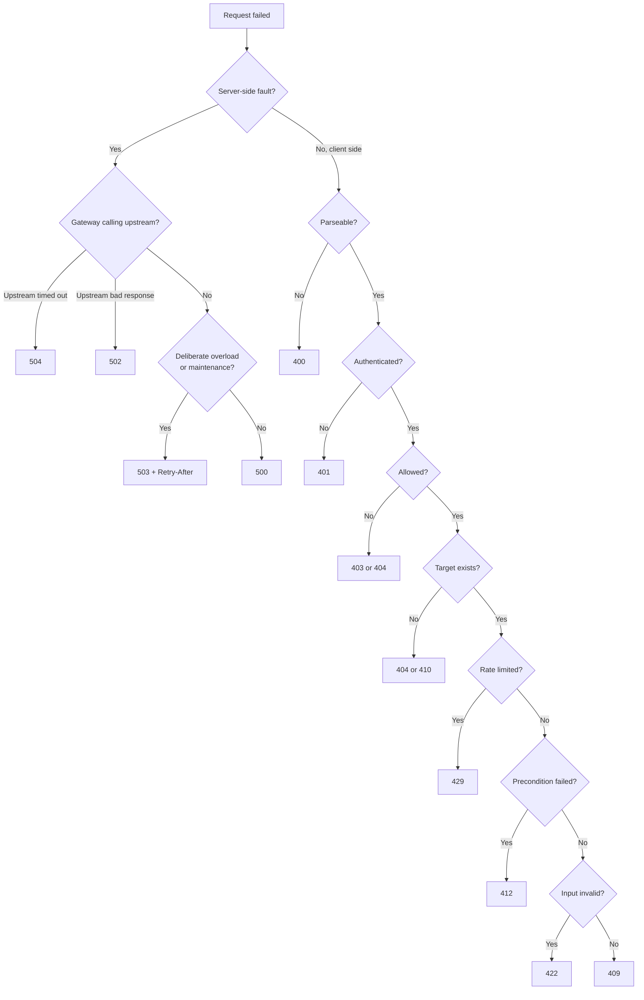

<!-- markdownlint-disable MD001 -->
<!-- markdownlint-disable MD024 -->
<!-- markdownlint-disable MD025 -->
<!-- markdownlint-disable MD026 -->
<!-- markdownlint-disable MD029 -->
<!-- markdownlint-disable MD033 -->
<!-- markdownlint-disable MD036 -->
<!-- markdownlint-disable MD040 -->
<!-- markdownlint-disable MD056 -->
<!-- markdownlint-disable MD060 -->

# HTTP Status Codes: Quick Reference

## Legend

| Column | Meaning                                                                                                                                                                                               |
| ------ | ----------------------------------------------------------------------------------------------------------------------------------------------------------------------------------------------------- |
| Spec   | Defining RFC (9110 unless noted)                                                                                                                                                                      |
| Retry  | Generic client behaviour: **No** = change the request; **Yes** = retry with backoff; **Idem** = retry only if idempotent or keyed; **Later** = retry after `Retry-After` or once the condition clears |
| Cache  | **H** = heuristically cacheable (may be stored without explicit freshness)                                                                                                                            |
| Status | Active unless marked Deprecated, Unused, Historic or Temporary                                                                                                                                        |

Rule for any code not listed: treat it as the `x00` of its class, and do not cache it.

## 1xx Informational

| Code | Name                        | Spec       | Use it for                                          | Retry | Cache | Status     |
| ---- | --------------------------- | ---------- | --------------------------------------------------- | ----- | ----- | ---------- |
| 100  | Continue                    | 9110       | Go-ahead after `Expect: 100-continue`               | -     | -     | Active     |
| 101  | Switching Protocols         | 9110       | WebSocket upgrade on HTTP/1.1                       | -     | -     | Active     |
| 102  | Processing                  | 2518       | Nothing; use `202` + status resource                | -     | -     | Deprecated |
| 103  | Early Hints                 | 8297       | Preload hints before the final response (web pages) | -     | -     | Active     |
| 104  | Upload Resumption Supported | IETF draft | Resumable uploads draft                             | -     | -     | Temporary  |

## 2xx Success

| Code | Name                          | Spec | Use it for                                                  | Retry | Cache | Status |
| ---- | ----------------------------- | ---- | ----------------------------------------------------------- | ----- | ----- | ------ |
| 200  | OK                            | 9110 | Success with a body; empty collections (`[]`)               | -     | H     | Active |
| 201  | Created                       | 9110 | New resource; `Location` points to it                       | -     | -     | Active |
| 202  | Accepted                      | 9110 | Queued work; `Location` to a status resource, `Retry-After` | -     | -     | Active |
| 203  | Non-Authoritative Information | 9110 | Transforming proxy altered the origin's `200`               | -     | H     | Active |
| 204  | No Content                    | 9110 | Success with no body (DELETE, PUT/PATCH without echo)       | -     | H     | Active |
| 205  | Reset Content                 | 9110 | Tell the UI to reset the form                               | -     | -     | Active |
| 206  | Partial Content               | 9110 | Byte ranges (`Range`, `Content-Range`)                      | -     | H     | Active |
| 207  | Multi-Status                  | 4918 | Per-item statuses (WebDAV; some bulk APIs)                  | -     | -     | Active |
| 208  | Already Reported              | 5842 | Inside a `207` body only                                    | -     | -     | Active |
| 226  | IM Used                       | 3229 | Delta encoding; practically unused                          | -     | -     | Active |

## 3xx Redirection

| Code | Name               | Spec | Use it for                                    | Method kept | Cache | Status     |
| ---- | ------------------ | ---- | --------------------------------------------- | ----------- | ----- | ---------- |
| 300  | Multiple Choices   | 9110 | Client picks among representations            | -           | H     | Active     |
| 301  | Moved Permanently  | 9110 | Permanent move of GET-only resources          | No          | H     | Active     |
| 302  | Found              | 9110 | Legacy temporary redirect; avoid in APIs      | No          | -     | Active     |
| 303  | See Other          | 9110 | Fetch the result with GET (POST/Redirect/GET) | Becomes GET | -     | Active     |
| 304  | Not Modified       | 9110 | Conditional GET matched; use the cached copy  | -           | -     | Active     |
| 305  | Use Proxy          | 9110 | Nothing                                       | -           | -     | Deprecated |
| 306  | (Unused)           | 9110 | Nothing                                       | -           | -     | Unused     |
| 307  | Temporary Redirect | 9110 | Temporary move, any method                    | Yes         | -     | Active     |
| 308  | Permanent Redirect | 9110 | Permanent API host or path migration          | Yes         | H     | Active     |

## 4xx Client error

| Code | Name                            | Spec | Use it for                                                   | Retry             | Cache | Status |
| ---- | ------------------------------- | ---- | ------------------------------------------------------------ | ----------------- | ----- | ------ |
| 400  | Bad Request                     | 9110 | Malformed syntax, unparseable body; generic fallback         | No                | -     | Active |
| 401  | Unauthorized                    | 9110 | Not authenticated; send `WWW-Authenticate`                   | After re-auth     | -     | Active |
| 402  | Payment Required                | 9110 | Reserved; only by documented convention                      | No                | -     | Active |
| 403  | Forbidden                       | 9110 | Authenticated but not allowed                                | No                | -     | Active |
| 404  | Not Found                       | 9110 | Unknown target; or concealing a `403`                        | No                | H     | Active |
| 405  | Method Not Allowed              | 9110 | Method unsupported on this resource; send `Allow`            | No                | H     | Active |
| 406  | Not Acceptable                  | 9110 | Cannot satisfy `Accept`                                      | No                | -     | Active |
| 407  | Proxy Authentication Required   | 9110 | Proxy needs credentials (never from origins)                 | After auth        | -     | Active |
| 408  | Request Timeout                 | 9110 | Client too slow to send the request                          | Idem              | -     | Active |
| 409  | Conflict                        | 9110 | Clash with current state; key in flight                      | After resolving   | -     | Active |
| 410  | Gone                            | 9110 | Deliberately and permanently removed                         | No                | H     | Active |
| 411  | Length Required                 | 9110 | `Content-Length` missing                                     | No                | -     | Active |
| 412  | Precondition Failed             | 9110 | `If-Match` / `If-Unmodified-Since` failed                    | After re-read     | -     | Active |
| 413  | Content Too Large               | 9110 | Body over limit (formerly "Payload Too Large")               | No                | -     | Active |
| 414  | URI Too Long                    | 9110 | Request target too long                                      | No                | H     | Active |
| 415  | Unsupported Media Type          | 9110 | Request body `Content-Type` unsupported                      | No                | -     | Active |
| 416  | Range Not Satisfiable           | 9110 | Requested range outside the representation                   | No                | -     | Active |
| 417  | Expectation Failed              | 9110 | `Expect` cannot be met                                       | Without `Expect`  | -     | Active |
| 418  | (Unused)                        | 9110 | Nothing (April Fools' origin)                                | -                 | -     | Unused |
| 421  | Misdirected Request             | 9110 | Wrong server for this authority (h2 coalescing)              | New connection    | -     | Active |
| 422  | Unprocessable Content           | 9110 | Semantically invalid input (formerly "Unprocessable Entity") | No                | -     | Active |
| 423  | Locked                          | 4918 | Resource locked                                              | Later             | -     | Active |
| 424  | Failed Dependency               | 4918 | Failed because a related action failed (bulk)                | No                | -     | Active |
| 425  | Too Early                       | 8470 | Refusing replayable 0-RTT early data                         | After handshake   | -     | Active |
| 426  | Upgrade Required                | 9110 | Client must switch protocol (`Upgrade`)                      | After upgrade     | -     | Active |
| 428  | Precondition Required           | 6585 | Conditional request (`If-Match`) mandatory                   | With precondition | -     | Active |
| 429  | Too Many Requests               | 6585 | Per-client rate limit; `Retry-After`                         | Later             | -     | Active |
| 431  | Request Header Fields Too Large | 6585 | Oversized header or header section                           | No                | -     | Active |
| 451  | Unavailable For Legal Reasons   | 7725 | Legal block                                                  | No                | -     | Active |

## 5xx Server error

| Code | Name                            | Spec | Use it for                                          | Retry       | Cache | Status   |
| ---- | ------------------------------- | ---- | --------------------------------------------------- | ----------- | ----- | -------- |
| 500  | Internal Server Error           | 9110 | Your own unexpected failure                         | Idem        | -     | Active   |
| 501  | Not Implemented                 | 9110 | Method unknown to the server                        | No          | H     | Active   |
| 502  | Bad Gateway                     | 9110 | Gateway got an invalid upstream response            | Yes         | -     | Active   |
| 503  | Service Unavailable             | 9110 | Overload, maintenance, load shedding; `Retry-After` | Later       | -     | Active   |
| 504  | Gateway Timeout                 | 9110 | Gateway's upstream did not answer in time           | Idem        | -     | Active   |
| 505  | HTTP Version Not Supported      | 9110 | Unsupported major version                           | No          | -     | Active   |
| 506  | Variant Also Negotiates         | 2295 | Negotiation misconfiguration (experimental)         | No          | -     | Active   |
| 507  | Insufficient Storage            | 4918 | Server storage exhausted                            | Later       | -     | Active   |
| 508  | Loop Detected                   | 5842 | Infinite loop during processing (WebDAV)            | No          | -     | Active   |
| 510  | Not Extended                    | 2774 | Extension framework policy (obsolete)               | No          | -     | Historic |
| 511  | Network Authentication Required | 6585 | Captive portal login (never from origins)           | After login | -     | Active   |

## Non-standard codes (recognize, never emit)

| Code     | Source          | Meaning                                                 |
| -------- | --------------- | ------------------------------------------------------- |
| 444      | nginx           | Connection closed without a response                    |
| 499      | nginx           | Client closed the request before the response           |
| 460, 463 | AWS ALB         | Client closed early; too many `X-Forwarded-For` entries |
| 509      | Apache / cPanel | Bandwidth limit exceeded                                |
| 520–526  | Cloudflare      | Origin failures (empty response, refused, timeout, TLS) |
| 598, 599 | Some proxies    | Informal network timeouts                               |

## Confused pairs, one line each

| Pair            | Rule                                                                     |
| --------------- | ------------------------------------------------------------------------ |
| 200 / 201 / 204 | Body → `200`; new resource → `201` + `Location`; nothing → `204`         |
| 201 / 202       | Exists now → `201`; queued → `202`                                       |
| 301 / 308       | Both permanent; `308` keeps method and body                              |
| 302 / 303 / 307 | `303` switches to GET; `307` keeps method; avoid `302`                   |
| 400 / 422       | Unparseable → `400`; parses but invalid → `422`                          |
| 401 / 403       | Unknown caller → `401`; known caller refused → `403`                     |
| 403 / 404       | Conceal existence → `404`                                                |
| 404 / 410       | Unknown → `404`; deliberately removed → `410`                            |
| 405 / 501       | Not on this resource → `405`; unknown method → `501`                     |
| 406 / 415       | Response format → `406`; request body format → `415`                     |
| 409 / 412       | Business state conflict → `409`; precondition header failed → `412`      |
| 409 / 422       | Valid input, clashing state → `409`; invalid input → `422`               |
| 408 / 504       | Client slow → `408`; upstream slow → `504`                               |
| 429 / 503       | One client over limit → `429`; everyone overloaded → `503`               |
| 500 / 502 / 504 | Own bug → `500`; bad upstream response → `502`; upstream timeout → `504` |

## Decision flow for errors

---
