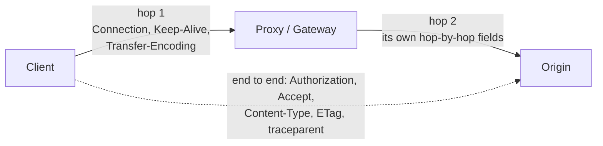
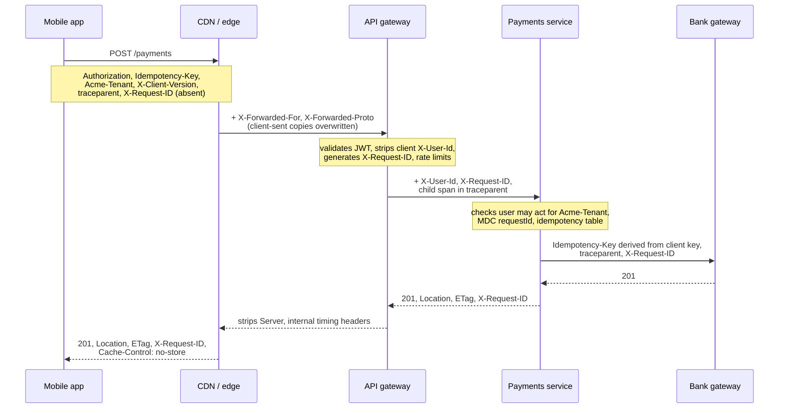

<!-- markdownlint-disable MD001 -->
<!-- markdownlint-disable MD024 -->
<!-- markdownlint-disable MD025 -->
<!-- markdownlint-disable MD026 -->
<!-- markdownlint-disable MD029 -->
<!-- markdownlint-disable MD033 -->
<!-- markdownlint-disable MD036 -->
<!-- markdownlint-disable MD040 -->
<!-- markdownlint-disable MD056 -->
<!-- markdownlint-disable MD060 -->

# R4. HTTP Headers: Standard and Custom (`X-`)

## Contents

| #    | Sub-topic                                                                                                |
| ---- | -------------------------------------------------------------------------------------------------------- |
| R4.1 | [Header fundamentals and categories](#r41-header-fundamentals-and-categories)                            |
| R4.2 | [Standard headers that matter for APIs](#r42-standard-headers-that-matter-for-apis)                      |
| R4.3 | [Custom headers: why clients send them](#r43-custom-headers-why-clients-send-them)                       |
| R4.4 | [Why headers, not body or query](#r44-why-headers-not-body-or-query)                                     |
| R4.5 | [The `X-` prefix and RFC 6648](#r45-the-x--prefix-and-rfc-6648)                                          |
| R4.6 | [Risks: spoofing, leakage, caching, CORS](#r46-risks-spoofing-leakage-caching-cors)                      |
| R4.7 | [Reading, writing and propagating headers in code](#r47-reading-writing-and-propagating-headers-in-code) |
| R4.8 | [Story: one request's headers, edge to database](#r48-story-one-requests-headers-edge-to-database)       |
| -    | [Exercises](#exercises) and [Solutions](#solutions)                                                      |
| -    | [Takeaways](#takeaways)                                                                                  |

## R4.1 Header fundamentals and categories

A header field is a `name: value` pair carrying metadata *about the message*: who is calling, what format is sent or wanted, how to cache, how to retry, how to trace.  
The body carries the resource representation; the headers carry everything around it.  
Some headers apply end to end (client to origin); a few apply only to one connection hop and must be stripped by every proxy.

### Syntax rules that bite

- **Names are case-insensitive.** HTTP/2 and HTTP/3 require lowercase on the wire. Code that compares names case-sensitively breaks on upgrade; use your framework's header map.

- **Values are ASCII.** Non-ASCII must be encoded (RFC 8187 for parameters, for example `filename*=UTF-8''r%C3%A9sum%C3%A9.pdf`).  
  Leading and trailing whitespace is trimmed. CR and LF are forbidden (response-splitting defence).

- **Repeated fields combine.** For list-valued fields, `Accept: a` + `Accept: b` equals `Accept: a, b`; order is preserved. Exception: `Set-Cookie` must never be combined.

- **No size limit in the spec; real limits everywhere.** Spring Boot (Tomcat) defaults to 8 KB for the request header section (`server.max-http-request-header-size`); nginx uses `large_client_header_buffers` (4 × 8 KB). Exceeding them returns `431` (R3).

- **New headers should use Structured Field Values** (RFC 9651, which obsoletes RFC 8941): typed Items, Lists and Dictionaries with integers, decimals, strings, tokens, byte sequences, booleans and dates.  
  Example: `Priority: u=3, i`. Parsers become uniform instead of every header inventing its own grammar.

### Categories by role

| Category                | Examples                                                                                     | Purpose                                   |
| ----------------------- | -------------------------------------------------------------------------------------------- | ----------------------------------------- |
| Request context         | `Host`, `User-Agent`, `Authorization`, `Cookie`, `Origin`, `Referer`                         | Who is asking, from where                 |
| Content negotiation     | `Accept`, `Accept-Language`, `Accept-Encoding`                                               | What the client can consume               |
| Conditionals            | `If-Match`, `If-None-Match`, `If-Modified-Since`, `If-Unmodified-Since`, `If-Range`          | Make the request depend on resource state |
| Representation metadata | `Content-Type`, `Content-Encoding`, `Content-Language`, `Content-Length`, `Content-Location` | Describe the body being sent              |
| Validators              | `ETag`, `Last-Modified`                                                                      | Identify a version of the representation  |
| Response control        | `Location`, `Retry-After`, `Allow`, `WWW-Authenticate`, `Vary`, `Date`                       | Tell the client what to do next           |
| Caching                 | `Cache-Control`, `Expires`, `Age`, `Vary`                                                    | Who may store this, for how long (R9)     |
| Hop-by-hop (connection) | `Connection`, `Keep-Alive`, `TE`, `Transfer-Encoding`, `Upgrade`, `Proxy-Connection`         | Apply to one hop only                     |

### End-to-end vs hop-by-hop



- **Hop-by-hop** fields describe the current connection. A proxy must remove them and any header named in `Connection: ...` before forwarding.

- **End-to-end** fields pass through unchanged.

- HTTP/2 and HTTP/3 **forbid** connection-specific fields entirely; framing replaces them.

- **Trailers** are fields sent *after* a chunked body (for example a checksum computed while streaming).  
  gRPC carries its status in trailers (`grpc-status`), one reason it needs HTTP/2 end to end.

## R4.2 Standard headers that matter for APIs

Before inventing a header, check whether a registered one already does the job.  
Most API concerns (format, auth, caching, concurrency, retry hints, deprecation, client preferences, proxy information) already have standard fields.

### The core set

| Header             | Direction | Purpose                                                             | Example                                        | Pitfall                                                    |
| ------------------ | --------- | ------------------------------------------------------------------- | ---------------------------------------------- | ---------------------------------------------------------- |
| `Content-Type`     | Both      | Media type of the body being sent                                   | `application/json`                             | Wrong type → `415`; JSON needs no `charset` (always UTF-8) |
| `Accept`           | Request   | Media types the client can consume                                  | `application/json, application/problem+json`   | Ignored silently by many APIs; decide a policy (`406`)     |
| `Authorization`    | Request   | Credentials                                                         | `Bearer eyJ...`                                | Never put tokens in the query string (logs, Referer)       |
| `Cache-Control`    | Both      | Caching rules                                                       | `private, max-age=60`                          | Missing on `404`/`301` → heuristic caching (R3)            |
| `ETag`             | Response  | Version identifier of the representation                            | `"v5"` (strong), `W/"v5"` (weak)               | `If-Match` needs strong ETags                              |
| `If-Match`         | Request   | Proceed only if the current ETag matches                            | `If-Match: "v5"`                               | Mismatch → `412`; missing when required → `428`            |
| `If-None-Match`    | Request   | GET: send body only if changed; PUT with `*`: create only if absent | `If-None-Match: "v5"`                          | Answer `304` on a match for GET                            |
| `Location`         | Response  | New resource (`201`) or redirect target (3xx)                       | `/orders/987`                                  | Relative references are allowed                            |
| `Retry-After`      | Response  | When to retry (`429`, `503`, 3xx, `202` polling)                    | `30` or an HTTP-date                           | Clients that ignore it cause retry storms                  |
| `Vary`             | Response  | Request headers the response depends on (cache key)                 | `Vary: Accept-Encoding, Accept-Language`       | Missing `Vary` serves one user's variant to another (R4.6) |
| `Allow`            | Response  | Methods supported by the resource                                   | `Allow: GET, POST`                             | Mandatory on `405`                                         |
| `WWW-Authenticate` | Response  | Auth challenge                                                      | `Bearer error="invalid_token"`                 | Mandatory on `401`                                         |
| `Forwarded`        | Request   | Standard proxy information (RFC 7239)                               | `for=192.0.2.60;proto=https;host=api.shop.com` | Trust only from your own proxies                           |

### Standard headers people reinvent with `X-`

| Need                       | Standard header                                                                                   | Commonly reinvented as                      |
| -------------------------- | ------------------------------------------------------------------------------------------------- | ------------------------------------------- |
| Pagination links           | `Link: <...?cursor=abc>; rel="next"` (RFC 8288)                                                   | `X-Next-Page`                               |
| Client preferences         | `Prefer: return=minimal`, `respond-async`, `wait=10` (RFC 7240), answered by `Preference-Applied` | `X-Return-Body: false`                      |
| Deprecation                | `Deprecation: @1735689599` (RFC 9745)                                                             | `X-API-Deprecated: true`                    |
| End-of-life date           | `Sunset: Wed, 31 Dec 2025 23:59:59 GMT` (RFC 8594)                                                | `X-API-EOL`                                 |
| Proxy client IP and scheme | `Forwarded` (RFC 7239)                                                                            | `X-Forwarded-For`, `X-Forwarded-Proto`      |
| Distributed tracing        | `traceparent`, `tracestate` (W3C)                                                                 | `X-B3-TraceId`, `X-Trace-Id`                |
| Server timing breakdown    | `Server-Timing: db;dur=53, app;dur=47` (W3C)                                                      | `X-Response-Time`                           |
| Rate-limit status          | `RateLimit-Policy`, `RateLimit` (IETF draft)                                                      | `X-RateLimit-Limit`, `-Remaining`, `-Reset` |
| Idempotency                | `Idempotency-Key` (IETF draft)                                                                    | `X-Idempotency-Key`                         |
| Accepted patch formats     | `Accept-Patch` (RFC 5789)                                                                         | Documentation only                          |
| Download filename          | `Content-Disposition: attachment; filename*=...`                                                  | `X-Filename`                                |

## R4.3 Custom headers: why clients send them

Clients add custom headers to carry **cross-cutting context** that no standard field covers, or that predates the standard: request correlation, tracing, retry safety, tenant selection, API version, client build, experiments, proxy information.  
The common thread: the information is about *the call*, not about *the resource*, and infrastructure along the path needs to read it cheaply.

### The catalogue

| Purpose                     | Typical header(s)                                                               | Who sets it                          | What the server does with it                                   |
| --------------------------- | ------------------------------------------------------------------------------- | ------------------------------------ | -------------------------------------------------------------- |
| Correlation / request ID    | `X-Request-ID`, `X-Correlation-ID`                                              | Client or edge; generated if absent  | Log on every line, echo in response, pass downstream           |
| Distributed tracing         | `traceparent`, `tracestate`; legacy `X-B3-*`, `X-Amzn-Trace-Id`                 | Client SDK or first instrumented hop | Continue the trace; create child spans                         |
| Idempotency                 | `Idempotency-Key` (legacy `X-Idempotency-Key`)                                  | Client, once per intent              | Deduplicate retries (R2 DD-3)                                  |
| Tenant / account selection  | `X-Tenant-ID`, `Stripe-Account`, `X-Org-Id`                                     | Client                               | Select tenant, **after** checking the principal may act for it |
| Client identification       | `X-Client-ID`, `X-API-Key`                                                      | Client                               | Quotas, analytics; `X-API-Key` is better as `Authorization`    |
| API versioning              | `Stripe-Version: 2024-06-20`, `X-GitHub-Api-Version: 2022-11-28`, `Api-Version` | Client                               | Route to version-specific behaviour (R11)                      |
| Client build and platform   | `X-Client-Version: ios/5.12.0`, `X-Platform`, `X-Device-Id`                     | Client app                           | Telemetry, compatibility shims, forced upgrade, kill switch    |
| Feature flags / experiments | `X-Feature-Flags`, `X-Experiment-Variant`                                       | Client or internal tools             | Toggle behaviour; **only** from trusted callers                |
| Proxy metadata              | `X-Forwarded-For`, `X-Forwarded-Proto`, `X-Forwarded-Host`, `X-Real-IP`         | Proxies, never clients               | Reconstruct the original client IP, scheme, host               |
| Request signing             | `X-Amz-Date`, `X-Amz-Content-Sha256`, `X-Hub-Signature-256`, `Stripe-Signature` | Signing client / webhook sender      | Verify integrity and authenticity                              |
| Method override             | `X-HTTP-Method-Override`                                                        | Restricted clients                   | Treat POST as PUT/PATCH/DELETE (R2.3)                          |
| Gateway-injected identity   | `X-User-Id`, `X-Authenticated-Scopes`                                           | **Gateway only**, after auth         | Trust only if the gateway strips client-supplied copies        |
| Response metadata           | `X-Request-ID` (echo), `X-Total-Count`, `X-RateLimit-*`                         | Server                               | Help clients debug, paginate, back off                         |

### The most important ones, in depth

#### Correlation and request IDs

- **Problem**: one user action fans out to 6 services and 3 queues.  
  Without a shared ID, joining the logs is guesswork; support cannot find "the failed payment at 10:42".

- **Mechanics**: accept the client's ID if valid, otherwise generate one at the edge.  
  Put it in the logging context (MDC in Java, tracing span in Rust) so every log line carries it.  
  Echo it in the response so the client can quote it. Pass it on every outbound call and message.

- **Request ID vs correlation ID**: some teams use a request ID per hop and a correlation ID per business transaction.  
  With W3C tracing, the trace ID plays the correlation role; keep one request ID for human-friendly support.

- **Validate it**: bounded length, restricted charset.  
  It goes into logs and response headers, so an unvalidated value enables log injection and header abuse.

#### Distributed tracing: W3C Trace Context

```text
traceparent: 00-4bf92f3577b34da6a3ce929d0e0e4736-00f067aa0ba902b7-01
             │  └──────── trace-id (16 bytes) ──┘ └ parent-id (8) ┘ └ flags (sampled)
             version
tracestate:  vendor1=opaque,vendor2=opaque
```

- A **standard** header pair (no `X-`), understood by OpenTelemetry, all major APMs, cloud load balancers and meshes.

- Spring Boot 3 with Micrometer Tracing and the OpenTelemetry bridge propagates it automatically on `RestClient`, `WebClient` and messaging.  
  In Rust, `tracing` + `opentelemetry` with a propagator (and `tracing-actix-web` on the server) does the same.

- Legacy formats still in the wild: Zipkin B3 (`X-B3-TraceId` or single `b3`), AWS `X-Amzn-Trace-Id`, Datadog `x-datadog-*`.  
  Bridges accept several formats during migrations.

#### Tenant and client identification

- **Why a header**: a user or service account may belong to several tenants (an accountant serving 20 companies).  
  The header *selects* which tenant this call acts for. Stripe's `Stripe-Account` (a platform acting for a connected account) is the canonical example.

- **The rule**: the header is a *claim*, not proof. Resolve the principal from `Authorization`, then check that the principal may act for the requested tenant.  
  Otherwise any caller reads any tenant by editing one header (BOLA, R10).

- **Single-tenant principals**: derive the tenant from the token's claims and ignore any header.

#### API versioning in a header

- Date-based versions pinned per request (`Stripe-Version: 2024-06-20`, `X-GitHub-Api-Version: 2022-11-28`) keep URIs stable while behaviour evolves.  
  Trade-offs against URI and media-type versioning come in R11.

- **Caching consequence**: if the version header changes the response, it must appear in `Vary`.

#### Client build and platform

- `X-Client-Version: android/5.12.0` lets the server keep compatibility shims for old builds, force an upgrade for builds with a known bug (return a 4xx with a specific problem type that the app understands), and slice error rates by release.

- `User-Agent` exists but is free-form and spoofed by libraries; a structured app-version header is easier to parse.  
  Browsers increasingly expose structured **Client Hints** (`Sec-CH-UA`, `Sec-CH-UA-Platform`) instead.

#### Feature flags and experiments

- Used by internal tools and QA to force a variant: `X-Feature-Flags: new-checkout`.

- **Danger**: a public client that can enable unreleased features can reach untested code paths.  
  Honour such headers only from trusted callers (internal network, signed, or specific roles), and evaluate flags server-side for real users.

## R4.4 Why headers, not body or query

Headers carry metadata about the *message*: method-independent, readable by infrastructure without parsing the payload, and kept out of the resource's identity and representation.  
The body is the resource representation; the query string is part of the resource identifier.

### Five reasons

1. **Method-independent.** `GET` and `DELETE` have no usable body (R2.1), yet they need auth, tracing and correlation. Headers exist on every request.

2. **Readable by infrastructure.** Gateways, load balancers, WAFs and meshes route, authenticate, rate-limit and trace by reading a few header bytes, without buffering or parsing a possibly streamed, compressed, multi-gigabyte body.

3. **Separation of concerns.** The body represents the resource. `{"orderId": 7, "traceId": "..."}` pollutes the domain model with transport concerns, and a `PUT` would then "replace" the trace ID.

4. **Not part of identity.** The URI, including the query, is the cache key, appears in access logs, browser history, bookmarks and `Referer`.  
  Secrets and per-call context in the query leak and fragment caches. Headers enter the cache key only when you list them in `Vary`.

5. **Automatic propagation.** Tracing libraries and meshes forward known headers across hops; nothing forwards body fields for you.

### When a header is the wrong place

| Data                                          | Right place                | Why not a header                                                     |
| --------------------------------------------- | -------------------------- | -------------------------------------------------------------------- |
| Filters, sorting, page size                   | Query                      | Part of *which* representation; should be cacheable and bookmarkable |
| Resource fields (amount, address)             | Body                       | They are the representation; validation, schema, auditing live there |
| Large data                                    | Body                       | Header limits (8 KB) → `431`                                         |
| Anything a cache must key on, unintentionally | Query (or header + `Vary`) | Forgetting `Vary` serves the wrong variant                           |

A useful test: *would two requests that differ only in this value be asking for a different resource or a different representation?*  
If yes, it belongs in the URI (or in negotiation headers with `Vary`). If it only describes *how* or *on whose behalf* the call is made, it belongs in a header.

## R4.5 The `X-` prefix and RFC 6648

`X-` once meant "experimental, non-standard". RFC 6648 (2012, BCP 178) deprecated the convention because successful `X-` headers became de facto standards and could never be renamed, leaving two names forever.  
New headers should get a meaningful name without `X-`, optionally with an organization prefix, and use Structured Fields. Existing `X-` headers stay as they are.

### History

- The `X-` convention came from email: RFC 822 (1982) reserved `X-` for user-defined extension fields. HTTP inherited the habit.

- It also appears in media types (`application/x-www-form-urlencoded`) and content codings (`x-gzip`).

### Why it failed

| Header born as `X-`      | What happened                                                                           |
| ------------------------ | --------------------------------------------------------------------------------------- |
| `X-Forwarded-For`        | Standardized as `Forwarded` (RFC 7239, 2014); `X-Forwarded-For` remains far more common |
| `x-gzip` content coding  | Standardized as `gzip`; RFC 9110 still requires recipients to treat `x-gzip` as `gzip`  |
| `X-Frame-Options`        | Never renamed; superseded by CSP `frame-ancestors`, but both still sent                 |
| `X-Content-Type-Options` | Standardized in the Fetch spec *with* the `X-` name; renaming would break everything    |
| `X-XSS-Protection`       | Deprecated; browsers removed the feature; recommended value now `0`                     |

The `X-` prefix promised a migration path ("experimental now, standard name later") that never works in practice: once deployed, a name is permanent.  
Every rename doubles parsing logic, documentation and attack surface.

### What RFC 6648 says

1. Creators of new parameters **should not** prefix names with `X-` or similar constructs.

2. Implementations **should not** infer status from the prefix ("`X-` means non-standard" is not a rule).

3. Name things as if they might become standard: meaningful, unlikely to collide. If collision is a concern, use an organization-specific prefix (`Acme-Tenant`, `Stripe-Version`).

4. It does **not** deprecate existing `X-` headers. `X-Request-ID` and `X-Forwarded-For` remain fine to use.

### Modern naming practice

- **Check the IANA HTTP Field Name Registry** first; reuse a registered field if it fits. RFC 9110 §16.3 defines the registry and allows easy provisional registration.

- **Prefer de facto names** where an ecosystem standard exists: `X-Request-ID` is understood by nginx, Heroku and most tooling; renaming it in your company buys nothing.

- **For genuinely new headers**: short, descriptive, no `X-`, organization prefix only if collision is plausible, Structured Fields syntax.

- **Reserved prefixes**: `Sec-` and `Proxy-` are *forbidden request headers* in browsers (JavaScript cannot set them), which is why browser security headers use `Sec-` (`Sec-Fetch-Site`, `Sec-CH-UA`).  
  Do not use them for your own fields.

- **Good modern examples**: `Idempotency-Key`, `traceparent`, `RateLimit`, `Priority`, `Deprecation`, `Stripe-Version`, `Stripe-Account`.

### Direct answer to "why do clients send `X-` headers?"

Because they need to attach **business or operational context to the call itself** (who the request is for, how to correlate it, whether it is a retry, which API version or app build is calling,  
which experiment applies) and no standard field existed when the convention started.  
The `X-` part is historical habit, not meaning.  
Today the same needs are met by registered fields where they exist (`traceparent`, `Idempotency-Key`, `Forwarded`, `Deprecation`) and by un-prefixed, organization-named fields where they do not.

## R4.6 Risks: spoofing, leakage, caching, CORS

Every request header is attacker-controlled until your own infrastructure proves otherwise.  
Strip or overwrite trust-sensitive headers at the edge, never leak internal ones, put response-affecting headers in `Vary`, and remember that browsers hide most response headers from JavaScript unless you expose them.

### 1. Spoofing: client-controlled headers treated as facts

| Header                                                   | Attack                                                | Defence                                                                                                                                |
| -------------------------------------------------------- | ----------------------------------------------------- | -------------------------------------------------------------------------------------------------------------------------------------- |
| `X-Forwarded-For`, `Forwarded`, `X-Real-IP`              | Fake source IP to bypass IP allowlists or rate limits | Trust only values appended by your proxies: take the address added by the last trusted hop (count trusted hops from the right)         |
| `X-User-Id`, `X-Authenticated-Scopes` (gateway-injected) | Client sends them directly, impersonating anyone      | Gateway **deletes** any client-supplied copies, then sets its own; services accept them only from the gateway (mTLS or network policy) |
| `X-Tenant-ID`                                            | Read another tenant's data                            | Authorize the principal against the tenant on every call                                                                               |
| `X-Feature-Flags`                                        | Enable unreleased code paths                          | Honour only from trusted callers                                                                                                       |
| `X-HTTP-Method-Override`                                 | Bypass method-based authorization                     | Accept only on POST, only from trusted clients                                                                                         |

Framework notes:

- **Spring Boot**: `server.forward-headers-strategy=native` lets Tomcat's `RemoteIpValve` rewrite the client IP and scheme from forwarded headers, but only for requests from addresses matching `server.tomcat.remoteip.internal-proxies`.  
  Never use `framework` or `native` without knowing which proxies sit in front.

- **Actix Web**: `ConnectionInfo::realip_remote_addr()` reads `Forwarded` / `X-Forwarded-For` and its documentation warns it can be spoofed; `HttpRequest::peer_addr()` is the real TCP peer.  
  Use the former only behind a proxy you control that overwrites the header.

### 2. Injection and log poisoning

- CR/LF in a header value used to allow **response splitting**; modern servers reject them, but values echoed from user input still need validation.

- Header values written to logs unescaped allow **log injection** (forged log lines, terminal escape sequences).  
  Bound length and charset of IDs you log.

### 3. Leakage in responses

- `Server: Apache/2.4.41 (Ubuntu)`, `X-Powered-By: Express`, `X-AspNet-Version` hand attackers a CVE shortlist. Remove or genericize them.

- Internal headers (`X-Internal-Debug`, `X-Backend-Host`, upstream timing with hostnames) must be stripped at the edge.

### 4. Caching: the missing `Vary`

If a header changes the response, shared caches must know it, or they serve one client's variant to another.

```text
GET /dashboard            X-Tenant-ID: acme     → 200 (acme data), Cache-Control: public, max-age=60
GET /dashboard            X-Tenant-ID: globex   → CDN serves the cached acme response
```

Fixes, in order of preference:

1. Tenant-specific data is not publicly cacheable: `Cache-Control: private` (or `no-store`).

2. If it must be cached at a shared layer, add `Vary: X-Tenant-ID` and confirm your CDN honours `Vary` on that header (many CDNs only support a few `Vary` values well).

3. Put the tenant in the URI (`/tenants/acme/dashboard`) so identity is in the cache key by construction.

`Vary: Authorization` or `Vary: Cookie` fragments caches per user; `Vary: *` makes a response uncacheable.

### 5. CORS: browsers hide headers

- **Response headers**: JavaScript can read only the CORS-safelisted ones (`Cache-Control`, `Content-Language`, `Content-Length`, `Content-Type`, `Expires`, `Last-Modified`, `Pragma`).  
  `ETag`, `Location`, `X-Request-ID`, `RateLimit` and `Retry-After` are invisible to the browser app unless listed in `Access-Control-Expose-Headers`.

- **Request headers**: any custom request header (`Idempotency-Key`, `X-Request-ID`, `Authorization`) makes the request non-simple, so the browser sends an `OPTIONS` preflight first.  
  The server must list those headers in `Access-Control-Allow-Headers`; cache the preflight with `Access-Control-Max-Age`.

### 6. Silent drops along the path

- **nginx drops headers containing underscores** by default (`underscores_in_headers off`). `X_Tenant_Id` vanishes between the client and your service. Use hyphens.

- Some proxies drop or truncate oversized headers before your app sees them; others reply `431` or `400` themselves.

- HTTP/2 lowercases names; any case-sensitive comparison in your code breaks.

## R4.7 Reading, writing and propagating headers in code

### Spring Boot

**Reading in a controller**

```java
@PostMapping("/payments")
ResponseEntity<PaymentDto> pay(@RequestHeader("Idempotency-Key") String idempotencyKey,          // missing → 400
                               @RequestHeader(value = "X-Client-Version", required = false) String clientVersion,
                               @RequestBody @Valid CreatePayment cmd) {
    StoredResponse resp = payments.createPayment(currentClientId(), idempotencyKey, cmd);           // R2 DD-3
    return resp.toResponseEntity();
}
```

**Correlation ID filter: accept or generate, log, echo**

```java
@Component
@Order(Ordered.HIGHEST_PRECEDENCE)
class RequestIdFilter extends OncePerRequestFilter {

    static final String HEADER = "X-Request-ID";
    private static final Pattern VALID = Pattern.compile("[A-Za-z0-9-]{1,64}");

    @Override
    protected void doFilterInternal(HttpServletRequest req, HttpServletResponse res, FilterChain chain)
            throws ServletException, IOException {
        String incoming = req.getHeader(HEADER);
        String id = (incoming != null && VALID.matcher(incoming).matches()) ? incoming : UUID.randomUUID().toString();
        MDC.put("requestId", id);                         // every log line in this request carries it
        res.setHeader(HEADER, id);                        // echo before the body is committed
        try {
            chain.doFilter(req, res);
        } finally {
            MDC.remove("requestId");                      // pooled threads must not leak it
        }
    }
}
```

**Propagating to downstream calls**

```java
@Bean
RestClient ordersClient(RestClient.Builder builder) {          // Boot's builder already propagates traceparent
    return builder
            .baseUrl("https://orders.internal")
            .requestInterceptor((request, body, execution) -> {
                String id = MDC.get("requestId");
                if (id != null) request.getHeaders().set(RequestIdFilter.HEADER, id);
                return execution.execute(request, body);
            })
            .build();
}
```

With `micrometer-tracing-bridge-otel` on the classpath, Spring Boot 3 creates spans and propagates `traceparent` on the auto-configured `RestClient.Builder` without extra code.

**Tenant selection, verified**

```java
@GetMapping("/invoices/{id}")
InvoiceDto invoice(@PathVariable UUID id,
                   @RequestHeader("Acme-Tenant") String tenant,
                   @AuthenticationPrincipal Jwt jwt) {
    if (!memberships.canActFor(jwt.getSubject(), tenant)) {
        throw new ResponseStatusException(HttpStatus.NOT_FOUND);     // conceal, R3
    }
    return invoices.get(tenant, id);
}
```

**CORS: allow custom request headers, expose response headers**

```java
@Bean
WebMvcConfigurer cors() {
    return new WebMvcConfigurer() {
        @Override
        public void addCorsMappings(CorsRegistry registry) {
            registry.addMapping("/api/**")
                    .allowedOrigins("https://app.acme.com")
                    .allowedMethods("GET", "POST", "PUT", "PATCH", "DELETE")
                    .allowedHeaders("Authorization", "Content-Type", "Idempotency-Key", "If-Match", "X-Request-ID")
                    .exposedHeaders("ETag", "Location", "Retry-After", "X-Request-ID")
                    .maxAge(3600);
        }
    };
}
```

**Trusting proxies**

```properties
server.forward-headers-strategy=native
server.tomcat.remoteip.internal-proxies=10\\.0\\.\\d{1,3}\\.\\d{1,3}     # only these may set X-Forwarded-*
server.max-http-request-header-size=16KB                                  # if you must raise the 8 KB default
```

### Actix Web

**Reading in a handler**

```rust
#[post("/payments")]
async fn pay(req: HttpRequest, body: web::Json<CreatePayment>, svc: web::Data<Payments>)
        -> Result<HttpResponse, ApiError> {
    let key = req.headers().get("idempotency-key")                       // names are case-insensitive
        .and_then(|v| v.to_str().ok())
        .ok_or(ApiError::MissingHeader("Idempotency-Key"))?;            // map to 400
    let client_version = req.headers().get("x-client-version").and_then(|v| v.to_str().ok());
    svc.create(key, client_version, body.into_inner()).await.map(|r| r.into_response())
}
```

**Correlation ID middleware: accept or generate, store, echo** (`middleware::from_fn`, Actix Web 4.9+)

```rust
use actix_web::{
    body::MessageBody,
    dev::{ServiceRequest, ServiceResponse},
    http::header::{HeaderName, HeaderValue},
    middleware::Next,
    Error, HttpMessage,
};
use uuid::Uuid;

#[derive(Clone)]
pub struct RequestId(pub String);

pub async fn request_id(req: ServiceRequest, next: Next<impl MessageBody>)
        -> Result<ServiceResponse<impl MessageBody>, Error> {
    let id = req.headers().get("x-request-id")
        .and_then(|v| v.to_str().ok())
        .filter(|v| v.len() <= 64 && v.chars().all(|c| c.is_ascii_alphanumeric() || c == '-'))
        .map(str::to_owned)
        .unwrap_or_else(|| Uuid::new_v4().to_string());

    req.extensions_mut().insert(RequestId(id.clone()));                  // handlers read it via web::ReqData
    let mut res = next.call(req).await?;
    res.headers_mut().insert(
        HeaderName::from_static("x-request-id"),
        HeaderValue::from_str(&id).expect("validated ASCII"),
    );
    Ok(res)
}

// App::new().wrap(actix_web::middleware::from_fn(request_id))
```

**Using it, and propagating downstream**

```rust
#[get("/orders/{id}")]
async fn get_order(id: web::Path<Uuid>, rid: web::ReqData<RequestId>,
                   http: web::Data<reqwest::Client>) -> Result<HttpResponse, ApiError> {
    let order = http.get(format!("https://orders.internal/orders/{}", id.into_inner()))
        .header("x-request-id", &rid.0)                                   // pass it on
        .send().await?
        .error_for_status()?
        .json::<Order>().await?;
    Ok(HttpResponse::Ok().json(order))
}
```

`ApiError` needs `From<reqwest::Error>` for the `?` operators.  
For logging and tracing, `tracing-actix-web` creates a span per request with a request ID, and an OpenTelemetry propagator handles `traceparent`.

**CORS** (`actix-cors`)

```rust
let cors = actix_cors::Cors::default()
    .allowed_origin("https://app.acme.com")
    .allowed_methods(["GET", "POST", "PUT", "PATCH", "DELETE"])
    .allowed_headers([header::AUTHORIZATION, header::CONTENT_TYPE, header::IF_MATCH])
    .allowed_header("idempotency-key")
    .allowed_header("x-request-id")
    .expose_headers([header::ETAG, header::LOCATION, header::RETRY_AFTER])
    .expose_headers(["x-request-id"])
    .max_age(3600);
// App::new().wrap(cors)
```

**Client IP behind a proxy**

```rust
let peer = req.peer_addr();                                   // real TCP peer (your proxy, if any)
let claimed = req.connection_info().realip_remote_addr()      // from Forwarded / X-Forwarded-For: spoofable
    .map(str::to_owned);
// Use `claimed` only when `peer` is one of your trusted proxies.
```

## R4.8 Story: one request's headers, edge to database

A mobile app pays an invoice for one of the user's companies. Follow the headers.



What each header did along the way:

| Header             | Set by         | Read by                       | Role in this request                             |
| ------------------ | -------------- | ----------------------------- | ------------------------------------------------ |
| `Authorization`    | App            | Gateway                       | Identifies the user                              |
| `Idempotency-Key`  | App            | Payments, then bank (derived) | Makes the payment retry-safe end to end          |
| `Acme-Tenant`      | App            | Payments                      | Selects the company; authorized against the user |
| `X-Client-Version` | App            | Payments, analytics           | Compatibility and per-release error rates        |
| `traceparent`      | App SDK / edge | Every hop                     | One trace across all services                    |
| `X-Request-ID`     | Gateway        | Every hop, logs, the app      | Support handle quoted by the user                |
| `X-Forwarded-For`  | Edge           | Gateway (rate limits, audit)  | Real client IP; client-sent value never trusted  |
| `X-User-Id`        | Gateway        | Payments                      | Authenticated identity; client copies stripped   |
| `Location`, `ETag` | Payments       | App                           | Where the payment lives, which version           |
| `Cache-Control`    | Payments       | Edge, app                     | `no-store`: never cache a payment response       |

## Exercises

**1. Classify.** For each header, say whether it is hop-by-hop or end-to-end, and whether it is a request,  
  response or representation header: `Connection`, `Transfer-Encoding`, `ETag`, `Content-Encoding`, `Authorization`, `Vary`, `Keep-Alive`, `Upgrade`, `Cache-Control`, `TE`.

**2. Header contract for a multi-tenant B2B API.** Define the headers for: tenant selection, request correlation, tracing, idempotency, API version, client build.  
  For each give the name (RFC 6648-compliant where you are inventing one), who sets it, how the server validates it, whether it is echoed, and its `Vary` and CORS implications.

**3. Incidents.** Diagnose and fix:

- a) A CDN served tenant A's dashboard to tenant B. The API selects the tenant from `X-Tenant-ID`.

- b) Audit logs show every request coming from `10.0.3.17`.

- c) After a hotfix, a rate limiter keyed on `X-Forwarded-For` was bypassed by an attacker sending random values.

- d) A browser app cannot read `X-Request-ID` or `ETag`, although `curl` shows both.

- e) `X_Tenant_Id` reaches the service from local tests but not in production.

**4. Header or not?** Choose header, query or body for: page size, access token, trace context, order amount, preferred response language, API version, search filters, "do not echo the full resource in the response".

## Solutions

### Solution 1

| Header              | Scope      | Kind                                              |
| ------------------- | ---------- | ------------------------------------------------- |
| `Connection`        | Hop-by-hop | Connection control (request and response)         |
| `Transfer-Encoding` | Hop-by-hop | Message framing (request and response)            |
| `ETag`              | End-to-end | Response (validator for the representation)       |
| `Content-Encoding`  | End-to-end | Representation metadata                           |
| `Authorization`     | End-to-end | Request                                           |
| `Vary`              | End-to-end | Response (caching)                                |
| `Keep-Alive`        | Hop-by-hop | Connection control                                |
| `Upgrade`           | Hop-by-hop | Connection control (request; also on `101`/`426`) |
| `Cache-Control`     | End-to-end | Request and response (caching)                    |
| `TE`                | Hop-by-hop | Request (transfer codings the client accepts)     |

Note the classic confusion: `Content-Encoding: gzip` is end-to-end (the representation is gzipped), while `Transfer-Encoding: chunked` is hop-by-hop (framing on one connection).

### Solution 2

| Concern      | Header                              | Set by             | Validation                                                                 | Echoed                                           | `Vary` / CORS                                                                                |
| ------------ | ----------------------------------- | ------------------ | -------------------------------------------------------------------------- | ------------------------------------------------ | -------------------------------------------------------------------------------------------- |
| Tenant       | `Acme-Tenant`                       | Client             | Known tenant ID format; principal must be a member, else `404`             | No                                               | In `Vary` if responses are shared-cacheable (better: `private`); allow-listed request header |
| Correlation  | `X-Request-ID` (de facto name kept) | Client or gateway  | ≤ 64 chars, `[A-Za-z0-9-]`; generate if missing or invalid                 | Yes                                              | Not in `Vary`; allow and expose                                                              |
| Tracing      | `traceparent`, `tracestate`         | Client SDK or edge | W3C format; restart the trace if malformed                                 | No                                               | Not in `Vary`; allow (browser SDKs send it)                                                  |
| Idempotency  | `Idempotency-Key`                   | Client, per intent | Required on POST to money-moving endpoints (`400` if absent); UUID format  | No (replays may add `Idempotent-Replayed: true`) | Allow-listed request header                                                                  |
| API version  | `Acme-Version: 2026-10-01`          | Client             | Known version, else `400`; default to the account's pinned version         | Yes (resolved version)                           | `Vary: Acme-Version` if cacheable; allow and expose                                          |
| Client build | `Acme-Client: ios/5.12.0`           | Client app         | Parse leniently; never reject on parse failure except forced-upgrade rules | No                                               | Not in `Vary`; allow                                                                         |

### Solution 3

| #   | Cause                                                                                           | Fix                                                                                                                                                |
| --- | ----------------------------------------------------------------------------------------------- | -------------------------------------------------------------------------------------------------------------------------------------------------- |
| a   | Response varies by `X-Tenant-ID` but was `public` without `Vary`; the CDN keyed only on the URI | `Cache-Control: private` (or `no-store`); if shared caching is needed, `Vary: X-Tenant-ID` verified on the CDN, or tenant in the path              |
| b   | The app logs the TCP peer, which is the load balancer                                           | Configure trusted-proxy handling (`forward-headers-strategy=native` + `internal-proxies`; in Actix, `realip_remote_addr()` behind a trusted proxy) |
| c   | The limiter trusted the **leftmost** `X-Forwarded-For` entry, which the client controls         | Use the address appended by your last trusted proxy (count trusted hops from the right), or have the edge overwrite the header                     |
| d   | Browsers expose only CORS-safelisted response headers                                           | Add `Access-Control-Expose-Headers: X-Request-ID, ETag` (and `Location`, `Retry-After` while at it)                                                |
| e   | nginx drops headers with underscores by default (`underscores_in_headers off`)                  | Rename to `Acme-Tenant` (hyphens); do not enable underscores in production                                                                         |

### Solution 4

| Data                            | Place                               | Reason                                                   |
| ------------------------------- | ----------------------------------- | -------------------------------------------------------- |
| Page size                       | Query                               | Selects which representation; cacheable, bookmarkable    |
| Access token                    | Header (`Authorization`)            | Secret; must not appear in logs, history or `Referer`    |
| Trace context                   | Header (`traceparent`)              | Cross-cutting, propagated automatically                  |
| Order amount                    | Body                                | Part of the resource representation                      |
| Preferred response language     | Header (`Accept-Language`) + `Vary` | Standard negotiation                                     |
| API version                     | Header (or URI); house choice, R11  | Header keeps URIs stable; must be in `Vary` if cacheable |
| Search filters                  | Query (or `POST /searches` if huge) | Part of which resource is requested                      |
| "Do not echo the full resource" | Header `Prefer: return=minimal`     | Standard preference; server answers `Preference-Applied` |

## Takeaways

- Headers carry metadata about the call; the body carries the resource; the query helps identify it.

- Check the registry before inventing a header. Most needs (pagination links, preferences, deprecation, tracing, forwarding) have standard fields.

- Clients send custom headers to carry cross-cutting context: correlation, tracing, idempotency, tenant, version, client build, experiments.

- `X-` means nothing today. RFC 6648: new headers get meaningful names without `X-`; existing `X-` headers stay; prefer de facto names where an ecosystem already agrees.

- Every request header is attacker-controlled until your edge strips or overwrites it. Gateway-injected identity is only safe if client copies are removed.

- A header that changes the response must be in `Vary`, or shared caches leak data between users.

- Browsers hide most response headers and preflight most custom request headers; configure CORS for both directions.

- Hyphens, not underscores; never compare names case-sensitively.

---
