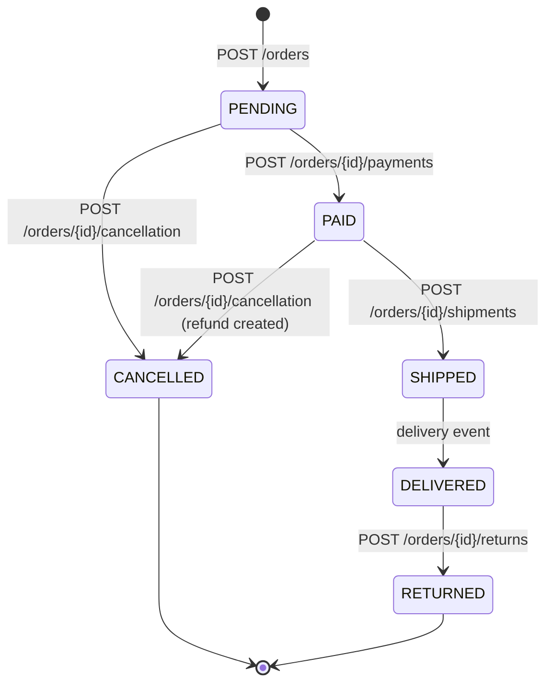
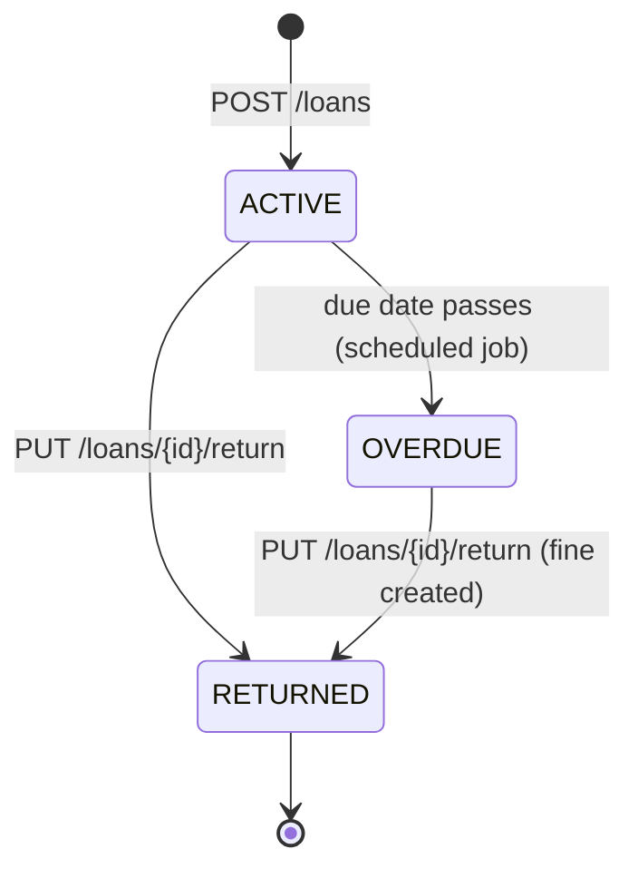

<!-- markdownlint-disable MD001 -->
<!-- markdownlint-disable MD024 -->
<!-- markdownlint-disable MD025 -->
<!-- markdownlint-disable MD026 -->
<!-- markdownlint-disable MD029 -->
<!-- markdownlint-disable MD033 -->
<!-- markdownlint-disable MD036 -->
<!-- markdownlint-disable MD040 -->
<!-- markdownlint-disable MD056 -->
<!-- markdownlint-disable MD060 -->

# R5. Resource Modeling

## Contents

| #    | Sub-topic                                                                                                       |
| ---- | --------------------------------------------------------------------------------------------------------------- |
| R5.1 | [Resources vs representations; nouns, not verbs](#r51-resources-vs-representations-nouns-not-verbs)             |
| R5.2 | [Identifiers](#r52-identifiers)                                                                                 |
| R5.3 | [URI design: collections, items, sub-resources, naming](#r53-uri-design-collections-items-sub-resources-naming) |
| R5.4 | [Modeling actions that are not CRUD](#r54-modeling-actions-that-are-not-crud)                                   |
| R5.5 | [Content negotiation and media types](#r55-content-negotiation-and-media-types)                                 |
| R5.6 | [Representation design conventions](#r56-representation-design-conventions)                                     |
| -    | [Code: Spring Boot and Actix Web](#code)                                                                        |
| R5.7 | [Story: modeling a library lending API end to end](#r57-story-modeling-a-library-lending-api-end-to-end)        |
| -    | [Exercises](#exercises) and [Solutions](#solutions)                                                             |
| -    | [Takeaways](#takeaways)                                                                                         |

## R5.1 Resources vs representations; nouns, not verbs

A resource is any concept a client needs to name and act on: an entity, a collection, a computed result, a process, a relationship.  
It is defined by the *domain*, not by your database.  
A representation is one serialized view of that resource at a moment (JSON detail, JSON summary, CSV).  
The URI names the resource with a noun; the HTTP method supplies the verb.

### What can be a resource

| Kind               | Example URI                                                        | Note                                                     |
| ------------------ | ------------------------------------------------------------------ | -------------------------------------------------------- |
| Entity             | `/orders/ord_7`                                                    | The classic case                                         |
| Collection         | `/orders`                                                          | A resource in its own right: `GET` lists, `POST` creates |
| Singleton          | `/users/me`, `/orders/ord_7/shipping-address`                      | Exactly one per parent; no ID needed                     |
| Computed / derived | `/reports/sales?month=2026-10`, `/tax-quotes?amount=500&region=KA` | Not stored; still identifiable and cacheable             |
| Process / event    | `/transfers`, `/orders/ord_7/cancellation`                         | A verb turned into a noun (R5.4)                         |
| Relationship       | `/memberships`, `/users/u_1/groups`                                | Becomes its own resource when it has attributes          |
| Long-running work  | `/operations/op_42`, `/report-runs/run_9`                          | Status of async work (`202`, R3)                         |

### A resource is not a table

| Mistake                                                      | Consequence                                                         | Better                                                       |
| ------------------------------------------------------------ | ------------------------------------------------------------------- | ------------------------------------------------------------ |
| One endpoint per table (`/order_lines`, `/order_line_taxes`) | Clients reassemble your schema; every refactor breaks them          | Model the **aggregate**: an order with its lines             |
| Exposing join tables (`/user_groups`)                        | Leaks storage design                                                | `/users/{id}/groups`, or `/memberships` if it has attributes |
| Column names as field names (`cust_fk`, `is_del`)            | Leaks schema; ugly; brittle                                         | Domain names (`customerId`); soft delete is invisible        |
| Returning the JPA entity directly                            | Lazy-loading surprises, cycles, accidental fields (password hashes) | Separate DTOs per use                                        |

The DDD **aggregate** is the natural resource boundary: the unit that is created, changed and kept consistent together.  
An order and its lines change together, so lines are part of the order resource (or a sub-resource of it); the customer changes independently, so it is a separate resource that the order links to.

### Representations are views, not the resource

- **Several representations per resource**: a summary in lists, a detail view, a CSV export, a PDF invoice.

- **Read model and write model differ**: the client writes what it owns (`items`, `shippingAddress`); the server adds what it owns (`id`, `status`, `total`, `createdAt`, `version`).  
  Use separate request and response types so a client cannot set `status: "PAID"` by including it in a `PUT`.

- **Representations evolve independently of storage**: you can split a table, move to another database or compute a field differently without changing the contract.

### Nouns, not verbs

The method is the verb. A verb in the path is the classic level 0/1 smell (R1.4).

| Smell                      | Fix                                  |
| -------------------------- | ------------------------------------ |
| `GET /getOrders`           | `GET /orders`                        |
| `POST /createOrder`        | `POST /orders`                       |
| `POST /orders/7/delete`    | `DELETE /orders/7`                   |
| `POST /updateOrderAddress` | `PUT /orders/7/shipping-address`     |
| `POST /doPayment`          | `POST /payments`                     |
| `GET /orders/7/cancel`     | `POST /orders/7/cancellation` (R5.4) |

## R5.2 Identifiers

Resource IDs should be opaque, stable, URI-safe, globally unique and not guessable.  
Never expose sequential database integers or natural keys that can change.

| Choice                 | Example                        | Verdict for public APIs                                                         |
| ---------------------- | ------------------------------ | ------------------------------------------------------------------------------- |
| Auto-increment integer | `/orders/1042`                 | Avoid: enumerable, leaks volume to competitors, collides across shards          |
| Natural key            | `/users/alice@x.com`           | Avoid: changes (email updates), personal data in logs and URLs                  |
| UUIDv4                 | `/orders/0b1c...`              | Fine; random, so poor index locality                                            |
| UUIDv7 / ULID          | `/orders/01JB...`              | Good: time-ordered, index-friendly, still unguessable enough with authorization |
| Prefixed opaque ID     | `/orders/ord_2Nf8kq...`        | Very good: type is visible in logs and support tickets (Stripe style)           |
| Slug plus ID           | `/articles/a_93k2-rest-basics` | Human-friendly URLs; resolve by the ID part only, the slug may change           |

Rules:

- **Opaque**: clients must not parse IDs; you keep freedom to change the scheme.

- **Stable forever**: "Cool URIs don't change" (Tim Berners-Lee, 1998). Never reuse a deleted ID.

- **URI-safe**: no `/`, spaces or `+` (R2.1); avoids percent-encoding bugs.

- **Strings in JSON**: a 64-bit integer above 2^53 loses precision in JavaScript. Twitter had to add `id_str` for this reason. Send IDs as strings.

- **Unguessable is not authorization**: random IDs reduce enumeration, but every access must still be authorized (BOLA, R10).

## R5.3 URI design: collections, items, sub-resources, naming

Plural nouns for collections, an ID for items, nesting only where the child's lifecycle belongs to the parent, and at most one or two levels deep.  
Everything else is a top-level resource found by query parameters or links.

### The basic shape

```text
/orders                         collection          GET list, POST create
/orders/{orderId}               item                GET, PUT, PATCH, DELETE
/orders/{orderId}/items         sub-collection      GET, POST
/orders/{orderId}/items/{itemId}                    GET, PATCH, DELETE
/orders/{orderId}/shipping-address   singleton      GET, PUT
/users/me                       alias for the current principal
```

### When to nest: lifecycle decides

Nesting asserts **ownership**. Use the same test as LLD Part A6:

| Relationship (A6)         | Lifecycle                                     | URI shape                                                           | Example                                    |
| ------------------------- | --------------------------------------------- | ------------------------------------------------------------------- | ------------------------------------------ |
| Composition               | Child cannot exist without parent             | Nest: `/orders/{id}/items/{itemId}`                                 | Order lines, invoice lines                 |
| Aggregation / association | Child lives independently                     | Top-level + link or filter: `/products/{id}`, `/reviews?productId=` | Products in an order, reviews of a product |
| Many-to-many without data | A relationship only                           | Sub-collection on either side: `/users/{id}/groups`                 | Group membership listing                   |
| Many-to-many with data    | The relationship has attributes (role, since) | Own resource: `/memberships/{id}`                                   | Membership with role and join date         |

### Nesting depth

- **One level** is ideal; **two** is the practical maximum.

- `/customers/{c}/orders/{o}/items/{i}/discounts/{d}` forces the client to know the whole ancestry just to address a discount, and every parent must be validated on each call.

- If child IDs are globally unique, offer a **top-level path** for direct access (`/order-items/{id}`) and keep nesting only for creation and listing within a parent.

### Scoping by tenant: path or header?

| Option                       | Pros                                                             | Cons                                                       |
| ---------------------------- | ---------------------------------------------------------------- | ---------------------------------------------------------- |
| `/tenants/{t}/invoices/{id}` | Tenant in cache key and logs by construction; explicit; linkable | Longer URIs; every route repeats the prefix                |
| `Acme-Tenant` header (R4)    | Short URIs; easy multi-tenant switching                          | Must remember `Vary` and authorization; invisible in links |
| Derived from the token       | Nothing to send; cannot be tampered with                         | Only works when each principal has exactly one tenant      |

### Naming rules

| Rule                                                        | Good                            | Bad                                     |
| ----------------------------------------------------------- | ------------------------------- | --------------------------------------- |
| Plural nouns for collections                                | `/orders`                       | `/order`, `/orderList`                  |
| Lowercase, kebab-case path segments                         | `/payment-methods`              | `/paymentMethods`, `/payment_methods`   |
| One JSON field casing, applied everywhere                   | `customerId` (or `customer_id`) | Mixed per endpoint                      |
| No file extensions                                          | `Accept: text/csv`              | `/orders.csv` (unless deliberate, R5.5) |
| No trailing slash                                           | `/orders`                       | `/orders/` (distinct URI, R2.1)         |
| No verbs, no CRUD words                                     | `/orders`                       | `/orders/create`, `/fetchOrders`        |
| Query parameters filter, sort, page; never identify an item | `/orders?status=OPEN`           | `/orders?id=7`                          |

JSON casing is a house choice: Google APIs and most JavaScript-facing APIs use `camelCase`; Stripe and GitHub use `snake_case`.  
Consistency matters more than the choice.

## R5.4 Modeling actions that are not CRUD

Real domains are full of verbs: cancel, approve, ship, refund, merge, publish.  
Four patterns map them onto resources.  
Prefer turning the action into a noun (a resource that records it); use a state change for simple transitions; accept a controller-style action endpoint when neither fits, and be consistent.

### The four patterns

| #   | Pattern                            | Example                                                                                                                                   | Response                        | Best when                                                                |
| --- | ---------------------------------- | ----------------------------------------------------------------------------------------------------------------------------------------- | ------------------------------- | ------------------------------------------------------------------------ |
| 1   | Update a state field               | `PATCH /orders/7 {"status": "CANCELLED"}`                                                                                                 | `200`, or `409` if not allowed  | Simple transitions, no side effects or extra data                        |
| 2   | **Reify the action as a resource** | `POST /orders/7/cancellation {"reason": "..."}`, `POST /refunds`, `POST /payments/{id}/captures`                                          | `201` + `Location` (or `202`)   | Auditable actions, extra data, side effects, async work, own permissions |
| 3   | Toggle a sub-resource              | `PUT /documents/7/archival`, `DELETE /documents/7/archival`; GitHub `PUT /user/starred/{owner}/{repo}`                                    | `204`                           | On/off states                                                            |
| 4   | Controller (action) resource       | `POST /payment_intents/{id}/confirm` (Stripe), `PUT /repos/{o}/{r}/pulls/{n}/merge` (GitHub), `POST /v1/orders/7:cancel` (Google AIP-136) | `200` with the updated resource | The action has no natural noun; consistency with an existing style       |

### Why reifying usually wins

- **Audit for free**: `GET /orders/7/cancellation` answers who, when and why.

- **Data has a home**: reason, refund amount, approver comment are fields of the new resource.

- **Idempotency fits**: a single cancellation per order (`PUT` or `POST` + key) dedupes naturally.

- **Async is natural**: `POST /refunds` → `202` + `Location: /refunds/re_9`, with its own status.

- **Authorization is per resource**: "may create refunds" is a clean permission; "may PATCH status to REFUNDED" is not.

- **Many events per entity**: an order can have several refunds or captures; a single status field cannot express that.

### Why a plain status PATCH gets muddy

- Business rules hide in field validation ("status can become SHIPPED only from PACKED, only by warehouse staff").

- A `PATCH` mixing `status` with other fields mixes a command with an edit.

- Side effects (emails, refunds, stock release) are triggered by a field change, which is surprising.

Use it only for genuinely simple transitions (`"read": true` on a notification).

### Expose valid transitions

Clients should not hard-code the state machine.  
Return what is allowed now, either as links (level 3, R1.4) or as a field:

```json
{
  "id": "ord_7",
  "status": "PAID",
  "allowedActions": ["cancel", "ship"],
  "_links": {
    "cancel": { "href": "/orders/ord_7/cancellation", "method": "POST" },
    "ship":   { "href": "/orders/ord_7/shipments",    "method": "POST" }
  }
}
```



An action that is invalid in the current state returns `409 Conflict` with a problem body naming the current state (R3).

### Other non-CRUD operations

| Operation                           | Model                                                                                      |
| ----------------------------------- | ------------------------------------------------------------------------------------------ |
| Pure calculation (tax, conversion)  | `GET /currency-conversions?from=USD&to=INR&amount=100`: safe, cacheable                    |
| Quote that must be honoured later   | `POST /quotes` → `201`, then reference the quote ID when ordering                          |
| Search with huge criteria           | `POST /order-searches` → `201`, then `GET /order-searches/{id}/results` (R2 exercise 1e)   |
| Long-running job                    | `POST /exports` → `202` + `Location: /operations/{id}`                                     |
| Validation without saving (dry run) | `POST /orders/validations` returning the result, or `POST /orders?dryRun=true`, documented |
| Bulk action                         | `POST /orders/cancellations` with a list of IDs (details in R6)                            |

## R5.5 Content negotiation and media types

One resource can have several representations; the client says which it wants with `Accept`, the server says what it sent with `Content-Type`, and lists the negotiating headers in `Vary`.  
Request bodies in an unsupported format get `415`; unsatisfiable `Accept` gets `406`, or a documented default.

### Media type anatomy

```text
application/vnd.acme.order.v2+json; charset=utf-8
└───┬────┘ └─────────┬─────────┘└─┬┘ └────┬─────┘
  type        subtype (vendor)   suffix   parameter
```

| Media type                                         | Use                                                    |
| -------------------------------------------------- | ------------------------------------------------------ |
| `application/json`                                 | Default JSON                                           |
| `application/problem+json`                         | Errors (RFC 9457, R7)                                  |
| `application/merge-patch+json`                     | JSON Merge Patch bodies (RFC 7396, R6)                 |
| `application/json-patch+json`                      | JSON Patch bodies (RFC 6902, R6)                       |
| `application/hal+json`, `application/vnd.api+json` | Hypermedia formats (HAL, JSON:API; R12)                |
| `application/vnd.github+json`                      | Vendor type (GitHub)                                   |
| `application/x-ndjson`                             | Newline-delimited JSON for streaming large result sets |
| `text/csv`                                         | Exports                                                |
| `multipart/form-data`                              | File uploads with fields                               |
| `application/octet-stream`                         | Raw bytes                                              |

- The **`+json` suffix** (RFC 6839) tells generic tools "this is JSON underneath", so they can parse and pretty-print it.  
  Spring's Jackson converter accepts `application/*+json` out of the box.

- **JSON has no charset parameter.** RFC 8259 mandates UTF-8; `application/json;charset=UTF-8` is harmless but meaningless.  
  Spring deprecated `APPLICATION_JSON_UTF8` in 5.2 for this reason.

### Proactive (server-driven) negotiation

```text
GET /orders/ord_7
Accept: text/csv;q=0.9, application/json;q=0.5
Accept-Language: hi-IN, en;q=0.8
Accept-Encoding: br, gzip

200 OK
Content-Type: text/csv
Content-Language: hi-IN
Content-Encoding: br
Vary: Accept, Accept-Language, Accept-Encoding
```

- `q` values (0 to 1) rank preferences; `*/*` means anything.

- The server picks the best match it supports, labels it with `Content-*` headers and adds `Vary` (R4.6).

- **No match**: return `406`, or ignore `Accept` and send the default. RFC 9110 allows both.  
  Strict `406` helps catch client bugs; lenient defaults help naive clients. Pick one and document it.

- **Request side**: `Content-Type` of the body must be supported, else `415`; advertise accepted formats with `Accept-Patch` and `Accept-Post`.

### Format in the URL instead?

`/orders/ord_7.csv` or `/orders/ord_7?format=csv` is common for browser downloads, where users cannot set `Accept`.  
It is pragmatic and linkable, but it creates a *separate resource and cache key*, so it is not negotiation.  
Acceptable as an addition, not as the only mechanism.  
Spring Boot supports it with `spring.mvc.contentnegotiation.favor-parameter=true`.

### Vendor media types and versioning

`Accept: application/vnd.acme.order.v2+json` selects version 2 of the order representation without changing the URI.  
It is precise (per representation) but heavier for clients and tooling.  
The full trade-off against URI and header versioning is R11.

### Compression

- `Accept-Encoding` / `Content-Encoding` (`gzip`, `br`, `zstd`) cut JSON size by 70 to 90%.  
  Usually done at the gateway or CDN.

- Do not compress responses that mix secrets with attacker-reflected input over TLS (BREACH-style attacks); for typical JSON APIs with tokens only in headers this is rarely an issue.

## R5.6 Representation design conventions

A handful of format decisions prevent most integration bugs: strings for IDs, exact types for money, RFC 3339 timestamps with zones, string enums, a wrapper object for collections, and a clear rule for `null` versus absent.

| Concern          | Convention                                                                                             | Why                                                            |
| ---------------- | ------------------------------------------------------------------------------------------------------ | -------------------------------------------------------------- |
| IDs              | Strings                                                                                                | JavaScript loses precision above 2^53                          |
| Money            | Integer minor units + currency (`{"amount": 49900, "currency": "INR"}`) or decimal string (`"499.00"`) | Floats cannot represent 0.1 exactly; rounding errors in totals |
| Timestamps       | RFC 3339 in UTC: `"2026-10-28T02:35:05Z"`                                                              | No ambiguity; sortable; time zone explicit                     |
| Dates            | `"2026-10-28"` (no time)                                                                               | A birthday is not an instant                                   |
| Durations        | ISO 8601 (`"PT15M"`) or explicit unit in the name (`timeoutSeconds`)                                   | Units never implicit                                           |
| Enums            | Strings (`"PAID"`), documented as extensible                                                           | Readable; clients must tolerate new values                     |
| Booleans         | `true` / `false`                                                                                       | Not `"Y"`, `1`, `"true"`                                       |
| Collections      | Wrapper object: `{"items": [...], "nextCursor": "..."}`                                                | Room for paging metadata without breaking clients              |
| `null` vs absent | Define it: absent = "not provided"; `null` = "explicitly no value"                                     | Merge-patch uses `null` to delete a field (R6)                 |
| Field naming     | One casing; no abbreviations (`quantity`, not `qty`)                                                   | Readability, consistency                                       |
| Links            | Absolute or root-relative URIs to related resources                                                    | Clients follow links instead of building URIs                  |
| Internal fields  | Never exposed (`passwordHash`, `deletedFlag`, `shardId`)                                               | Leakage and coupling                                           |

## Code

### Spring Boot

**Separate request and response types; server-owned fields cannot be written**

```java
public record CreateOrderRequest(
        @NotEmpty List<@Valid LineRequest> items,
        @NotNull @Valid AddressDto shippingAddress) {}

public record OrderResponse(
        String id,                       // "ord_..." string, never a raw long
        String status,                   // server-owned
        Money total,                     // server-computed
        List<LineResponse> items,
        AddressDto shippingAddress,
        Instant createdAt,               // serialized as RFC 3339 UTC
        List<String> allowedActions) {}

public record Money(long amountMinor, String currency) {}
```

```properties
spring.jackson.serialization.write-dates-as-timestamps=false     # Instant → "2026-10-28T02:35:05Z"
spring.jackson.default-property-inclusion=non_null               # omit absent, document what null means
```

**A reified action as a sub-resource**

```java
@RestController
@RequestMapping("/orders/{orderId}/cancellation")
class CancellationController {

    private final OrderService orders;

    CancellationController(OrderService orders) { this.orders = orders; }

    @PostMapping
    ResponseEntity<CancellationResponse> cancel(@PathVariable String orderId,
                                                @RequestHeader("Idempotency-Key") String key,
                                                @RequestBody @Valid CancelRequest req) {
        Cancellation c = orders.cancel(orderId, req.reason(), key);      // InvalidStateTransitionException → 409
        return ResponseEntity
                .created(URI.create("/orders/" + orderId + "/cancellation"))
                .body(CancellationResponse.from(c));
    }

    @GetMapping
    CancellationResponse get(@PathVariable String orderId) {             // who, when, why
        return CancellationResponse.from(orders.cancellation(orderId));
    }
}
```

**Content negotiation: JSON, vendor JSON, CSV**

```java
@GetMapping(value = "/orders/{id}",
            produces = { MediaType.APPLICATION_JSON_VALUE, "application/vnd.acme.order.v2+json" })
OrderResponse json(@PathVariable String id) { return orders.view(id); }

@GetMapping(value = "/orders/{id}", produces = "text/csv")
String csv(@PathVariable String id) { return OrderCsv.render(orders.view(id)); }
// Unsupported Accept → 406; unsupported request Content-Type → 415 (Spring defaults)
```

```properties
spring.mvc.contentnegotiation.favor-parameter=true                # also allow ?format=csv for browser downloads
spring.mvc.contentnegotiation.media-types.csv=text/csv
```

### Actix Web

**Routes: collection, item, sub-resource, reified action**

```rust
App::new()
    .service(
        web::scope("/orders")
            .route("", web::get().to(list_orders))
            .route("", web::post().to(create_order))
            .route("/{order_id}", web::get().to(get_order))
            .route("/{order_id}/items", web::get().to(list_items))
            .route("/{order_id}/items/{item_id}", web::patch().to(update_item))
            .route("/{order_id}/cancellation", web::post().to(cancel_order))
            .route("/{order_id}/cancellation", web::get().to(get_cancellation)),
    )
```

**Request and response types with conventions applied**

```rust
#[derive(Deserialize)]
#[serde(rename_all = "camelCase", deny_unknown_fields)]      // a client cannot sneak in "status"
struct CreateOrderRequest {
    items: Vec<LineRequest>,
    shipping_address: Address,
}

#[derive(Serialize)]
#[serde(rename_all = "camelCase")]
struct OrderResponse {
    id: String,                                               // "ord_..."
    status: OrderStatus,                                      // serialized as "PAID"
    total: Money,
    items: Vec<LineResponse>,
    shipping_address: Address,
    created_at: chrono::DateTime<chrono::Utc>,                // RFC 3339
    allowed_actions: Vec<&'static str>,
}

#[derive(Serialize)]
#[serde(rename_all = "camelCase")]
struct Money { amount_minor: i64, currency: &'static str }

#[derive(Serialize)]
#[serde(rename_all = "SCREAMING_SNAKE_CASE")]
enum OrderStatus { Pending, Paid, Shipped, Delivered, Cancelled, Returned }
```

**Content negotiation by `Accept`**

```rust
async fn get_order(accept: Option<web::Header<header::Accept>>, id: web::Path<String>,
                   svc: web::Data<Orders>) -> Result<HttpResponse, ApiError> {
    let order = svc.view(&id).await?;
    let ranked = accept.map(|a| a.into_inner().ranked()).unwrap_or_default();   // absent Accept = anything
    if ranked.is_empty() {
        return Ok(json(order));
    }
    for mime in ranked {
        match mime.essence_str() {
            "application/json" | "application/vnd.acme.order.v2+json" | "application/*" | "*/*" => {
                return Ok(json(order));
            }
            "text/csv" => {
                return Ok(HttpResponse::Ok()
                    .content_type("text/csv")
                    .insert_header((header::VARY, "Accept"))
                    .body(order.to_csv()));
            }
            _ => continue,
        }
    }
    Err(ApiError::NotAcceptable)                                                  // 406
}

fn json(order: OrderResponse) -> HttpResponse {
    HttpResponse::Ok().insert_header((header::VARY, "Accept")).json(order)
}
```

## R5.7 Story: modeling a library lending API end to end

The same library you modeled in LLD Part A6, now as an API.  
Requirements: browse titles; members borrow physical copies; return them; reserve a title when no copy is free; pay fines for late returns.

### Step 1: find the nouns, and the verbs that become nouns

| Domain concept       | Resource?                                     | Reasoning                                        |
| -------------------- | --------------------------------------------- | ------------------------------------------------ |
| Book (title)         | `/books/{bookId}`                             | Catalogue entity                                 |
| Copy (physical item) | `/books/{bookId}/copies/{copyId}`             | Composition: a copy belongs to exactly one title |
| Member               | `/members/{memberId}`, `/members/me`          | Independent entity                               |
| Borrow (verb)        | **`/loans`**                                  | Reified: who, which copy, when, due date         |
| Return (verb)        | **`/loans/{loanId}/return`** (singleton)      | Reified: records when, condition, by whom        |
| Reserve (verb)       | **`/reservations`**                           | Reified: queue position, expiry                  |
| Fine                 | `/members/{memberId}/fines/{fineId}`          | Composition: a fine belongs to a member          |
| Pay fine (verb)      | **`/fines/{fineId}/payments`** or `/payments` | Reified; keyed for idempotency                   |

### Step 2: endpoints and outcomes

```text
GET   /books?query=distributed&available=true            → 200 {"items": [...], "nextCursor": ...}
GET   /books/bk_42/copies?status=AVAILABLE                 → 200

POST  /loans  {"copyId": "cp_7", "memberId": "mb_1"}      Idempotency-Key: K
      → 201 Location: /loans/ln_9   (dueAt set by the server)
      → 409 copy already on loan · 422 member has unpaid fines (policy) · 404 unknown copy

PUT   /loans/ln_9/return  {"condition": "GOOD"}           → 201 first time, 200 on repeat (idempotent)
      → fine created automatically if late; Link: </members/mb_1/fines/fn_3>; rel="related"

POST  /reservations  {"bookId": "bk_42", "memberId": "mb_1"}   → 201, queue position in body
DELETE /reservations/rs_5                                   → 204

GET   /members/me/loans?status=ACTIVE                       → 200
GET   /members/me/fines?status=UNPAID                       → 200
POST  /fines/fn_3/payments  {"amount": {"amountMinor": 5000, "currency": "INR"}}   Idempotency-Key: K2
      → 201
```

### Step 3: the loan lifecycle



### Step 4: design decisions worth defending in an interview

- **Return is `PUT` on a singleton**, not `POST`: a loan is returned once, so the operation is naturally idempotent, and the return record is addressable.

- **Copies are nested under books** (composition), but **loans are top-level**: a loan relates a member and a copy, and is queried from both sides (`/members/me/loans`, `/loans?copyId=`).

- **The due date is server-owned**: the request cannot set `dueAt`.

- **Business rejections use precise codes**: `409` for state conflicts (copy on loan), `422` or `409` for policy rejections (unpaid fines), with a problem type the app can map to a message.

- **Members never see other members' loans**: `/members/{id}/...` is authorized against the caller; `/members/me` avoids exposing IDs at all.

## Exercises

**1. Fix these endpoints.** Rewrite each one.

- a) `GET /api/getAllUsers`

- b) `POST /users/42/activateAccount`

- c) `GET /users/42/orders/981/items/3/product/reviews`

- d) `POST /order/create`

- e) `GET /orders?id=981`

- f) `PUT /users/42` with body `{"email": "...", "role": "ADMIN"}` sent by the user themself

- g) `GET /Orders/981/`

- h) `POST /reports/generateMonthlySales` (takes 3 minutes)

**2. Ride-hailing trip.** Model the lifecycle: a rider requests a trip, a driver accepts, starts, completes; either party can cancel before start; the rider rates the driver afterwards.  
  Give resources, URIs, methods and the main status codes.

**3. Nest or not?** For each, choose nested sub-resource, top-level with filter, or relationship resource:  
  (a) comments on a blog post,  
  (b) products in a category (a product can be in several),  
  (c) addresses of a customer,  
  (d) team members with a role and join date,  
  (e) payments for an order (several partial payments allowed).

**4. Negotiation.** Your endpoint supports `application/json` and `text/csv`, with JSON as default.  
  What do you return for: (a) `Accept: application/xml`; (b) `Accept: */*`; (c) `Accept: text/csv;q=0.9, application/json;q=0.1`; (d) no `Accept`; (e) `POST` with `Content-Type: text/plain`?  
  Include the relevant headers.

**5. Review this representation.**

```json
{
  "ID": 9007199254740993,
  "cust_fk": 77,
  "amt": 499.99,
  "created": "28/10/2026 08:05",
  "is_paid": "Y",
  "status": 3,
  "pwd_hash": "$2a$10$...",
  "items": [ { "qty": 2, "sku": "A-1" } ]
}
```

## Solutions

### Solution 1

| #   | Rewrite                                                                                                                                | Why                                                             |
| --- | -------------------------------------------------------------------------------------------------------------------------------------- | --------------------------------------------------------------- |
| a   | `GET /users` (paginated)                                                                                                               | Verb in path; "all" is a filter, not a resource                 |
| b   | `POST /users/42/activation` → `201` (or `PUT /users/42/activation` → `204`)                                                            | Reify the action; idempotent toggle variant works too           |
| c   | `GET /products/{productId}/reviews`                                                                                                    | Depth 5; reviews belong to the product, not to the order        |
| d   | `POST /orders`                                                                                                                         | Plural noun; method is the verb                                 |
| e   | `GET /orders/981`                                                                                                                      | Query parameters filter collections, never identify items       |
| f   | `PUT /users/42/email` (or `PATCH` with a write model that excludes `role`); role changes via `PUT /users/42/role` restricted to admins | Mass assignment: user escalates to ADMIN by including the field |
| g   | `GET /orders/981`                                                                                                                      | Lowercase, no trailing slash                                    |
| h   | `POST /reports` (or `/report-runs`) with `{"type": "MONTHLY_SALES", "month": "2026-10"}` → `202` + `Location` to a status resource     | Verb in path; long work is async                                |

### Solution 2

```text
POST   /trips  {"pickup": {...}, "dropoff": {...}}           Idempotency-Key  → 201 status REQUESTED
POST   /trips/{id}/acceptance        (driver)                 → 201; 409 if already accepted or cancelled
POST   /trips/{id}/start             (driver; controller-style, or PUT /trips/{id}/start-event)  → 200; 409 if not ACCEPTED
POST   /trips/{id}/completion        (driver, with fare data) → 201; 409 if not STARTED
POST   /trips/{id}/cancellation      (rider or driver, reason) → 201; 409 if STARTED or later
PUT    /trips/{id}/rating  {"stars": 5, "comment": "..."}     (rider) → 201 then 200; 409 if not COMPLETED; 403 if not the rider
GET    /trips/{id}                                             → 200 with status and allowedActions for the caller
GET    /drivers/me/trips?status=REQUESTED&near=...             → 200 (offers for drivers)
```

Points worth stating: acceptance is reified so the race between two drivers resolves with exactly one `201` and `409` for the rest (unique constraint on trip ID);  
`allowedActions` depends on the caller's role; rating is a singleton `PUT` so a resubmit does not create a second rating.

### Solution 3

| #   | Choice                                                                                                  | Reason                                                                     |
| --- | ------------------------------------------------------------------------------------------------------- | -------------------------------------------------------------------------- |
| a   | Nested: `/posts/{id}/comments`, plus `/comments/{id}` for direct access                                 | Comments die with the post (composition)                                   |
| b   | Top-level with filter: `/products?categoryId=c_1`; `/categories/{id}/products` as a convenience listing | Many-to-many; products live independently                                  |
| c   | Nested: `/customers/{id}/addresses/{addressId}`                                                         | Owned by the customer                                                      |
| d   | Relationship resource: `/teams/{id}/memberships/{membershipId}` (or `/memberships`)                     | The relationship has attributes (role, joinedAt)                           |
| e   | Nested listing `/orders/{id}/payments`, top-level `/payments/{id}`                                      | Several per order; payments are also queried on their own (reconciliation) |

### Solution 4

| Case | Response                                                                                                                          |
| ---- | --------------------------------------------------------------------------------------------------------------------------------- |
| a    | `406 Not Acceptable` (strict policy), or `200` JSON if your documented policy is "default on mismatch"; `Vary: Accept` either way |
| b    | `200`, `Content-Type: application/json`, `Vary: Accept`                                                                           |
| c    | `200`, `Content-Type: text/csv`, `Vary: Accept` (higher `q` wins)                                                                 |
| d    | `200`, `Content-Type: application/json` (absent `Accept` means anything), `Vary: Accept`                                          |
| e    | `415 Unsupported Media Type`, with `Accept-Post: application/json` to advertise what is accepted                                  |

### Solution 5

| Problem                                                    | Fix                                                    |
| ---------------------------------------------------------- | ------------------------------------------------------ |
| `ID` numeric above 2^53: JavaScript reads it as ...992     | `"id": "ord_..."` string; consistent casing            |
| `cust_fk`: schema leak, foreign-key naming                 | `"customerId": "cus_..."` or an embedded customer link |
| `amt: 499.99` as float, no currency                        | `"total": {"amountMinor": 49999, "currency": "INR"}`   |
| `created` in local format, no zone                         | `"createdAt": "2026-10-28T02:35:05Z"`                  |
| `is_paid: "Y"` string boolean, redundant with status       | Remove; derive from `status`, or `"paid": true`        |
| `status: 3` magic number                                   | `"status": "PAID"`                                     |
| `pwd_hash` exposed                                         | Never serialize; separate DTO                          |
| `qty` abbreviation; mixed casing                           | `"quantity"`, one casing everywhere                    |
| Bare top-level object for an item is fine; for lists, wrap | `{"items": [...], "nextCursor": ...}` for collections  |

## Takeaways

- Resources come from the domain (aggregates, processes, relationships), not from tables.

- The URI is a noun; the method is the verb. Verbs in paths are a level 0/1 smell.

- IDs: opaque, stable, URI-safe, strings in JSON, never sequential in public APIs; still authorize every access.

- Nest only for composition, at most two levels; everything else is top-level with filters or links.

- Turn important actions into resources (cancellation, refund, loan): audit, idempotency, async and permissions come naturally.  
  Use state PATCH only for trivial transitions; controller endpoints only when no noun fits, consistently.

- Expose allowed transitions; reject invalid ones with `409`.

- `Accept` / `Content-Type` / `Vary` drive negotiation; `406` for unsatisfiable responses (or a documented default), `415` for unsupported request bodies.

- Representation conventions (string IDs, exact money, RFC 3339 UTC, string enums, wrapped collections, defined `null`) prevent most integration bugs.

---
