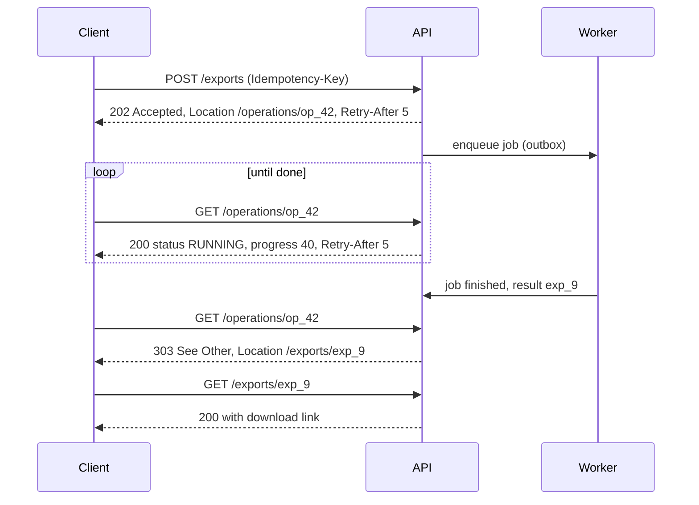

<!-- markdownlint-disable MD001 -->
<!-- markdownlint-disable MD024 -->
<!-- markdownlint-disable MD025 -->
<!-- markdownlint-disable MD026 -->
<!-- markdownlint-disable MD029 -->
<!-- markdownlint-disable MD033 -->
<!-- markdownlint-disable MD036 -->
<!-- markdownlint-disable MD040 -->
<!-- markdownlint-disable MD056 -->
<!-- markdownlint-disable MD060 -->

# R6. Request and Response Design

## Contents

| #    | Sub-topic                                                                                            |
| ---- | ---------------------------------------------------------------------------------------------------- |
| R6.1 | [PUT vs PATCH; JSON Merge Patch vs JSON Patch](#r61-put-vs-patch-json-merge-patch-vs-json-patch)     |
| R6.2 | [Filtering, sorting, sparse fieldsets, expansion](#r62-filtering-sorting-sparse-fieldsets-expansion) |
| R6.3 | [Pagination: offset, keyset, cursor](#r63-pagination-offset-keyset-cursor)                           |
| R6.4 | [Bulk and batch operations; partial success](#r64-bulk-and-batch-operations-partial-success)         |
| R6.5 | [Long-running operations](#r65-long-running-operations)                                              |
| R6.6 | [What writes return](#r66-what-writes-return)                                                        |
| R6.7 | [Story: an admin orders dashboard](#r67-story-an-admin-orders-dashboard)                             |
| -    | [Exercises](#exercises) and [Solutions](#solutions)                                                  |
| -    | [Takeaways](#takeaways)                                                                              |

## R6.1 PUT vs PATCH; JSON Merge Patch vs JSON Patch

`PUT` sends the whole new state; `PATCH` sends a *patch document* whose media type defines how to apply it.  
Two standard formats exist: **JSON Merge Patch** (send the fields you want changed; `null` deletes) and **JSON Patch** (a list of operations with paths).  
Merge Patch covers most API needs; JSON Patch handles array elements, moves and guarded changes.  
Either way, pair `PATCH` with `If-Match` to avoid lost updates.

### PUT vs PATCH

| Aspect           | PUT                                        | PATCH                                                      |
| ---------------- | ------------------------------------------ | ---------------------------------------------------------- |
| Body             | Complete representation                    | Patch document (format given by `Content-Type`)            |
| Omitted fields   | Removed or reset                           | Unchanged                                                  |
| Idempotent       | Yes, by definition                         | Only if the patch operations are (R2.3)                    |
| Can create       | Yes, at a client-chosen URI                | Possible, rarely used                                      |
| Bandwidth        | Whole resource                             | Only the change                                            |
| Concurrency risk | Overwrites concurrent changes to any field | Overwrites only touched fields, but still needs `If-Match` |

**"Partial PUT" is a bug, not a style.** A `PUT` that leaves omitted fields unchanged breaks PUT semantics: caches, clients and retries assume full replacement.

### JSON Merge Patch (RFC 7396), `application/merge-patch+json`

The patch mirrors the target's shape:

- a key present with a value **replaces** that member (objects merge recursively);

- a key present with `null` **removes** that member;

- a key absent leaves the member **unchanged**;

- a non-object patch (array, string, number) **replaces the whole target**;

- **arrays are replaced wholesale**, never merged element by element.

```text
Target                                   Patch                                    Result
{                                        {                                        {
  "notes": "leave at door",                "notes": null,                           "status": "PENDING",
  "status": "PENDING",                     "shippingAddress": {                     "shippingAddress": {
  "shippingAddress": {                       "line2": "Flat 4B"                       "line1": "12 MG Road",
    "line1": "12 MG Road",                 },                                         "line2": "Flat 4B",
    "city": "Pune"                         "tags": ["gift"]                           "city": "Pune"
  },                                     }                                          },
  "tags": ["priority", "fragile"]                                                   "tags": ["gift"]
}                                                                                 }
```

Limits: you cannot set a field to JSON `null` (null means delete), and you cannot change one element of an array.

### JSON Patch (RFC 6902), `application/json-patch+json`

An ordered array of operations, applied **atomically** (all or nothing):

| Op        | Example                                                      | Effect                               |
| --------- | ------------------------------------------------------------ | ------------------------------------ |
| `add`     | `{"op": "add", "path": "/tags/-", "value": "gift"}`          | Insert; `-` appends to an array      |
| `remove`  | `{"op": "remove", "path": "/coupon"}`                        | Delete a member or array element     |
| `replace` | `{"op": "replace", "path": "/items/1/quantity", "value": 3}` | Replace an existing value            |
| `move`    | `{"op": "move", "from": "/billing", "path": "/shipping"}`    | Remove from one path, add at another |
| `copy`    | `{"op": "copy", "from": "/billing", "path": "/shipping"}`    | Duplicate a value                    |
| `test`    | `{"op": "test", "path": "/status", "value": "PENDING"}`      | Abort the whole patch if not equal   |

Paths are **JSON Pointers** (RFC 6901): `/items/1/quantity`; `~1` encodes `/` and `~0` encodes `~` inside a key.

- **Strengths**: array element edits, moves, explicit nulls, and `test` as an inline precondition.

- **Weakness**: array indices are positional. If another client inserted an item, `/items/1` now points at a different element. Always combine with `If-Match`.

### Choosing

| Need                                        | Format                                                    |
| ------------------------------------------- | --------------------------------------------------------- |
| Change a few scalar or nested object fields | Merge Patch                                               |
| Clear an optional field                     | Merge Patch (`null`)                                      |
| Edit one element in an array                | JSON Patch, or model the element as a sub-resource (R5.3) |
| Set a field to an explicit JSON `null`      | JSON Patch                                                |
| Change only if a field still has a value    | JSON Patch `test`, or `If-Match` on the whole resource    |
| Plain `PATCH` with `application/json`       | Treat as Merge Patch semantics; document it               |

Advertise what you accept: `Accept-Patch: application/merge-patch+json, application/json-patch+json`. Unsupported patch type → `415`.

### The `null` vs absent problem in code

A typical DTO cannot tell "field absent" from "field null": both deserialize to `null` in Java records, and to `None` for `Option<T>` in Rust.  
Merge Patch depends on that distinction. Two fixes:

1. **Patch the JSON tree, then bind**: load the current representation as JSON, apply the patch to the tree, deserialize the result into the full write model, validate, save.  
  Correct for every field with no per-field code. Shown below.

2. **Tri-state fields**: Java `JsonNullable<T>` (openapitools `jackson-databind-nullable`);  
  Rust `Option<Option<T>>` with `serde_with::rust::double_option` (absent = `None`, null = `Some(None)`, value = `Some(Some(v))`).

### Code: Merge Patch with `If-Match`

**Spring Boot**

```java
@PatchMapping(value = "/orders/{id}", consumes = "application/merge-patch+json")
ResponseEntity<OrderResponse> patch(@PathVariable String id,
                                    @RequestHeader(HttpHeaders.IF_MATCH) String ifMatch,       // missing → 400 (or map to 428)
                                    @RequestBody JsonNode patch) {                              // Jackson accepts application/*+json
    Order current = orders.get(id);
    if (!current.etag().equals(ifMatch)) {
        throw new ResponseStatusException(HttpStatus.PRECONDITION_FAILED);                     // 412
    }
    JsonNode merged = mergePatch(mapper.valueToTree(UpdateOrderRequest.from(current)), patch);
    UpdateOrderRequest update = mapper.treeToValue(merged, UpdateOrderRequest.class);         // write model only
    Set<ConstraintViolation<UpdateOrderRequest>> violations = validator.validate(update);
    if (!violations.isEmpty()) throw new ValidationException(violations);                    // → 422 via advice
    Order saved = orders.update(id, update, ifMatch);                                          // version check in SQL too
    return ResponseEntity.ok().eTag(saved.etag()).body(OrderResponse.from(saved));
}

/** RFC 7396 MergePatch(target, patch), section 2. */
static JsonNode mergePatch(JsonNode target, JsonNode patch) {
    if (!patch.isObject()) {
        return patch.deepCopy();
    }
    ObjectNode result = (target != null && target.isObject())
            ? ((ObjectNode) target).deepCopy()
            : JsonNodeFactory.instance.objectNode();
    for (Map.Entry<String, JsonNode> e : patch.properties()) {
        if (e.getValue().isNull()) {
            result.remove(e.getKey());
        } else {
            result.set(e.getKey(), mergePatch(result.get(e.getKey()), e.getValue()));
        }
    }
    return result;
}
```

Binding into `UpdateOrderRequest` (client-owned fields only) means a patch containing `"status": "PAID"` is ignored or rejected (`FAIL_ON_UNKNOWN_PROPERTIES`), never applied.

**Actix Web** (crate `json-patch` implements both RFCs)

```rust
#[patch("/orders/{id}")]
async fn patch_order(req: HttpRequest, id: web::Path<String>, body: web::Bytes,
                     svc: web::Data<Orders>) -> Result<HttpResponse, ApiError> {
    let if_match = header_str(&req, header::IF_MATCH).ok_or(ApiError::PreconditionRequired)?;   // 428
    let current = svc.get(&id).await?;
    if current.etag() != if_match {
        return Err(ApiError::PreconditionFailed);                                               // 412
    }
    let mut doc = serde_json::to_value(UpdateOrderRequest::from(&current))?;
    match header_str(&req, header::CONTENT_TYPE) {
        Some("application/merge-patch+json") => {
            let patch: serde_json::Value = serde_json::from_slice(&body).map_err(ApiError::bad_request)?;
            json_patch::merge(&mut doc, &patch);                                                // RFC 7396
        }
        Some("application/json-patch+json") => {
            let patch: json_patch::Patch = serde_json::from_slice(&body).map_err(ApiError::bad_request)?;
            json_patch::patch(&mut doc, &patch).map_err(|_| ApiError::PatchConflict)?;          // atomic; failed test → 409
        }
        _ => return Err(ApiError::UnsupportedMediaType),                                        // 415
    }
    let update: UpdateOrderRequest = serde_json::from_value(doc).map_err(ApiError::unprocessable)?;  // 422
    update.validate()?;                                                                         // 422
    let saved = svc.update(&id, update, if_match).await?;
    Ok(HttpResponse::Ok().insert_header((header::ETAG, saved.etag())).json(OrderResponse::from(saved)))
}

fn header_str(req: &HttpRequest, name: header::HeaderName) -> Option<&str> {
    req.headers().get(name).and_then(|v| v.to_str().ok())
        .map(|s| s.split(';').next().unwrap_or(s).trim())                                      // drop parameters
}
```

## R6.2 Filtering, sorting, sparse fieldsets, expansion

Query parameters select *which* items and *which parts* of them.  
Keep the vocabulary small and explicit: an allow-list of filterable and sortable fields, each backed by an index; a stable sort with a unique tiebreaker; optional field selection and expansion with depth limits.  
Every filter you expose is a query someone can run against your database at scale.

### Filtering styles

| Style                     | Example                                                                                                                          | Used by                 | Trade-off                                         |
| ------------------------- | -------------------------------------------------------------------------------------------------------------------------------- | ----------------------- | ------------------------------------------------- |
| Equality parameters       | `?status=OPEN&customerId=cus_1`                                                                                                  | Most APIs               | Simple, cacheable, limited                        |
| Multi-value               | `?status=OPEN,PAID` or `?status=OPEN&status=PAID`                                                                                | Most APIs               | Pick one style and document it (R2.1)             |
| Range suffixes / brackets | `?createdAfter=...&createdBefore=...`, `?created[gte]=...`                                                                       | Stripe (`created[gte]`) | Explicit, still easy to index                     |
| Operator prefixes         | `?total=gte:1000`                                                                                                                | Some APIs               | Compact; custom parsing                           |
| Expression language       | `?filter=status = "OPEN" AND total > 1000` (Google AIP-160), OData `$filter=status eq 'OPEN'`, RSQL `status==OPEN;total=gt=1000` | Google, Microsoft       | Powerful; hard to index, easy to abuse            |
| Full-text search          | `?q=wireless headphones`                                                                                                         | Search endpoints        | Belongs to a search engine, not the OLTP database |

**Architect concerns**

- **Every filter needs an index** (or a search engine). An unindexed filter on a 100M-row table is a self-inflicted denial of service.

- **Allow-list fields and operators**; reject the rest with `400`.

- **Bound ranges** (for example at most 90 days per query) and cap result sizes.

- **Unknown parameters**: rejecting them (`400`) catches typos like `?stauts=OPEN` that would otherwise silently return everything. Prefer strict.

### Sorting

```text
GET /orders?sort=-createdAt,total        (JSON:API style: "-" means descending)
GET /orders?orderBy=createdAt desc       (Google AIP-132 style)
```

- Allow-list sortable fields; each needs a supporting index.

- **Always append a unique tiebreaker** (`id`) internally.  
  Without it, rows with equal `createdAt` come back in arbitrary order and pagination duplicates or skips them (R6.3).

### Sparse fieldsets

```text
GET /orders?fields=id,status,total            (Google "fields", generic)
GET /orders?fields[orders]=id,status,total    (JSON:API)
```

- Cuts payload for mobile and list views; lets the server skip expensive computed fields.

- Costs: more cache variants, projection logic, and fields that depend on others.  
  It is the slice of GraphQL's benefit that REST can offer cheaply.

### Expansion (embedding related resources)

```text
GET /orders/ord_7?expand=customer,items.product        (Stripe uses expand[]=customer)
GET /orders/ord_7?include=customer                     (JSON:API)
```

```json
{
  "id": "ord_7",
  "customer": { "id": "cus_1", "name": "Asha" },
  "items": [ { "product": { "id": "prd_9", "name": "Headphones" }, "quantity": 1 } ]
}
```

- Saves round trips (the N+1 *client* problem).

- Limit depth (Stripe allows four levels), and **authorize embedded resources** exactly as if fetched directly.

- Avoid the N+1 *server* problem: batch-load expansions instead of one query per item.

### Code: allow-listed filters and sorting

**Spring Boot**

```java
record OrderQuery(Set<String> status, String customerId, Instant createdAfter, Instant createdBefore,
                  String sort, Integer limit, String cursor) {}

private static final Map<String, String> SORTABLE = Map.of("createdAt", "created_at", "total", "total_minor");

@GetMapping("/orders")
Page<OrderSummary> list(@Valid OrderQuery q) {                       // binds query params into the record
    List<SortKey> sort = SortKey.parse(q.sort(), SORTABLE);          // unknown field → 400
    if (q.createdAfter() != null && q.createdBefore() != null
            && Duration.between(q.createdAfter(), q.createdBefore()).toDays() > 90) {
        throw new BadRequestException("date range must be at most 90 days");
    }
    return orders.search(q, sort);                                   // id appended as tiebreaker inside
}
```

**Actix Web**

```rust
#[derive(Deserialize)]
#[serde(rename_all = "camelCase", deny_unknown_fields)]                 // ?stauts=OPEN → 400
struct OrderQuery {
    status: Option<String>,                                             // "OPEN,PAID", split and validated
    customer_id: Option<String>,
    created_after: Option<chrono::DateTime<chrono::Utc>>,
    created_before: Option<chrono::DateTime<chrono::Utc>>,
    sort: Option<String>,
    limit: Option<u32>,
    cursor: Option<String>,
}

async fn list_orders(q: web::Query<OrderQuery>, svc: web::Data<Orders>) -> Result<HttpResponse, ApiError> {
    let sort = SortKey::parse(q.sort.as_deref(), &[("createdAt", "created_at"), ("total", "total_minor")])?;
    Ok(HttpResponse::Ok().json(svc.search(&q, &sort).await?))
}
```

## R6.3 Pagination: offset, keyset, cursor

Never return an unbounded list.  
Offset pagination is simple and supports page numbers but degrades with depth and shifts under concurrent writes.  
Keyset pagination seeks from the last row seen using an index, so it is fast at any depth and stable under inserts.  
Wrap keyset state in an opaque, signed **cursor** so clients cannot depend on its contents.

### Limits first

- Default page size (for example 20) and a hard maximum (for example 100). A client asking for `limit=100000` gets the maximum, or `400`.

- Fetch `limit + 1` rows: if the extra row exists, there is a next page. No `COUNT(*)` needed.

### Offset / limit

```
GET /orders?offset=40&limit=20
SELECT ... FROM orders ORDER BY created_at DESC, id DESC LIMIT 20 OFFSET 40;
```

- **Cost grows with depth**: `OFFSET 1000000` reads and discards a million rows.

- **Drift under writes**: a new order inserted at the top while a client reads page 2 pushes one row down, so page 3 repeats it.  
  A deletion makes the client skip a row.

- Fine for small, stable data and for UIs that need "jump to page 7".

### Keyset (seek)

```sql
-- first page
SELECT id, created_at, status, total_minor FROM orders
 WHERE status = 'OPEN'
 ORDER BY created_at DESC, id DESC
 LIMIT 21;

-- next page: continue strictly after the last row of the previous page
SELECT id, created_at, status, total_minor FROM orders
 WHERE status = 'OPEN'
   AND (created_at, id) < (:last_created_at, :last_id)        -- row-value comparison (PostgreSQL, MySQL 8)
 ORDER BY created_at DESC, id DESC
 LIMIT 21;
-- index: (status, created_at DESC, id DESC)
```

- Constant cost per page at any depth: an index seek, then `limit` rows.
- Stable: inserts above the position do not shift the next page; deletions do not cause skips.
- Cannot jump to an arbitrary page; the sort must be on indexed columns ending with a unique key.

### Cursor = opaque keyset

The client receives a token, not the keyset values:

```json
{
  "items": [ ... 20 orders ... ],
  "nextCursor": "eyJjIjoiMjAyNi0xMC0yOVQxMDoxNTowMFoiLCJpIjoib3JkXzc3In0.k3Jd...",
  "hasMore": true
}
```

```text
Link: <https://api.shop.com/orders?status=OPEN&limit=20&cursor=eyJj...>; rel="next"
```

- Encode the last row's sort values **plus the sort and filter it belongs to**; sign it (HMAC, R2.4).  
  A cursor replayed with different filters gets `400`.

- Opaque cursors let you change the implementation later (keyset today, a search-engine scroll token tomorrow) without breaking clients.

- Optionally expire cursors (for example after 24 hours) and say so.

### Comparison

| Aspect                    | Offset                              | Keyset           | Opaque cursor (over keyset)               |
| ------------------------- | ----------------------------------- | ---------------- | ----------------------------------------- |
| Deep-page cost            | Grows with offset                   | Constant         | Constant                                  |
| Stable under inserts      | No (duplicates, skips)              | Yes              | Yes                                       |
| Jump to page N            | Yes                                 | No               | No                                        |
| Total count               | Easy but costly at scale            | Separate query   | Separate query                            |
| Client can tamper         | Yes (any offset)                    | Yes (raw values) | No (signed)                               |
| Implementation can change | No                                  | No               | Yes                                       |
| Fits                      | Small admin tables, page-number UIs | Internal APIs    | Public APIs, feeds, infinite scroll, sync |

### Total counts

`COUNT(*)` over a large filtered set can cost more than the page itself.  
Options: omit totals; return them only on request (`?includeTotal=true`); return an estimate (`"totalEstimate": 120000`); cap them ("10,000+").

### Incremental sync

For clients that mirror data (mobile offline sync, data pipelines):

```text
GET /orders?updatedSince=2026-10-29T00:00:00Z&cursor=...      ordered by (updated_at, id)
```

Deletions must be visible too: return tombstones (`"deleted": true`) or provide `/orders/deletions?since=`.

### Code: keyset with a signed cursor

**Spring Boot (`JdbcClient`)**

```java
Page<OrderSummary> search(String status, int limit, String cursorToken) {
    int size = Math.min(Math.max(limit, 1), 100);
    Cursor after = cursorToken == null ? null : cursors.decode(cursorToken, "status=" + status);  // HMAC + filter check → 400
    List<OrderSummary> rows = jdbc.sql("""
            SELECT id, created_at, status, total_minor FROM orders
             WHERE status = :status
               AND (CAST(:afterTs AS timestamptz) IS NULL OR (created_at, id) < (:afterTs, :afterId))
             ORDER BY created_at DESC, id DESC
             LIMIT :fetch
            """)
            .param("status", status)
            .param("afterTs", after == null ? null : after.createdAt())
            .param("afterId", after == null ? null : after.id())
            .param("fetch", size + 1)
            .query(OrderSummary.class)
            .list();
    boolean hasMore = rows.size() > size;
    List<OrderSummary> page = hasMore ? rows.subList(0, size) : rows;
    String next = hasMore ? cursors.encode(page.getLast(), "status=" + status) : null;
    return new Page<>(page, next, hasMore);
}
```

Spring Data 3.1+ offers the same through `ScrollPosition.keyset()` and `Window<T>` on repository methods.

**Actix Web (`sqlx`)**

```rust
async fn search(pool: &PgPool, status: &str, limit: u32, after: Option<Cursor>) -> sqlx::Result<Page<OrderSummary>> {
    let size = limit.clamp(1, 100) as i64;
    let (after_ts, after_id) = after.map(|c| (Some(c.created_at), Some(c.id))).unwrap_or((None, None));
    let mut rows: Vec<OrderSummary> = sqlx::query_as(
        r#"SELECT id, created_at, status, total_minor FROM orders
            WHERE status = $1
              AND ($2::timestamptz IS NULL OR (created_at, id) < ($2, $3))
            ORDER BY created_at DESC, id DESC
            LIMIT $4"#)
        .bind(status).bind(after_ts).bind(after_id).bind(size + 1)
        .fetch_all(pool).await?;
    let has_more = rows.len() as i64 > size;
    rows.truncate(size as usize);
    let next = if has_more { rows.last().map(Cursor::from) } else { None };
    Ok(Page { items: rows, next_cursor: next.map(|c| c.encode()), has_more })
}
```

## R6.4 Bulk and batch operations; partial success

*Bulk* applies one operation to many resources of the same type; *batch* packs several different requests into one.  
Bulk endpoints are worth it for throughput and atomicity; generic batch endpoints rarely are under HTTP/2.  
The key decision is **atomic** (all or nothing) versus **partial success** (per-item results), and it must be explicit in the contract.

### Bulk vs batch

| Kind  | Example                                                                                 | Use                                               |
| ----- | --------------------------------------------------------------------------------------- | ------------------------------------------------- |
| Bulk  | `POST /shipments/bulk {"items": [...]}`, Google `POST /v1/orders:batchCreate` (AIP-233) | Imports, mass updates, efficient DB batching      |
| Batch | `POST /$batch` (OData, Microsoft Graph) with sub-requests                               | Many heterogeneous calls from constrained clients |

Generic batch endpoints lose a lot: HTTP caching, per-request status codes at the HTTP layer, per-request rate limiting and simple authorization.  
Under HTTP/2, concurrent individual requests are usually the better answer (R2.2).

### Atomic vs partial success

| Aspect       | Atomic                                        | Partial success                                                      |
| ------------ | --------------------------------------------- | -------------------------------------------------------------------- |
| Semantics    | All items succeed, or none                    | Each item succeeds or fails independently                            |
| HTTP status  | `201`/`200`, or one 4xx for the whole request | `200` with per-item results (or `207 Multi-Status`)                  |
| Client logic | Simple                                        | Must inspect every item; retry failed ones only                      |
| Server cost  | One transaction; size-limited                 | Independent writes; scales to large batches                          |
| Fits         | Small, related changes (an order's lines)     | Imports, mass actions where one bad row must not block 499 good ones |

### Partial-success response

```text
POST /shipments/bulk
Idempotency-Key: 4f0c...
{"items": [ {"clientRef": "row-1", ...}, {"clientRef": "row-2", ...}, {"clientRef": "row-3", ...} ]}

200 OK
{
  "summary": { "succeeded": 2, "failed": 1 },
  "results": [
    { "index": 0, "clientRef": "row-1", "status": 201, "id": "shp_81", "location": "/shipments/shp_81" },
    { "index": 1, "clientRef": "row-2", "status": 422,
      "error": { "type": "https://api.acme.com/problems/invalid-address", "detail": "postcode missing" } },
    { "index": 2, "clientRef": "row-3", "status": 201, "id": "shp_82", "location": "/shipments/shp_82" }
  ]
}
```

Rules:

- **Results in input order**, with the index and the client's own reference.

- **Per-item status uses HTTP codes** and Problem Details (R7), so clients reuse their single-item logic.

- **Cap the size** (for example 1,000 items); larger → `413` or a documented `422`, or the async path below.

- **Idempotency** for the whole request (`Idempotency-Key`) and, ideally, per item (`clientRef` unique per client), so retrying only the failed items is safe.

- **Never `201` for a partially failed bulk**: it tells generic clients everything was created.

- Whether partial failure returns `200` or `207` is a house choice; the body is what matters. Never hide failures behind a bare success.

### Very large bulk jobs

Above a few thousand items, switch to an async job (R6.5): upload the input (often NDJSON or CSV), get `202` with a job resource, and download per-item results as a file when done.

## R6.5 Long-running operations

When work outlasts a reasonable request timeout, accept it with `202 Accepted`, return an **operation resource** the client can poll, and finish with a link (or `303`) to the result.  
Add webhooks when clients should not poll, `Prefer: respond-async` / `wait` to let clients choose, an idempotency key so retries do not start duplicate jobs, and a cancellation action.

### The flow



### The operation resource

```json
{
  "id": "op_42",
  "type": "orders.export",
  "status": "RUNNING",
  "progress": { "percent": 40, "processed": 800000, "total": 2000000 },
  "createdAt": "2026-10-30T01:00:00Z",
  "updatedAt": "2026-10-30T01:02:10Z",
  "expiresAt": "2026-11-06T01:00:00Z",
  "result": null,
  "error": null,
  "_links": {
    "self":   { "href": "/operations/op_42" },
    "cancel": { "href": "/operations/op_42/cancellation", "method": "POST" }
  }
}
```

| Status      | Meaning                             | Client action                           |
| ----------- | ----------------------------------- | --------------------------------------- |
| `PENDING`   | Queued                              | Poll after `Retry-After`                |
| `RUNNING`   | In progress                         | Poll; show progress                     |
| `SUCCEEDED` | Done; `result` links to the output  | Follow the link (or the `303`)          |
| `FAILED`    | Done; `error` holds Problem Details | Fix and resubmit, or retry if transient |
| `CANCELLED` | Stopped on request                  | None                                    |

Precedents: Google's long-running operations (`done`, `response`, `error`), Azure's `Operation-Location` header. Same idea, different names.

### How the client learns about completion

| Mechanism       | How                                                                                          | Use when                                       |
| --------------- | -------------------------------------------------------------------------------------------- | ---------------------------------------------- |
| Polling         | `GET /operations/{id}`, paced by `Retry-After`                                               | Default; simplest; server controls the rate    |
| Long polling    | `GET /operations/{id}` with `Prefer: wait=30` (RFC 7240); server holds until done or timeout | Fewer requests, near-real-time                 |
| Webhooks        | Client registers a URL; server POSTs an event when done                                      | Server-to-server integrations                  |
| SSE / WebSocket | Stream progress events                                                                       | Interactive UIs showing progress               |
| Client choice   | `Prefer: respond-async`; server returns `200` synchronously if fast, else `202`              | One endpoint serving both quick and slow cases |

### Webhooks done right

- **Sign every delivery** (HMAC over the timestamp and body, sent in a signature header; the Standard Webhooks spec defines `webhook-id`, `webhook-timestamp`, `webhook-signature`).  
  Receivers verify and reject old timestamps (replay protection).

- **At-least-once delivery** with retries and backoff; include an event ID so receivers deduplicate (the inbox pattern, R2 DD-3).

- **Thin events**: send the event type and resource link, and let the receiver fetch current state. This avoids stale or out-of-order payloads.

- Receivers answer `2xx` fast and process asynchronously.

### Operational rules

- **Idempotent creation**: `Idempotency-Key` on `POST /exports`, so a retried submit returns the same operation.

- **Cancellation** as a reified action: `POST /operations/{id}/cancellation` → `202` (cancellation is itself asynchronous); `409` if already finished.

- **Retention**: operations expire (`expiresAt`); after that, `410 Gone` or `404`.

- **Worker crashes**: leases and recovery, as in R2 DD-3; the operation must not stay `RUNNING` forever.

### Code: `202` and the status resource

**Spring Boot**

```java
@PostMapping("/exports")
ResponseEntity<OperationResponse> export(@RequestHeader("Idempotency-Key") String key,
                                         @RequestBody @Valid ExportRequest req) {
    Operation op = operations.submitExport(currentClientId(), key, req);      // same key → same operation
    return ResponseEntity.accepted()
            .location(URI.create("/operations/" + op.id()))
            .header(HttpHeaders.RETRY_AFTER, "5")
            .body(OperationResponse.from(op));
}

@GetMapping("/operations/{id}")
ResponseEntity<OperationResponse> operation(@PathVariable String id) {
    Operation op = operations.get(id);
    if (op.status() == OperationStatus.SUCCEEDED) {
        return ResponseEntity.status(HttpStatus.SEE_OTHER).location(op.resultUri()).build();
    }
    ResponseEntity.BodyBuilder ok = ResponseEntity.ok();
    if (!op.status().isTerminal()) ok.header(HttpHeaders.RETRY_AFTER, "5");
    return ok.body(OperationResponse.from(op));
}
```

**Actix Web**

```rust
#[post("/exports")]
async fn export(req: HttpRequest, body: web::Json<ExportRequest>, ops: web::Data<Operations>)
        -> Result<HttpResponse, ApiError> {
    let key = header_str(&req, HeaderName::from_static("idempotency-key")).ok_or(ApiError::MissingIdempotencyKey)?;
    let op = ops.submit_export(key, body.into_inner()).await?;
    Ok(HttpResponse::Accepted()
        .insert_header((header::LOCATION, format!("/operations/{}", op.id)))
        .insert_header((header::RETRY_AFTER, "5"))
        .json(op))
}

#[get("/operations/{id}")]
async fn operation(id: web::Path<String>, ops: web::Data<Operations>) -> Result<HttpResponse, ApiError> {
    let op = ops.get(&id).await?;
    Ok(match op.status {
        OpStatus::Succeeded => HttpResponse::SeeOther()
            .insert_header((header::LOCATION, op.result_uri()))
            .finish(),
        s if !s.is_terminal() => HttpResponse::Ok().insert_header((header::RETRY_AFTER, "5")).json(op),
        _ => HttpResponse::Ok().json(op),
    })
}
```

## R6.6 What writes return

By default, return the resource's full representation after a create or update, with `ETag` and (for creates) `Location`.  
It saves the client a follow-up GET and shows server-computed fields. Let clients opt out with `Prefer: return=minimal`.

| Operation       | Default response                                   | With `Prefer: return=minimal`      |
| --------------- | -------------------------------------------------- | ---------------------------------- |
| `POST` create   | `201`, `Location`, `ETag`, full representation     | `201`, `Location`, `ETag`, no body |
| `PUT` / `PATCH` | `200`, `ETag`, full representation                 | `204`, `ETag`                      |
| `DELETE`        | `204`                                              | `204`                              |
| Async           | `202`, `Location` of the operation, operation body | `202`, `Location`                  |

When honouring a preference, echo `Preference-Applied: return=minimal`. Large resources or high-volume endpoints benefit most from minimal responses.

## R6.7 Story: an admin orders dashboard

An operations team needs a dashboard over 50 million orders: list and filter, edit notes, cancel a selection, and export everything for finance.

| Need                                           | Design                                                                                                                                                          | Module link |
| ---------------------------------------------- | --------------------------------------------------------------------------------------------------------------------------------------------------------------- | ----------- |
| List open orders for a customer, newest first  | `GET /orders?status=OPEN&customerId=cus_1&sort=-createdAt&limit=50`; keyset cursor; `Link: rel="next"`; index `(customer_id, status, created_at DESC, id DESC)` | R6.2, R6.3  |
| Show counts without slowing the list           | `GET /orders/stats?status=OPEN` (separately cached), not `COUNT(*)` on every page                                                                               | R6.3        |
| Edit delivery notes                            | `PATCH /orders/ord_7` with `application/merge-patch+json` `{"notes": "call on arrival"}` and `If-Match`; `412` if someone else edited                           | R6.1, R8    |
| Cancel 50 selected orders                      | `POST /orders/cancellations {"orderIds": [...]}` with `Idempotency-Key`; `200` with per-item results: shipped ones get `409`                                    | R6.4, R5.4  |
| Export 2 million orders as CSV                 | `POST /exports {"format": "csv", "filter": {...}}` → `202` + `/operations/op_42`; poll or webhook; result is a pre-signed download URL valid for 1 hour         | R6.5        |
| Show the agent the updated order after editing | `200` with full representation and new `ETag`                                                                                                                   | R6.6        |

What the design avoids:

- `OFFSET 2000000` scans when an agent scrolls deep.

- Duplicate rows on page 3 when new orders arrive while browsing.

- One shipped order blocking the cancellation of 49 others.

- A 5-minute synchronous export request killed by the gateway's 60-second timeout.

- Two agents silently overwriting each other's notes.

## Exercises

**1. Merge Patch outcomes.** Target:

```json
{ "name": "Asha", "phone": "+91-98", "address": { "city": "Pune", "pin": "411001" }, "tags": ["vip", "beta"] }
```

What is the result of each patch, applied separately?

- a) `{"phone": null}`

- b) `{"address": {"pin": "411045"}}`

- c) `{"tags": ["vip"]}`

- d) `{"address": null, "nickname": "A"}`

- e) `["x"]`

**2. JSON Patch.** On an order with `items` (an array) and an optional `coupon`, write one atomic JSON Patch that: changes the quantity of the item at index 1 to 3,  
  appends the tag `"gift"` to `tags`, removes `coupon`, and only applies if `status` is still `"PENDING"`.  
  What else should the request carry, and why?

**3. Pagination redesign.** An activity feed uses `?page=N&size=20` over a 50-million-row table with constant inserts.  
  Users report duplicates while scrolling, and page 5,000 takes 9 seconds.  
  Redesign it: endpoint, SQL, index, cursor contents, and what happens if a client reuses a cursor with a different filter.

**4. Bulk shipments.** A merchant uploads 500 shipments at a time from a spreadsheet; some rows have bad addresses.  
  Design the request, the response for 498 successes and 2 failures, the status code, and how a retry after a timeout avoids duplicates.

**5. Export API.** Design a report export that takes 2 to 20 minutes: endpoints, statuses, codes, how clients learn about completion (both polling and webhooks), webhook security, cancellation and retention.

## Solutions

### Solution 1

| Patch | Result                                                                                                                                   |
| ----- | ---------------------------------------------------------------------------------------------------------------------------------------- |
| a     | `{"name": "Asha", "address": {"city": "Pune", "pin": "411001"}, "tags": ["vip", "beta"]}` (phone removed)                                |
| b     | `{"name": "Asha", "phone": "+91-98", "address": {"city": "Pune", "pin": "411045"}, "tags": ["vip", "beta"]}` (nested merge keeps `city`) |
| c     | `{..., "tags": ["vip"]}` (arrays replaced wholesale, not merged)                                                                         |
| d     | `{"name": "Asha", "phone": "+91-98", "tags": ["vip", "beta"], "nickname": "A"}` (address removed, nickname added)                        |
| e     | `["x"]` (a non-object patch replaces the whole target; your API should reject this with `422`)                                           |

### Solution 2

```json
[
  { "op": "test",    "path": "/status",           "value": "PENDING" },
  { "op": "replace", "path": "/items/1/quantity", "value": 3 },
  { "op": "add",     "path": "/tags/-",           "value": "gift" },
  { "op": "remove",  "path": "/coupon" }
]
```

Send with `Content-Type: application/json-patch+json` and **`If-Match`**.  
The `test` guards one field, but the array index `/items/1` is only meaningful against the exact version the client saw; if another client inserted or removed an item, index 1 is a different line.  
`If-Match` makes the server reject the patch (`412`) instead of editing the wrong item. Note also that `remove` fails if `coupon` is absent,  
aborting the whole patch (`409` or `422` by house rule), which is the atomicity working as intended.

### Solution 3

```text
GET /feed?limit=20                          → first page
GET /feed?limit=20&cursor=<opaque>          → next page; Link: <...>; rel="next"
```

```sql
SELECT id, created_at, actor_id, verb, object_id FROM activities
 WHERE user_id = :userId
   AND (:afterTs IS NULL OR (created_at, id) < (:afterTs, :afterId))
 ORDER BY created_at DESC, id DESC
 LIMIT 21;
-- index: (user_id, created_at DESC, id DESC)
```

- **Cursor contents**: last row's `created_at` and `id`, the filter (`userId`, any other filters) and sort, an expiry, and an HMAC signature. Base64url encoded, opaque to clients.

- **Why it fixes both problems**: each page is an index seek plus 21 rows (no deep scans), and new inserts at the top do not shift later pages (no duplicates).

- **Reused with a different filter**: the server compares the filter inside the cursor with the request and returns `400` with a problem type such as `cursor-mismatch`. The client restarts from the first page.

- **Trade-off accepted**: no "jump to page 5,000", which a feed does not need.

### Solution 4

```text
POST /shipments/bulk
Idempotency-Key: 9b1e...                         (one per upload attempt of this file)
Content-Type: application/json
{"items": [ {"clientRef": "sheet-row-2", "address": {...}, "parcel": {...}}, ... 500 items ]}

200 OK
{
  "summary": {"succeeded": 498, "failed": 2},
  "results": [
    {"index": 0, "clientRef": "sheet-row-2", "status": 201, "id": "shp_1", "location": "/shipments/shp_1"},
    ...
    {"index": 41, "clientRef": "sheet-row-43", "status": 422,
     "error": {"type": "https://api.acme.com/problems/invalid-address", "detail": "pin code missing"}},
    ...
  ]
}
```

- **Partial success**: one bad row must not block 498 good ones. `200` (or `207` by house rule), never `201`.

- **Timeout retry**: the same `Idempotency-Key` replays the stored response (R2 DD-3). `clientRef` is unique per merchant (enforced by a unique constraint),  
  so even a retry with a new key cannot create a second shipment for an already-created row; the item returns `409` with a link to the existing shipment.

- **Fixing failures**: the merchant corrects rows 43 and 87 and submits just those two, with a new key and the same `clientRef`s.

- **Limits**: maximum 1,000 items per request; larger uploads go through the async import path.

### Solution 5

```text
POST   /report-exports  {"report": "sales", "month": "2026-10", "format": "csv"}
       Idempotency-Key: ...                          → 202, Location: /operations/op_42, Retry-After: 10
GET    /operations/op_42                              → 200 {status: PENDING | RUNNING, progress}, Retry-After: 10
                                                      → 303 See Other, Location: /report-exports/rex_9   when SUCCEEDED
                                                      → 200 {status: FAILED, error: {problem details}}
GET    /report-exports/rex_9                          → 200 {downloadUrl (pre-signed, 1 h), sizeBytes, rowCount, expiresAt}
POST   /operations/op_42/cancellation                 → 202; 409 if already finished
GET    /operations/op_42 after retention (7 days)     → 410 Gone
```

- **Polling** is the default, paced by `Retry-After`; `Prefer: wait=30` supported for long polling.

- **Webhooks**: clients register `POST /webhook-endpoints {"url": "...", "events": ["report_export.succeeded", "report_export.failed"]}`.  
  Deliveries carry `webhook-id`, `webhook-timestamp` and an HMAC `webhook-signature` over both plus the body;  
  receivers verify, reject timestamps older than 5 minutes, deduplicate by `webhook-id`, and fetch `/operations/op_42` for current state (thin events).  
  Retries with exponential backoff for up to 24 hours.

- **Reliability**: job enqueued via the outbox in the same transaction as the operation row; workers hold leases so a crashed job is resumed or marked `FAILED`, never stuck in `RUNNING`.

## Takeaways

- `PUT` replaces; `PATCH` applies a patch document whose media type defines the semantics. Partial PUT is a bug.

- Merge Patch (`null` deletes, arrays replaced) covers most updates; JSON Patch handles array elements, explicit nulls and `test`. Always pair `PATCH` with `If-Match`.

- Apply patches to the JSON tree of the write model, then validate; this solves `null` vs absent and blocks writes to server-owned fields.

- Filters and sorts are allow-listed, indexed and bounded; sorts always end with a unique tiebreaker.

- Keyset pagination behind a signed opaque cursor is the default for APIs; offset only for small data or page-number UIs.

- Bulk operations must state atomic vs partial success; partial success returns per-item HTTP statuses in input order, never a bare `201`.

- Long work: `202` + operation resource + `Retry-After`, then `303` to the result; webhooks are signed, at-least-once, thin and deduplicated.

- Writes return the full representation with `ETag` by default; `Prefer: return=minimal` opts out.

---
