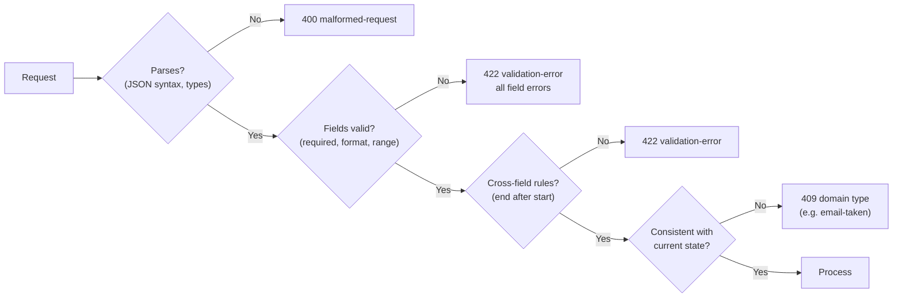
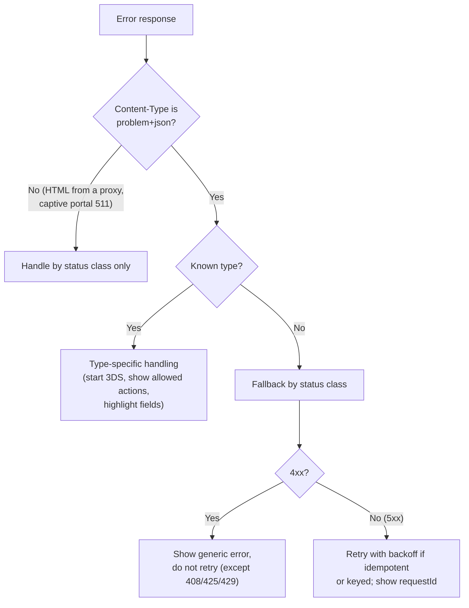

<!-- markdownlint-disable MD001 -->
<!-- markdownlint-disable MD024 -->
<!-- markdownlint-disable MD025 -->
<!-- markdownlint-disable MD026 -->
<!-- markdownlint-disable MD029 -->
<!-- markdownlint-disable MD033 -->
<!-- markdownlint-disable MD036 -->
<!-- markdownlint-disable MD040 -->
<!-- markdownlint-disable MD056 -->
<!-- markdownlint-disable MD060 -->

# R7. Error Model

## Contents

| #    | Sub-topic                                                                   |
| ---- | --------------------------------------------------------------------------- |
| R7.1 | [Why an error model](#r71-why-an-error-model)                               |
| R7.2 | [RFC 9457 Problem Details](#r72-rfc-9457-problem-details)                   |
| R7.3 | [Designing problem types](#r73-designing-problem-types)                     |
| R7.4 | [Validation errors](#r74-validation-errors)                                 |
| R7.5 | [What must never leak](#r75-what-must-never-leak)                           |
| R7.6 | [Errors across service boundaries](#r76-errors-across-service-boundaries)   |
| R7.7 | [How clients should consume errors](#r77-how-clients-should-consume-errors) |
| R7.8 | [Code: Spring Boot and Actix Web](#r78-code-spring-boot-and-actix-web)      |
| R7.9 | [Story: one checkout, five failures](#r79-story-one-checkout-five-failures) |
| -    | [Exercises](#exercises) and [Solutions](#solutions)                         |
| -    | [Takeaways](#takeaways)                                                     |

## R7.1 Why an error model

The status code tells generic components *what class* of failure happened (R3).  
Clients also need to know *which specific* failure it was, *what to fix* and *how to reference it in a support ticket*, and they need that in the same shape on every endpoint.  
An error model is the contract for the failure path, which is where most integration time is actually spent.

Three audiences read every error:

| Audience         | Needs                                                       | Served by                                      |
| ---------------- | ----------------------------------------------------------- | ---------------------------------------------- |
| Client code      | A stable identifier to branch on; field locations for forms | `type`, extension members, `errors[].pointer`  |
| Developer / user | A clear explanation of what happened and how to fix it      | `title`, `detail`, documentation behind `type` |
| Operator         | A handle to find the request in logs and traces             | `instance`, `requestId`, `traceId`             |

Without a model, every team invents its own shape: `{"error": "..."}` here, `{"message": "...", "code": 12}` there, HTML from the proxy, a stack trace from the framework.  
Clients end up parsing strings, which breaks the first time someone fixes a typo in a message.

## R7.2 RFC 9457 Problem Details

RFC 9457 (2023, replacing RFC 7807) defines one JSON shape for errors, served as `application/problem+json`.  
Five standard members (`type`, `title`, `status`, `detail`, `instance`) plus any extension members you define. `type` is the identifier clients branch on; everything else is for humans or operators.

```text
HTTP/1.1 422 Unprocessable Content
Content-Type: application/problem+json
Content-Language: en

{
  "type": "https://api.acme.com/problems/insufficient-funds",
  "title": "Insufficient funds",
  "status": 422,
  "detail": "Balance is 300.00 INR; the transfer needs 500.00 INR.",
  "instance": "/transfers/attempts/req_7f3a9c",
  "balance": { "amountMinor": 30000, "currency": "INR" },
  "requestId": "req_7f3a9c"
}
```

### The members

| Member     | Type          | Meaning                                         | Rules                                                                              |
| ---------- | ------------- | ----------------------------------------------- | ---------------------------------------------------------------------------------- |
| `type`     | URI reference | **The primary identifier** of the problem kind  | Stable forever; ideally resolves to human documentation; defaults to `about:blank` |
| `title`    | string        | Short, human-readable summary of the *type*     | Same for every occurrence of the type (localization aside)                         |
| `status`   | number        | The HTTP status code                            | Advisory copy; must match the actual response status                               |
| `detail`   | string        | Human-readable explanation of *this occurrence* | Help the client fix it; **clients must not parse it**                              |
| `instance` | URI reference | Identifies this specific occurrence             | Often a request or log reference; may or may not be dereferenceable                |
| Extensions | any           | Additional machine-readable data for this type  | Documented per type; clients ignore unknown extensions                             |

### Details worth knowing

- **`about:blank`** means "no semantics beyond the status code".  
  Its `title` should be the status reason phrase. Use it for generic errors (`404`, `405`, `500`) that need no specific type.

- **`type` URIs** should be absolute and point to documentation.  
  A relative `type` is resolved against the request URI, which is confusing; avoid it.  
  The URI is an identifier first: clients compare it as a string and must not need to fetch it.

- **Multiple problems**: RFC 9457 recommends that when several problems of the *same type* occur (for example many invalid fields), you report them in an extension array such as `errors`.  
  When problems of *different types* occur, return the most relevant or urgent one.

- **A registry of common problem types** exists at IANA, created by RFC 9457, so widely useful types can be shared across APIs.

- **Content negotiation**: send `application/problem+json` even when the client asked for `application/json`; it is JSON underneath (the `+json` suffix).  
  Clients that parse JSON can read it.

- **Not only for 4xx**: `500`, `502`, `503` and `504` get problem bodies too, with a generic `detail` and the correlation ID.

### Alternatives you will meet

| Ecosystem             | Shape                                                                                                                                                                |
| --------------------- | -------------------------------------------------------------------------------------------------------------------------------------------------------------------- |
| Stripe                | `{"error": {"type": "card_error", "code": "card_declined", "decline_code": "insufficient_funds", "param": "...", "message": "..."}}`                                 |
| Google APIs (AIP-193) | `{"error": {"code": 400, "status": "INVALID_ARGUMENT", "message": "...", "details": [{"@type": "...ErrorInfo", "reason": "...", "domain": "...", "metadata": {}}]}}` |
| GraphQL               | `200` with an `errors` array; `extensions.code` for machine use                                                                                                      |
| JSON:API              | `{"errors": [{"status": "422", "code": "...", "source": {"pointer": "/data/attributes/email"}}]}`                                                                    |

They all converge on the same ideas: a stable machine code, a human message, a pointer to the offending input, and metadata.  
RFC 9457 is the standards-track version; choose it for new HTTP APIs unless your ecosystem already has a strong convention.

## R7.3 Designing problem types

Define one problem type per *distinct condition the client can act on differently*.  
Name it in domain terms, document it, list its extension members, and treat the catalogue as part of the API contract: types are never renamed or repurposed, only added.

### Granularity: the "different reaction" test

Create a separate type when a client would react differently:

| Too coarse        | Right granularity                                                                   | Client reaction                                                |
| ----------------- | ----------------------------------------------------------------------------------- | -------------------------------------------------------------- |
| `payment-failed`  | `card-declined`, `insufficient-funds`, `card-expired`, `3ds-required`               | Ask for another card / top up / update expiry / start 3DS flow |
| `invalid-request` | `validation-error` (with field errors), `cursor-mismatch`, `idempotency-key-reused` | Fix fields / restart paging / use a new key                    |
| `conflict`        | `order-not-cancellable` (with `currentState`), `email-taken`                        | Refresh order / suggest login                                  |

Too fine (one type per field rule) is noise: field-level codes belong inside `errors[]`, not as separate types.

### A catalogue entry

```text
type:       https://api.acme.com/problems/order-not-cancellable
title:      Order cannot be cancelled
status:     409
when:       POST /orders/{id}/cancellation on an order in SHIPPED, DELIVERED or CANCELLED state
extensions: currentState (string), allowedActions (array of string)
client:     refresh the order and show the allowed actions; do not retry
since:      2026-10-01
```

### Example catalogue

| Type (suffix)            | Status | Extension members                                             | Client should                                     |
| ------------------------ | ------ | ------------------------------------------------------------- | ------------------------------------------------- |
| `validation-error`       | 422    | `errors[]` (`pointer`/`parameter`/`header`, `code`, `detail`) | Highlight fields; fix and resubmit                |
| `malformed-request`      | 400    | `pointer` (where parsing failed, if known)                    | Fix the client bug                                |
| `unauthenticated`        | 401    | (none)                                                        | Refresh token, retry once                         |
| `forbidden`              | 403    | `requiredScope`                                               | Request permission; do not retry                  |
| `not-found`              | 404    | (none; prefer `about:blank`)                                  | Do not retry                                      |
| `order-not-cancellable`  | 409    | `currentState`, `allowedActions`                              | Refresh; show allowed actions                     |
| `email-taken`            | 409    | (none)                                                        | Offer sign-in or reset                            |
| `precondition-failed`    | 412    | `currentEtag` (optional)                                      | Re-read, merge, retry                             |
| `insufficient-funds`     | 422    | `balance`, `required`                                         | Ask user to top up                                |
| `idempotency-key-reused` | 422    | (none)                                                        | Use a new key for a new intent (R2 DD-4)          |
| `rate-limited`           | 429    | `retryAfterSeconds` (mirror of the header)                    | Back off until `Retry-After`                      |
| `dependency-unavailable` | 503    | (none)                                                        | Retry with backoff                                |
| `internal-error`         | 500    | (none beyond `requestId`)                                     | Retry if idempotent; quote `requestId` to support |

### Contract rules

- **Types are append-only.** Never rename, never change meaning, never change the status of an existing type.  
  Adding a type is a compatible change *only if* clients follow the fallback rule (R7.7).

- **A `code` string next to `type`** (for example `"code": "INSUFFICIENT_FUNDS"`) is a common convenience for clients that dislike URIs.  
  If you add it, it is equally permanent.

- **Extension members are typed and documented per type.** Never add an ad hoc field to one occurrence.

- **Put dynamic values in extensions, not only in `detail`.** If the client needs the balance, it gets `balance` as data, not "Balance is 300.00" to regex out of a sentence.

## R7.4 Validation errors

Report **all** field errors at once, each with a precise location (a JSON Pointer into the body, or the name of the query parameter or header), a stable code and a human message.  
Use `400` when the request cannot be parsed and `422` when it parses but violates rules; state conflicts are `409`.

### The validation pipeline and its codes



### Shape

```json
{
  "type": "https://api.acme.com/problems/validation-error",
  "title": "Request validation failed",
  "status": 422,
  "detail": "3 fields are invalid.",
  "instance": "/requests/req_91ab",
  "errors": [
    { "pointer": "/shippingAddress/pinCode", "code": "invalid_format", "detail": "Must be 6 digits." },
    { "pointer": "/items/1/quantity",        "code": "out_of_range",   "detail": "Must be between 1 and 10.", "min": 1, "max": 10 },
    { "parameter": "currency",               "code": "unsupported",    "detail": "Supported: INR, USD." }
  ]
}
```

| Field in `errors[]`                 | Meaning                                                                                                    |
| ----------------------------------- | ---------------------------------------------------------------------------------------------------------- |
| `pointer`                           | JSON Pointer (RFC 6901) into the request body: `/items/1/quantity`                                         |
| `parameter`                         | Name of a query or path parameter                                                                          |
| `header`                            | Name of a request header                                                                                   |
| `code`                              | Stable machine code for the rule (`required`, `too_long`, `out_of_range`, `invalid_format`, `unsupported`) |
| `detail`                            | Human message, localizable                                                                                 |
| Rule data (`min`, `max`, `allowed`) | Machine-readable constraint values so clients can render their own text                                    |

### Rules

- **All errors, not the first one.** A form with five mistakes should not take five round trips.

- **Pointers into the request as sent**, not into your internal model: the client must be able to map them to its own fields.

- **Codes are contract; messages are not.** Clients branch on `code`; `detail` may change wording or language at any time.

- **Localize human text** using `Accept-Language`, and set `Content-Language`. Codes stay in English.

- **Cap the list** (for example 100 errors) so a malicious 10,000-item body does not produce a megabyte of errors.

- **Do not echo raw input back** in messages ("`<script>…` is not a valid email"): it creates reflected-content risks in clients that render HTML.

## R7.5 What must never leak

Errors are the most common accidental information channel in an API.  
Return what the client needs to fix the request and a correlation ID; keep everything else (stack traces, internals, other users' data, existence of accounts) in logs.

### Never in a response

| Leak                                | Example                                                                      | Why it matters                              |
| ----------------------------------- | ---------------------------------------------------------------------------- | ------------------------------------------- |
| Stack traces, exception class names | `java.lang.NullPointerException at com.acme.pay.Ledger.post(Ledger.java:88)` | Reveals code structure and libraries        |
| SQL and schema                      | `ERROR: duplicate key value violates unique constraint "users_email_key"`    | Reveals tables, columns, database vendor    |
| Infrastructure                      | Internal hostnames, IPs, file paths, pod names                               | Maps your network for attackers             |
| Library and server versions         | `Server: Apache/2.4.41`, `Jackson 2.13.1 failed ...`                         | CVE shortlist (R4.6)                        |
| Secrets                             | Connection strings, tokens, keys in messages                                 | Direct compromise                           |
| Other users' data                   | "Order belongs to <asha@example.com>"                                        | Privacy breach                              |
| Account existence                   | Login: "user not found" vs "wrong password"                                  | User enumeration                            |
| Raw upstream errors                 | A payment gateway's internal message passed through verbatim                 | Leaks partner internals; inconsistent shape |

### Enumeration-safe messages

| Endpoint                  | Leaky                                          | Safe                                                                                                                  |
| ------------------------- | ---------------------------------------------- | --------------------------------------------------------------------------------------------------------------------- |
| Login                     | "No account for this email" / "Wrong password" | `401` "Invalid email or password" for both                                                                            |
| Password reset            | "No account with that email"                   | `202` "If an account exists, we sent a reset link" for both                                                           |
| Sign-up                   | `409 email-taken`                              | Acceptable if the product allows it; otherwise `202` "check your email" and send a "you already have an account" mail |
| Another tenant's resource | `403 forbidden`                                | `404` (R3)                                                                                                            |

Response *timing* can leak the same facts (an existing user takes longer because the password hash is checked).  
Equalize expensive work on both paths where enumeration matters.

### The right pattern for 5xx

```json
{
  "type": "about:blank",
  "title": "Internal Server Error",
  "status": 500,
  "detail": "An unexpected error occurred. Quote the request ID if you contact support.",
  "instance": "/requests/req_c41d",
  "requestId": "req_c41d"
}
```

The full exception, with stack trace and context, goes to logs and traces under `req_c41d` (R4.3 correlation IDs).  
Support finds it in seconds; the attacker learns nothing.

## R7.6 Errors across service boundaries

Never forward a downstream error verbatim.  
Translate it into *your* contract: a downstream client error usually means *you* sent something wrong (your `500`) or reflects the caller's input (a `4xx` you re-express in your own types);  
a downstream outage becomes your `502`, `503` or `504`. Keep the correlation ID across the hop.

### Translation guide

| Downstream returns                         | Typical meaning for you                         | You return                                                                             |
| ------------------------------------------ | ----------------------------------------------- | -------------------------------------------------------------------------------------- |
| `400`/`422` caused by *your* request shape | Your bug                                        | `500 internal-error` (and alert)                                                       |
| `400`/`422` caused by *the caller's* data  | Caller's input is invalid for the business      | `422` with your own type and pointer into *your* request                               |
| `404` for an ID the caller supplied        | Caller referenced something that does not exist | `422 validation-error` (pointer to the field) or `404`                                 |
| `404` for an ID you hold internally        | Data inconsistency                              | `500` (and alert)                                                                      |
| `409`                                      | Business conflict                               | `409` with your own type                                                               |
| `401`/`403` on your service credentials    | Your misconfiguration                           | `500` or `502` (never `401` to the caller)                                             |
| `429`                                      | You exceeded the dependency's quota             | `503 dependency-unavailable` + `Retry-After`, not `429` (the caller did nothing wrong) |
| `5xx`, connection refused, reset           | Dependency failure                              | `502` (or `503` if you shed load / circuit is open)                                    |
| Timeout                                    | Dependency too slow                             | `504`; beware the work may have completed (R2 DD-3)                                    |

### gRPC to HTTP

When the downstream is gRPC (R1.1), map its status codes.  
This is the mapping Google uses at its HTTP edge:

| gRPC status                        | HTTP | gRPC status           | HTTP |
| ---------------------------------- | ---- | --------------------- | ---- |
| `OK`                               | 200  | `RESOURCE_EXHAUSTED`  | 429  |
| `INVALID_ARGUMENT`                 | 400  | `FAILED_PRECONDITION` | 400  |
| `OUT_OF_RANGE`                     | 400  | `ABORTED`             | 409  |
| `UNAUTHENTICATED`                  | 401  | `CANCELLED`           | 499  |
| `PERMISSION_DENIED`                | 403  | `UNIMPLEMENTED`       | 501  |
| `NOT_FOUND`                        | 404  | `UNAVAILABLE`         | 503  |
| `ALREADY_EXISTS`                   | 409  | `DEADLINE_EXCEEDED`   | 504  |
| `INTERNAL`, `UNKNOWN`, `DATA_LOSS` | 500  |                       |      |

(`499` is non-standard, R3.8; at your public edge, client-cancelled requests usually never get a response anyway.)

### Observability

- Emit metrics **by problem type**, not just by status: a spike in `card-declined` is a business signal; a spike in `validation-error` from one client version is a client bug;  
  a spike in `malformed-request` from one IP is probing.

- Alert on 5xx rates; dashboard 4xx by type and client.

## R7.7 How clients should consume errors

Branch on the status class first, then on `type`; treat unknown types as the generic error for their status.  
Show `detail` to developers; show users copy that the client owns, keyed by `type` and `code`.



- **Never parse `detail` or `title`.** They change wording and language.

- **Expect non-problem bodies.** Load balancers, CDNs, WAFs and captive portals return HTML or empty bodies; the client must still behave correctly by status.

- **Log the `requestId`** with every client-side error and show it in "contact support" screens.

- **Unknown types are normal.** A server adding a new problem type must not crash old clients; this is what makes adding types a compatible change.

## R7.8 Code: Spring Boot and Actix Web

### Spring Boot

**Enable Problem Details for framework exceptions**

```properties
spring.mvc.problemdetails.enabled=true          # Spring MVC's own exceptions (405, 406, 415, 400 ...) render as problem+json
```

**Domain exceptions that carry their problem**

```java
public abstract class ApiProblem extends ErrorResponseException {

    private static final String BASE = "https://api.acme.com/problems/";

    protected ApiProblem(HttpStatus status, String slug, String title, String detail) {
        super(status, problem(status, slug, title, detail), null);
    }

    private static ProblemDetail problem(HttpStatus status, String slug, String title, String detail) {
        ProblemDetail pd = ProblemDetail.forStatusAndDetail(status, detail);
        pd.setType(URI.create(BASE + slug));
        pd.setTitle(title);
        return pd;
    }
}

public final class OrderNotCancellable extends ApiProblem {
    public OrderNotCancellable(String orderId, OrderStatus current, List<String> allowed) {
        super(HttpStatus.CONFLICT, "order-not-cancellable", "Order cannot be cancelled",
              "Order " + orderId + " is " + current + ".");
        getBody().setProperty("currentState", current.name());
        getBody().setProperty("allowedActions", allowed);
    }
}
```

`ErrorResponseException` is rendered by Spring MVC directly with the right status and `application/problem+json`; no handler method is needed per exception.

**One advice for validation, correlation IDs and the 500 fallback**

```java
@RestControllerAdvice
class ProblemAdvice extends ResponseEntityExceptionHandler {          // keeps correct codes for Spring's own exceptions

    private static final URI VALIDATION = URI.create("https://api.acme.com/problems/validation-error");

    @Override
    protected ResponseEntity<Object> handleMethodArgumentNotValid(MethodArgumentNotValidException ex,
            HttpHeaders headers, HttpStatusCode status, WebRequest request) {
        List<Map<String, Object>> errors = ex.getFieldErrors().stream()
                .limit(100)
                .map(f -> Map.<String, Object>of(
                        "pointer", toJsonPointer(f.getField()),               // items[1].quantity → /items/1/quantity
                        "code", String.valueOf(f.getCode()),                   // e.g. NotNull, Size, Pattern
                        "detail", String.valueOf(f.getDefaultMessage())))
                .toList();
        ProblemDetail pd = ProblemDetail.forStatusAndDetail(HttpStatus.UNPROCESSABLE_ENTITY,
                errors.size() + " field(s) are invalid.");
        pd.setType(VALIDATION);
        pd.setTitle("Request validation failed");
        pd.setProperty("errors", errors);
        return ResponseEntity.unprocessableEntity()
                .contentType(MediaType.APPLICATION_PROBLEM_JSON)
                .body(withRequestId(pd));
    }

    @ExceptionHandler(Exception.class)
    ResponseEntity<ProblemDetail> unexpected(Exception e) {
        log.error("unhandled exception", e);                                   // full detail, MDC carries requestId
        ProblemDetail pd = ProblemDetail.forStatusAndDetail(HttpStatus.INTERNAL_SERVER_ERROR,
                "An unexpected error occurred. Quote the request ID if you contact support.");
        return ResponseEntity.internalServerError()
                .contentType(MediaType.APPLICATION_PROBLEM_JSON)
                .body(withRequestId(pd));
    }

    private static ProblemDetail withRequestId(ProblemDetail pd) {
        String id = MDC.get("requestId");                                      // set by the R4.7 filter
        if (id != null) {
            pd.setProperty("requestId", id);
            pd.setInstance(URI.create("/requests/" + id));
        }
        return pd;
    }

    static String toJsonPointer(String springPath) {                          // "items[1].quantity" → "/items/1/quantity"
        return "/" + springPath.replace("~", "~0").replace("/", "~1")
                .replaceAll("\\[(\\d+)]", ".$1").replace('.', '/');
    }
}
```

**Gaps that produce a second error shape (close them)**

- **Spring Security** writes its own `401`/`403` bodies before MVC is involved.  
  Register an `AuthenticationEntryPoint` and an `AccessDeniedHandler` that write `application/problem+json`.

- **Errors outside MVC** (exceptions in filters, servlet container errors) go to Spring Boot's `/error` endpoint, whose default JSON (`timestamp`, `status`, `error`, `path`) is a different shape.  
  Customize it (an `ErrorAttributes` bean or your own `ErrorController`) to emit the same problem shape.

- **Localization**: Spring resolves `ProblemDetail` titles and details from a `MessageSource` using codes such as `problemDetail.title.<exception class>`,  
  so `Accept-Language` can select translated text.

### Actix Web

**A problem type and an error enum**

```rust
#[derive(Serialize)]
#[serde(rename_all = "camelCase")]
pub struct Problem {
    #[serde(rename = "type")]
    pub kind: String,
    pub title: &'static str,
    pub status: u16,
    #[serde(skip_serializing_if = "Option::is_none")]
    pub detail: Option<String>,
    #[serde(skip_serializing_if = "Option::is_none")]
    pub instance: Option<String>,
    #[serde(flatten)]
    pub extensions: serde_json::Map<String, serde_json::Value>,
}

#[derive(Debug, thiserror::Error)]
pub enum ApiError {
    #[error("malformed request: {0}")]
    Malformed(String),
    #[error("{} field(s) are invalid", .0.len())]
    Validation(Vec<FieldError>),
    #[error("order {id} is {current}")]
    OrderNotCancellable { id: String, current: String, allowed: Vec<&'static str> },
    #[error("not found")]
    NotFound,
    #[error("unexpected error")]
    Internal(#[from] anyhow::Error),
}

#[derive(Debug, Serialize)]
pub struct FieldError { pub pointer: String, pub code: String, pub detail: String }

const BASE: &str = "https://api.acme.com/problems/";

impl ResponseError for ApiError {
    fn status_code(&self) -> StatusCode {
        match self {
            ApiError::Malformed(_)                 => StatusCode::BAD_REQUEST,
            ApiError::Validation(_)                => StatusCode::UNPROCESSABLE_ENTITY,
            ApiError::OrderNotCancellable { .. }   => StatusCode::CONFLICT,
            ApiError::NotFound                     => StatusCode::NOT_FOUND,
            ApiError::Internal(_)                  => StatusCode::INTERNAL_SERVER_ERROR,
        }
    }

    fn error_response(&self) -> HttpResponse {
        let status = self.status_code();
        let mut ext = serde_json::Map::new();
        let (kind, title) = match self {
            ApiError::Malformed(_) => (format!("{BASE}malformed-request"), "Malformed request"),
            ApiError::Validation(errors) => {
                ext.insert("errors".into(), serde_json::to_value(errors).unwrap_or_default());
                (format!("{BASE}validation-error"), "Request validation failed")
            }
            ApiError::OrderNotCancellable { current, allowed, .. } => {
                ext.insert("currentState".into(), current.clone().into());
                ext.insert("allowedActions".into(), serde_json::to_value(allowed).unwrap_or_default());
                (format!("{BASE}order-not-cancellable"), "Order cannot be cancelled")
            }
            ApiError::NotFound => ("about:blank".to_owned(), "Not Found"),
            ApiError::Internal(e) => {
                log::error!("unhandled: {e:?}");                              // detail in logs only
                ("about:blank".to_owned(), "Internal Server Error")
            }
        };
        let detail = match self {
            ApiError::Internal(_) => "An unexpected error occurred. Quote the request ID if you contact support.".to_owned(),
            other => other.to_string(),
        };
        HttpResponse::build(status)
            .content_type("application/problem+json")
            .json(Problem { kind, title, status: status.as_u16(), detail: Some(detail), instance: None, extensions: ext })
    }
}
```

The request ID from the R4.7 middleware is added in a final middleware that inserts `requestId` into problem bodies,  
or simply via the echoed `X-Request-ID` header, which clients log alongside the body.

**Validation with the `validator` crate, mapped to pointers**

```rust
#[derive(Deserialize, Validate)]
#[serde(rename_all = "camelCase")]
struct CreateOrderRequest {
    #[validate(length(min = 1, max = 50), nested)]
    items: Vec<LineRequest>,
    #[validate(nested)]
    shipping_address: Address,
}

fn to_field_errors(errs: &validator::ValidationErrors, prefix: &str, out: &mut Vec<FieldError>) {
    for (field, kind) in errs.errors() {
        let path = format!("{prefix}/{}", to_camel(field));
        match kind {
            ValidationErrorsKind::Field(list) => out.extend(list.iter().map(|e| FieldError {
                pointer: path.clone(),
                code: e.code.to_string(),
                detail: e.message.as_deref().map(str::to_owned).unwrap_or_else(|| e.code.to_string()),
            })),
            ValidationErrorsKind::Struct(inner) => to_field_errors(inner, &path, out),
            ValidationErrorsKind::List(items) => {
                for (i, inner) in items { to_field_errors(inner, &format!("{path}/{i}"), out); }
            }
        }
    }
}
```

**Make framework errors use the same shape**

```rust
App::new()
    .app_data(web::JsonConfig::default()
        .limit(256 * 1024)
        .error_handler(|err, _req| ApiError::Malformed(err.to_string()).into()))      // 400 problem
    .app_data(web::QueryConfig::default()
        .error_handler(|err, _req| ApiError::Malformed(err.to_string()).into()))
    .app_data(web::PathConfig::default()
        .error_handler(|err, _req| ApiError::Malformed(err.to_string()).into()))
    .default_service(web::to(|| async { ApiError::NotFound.error_response() }))     // unmatched routes → 404 problem
```

`serde_json`'s error text includes line and column, which is safe; to return a JSON Pointer for type errors, deserialize through the `serde_path_to_error` crate.

## R7.9 Story: one checkout, five failures

A mobile app places an order. Five things can go wrong; each produces a different, actionable response.

| #   | Situation                               | Status | `type` suffix        | Key extensions                                                  | App behaviour                                                              |
| --- | --------------------------------------- | ------ | -------------------- | --------------------------------------------------------------- | -------------------------------------------------------------------------- |
| 1   | PIN code has 5 digits, quantity 0       | 422    | `validation-error`   | `errors[]` with `/shippingAddress/pinCode`, `/items/0/quantity` | Highlights both fields at once                                             |
| 2   | One item went out of stock              | 409    | `out-of-stock`       | `skus: ["A-1"]`, `available: {"A-1": 0}`                        | Removes the item, asks the user to confirm                                 |
| 3   | Card declined, insufficient funds       | 422    | `insufficient-funds` | `required`, `paymentMethodId`                                   | Offers another payment method                                              |
| 4   | User tapped "Pay" 12 times in 2 seconds | 429    | `rate-limited`       | `retryAfterSeconds` (plus `Retry-After`)                        | Disables the button, retries after the delay with the same idempotency key |
| 5   | Payment gateway timed out               | 504    | `about:blank`        | `requestId`                                                     | Shows "processing", polls the order; never charges twice (R2 DD-3)         |

What made this work:

- The app branches on `type`, not on English sentences, so the copy team can rewrite every message without touching code.
- Dynamic values (`available`, `required`) are data, not text to parse.
- Case 5 carries a `requestId`; when the user calls support, the agent finds the trace immediately.
- None of the responses mentions a gateway name, a table, a stack frame or another user.

## Exercises

**1. Rewrite as Problem Details.** Give status, headers and body for each.

- a) `200 {"success": false, "error": "Invalid email"}`

- b) `500 {"error": "org.postgresql.util.PSQLException: duplicate key value violates unique constraint \"users_email_key\""}`

- c) `400 "Something went wrong"` (plain text) for an expired coupon

- d) `403 {"message": "You are not allowed to see order ord_9 of user asha@example.com"}`

**2. Problem catalogue.** Design six problem types for a peer-to-peer payments API (send money, request money, add bank account).  
  For each: `type` suffix, status, extension members, client action.

**3. Validation response.** For this request to `POST /transfers`:

```json
{ "amount": { "amountMinor": -500, "currency": "XYZ" }, "to": "", "note": "<long 5000-character string>" }
```

with rules: amount positive, currency in {INR, USD}, `to` required, note at most 140 characters; write the full response.

**4. Leak review.** What is wrong with each, and what should it be?

- a) Login returns `404 user-not-found` for unknown emails and `401` for wrong passwords.

- b) A `502` body contains the payment gateway's raw JSON error, including its merchant account ID.

- c) A `500` body includes `"exception": "NullPointerException", "trace": [...]` only when the header `X-Debug: true` is present.

**5. Downstream mapping.** Your order service calls an inventory service.  
  Map each inventory response to your public response:  
  (a) `404` for a SKU the caller sent;  
  (b) `400` because your service sent a malformed request;  
  (c) `429` from inventory;  
  (d) connection timeout after 2 s;  
  (e) `409 reservation-conflict` because stock was taken by someone else.

## Solutions

### Solution 1

**a)**

```text
422 Unprocessable Content
Content-Type: application/problem+json

{ "type": "https://api.acme.com/problems/validation-error", "title": "Request validation failed", "status": 422,
  "detail": "1 field is invalid.",
  "errors": [ { "pointer": "/email", "code": "invalid_format", "detail": "Must be a valid email address." } ] }
```

**b)** If the duplicate is the caller's email (a business conflict):

```text
409 Conflict
Content-Type: application/problem+json

{ "type": "https://api.acme.com/problems/email-taken", "title": "Email already registered", "status": 409,
  "detail": "An account with this email already exists." }
```

Catch the constraint violation and translate it; never expose the SQL, the driver class or the constraint name.  
If enumeration matters for sign-up, use the `202` "check your email" pattern from R7.5 instead.

**c)**

```text
422 Unprocessable Content
Content-Type: application/problem+json

{ "type": "https://api.acme.com/problems/coupon-expired", "title": "Coupon expired", "status": 422,
  "detail": "Coupon DIWALI25 expired on 2026-10-25.", "couponCode": "DIWALI25", "expiredAt": "2026-10-25T18:29:59Z" }
```

Plain text and `400` give the client nothing to act on; an expired coupon is valid syntax with a business rule failure.

**d)**

```text
404 Not Found
Content-Type: application/problem+json

{ "type": "about:blank", "title": "Not Found", "status": 404 }
```

The original leaks another user's email and confirms the order exists (R3: conceal with `404`).

### Solution 2

| Type suffix                          | Status | Extensions                                           | Client action                             |
| ------------------------------------ | ------ | ---------------------------------------------------- | ----------------------------------------- |
| `validation-error`                   | 422    | `errors[]`                                           | Highlight fields                          |
| `insufficient-funds`                 | 422    | `balance`, `required`                                | Prompt to add money or reduce amount      |
| `recipient-not-found`                | 422    | `pointer: "/to"`                                     | Ask user to check the recipient handle    |
| `transfer-limit-exceeded`            | 422    | `limit`, `period` (`"P1D"`), `remaining`, `resetsAt` | Show remaining limit and when it resets   |
| `bank-account-verification-required` | 403    | `verificationUrl`                                    | Start the verification flow               |
| `idempotency-key-reused`             | 422    | (none)                                               | Developer bug: new intent needs a new key |
| `rate-limited`                       | 429    | `retryAfterSeconds`                                  | Back off                                  |

Any six of these are a good answer; what matters is one type per distinct client reaction, data in extensions, and stable names.

### Solution 3

```text
422 Unprocessable Content
Content-Type: application/problem+json
Content-Language: en

{
  "type": "https://api.acme.com/problems/validation-error",
  "title": "Request validation failed",
  "status": 422,
  "detail": "4 fields are invalid.",
  "instance": "/requests/req_5d2e",
  "requestId": "req_5d2e",
  "errors": [
    { "pointer": "/amount/amountMinor", "code": "out_of_range",   "detail": "Must be greater than 0.", "min": 1 },
    { "pointer": "/amount/currency",    "code": "unsupported",    "detail": "Supported currencies: INR, USD.", "allowed": ["INR", "USD"] },
    { "pointer": "/to",                 "code": "required",       "detail": "Recipient is required." },
    { "pointer": "/note",               "code": "too_long",       "detail": "Must be at most 140 characters.", "max": 140 }
  ]
}
```

All four errors in one response; the note is not echoed back; constraint values are data.

### Solution 4

| #   | Problem                                                                                    | Fix                                                                                                |
| --- | ------------------------------------------------------------------------------------------ | -------------------------------------------------------------------------------------------------- |
| a   | User enumeration: the difference reveals which emails have accounts                        | `401` "Invalid email or password" for both; equalize timing (hash a dummy password)                |
| b   | Leaks partner internals and an account identifier; inconsistent shape                      | `502` (or `504`) with your own problem body and `requestId`; log the gateway response              |
| c   | Any client can send `X-Debug: true`; debug features become an attack surface in production | Never include traces in responses; debug detail lives in logs and traces, reachable by `requestId` |

### Solution 5

| #   | Inventory says                   | You return                                                                                              |
| --- | -------------------------------- | ------------------------------------------------------------------------------------------------------- |
| a   | `404` for a SKU the caller sent  | `422 validation-error` with `pointer: "/items/2/sku"`, code `unknown_sku` (the caller's input is wrong) |
| b   | `400` for your malformed request | `500 internal-error` with `requestId`; alert, because it is your bug                                    |
| c   | `429`                            | `503 dependency-unavailable` with `Retry-After`; the caller is not over *their* limit                   |
| d   | Timeout                          | `504` with `requestId`; make the reservation idempotent so a retry cannot double-reserve                |
| e   | `409 reservation-conflict`       | `409 out-of-stock` with `skus` and `available` in your own vocabulary                                   |

## Takeaways

- Status codes say the class of failure; Problem Details (RFC 9457, `application/problem+json`) say which failure, for whom, and where to look.

- `type` is the contract: stable, documented, one per distinct client reaction, append-only. `title` and `detail` are for humans and are never parsed.

- Put dynamic values in extension members; put field problems in `errors[]` with JSON Pointers and stable codes; report all of them at once.

- `400` cannot parse, `422` invalid content, `409` conflicts with state.

- Never leak stack traces, SQL, infrastructure, other users' data or account existence; return a `requestId` and keep the detail in logs.

- Translate downstream errors into your own contract; downstream `429` is your `503`, downstream `400` on your request is your `500`.

- Clients branch on status class, then `type`, and fall back gracefully on unknown types and non-problem bodies.

- Close every path that produces a second error shape: security filters, the framework's `/error` endpoint, extractor errors, unmatched routes.

---
