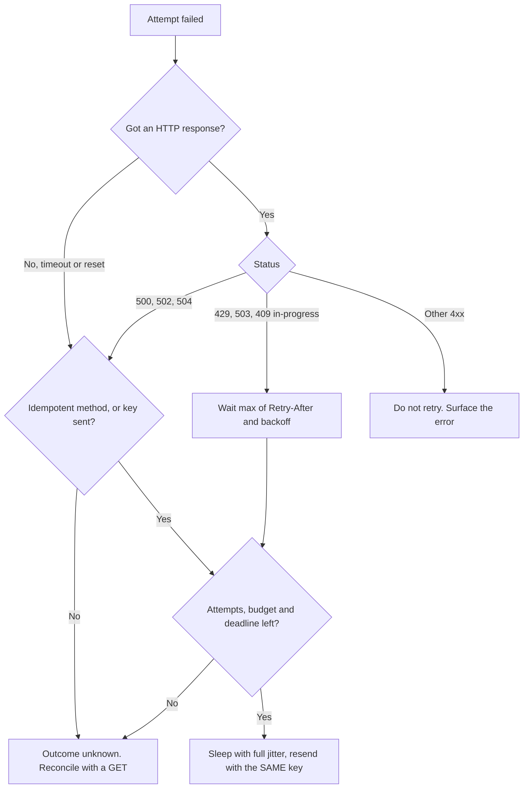
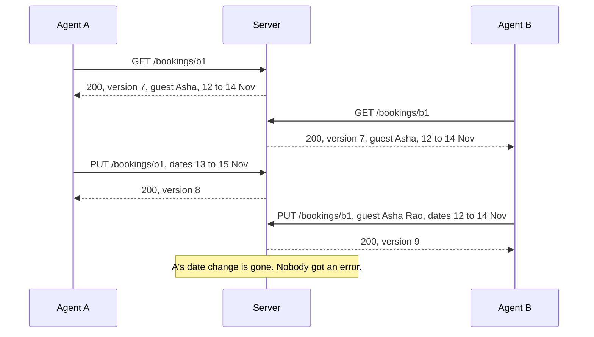
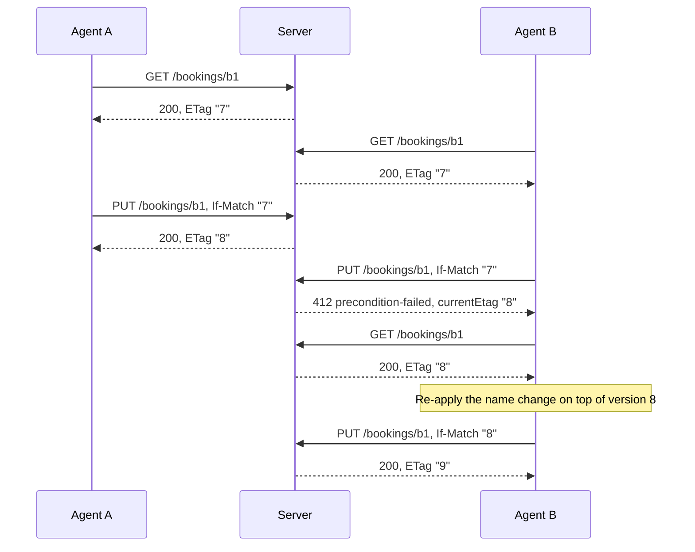
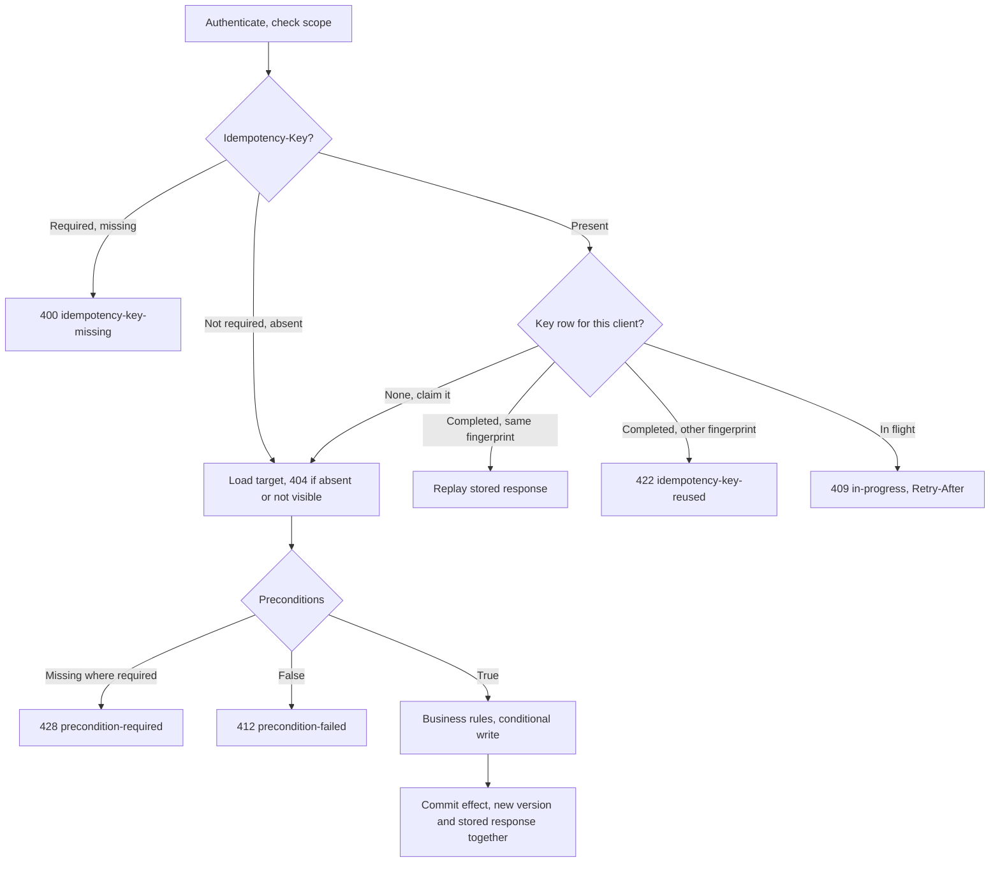

<!-- markdownlint-disable MD001 -->
<!-- markdownlint-disable MD024 -->
<!-- markdownlint-disable MD025 -->
<!-- markdownlint-disable MD026 -->
<!-- markdownlint-disable MD029 -->
<!-- markdownlint-disable MD033 -->
<!-- markdownlint-disable MD036 -->
<!-- markdownlint-disable MD040 -->
<!-- markdownlint-disable MD056 -->
<!-- markdownlint-disable MD060 -->

# R8. Idempotency and Concurrency

## Contents

| #     | Sub-topic                                                                                                     |
| ----- | ------------------------------------------------------------------------------------------------------------- |
| R8.1  | [Two problems, one question](#r81-two-problems-one-question)                                                  |
| R8.2  | [Idempotent by design vs by key](#r82-idempotent-by-design-vs-by-key)                                         |
| R8.3  | [The `Idempotency-Key` header contract](#r83-the-idempotency-key-header-contract)                             |
| R8.4  | [Retries and at-least-once delivery](#r84-retries-and-at-least-once-delivery)                                 |
| R8.5  | [Deduplication storage and key expiry](#r85-deduplication-storage-and-key-expiry)                             |
| R8.6  | [The lost-update problem](#r86-the-lost-update-problem)                                                       |
| R8.7  | [Optimistic concurrency: `ETag`, `If-Match`, `412`, `428`](#r87-optimistic-concurrency-etag-if-match-412-428) |
| R8.8  | [Implementing the check in the database](#r88-implementing-the-check-in-the-database)                         |
| R8.9  | [Where idempotency and concurrency meet](#r89-where-idempotency-and-concurrency-meet)                         |
| R8.10 | [Testing idempotency and concurrency](#r810-testing-idempotency-and-concurrency)                              |
| R8.11 | [Code: Spring Boot and Actix Web](#r811-code-spring-boot-and-actix-web)                                       |
| R8.12 | [Story: one room, two agents, a flaky train](#r812-story-one-room-two-agents-a-flaky-train)                   |
| -     | [Exercises](#exercises) and [Solutions](#solutions)                                                           |
| -     | [Takeaways](#takeaways)                                                                                       |

## R8.1 Two problems, one question

"The same request twice" and "two requests at once" are different failures with different tools. Duplicates come from retries and are solved by idempotency (by method design, or by a key).  
Races come from independent writers and are solved by concurrency control (preconditions, conditional writes, constraints).  
A system needs both, and neither substitutes for the other.

| Aspect               | Same request arrives twice                         | Two different requests arrive at once                  |
| -------------------- | -------------------------------------------------- | ------------------------------------------------------ |
| Typical cause        | Timeout and retry, double-click, broker redelivery | Two users, two workers, two devices of one user        |
| Failure if unhandled | Duplicate effect: double charge, two orders        | Lost update, oversold stock, broken invariant          |
| HTTP tools           | Idempotent methods, `Idempotency-Key`              | `ETag` with `If-Match`, `412`, `428`, `409`            |
| Storage tools        | Unique constraint on the key or a natural key      | Version column, conditional `UPDATE`, row locks        |
| Who must cooperate   | Client (reuse the key), every hop (dedup)          | Client (send the validator), server (check atomically) |

## R8.2 Idempotent by design vs by key

Prefer operations that are idempotent by construction: the client names the target (`PUT` to a known URI), the change is absolute rather than relative,  
and state transitions treat "already there" as success. Use an `Idempotency-Key` only where that is impossible: the server mints the identifier,  
or the effect is inherently "do it again" (move money, send a message).

### Classify every write

| Operation                                    | Idempotent by design? | Why / what to add                                               |
| -------------------------------------------- | --------------------- | --------------------------------------------------------------- |
| `PUT /users/42/avatar`                       | Yes                   | Replaces state; N calls leave the same state                    |
| `DELETE /sessions/s_9`                       | Yes                   | Second call finds nothing to delete; `204` then `404` is fine   |
| `PATCH` merge `{"status": "ARCHIVED"}`       | Yes in practice       | Absolute value; still needs `If-Match` against concurrent edits |
| `PATCH` JSON Patch `add` to `/items/-`       | No                    | Appends each time; needs a key or a `test` guard                |
| `POST /orders/7/cancel`                      | Yes, if modeled so    | "Already cancelled" returns `200` with current state, not `409` |
| `POST /accounts/9/credits` `{"amount": 100}` | No                    | Relative change; needs a key                                    |
| `POST /payments`                             | No                    | Server mints the ID, effect is external; key required           |
| `POST /notifications/email`                  | No                    | Key here, and a derived key to the email provider               |

### Four ways to get idempotency without a key

1. **Client-chosen identifiers.** Turn `POST /orders` into `PUT /orders/{uuid}` where the client generates a UUID (v4, or v7 for index locality).  
  The retry targets the same URI and the upsert from R2 DD-1 does the rest.  
  Validate the format, scope the ID to the tenant, and never let a client overwrite another tenant's resource by guessing an ID.

2. **Absolute instead of relative changes.** `{"balance": 600}` is idempotent; `{"delta": +100}` is not.  
  Absolute writes trade a duplicate problem for a lost-update problem, so they must carry `If-Match` (R8.7).

3. **Idempotent state transitions.** A transition endpoint returns success when the resource is already in the target state, and `409` only when the transition is impossible (cancel a shipped order).

4. **Natural business keys.** A unique constraint on `(merchant_id, merchant_order_ref)` rejects a duplicate create.  
  This is not the body-hash mistake from R2 DD-4: here the client explicitly asserts identity through a field it controls; the server does not guess it from the payload. On a duplicate,  
  return `409` with the existing resource's `Location`, or `200` with it if the API documents create-or-return.

### What "idempotent" promises and what it does not

RFC 9110 defines idempotency by **effect on the server**, not by identical responses.  
A second `DELETE` returning `404` is still idempotent.  
An `Idempotency-Key` gives the stronger guarantee: the same *response* is replayed. Clients that need "the result of my first attempt" need a key, even on methods that are idempotent by design.

## R8.3 The `Idempotency-Key` header contract

The IETF HTTPAPI working group's draft standardises `Idempotency-Key`, codifying what Stripe, Adyen, PayPal and others already did.  
The client sends a unique value per intent; the server documents which endpoints require it, how long keys live and what is fingerprinted, and it answers misuse with `400`, `422` and `409`.  
The table design and processing flow are in R2 DD-3; this section is the wire contract.

### On the wire

```text
POST /v1/payments HTTP/1.1
Host: api.acme.com
Authorization: Bearer eyJ...
Content-Type: application/json
Idempotency-Key: "8e03978e-40d5-43e8-bc93-6894a57f9324"

{"amountMinor": 50000, "currency": "INR", "to": "acct_42"}
```

```text
HTTP/1.1 201 Created                         ← replay of the first attempt
Location: /v1/payments/pay_91
Content-Type: application/json
Idempotent-Replayed: true

{"id": "pay_91", "status": "SUCCEEDED", "amountMinor": 50000, "currency": "INR"}
```

### The contract, element by element

| Element         | Rule                                                                                                                                                       |
| --------------- | ---------------------------------------------------------------------------------------------------------------------------------------------------------- |
| Name            | `Idempotency-Key`, no `X-` prefix (R4.5)                                                                                                                   |
| Value syntax    | The draft defines a Structured Field String (RFC 9651), so quoted: `"8e03..."`. Stripe and most SDKs send it bare. Accept both, compare the unquoted value |
| Value content   | A random UUID or equivalent entropy; reject keys shorter than about 8 or longer than 255 characters, and restrict the charset                              |
| Scope           | Unique per `(client or tenant, key)`; adding method and route template prevents one key serving two endpoints                                              |
| Fingerprint     | Optional in the draft; recommended. Hash of method, route template and the canonical validated command (R8.11)                                             |
| Methods         | Meant for `POST` and `PATCH`. Accepting it on `PUT` and `DELETE` is harmless and fixes the retried-precondition case (R8.9)                                |
| Required or not | Per endpoint, documented. Mandatory on anything that moves money or sends messages                                                                         |
| Expiry          | Published (Stripe: keys can be removed after 24 hours). After expiry the same key is a new request                                                         |
| Replay          | Same status, body and stored headers (`Location`, `ETag`); mark it with `Idempotent-Replayed: true` (Stripe convention, not in the draft)                  |
| Documentation   | The draft asks the server to publish its idempotency policy: which endpoints, expiry, fingerprint, errors                                                  |

### Error responses

| Situation                                   | Status                | Problem type suffix               | Client should                                  |
| ------------------------------------------- | --------------------- | --------------------------------- | ---------------------------------------------- |
| Key missing on an endpoint that requires it | `400`                 | `idempotency-key-missing`         | Fix the client: generate one per intent        |
| Key malformed (length, charset)             | `400`                 | `idempotency-key-invalid`         | Fix the client                                 |
| Same key, different fingerprint             | `422`                 | `idempotency-key-reused`          | Bug: a new intent needs a new key              |
| Same key, first request still running       | `409` + `Retry-After` | `idempotency-request-in-progress` | Wait, retry with the same key                  |
| Same key, first request completed           | Original status       | (replay)                          | Treat as the original result                   |
| Same key, after expiry                      | As a new request      | (none)                            | Do not retry this late; reconcile with a `GET` |

The `400`, `422` and `409` mappings are the ones the draft specifies,  
and they line up with R3: `400` cannot process the message, `422` understood but semantically wrong, `409` conflicts with current state.

### What gets stored and replayed

| First attempt's outcome                                    | Single-transaction design (R2 DD-3)  | Phased design with external calls (R2 DD-3 b)                 |
| ---------------------------------------------------------- | ------------------------------------ | ------------------------------------------------------------- |
| Rejected before execution (`400`, `401`, validation `422`) | Not stored; retry re-validates       | Not stored                                                    |
| Business rejection (`insufficient-funds`)                  | Stored, replayed                     | Stored, replayed                                              |
| Success (`2xx`)                                            | Stored, replayed                     | Stored, replayed                                              |
| Failure before any external effect (`5xx`)                 | Rolled back with the key: retry runs | Key keeps its recovery point: retry resumes                   |
| Failure after an external effect                           | Not possible by construction         | Retry resumes from the recovery point; never re-calls blindly |

Stripe documents a stricter variant: once an endpoint has started executing, the first result is saved and replayed, `500`s included.  
That chooses "never execute twice" over "eventually succeed" and pushes reconciliation to the client.  
Resuming from a recovery point is the better choice when you own the processing.

## R8.4 Retries and at-least-once delivery

Every layer between the user and the database retries something, so delivery is at least once and duplicates are normal (R2 DD-3).  
Retries are safe only on idempotent or keyed operations, and they are dangerous in aggregate: stacked layers multiply load exactly when a dependency is failing.  
Retry at one layer, back off exponentially with full jitter, cap retries with a budget, honour `Retry-After`, and stop at the caller's deadline.

### What is safe to retry

| Failure the client observed                                      | Did the server act? | `GET`/`PUT`/`DELETE` | `POST` without key | `POST` with key   |
| ---------------------------------------------------------------- | ------------------- | -------------------- | ------------------ | ----------------- |
| DNS failure, connection refused                                  | No                  | Retry                | Retry              | Retry             |
| HTTP/2 `REFUSED_STREAM`, or stream above `GOAWAY` last-stream-id | No, guaranteed      | Retry                | Retry              | Retry             |
| Timeout or reset after the request was sent                      | Unknown             | Retry                | Do not             | Retry             |
| `500`, `502`, `504`                                              | Unknown or partial  | Retry                | Do not             | Retry             |
| `503`, `429` with `Retry-After`                                  | Usually not         | Retry after delay    | Only if documented | Retry after delay |
| `409 idempotency-request-in-progress`                            | Running now         | n/a                  | n/a                | Retry after delay |
| Any other `4xx`                                                  | Rejected            | Do not               | Do not             | Do not            |

RFC 9110 §9.2.2 states the rule for automatic retries: a client should not automatically retry a non-idempotent request unless it knows the semantics are idempotent.  
The key is how it knows.

### Who retries, often without you noticing

| Layer                       | Behaviour worth knowing                                                                                                            |
| --------------------------- | ---------------------------------------------------------------------------------------------------------------------------------- |
| Humans                      | Double-click, refresh, back-button resubmit, "it didn't work, try again"                                                           |
| HTTP client libraries       | May silently resend idempotent requests when a reused keep-alive connection turns out to be closed                                 |
| SDKs                        | AWS SDKs retry with backoff and a retry quota; Stripe SDKs add an `Idempotency-Key` automatically when network retries are enabled |
| nginx `proxy_next_upstream` | Retries on the next upstream on error or timeout; since 1.9.13 not for `POST`, `PATCH`, `LOCK` unless `non_idempotent` is set      |
| Envoy / Istio               | Per-route retry policy (`retry_on: 5xx, reset, connect-failure`); Envoy also has a retry budget                                    |
| Message brokers             | Redelivery: SQS visibility timeout, Kafka offsets not committed before a rebalance                                                 |
| Workflow engines            | Temporal retries activities by default, with no attempt limit, until the timeout                                                   |

### Retry amplification

If each of *L* layers makes up to *a* attempts, one user action can become *a^L* requests at the bottom. Three layers with three attempts each is 27.  
During an outage the struggling dependency receives that multiple of its normal load, recovery takes longer,  
and the system can settle into a **metastable failure**: still overloaded after the original trigger is gone, because retries alone keep it saturated.

### The rules

1. **Retry at one layer.** Usually the outermost layer that holds the key and the user's deadline.  
  Inner layers fail fast, except for retries that are provably safe and cheap (connect failure, `REFUSED_STREAM`).

2. **Exponential backoff with full jitter.** `sleep = random(0, min(cap, base × 2^attempt))`.  
  Without jitter, clients that failed together retry together in synchronised waves.

3. **Retry budget.** Retries may add at most a fixed share of traffic (Envoy's default budget is 20% of active requests; 10% is common in client token buckets).  
  When the budget is spent, fail fast.

4. **Honour `Retry-After`.** Wait at least that long; the server knows its recovery time better than your backoff formula.

5. **Deadlines, not attempt counts alone.** Propagate a total deadline; do not start an attempt that cannot finish before it.

6. **Same key, every attempt.** A new key means a new intent (R2 DD-4).

7. **Idempotent receivers everywhere.** Every consumer deduplicates (inbox table, R2 DD-3), because some layer will redeliver.



## R8.5 Deduplication storage and key expiry

Keep the key table in the same database as the business data, so the key, the effect and the stored response commit together (R2 DD-3).  
Everything else is a trade-off against that.  
Retention must exceed the longest time a client can still retry, purging must never remove an in-flight key, and a natural business constraint should catch what slips past expiry.

### Storage options

| Store                                              | Atomic claim           | Same transaction as the effect | Failure mode                                               | Use                                  |
| -------------------------------------------------- | ---------------------- | ------------------------------ | ---------------------------------------------------------- | ------------------------------------ |
| Table in the business database                     | Primary-key insert     | Yes                            | Table growth; needs a purge                                | Default                              |
| Redis `SET key val NX PX ttl`                      | Yes                    | No                             | Async replication or eviction can lose a key: duplicate    | Fast-path lock in front of the table |
| DynamoDB conditional `PutItem` + TTL               | `attribute_not_exists` | Yes, with `TransactWriteItems` | TTL deletion is lazy (can take days): check expiry on read | DynamoDB-native services             |
| In-process memory                                  | Per node only          | No                             | Second node, restart, deploy: duplicate                    | Never                                |
| Broker dedup (SQS FIFO, Kafka idempotent producer) | For that hop only      | No                             | Window is short (SQS FIFO: 5 minutes); not end to end      | In addition, never instead           |

### Choosing retention

```text
retention  >  client retry window  +  offline queue time  +  async processing time  +  margin
```

| Client                                   | Longest retry horizon          | Sensible retention                     |
| ---------------------------------------- | ------------------------------ | -------------------------------------- |
| Server-to-server SDK, seconds of retries | Minutes                        | 24 hours                               |
| Mobile app with an offline outbox        | Days (phone off on a flight)   | 7 days                                 |
| Batch file re-submitted by a partner     | The partner's re-run policy    | Match it, plus margin                  |
| `202` jobs that run for hours            | Job duration plus retry window | Measured from completion, not creation |

### Expiry edge cases

| Edge case                                           | What goes wrong                                                                                                                                                                             | Mitigation                                                                                                                                    |
| --------------------------------------------------- | ------------------------------------------------------------------------------------------------------------------------------------------------------------------------------------------- | --------------------------------------------------------------------------------------------------------------------------------------------- |
| Retry arrives after retention                       | Treated as new: duplicate effect                                                                                                                                                            | Size retention as above; clients stop retrying after a documented window and reconcile with `GET`; natural unique constraint as a second line |
| Purge deletes an in-flight key                      | A concurrent retry re-executes                                                                                                                                                              | Purge only completed rows (`state = 'COMPLETED'` in the phased design); never rows with a live lease                                          |
| Sliding expiry (extended on every replay)           | A client in a retry loop keeps the key alive forever                                                                                                                                        | Expire from completion time, fixed                                                                                                            |
| Lazy TTL or cache eviction                          | Expired row still replays, or evicted early and duplicates                                                                                                                                  | Check `expires_at` on read; Redis key stores use `noeviction`                                                                                 |
| App servers disagree on time                        | Expiry decided differently per node                                                                                                                                                         | Use the database clock (`now()`), never `System.currentTimeMillis()` per node                                                                 |
| Region failover with async replication              | Key committed in region A not yet in B; retry in B executes again                                                                                                                           | Route a client's writes to a home region; or replicate the key table synchronously                                                            |
| Large response bodies                               | Table bloat                                                                                                                                                                                 | Store status, headers and resource ID; re-render on replay and document that the body is current state                                        |
| One huge `DELETE` purge                             | Long locks, replication lag, I/O spike                                                                                                                                                      | Delete in small batches on a schedule                                                                                                         |
| Partitioning by `created_at` to drop old partitions | PostgreSQL requires the partition key in every unique constraint, so `(client_id, idem_key)` is unique only within a partition: a retry landing in the next day's partition is not detected | Do not time-partition this table; or partition by a value derived deterministically from the key                                              |

**Batched purge (PostgreSQL)**

```sql
-- runs every minute; each run removes at most 5,000 rows
DELETE FROM idempotency_keys
 WHERE ctid = ANY (ARRAY(
        SELECT ctid
          FROM idempotency_keys
         WHERE created_at < now() - interval '24 hours'
        -- phased design: AND state = 'COMPLETED'
         LIMIT 5000));
```

Index `created_at` for this query. Retention is a contract: publish it, alert when purge lags, and never shorten it without a deprecation window.

## R8.6 The lost-update problem

Two clients read the same version, each changes something, each writes back the whole thing.  
The second write silently erases the first. No error is raised anywhere, which is why it survives code review and testing.  
HTTP's answer is the conditional request: write only if the resource is still the version you read.



`PATCH` narrows the window (B would send only the name) but does not close it: two patches to the same field still collide, and JSON Patch array indices shift under concurrent inserts (R6.1).

### Strategies

| Strategy                    | Mechanism                                                            | Strength                         | Cost                                                      | Fits                                           |
| --------------------------- | -------------------------------------------------------------------- | -------------------------------- | --------------------------------------------------------- | ---------------------------------------------- |
| Last write wins             | Nothing                                                              | Simple                           | Silent data loss                                          | Preferences, caches, single-writer data        |
| Optimistic concurrency      | `ETag` + `If-Match`; stale writes get `412`                          | No locks, stateless, HTTP-native | Client must re-read and merge; poor under high contention | Most resources edited by people or services    |
| Pessimistic lock resource   | Client acquires a lock with a TTL; others get `423` or `409`         | No wasted work under contention  | Leaked locks, stateful protocol, TTL tuning               | Long human edits (CMS checkout, WebDAV `LOCK`) |
| Commutative operations      | Send intents (`POST /accounts/9/credits`); server applies atomically | No conflicts on hot data         | Needs a key per operation; harder modeling                | Counters, balances, inventory                  |
| Field-level merge, CRDT, OT | Merge non-overlapping changes automatically                          | Concurrent edits all succeed     | Complexity                                                | Collaborative editors                          |

## R8.7 Optimistic concurrency: `ETag`, `If-Match`, `412`, `428`

The server tags each version of a representation with an `ETag`. The client echoes it in `If-Match` on writes.  
The server performs the write only if the current tag still matches; otherwise `412 Precondition Failed`.  
To make clients participate, reject unconditional writes with `428 Precondition Required`. `If-Match` uses **strong comparison**, so the tag must be a strong validator.



### Strong and weak validators (RFC 9110 §8.8.3)

- **Strong** `"42"`: changes whenever the representation data changes. Safe for writes and byte ranges.

- **Weak** `W/"42"`: changes only on semantically significant changes; two byte-different representations may share it. Fine for cache revalidation, useless for writes.

| ETag 1  | ETag 2  | Strong comparison | Weak comparison |
| ------- | ------- | ----------------- | --------------- |
| `W/"1"` | `W/"1"` | No match          | Match           |
| `W/"1"` | `W/"2"` | No match          | No match        |
| `W/"1"` | `"1"`   | No match          | Match           |
| `"1"`   | `"1"`   | Match             | Match           |

`If-Match` uses strong comparison; `If-None-Match` uses weak. A weak tag therefore can **never** satisfy `If-Match`. Two production traps follow from this:

- **nginx `gzip`** turns a strong `ETag` into a weak one when it compresses a response. The client echoes `W/"42"` and every conditional write fails with `412`.

- **Spring `ShallowEtagHeaderFilter`** hashes the rendered body for `GET` revalidation.  
  It saves bandwidth, not database work, and does nothing for writes; a write path needs a validator the server can check before rendering.

### Where the tag comes from

| Source                                | Example                 | Strong? | Notes                                                                     |
| ------------------------------------- | ----------------------- | ------- | ------------------------------------------------------------------------- |
| Version column, incremented per write | `"42"`                  | Yes     | Cheap to check in `WHERE`; the default for writable resources             |
| `updated_at` timestamp                | `"1730448000123"`       | Risky   | Two writes in one clock tick, clock skew between nodes                    |
| Hash of the rendered representation   | `"a3f9c1..."`           | Yes     | Must render to compute; changes per media type and `fields=` selection    |
| Version plus variant                  | `"42-json"`, `"42-csv"` | Yes     | When one resource has several representations; parse the version back out |

An ETag based on a version reveals how many times the resource changed.  
If that matters, HMAC the version with a server secret and keep the version itself internal.

### The conditional headers

| Header                         | Meaning in an API                                         | When false |
| ------------------------------ | --------------------------------------------------------- | ---------- |
| `If-Match: "42"`               | Write only if the current version is 42                   | `412`      |
| `If-Match: *`                  | Write only if the resource exists (`PUT` must not create) | `412`      |
| `If-None-Match: *`             | Write only if nothing exists (create-only `PUT`)          | `412`      |
| `If-None-Match: "42"` on `GET` | Send the body only if it changed                          | `304` (R9) |
| `If-Unmodified-Since: <date>`  | Date-based `If-Match`; one-second resolution              | `412`      |
| `If-Modified-Since: <date>`    | `GET` revalidation by date                                | `304` (R9) |

`If-Match` may carry a list (`"41", "42"`); support it if cheap, but a single tag is the common case.  
Prefer entity tags to dates: two writes within one second are indistinguishable by date.

### Evaluation order (RFC 9110 §13.2.2)

1. `If-Match` present: false → `412`.

2. Otherwise `If-Unmodified-Since` present: false → `412`.

3. `If-None-Match` present: false → `304` for `GET`/`HEAD`, `412` for everything else.

4. Otherwise, for `GET`/`HEAD`, `If-Modified-Since`: false → `304`.

5. `If-Range` for range requests.

Preconditions are **ignored** when the response without them would not have been `2xx` or `412`. So authentication (`401`), authorisation (`403`) and existence (`404`) are decided first;  
a client never learns "this exists, but your tag is stale" about something it may not see.

### `412` and the "already applied" exception

RFC 9110 §13.1.1 allows one important exception: if `If-Match` is false but the requested state change **appears to have already been applied**, the server may answer `2xx`.  
This exists for the retry whose first response was lost (R8.9).

A `412` body should tell the client how to recover:

```text
HTTP/1.1 412 Precondition Failed
Content-Type: application/problem+json
ETag: "8"

{
  "type": "https://api.acme.com/problems/precondition-failed",
  "title": "Precondition failed",
  "status": 412,
  "detail": "The booking was changed by someone else. Re-read it and apply your change again.",
  "currentEtag": "\"8\""
}
```

### `428 Precondition Required` (RFC 6585)

Optimistic concurrency only works if clients send the tag.  
For contested resources, make `If-Match` mandatory on `PUT`, `PATCH` and `DELETE`, and answer its absence with `428` and problem type `precondition-required`.  
Roll it out like any breaking change (R11): log unconditional writes per client, notify, then enforce.

### `412` or `409`?

| Situation                                          | Status | Why                                                  |
| -------------------------------------------------- | ------ | ---------------------------------------------------- |
| `If-Match` tag is stale                            | `412`  | The client's own precondition header evaluated false |
| Version sent in the body (`"version": 7`) is stale | `409`  | No precondition header; it is a conflict with state  |
| Transition impossible from the current state       | `409`  | Business conflict (`order-not-cancellable`, R7)      |
| Last unit already sold                             | `409`  | Business invariant (`out-of-stock`)                  |

The header approach is preferred: it is generic, works for `DELETE` (no body) and is understood by proxies and client libraries.

## R8.8 Implementing the check in the database

The comparison must be part of the write itself: `UPDATE ... WHERE id = :id AND version = :expected`, then inspect the affected row count.  
Comparing in application code and then writing is a check-then-act race; two requests can both pass the check.  
The HTTP-layer comparison in R6.1 is a fast fail; the `WHERE` clause is the guarantee.

### The compare-and-set

```sql
UPDATE bookings
   SET guest_name = :guest, check_in = :in, check_out = :out,
       version    = version + 1,
       updated_at = now()
 WHERE id = :id
   AND version = :expected
RETURNING id, guest_name, check_in, check_out, version;
```

- **One row returned**: success; the new `version` is the new `ETag`.

- **Zero rows**: either the row does not exist (`404`) or the version moved (`412`).  
  One extra `SELECT version` tells which; `404` wins, per the evaluation rule above.

### Why it is safe under concurrency

| Database and isolation                          | Two concurrent updates with the same `:expected`                                                                                               |
| ----------------------------------------------- | ---------------------------------------------------------------------------------------------------------------------------------------------- |
| PostgreSQL, `READ COMMITTED`                    | The second blocks on the row lock; after the first commits it re-evaluates `WHERE` on the new row version, finds `version = 8`, updates 0 rows |
| PostgreSQL, `REPEATABLE READ` or `SERIALIZABLE` | The second fails with SQLSTATE `40001` (serialization failure); map to `412`                                                                   |
| MySQL InnoDB, any level                         | `UPDATE` reads the latest committed row under a lock (a "current read"), so the second sees version 8 and updates 0 rows                       |

### The race it prevents

```java
@Transactional                                              // READ COMMITTED: this does NOT make it safe
public void rename(String id, long expected, String name) {
    Booking b = repo.find(id);                              // T1 and T2 both read version 7
    if (b.version() != expected) throw new PreconditionFailed(etag(b.version()));
    jdbc.sql("UPDATE bookings SET guest_name = :n, version = version + 1 WHERE id = :id")   // no version in WHERE
        .param("n", name).param("id", id).update();         // both succeed; version ends at 9; one change lost
}
```

### JPA `@Version`, and its trap

```java
@Entity
class Booking {
    @Id String id;
    @Version long version;                   // Hibernate adds "AND version = ?" to every UPDATE and DELETE
    String guestName;
    LocalDate checkIn, checkOut;
}

@Transactional
public Booking replace(String id, long expected, BookingRequest req) {
    Booking b = repo.findById(id).orElseThrow(NotFound::new);
    if (b.getVersion() != expected) {                       // guards the client's think time (minutes)
        throw new PreconditionFailed(ETags.of(b.getVersion()));
    }
    b.apply(req);
    return repo.saveAndFlush(b);                            // guards load-to-flush (milliseconds); flush now so the new version is known
}
```

- `@Version` compares against the version **loaded in this transaction**, not the one the client saw.  
  Without the explicit comparison, a client holding version 3 overwrites version 9.  
  The explicit check covers the client's window; `@Version` covers the gap between `findById` and the flush.

- Never assign the version field yourself; JPA treats it as provider-managed.

- Use `saveAndFlush` (or `entityManager.flush()`) before building the response, otherwise the version increments at commit, after you computed the `ETag`.

- A conflict at flush throws `ObjectOptimisticLockingFailureException`; map it to `412`.

### Pessimistic locking inside one request

`SELECT ... FOR UPDATE` is correct when the **server** does a read-modify-write within one transaction lasting milliseconds (recompute a balance, apply a rule). It can never span two HTTP requests: a lock held across a user's think time would be held by a connection that may never come back. `FOR UPDATE NOWAIT` fails fast instead of queueing; `FOR UPDATE SKIP LOCKED` is the tool for job queues, not for resources.

Server-internal optimistic retries are fine: on a version conflict the server may reload and recompute a few times, because it recomputes from fresh state. The server must never auto-retry a **client's** `If-Match` write with a refreshed tag; that silently converts optimistic concurrency back into last write wins.

### Hot rows: counters and inventory

For counters, a version check is the wrong tool: under contention almost every attempt fails and clients retry in a storm. Make the business invariant the condition and the change relative:

```sql
UPDATE inventory
   SET available = available - :qty
 WHERE sku = :sku
   AND available >= :qty                 -- the invariant is the precondition
RETURNING available;
```

Zero rows means `409 out-of-stock` (or `404` if the SKU does not exist).  
Expose it as an operation (`POST /reservations` with an `Idempotency-Key`), not as `PUT` of a stock number.

A single hot row serialises every writer on its lock. Under flash-sale load, split stock across N bucket rows and pick a bucket at random, admit buyers through a queue,  
or gate with an atomic Redis `DECR` and reconcile against the database.

## R8.9 Where idempotency and concurrency meet

The two problems interact in four places: a retried conditional write that gets a false `412`; the order in which the server evaluates keys and preconditions;  
concurrent duplicates, which are a race on the key itself; and the trap of believing that an idempotent method is free of races.

### 1. The retried conditional write

```text
PUT /bookings/b1   If-Match: "7"   → applied, now "8"   → response lost
PUT /bookings/b1   If-Match: "7"   → 412               ← the client believes its change failed
```

Three fixes, strongest first:

| Fix                                        | How                                                                                                                    | Limits                                                                   |
| ------------------------------------------ | ---------------------------------------------------------------------------------------------------------------------- | ------------------------------------------------------------------------ |
| `Idempotency-Key` on the conditional write | Key lookup runs **before** precondition evaluation; the retry replays the original `200`                               | Client must send a key on `PUT`/`PATCH`                                  |
| "Already applied" check (RFC 9110 §13.1.1) | On a false `If-Match`, if the current state equals what this `PUT` would produce, return `200` with the current `ETag` | Easy for `PUT`; unreliable for `PATCH`, or when someone changed it again |
| Client reconciles on `412`                 | Re-read; if the change is already there, treat as success                                                              | Logic in every client                                                    |

### 2. The order of evaluation



The replay comes before the existence check for the same reason it comes before preconditions: a retried `DELETE` whose first attempt succeeded must replay `204`, not report `404`.  
Replays are scoped to the same client, so nothing leaks to anyone else.

### 3. Concurrent duplicates are a race on the key

Two copies of one request arriving together are serialised by the primary-key insert on `(client_id, idem_key)` (R2 DD-3).  
What a key cannot catch is the same intent sent under **two different keys** (two devices, or a client bug that generates a key per attempt).  
Only a natural business constraint or a precondition stops that.

### 4. Idempotent is not race-free

`PUT` is idempotent and still loses updates. A keyed `POST /reservations` is duplicate-proof and can still oversell. Each failure needs its own mechanism:

| Failure                                 | Idempotent method | `Idempotency-Key`   | `If-Match` | Conditional `UPDATE` | Unique constraint |
| --------------------------------------- | ----------------- | ------------------- | ---------- | -------------------- | ----------------- |
| Retry duplicates a server-minted create | -                 | Yes                 | -          | -                    | Yes (natural key) |
| Retry duplicates a `PUT` to a known URI | Yes               | -                   | -          | -                    | -                 |
| Double-click on "Pay"                   | -                 | Yes (UI reuses key) | -          | -                    | -                 |
| Two editors overwrite each other        | -                 | -                   | Yes        | Yes                  | -                 |
| Two buyers take the last unit           | -                 | -                   | -          | Yes                  | -                 |
| Retried conditional write gets `412`    | -                 | Yes                 | -          | -                    | -                 |
| Same intent under two keys              | -                 | -                   | -          | -                    | Yes               |

## R8.10 Testing idempotency and concurrency

These bugs do not appear in sequential unit tests against an in-memory database.  
Run real concurrency against the real database engine, inject faults at every step boundary, simulate lost responses, and assert on **effects** (rows, downstream calls, invariants),  
not just on status codes.

| Test                     | How                                                     | Assert                                                                       |
| ------------------------ | ------------------------------------------------------- | ---------------------------------------------------------------------------- |
| Replay                   | Same key twice, sequentially                            | Identical status, body, `Location`; `Idempotent-Replayed: true`; one row     |
| Fingerprint mismatch     | Same key, different amount                              | `422 idempotency-key-reused`; no new row                                     |
| Missing or malformed key | Omit it; send 300 characters                            | `400`                                                                        |
| Concurrent duplicates    | 50 threads behind a barrier, same key                   | Exactly one effect; others replay `201` or get `409`                         |
| Crash between steps      | Test hook throws after the gateway call, before commit  | Retry leads to exactly one downstream charge (the fake gateway records keys) |
| Lost response            | Toxiproxy cuts the connection after the server responds | Client retries; one effect; client ends with the original result             |
| Expiry and purge         | Backdate `created_at`; run purge                        | Old completed keys gone; in-flight keys kept                                 |
| Lost update              | `GET`, then two `PUT`s with the same `ETag`             | One `200`, one `412`; the first change survives                              |
| Concurrent writers       | N parallel `PUT`s with the same `ETag`                  | Exactly one `200`                                                            |
| Missing precondition     | `PUT` without `If-Match`                                | `428`                                                                        |
| Full stack `ETag`        | Through the real proxy with compression on              | The served `ETag` satisfies `If-Match`                                       |
| Oversell                 | 200 parallel reservations for 100 units                 | Exactly 100 succeed; `available` is 0, never negative                        |

Tooling notes:

- **Testcontainers with the production engine.** H2 and other stand-ins differ in locking and MVCC; the race you are testing may simply not exist there.

- **Barriers, not sleeps.** `CyclicBarrier` (Java) or `tokio::sync::Barrier` (Rust) releases all requests together; sleeps only make the test slow and flaky.

- **Toxiproxy** for network faults (latency, resets, cut connections) between the client and the server, and between the server and its dependencies.

- **Fake downstreams that record idempotency keys** turn "charged once" into an assertion.

- For critical paths, **history-checking** tests in the style of Jepsen and Elle: run random concurrent operations, record every request and response, and check the history against the invariants.

## R8.11 Code: Spring Boot and Actix Web

### Spring Boot

**Problem types (extending R7's `ApiProblem`)**

```java
public final class PreconditionRequired extends ApiProblem {
    public PreconditionRequired() {
        super(HttpStatus.PRECONDITION_REQUIRED, "precondition-required", "Precondition required",
              "Send If-Match with the ETag from your last read of this resource.");
    }
}

public final class PreconditionFailed extends ApiProblem {
    public PreconditionFailed(@Nullable String currentEtag) {
        super(HttpStatus.PRECONDITION_FAILED, "precondition-failed", "Precondition failed",
              "The resource was changed by someone else. Re-read it and apply your change again.");
        if (currentEtag != null) getBody().setProperty("currentEtag", currentEtag);
        if (currentEtag != null) getHeaders().setETag(currentEtag);
    }
}

public final class IdempotencyKeyMissing extends ApiProblem {
    public IdempotencyKeyMissing() {
        super(HttpStatus.BAD_REQUEST, "idempotency-key-missing", "Idempotency-Key required",
              "Generate one key per user intent and send it on every retry of that intent.");
    }
}

public final class IdempotencyInProgress extends ApiProblem {
    public IdempotencyInProgress(Duration retryAfter) {
        super(HttpStatus.CONFLICT, "idempotency-request-in-progress", "Request still in progress",
              "A request with this Idempotency-Key is still being processed.");
        getHeaders().set(HttpHeaders.RETRY_AFTER, String.valueOf(retryAfter.toSeconds()));
    }
}
// IdempotencyKeyInvalid (400) and IdempotencyKeyReused (422) follow the same pattern.
```

`ErrorResponseException.getHeaders()` returns mutable headers that Spring MVC writes with the problem body.

**Parsing the key and fingerprinting the command**

```java
public record IdempotencyKey(String value) {

    private static final Pattern ALLOWED = Pattern.compile("[A-Za-z0-9_\\-:.]{8,255}");

    public static IdempotencyKey parse(@Nullable String raw) {
        if (raw == null || raw.isBlank()) throw new IdempotencyKeyMissing();
        String v = raw.strip();
        if (v.length() >= 2 && v.startsWith("\"") && v.endsWith("\"")) {
            v = v.substring(1, v.length() - 1);                          // draft: sf-string; Stripe style: bare
        }
        if (!ALLOWED.matcher(v).matches()) throw new IdempotencyKeyInvalid();
        return new IdempotencyKey(v);
    }
}

/** Fingerprint of the validated command, not the raw bytes: whitespace and key order do not matter. */
static String fingerprint(ObjectMapper mapper, String method, String routeTemplate, Object command) {
    try {
        MessageDigest sha = MessageDigest.getInstance("SHA-256");
        sha.update((method + " " + routeTemplate + "\n").getBytes(StandardCharsets.UTF_8));
        // DTO fields serialise in declaration order; enable ORDER_MAP_ENTRIES_BY_KEYS if the DTO holds maps
        return HexFormat.of().formatHex(sha.digest(mapper.writeValueAsBytes(command)));
    } catch (JsonProcessingException | NoSuchAlgorithmException e) {
        throw new IllegalStateException(e);
    }
}
```

**The endpoint (processing flow as in R2 DD-3)**

```java
@PostMapping("/v1/payments")
public ResponseEntity<String> create(@AuthenticationPrincipal Jwt caller,
                                     @RequestHeader(name = "Idempotency-Key", required = false) String rawKey,
                                     @Valid @RequestBody CreatePayment cmd) {
    IdempotencyKey key = IdempotencyKey.parse(rawKey);
    String fp = fingerprint(mapper, "POST", "/v1/payments", cmd);
    StoredResponse r = payments.create(caller.getSubject(), key, fp, cmd);     // claims the key, or replays, or 409/422

    ResponseEntity.BodyBuilder out = ResponseEntity.status(r.status())
            .contentType(MediaType.APPLICATION_JSON);
    if (r.location() != null) out.location(URI.create(r.location()));
    if (r.replayed()) out.header("Idempotent-Replayed", "true");
    return out.body(r.body());                                                  // stored JSON, byte for byte
}
```

**Conditional replace with `If-Match`**

```java
public final class ETags {
    public static String of(long version) { return "\"" + version + "\""; }

    /** Strong tag → version. Weak tags never satisfy If-Match (RFC 9110 §13.1.1). */
    public static OptionalLong version(String tag) {
        String t = tag.strip();
        if (t.startsWith("W/") || t.length() < 3 || !t.startsWith("\"") || !t.endsWith("\"")) return OptionalLong.empty();
        try { return OptionalLong.of(Long.parseLong(t.substring(1, t.length() - 1))); }
        catch (NumberFormatException e) { return OptionalLong.empty(); }
    }
}

@PutMapping("/v1/bookings/{id}")
public ResponseEntity<BookingResponse> replace(@PathVariable String id,
        @RequestHeader(name = HttpHeaders.IF_MATCH, required = false) String ifMatch,
        @Valid @RequestBody BookingRequest req) {
    if (ifMatch == null) throw new PreconditionRequired();                                  // 428
    OptionalLong expected = ifMatch.strip().equals("*") ? OptionalLong.empty()              // * : must exist
            : OptionalLong.of(ETags.version(ifMatch).orElseThrow(() -> new PreconditionFailed(null)));
    Booking saved = bookings.replace(id, expected, req);
    return ResponseEntity.ok().eTag(ETags.of(saved.version())).body(BookingResponse.from(saved));
}
```

**Repository: the compare-and-set**

```java
public Booking replace(String id, OptionalLong expected, BookingRequest b) {
    return jdbc.sql("""
            UPDATE bookings
               SET guest_name = :guest, check_in = :in, check_out = :out,
                   version = version + 1, updated_at = now()
             WHERE id = :id
               AND (:anyVersion OR version = :expected)
            RETURNING id, guest_name, check_in, check_out, version
            """)
            .param("id", id)
            .param("anyVersion", expected.isEmpty())                                      // If-Match: *
            .param("expected", expected.orElse(0))
            .param("guest", b.guestName()).param("in", b.checkIn()).param("out", b.checkOut())
            .query(Booking.class)
            .optional()
            .orElseThrow(() -> currentVersion(id)
                    .<RuntimeException>map(v -> new PreconditionFailed(ETags.of(v)))         // 412
                    .orElseGet(NotFound::new));                                            // 404 wins
}

private Optional<Long> currentVersion(String id) {
    return jdbc.sql("SELECT version FROM bookings WHERE id = :id").param("id", id).query(Long.class).optional();
}

public void reserve(String sku, int qty) {                         // hot row: invariant as the condition
    int updated = jdbc.sql("UPDATE inventory SET available = available - :qty WHERE sku = :sku AND available >= :qty")
            .param("sku", sku).param("qty", qty).update();
    if (updated == 0) throw availableUnits(sku).map(a -> (RuntimeException) new OutOfStock(sku, a)).orElseGet(NotFound::new);
}
```

With JPA instead of SQL, use the `@Version` pattern from R8.8 and add one advice method:

```java
@ExceptionHandler(ObjectOptimisticLockingFailureException.class)
ProblemDetail onOptimisticLock(ObjectOptimisticLockingFailureException e) {
    return new PreconditionFailed(null).getBody();                 // status 412 is set on the ProblemDetail
}
```

**Client: one key per intent, full jitter, `Retry-After`**

```java
private static final int MAX_ATTEMPTS = 5;
private static final long BASE_MS = 200, CAP_MS = 10_000;
private static final String IN_PROGRESS = "https://api.acme.com/problems/idempotency-request-in-progress";

public PaymentResponse pay(PaymentIntent intent) throws InterruptedException {
    String key = intent.idempotencyKey();                        // created with the intent, persisted before first send
    for (int attempt = 1; ; attempt++) {
        try {
            return rest.post().uri("/v1/payments")
                    .header("Idempotency-Key", key)              // SAME key on every attempt
                    .body(intent.request())
                    .retrieve()
                    .body(PaymentResponse.class);
        } catch (RestClientResponseException e) {                // an HTTP response arrived
            if (!retryable(e) || attempt == MAX_ATTEMPTS) throw e;
            Thread.sleep(delayMs(attempt, retryAfterMs(e)));
        } catch (ResourceAccessException e) {                    // timeout or reset: outcome unknown, the key makes it safe
            if (attempt == MAX_ATTEMPTS) throw e;
            Thread.sleep(delayMs(attempt, 0));
        }
    }
}

private static boolean retryable(RestClientResponseException e) {
    int s = e.getStatusCode().value();
    if (s == 409) {
        ProblemDetail p = e.getResponseBodyAs(ProblemDetail.class);
        return p != null && p.getType() != null && IN_PROGRESS.equals(p.getType().toString());
    }
    return s == 429 || s == 500 || s == 502 || s == 503 || s == 504;  // 500 only because a key is sent
}

private static long delayMs(int attempt, long retryAfterMs) {
    long ceiling = Math.min(CAP_MS, BASE_MS << attempt);                        // exponential
    long jittered = ThreadLocalRandom.current().nextLong(ceiling + 1);          // full jitter
    return Math.max(jittered, retryAfterMs);                                    // never earlier than Retry-After
}

private static long retryAfterMs(RestClientResponseException e) {
    String v = e.getResponseHeaders() == null ? null : e.getResponseHeaders().getFirst(HttpHeaders.RETRY_AFTER);
    try { return v == null ? 0 : Long.parseLong(v.strip()) * 1000; }          // HTTP-date form omitted for brevity
    catch (NumberFormatException ex) { return 0; }
}
```

A production client would also check a shared retry budget and the caller's deadline before sleeping (Resilience4j `Retry` plus a `RateLimiter` used as a budget, or the AWS SDK's retry quota model).

**Tests: concurrent duplicates and the lost update**

```java
@SpringBootTest(webEnvironment = WebEnvironment.RANDOM_PORT)
@Testcontainers
class ConcurrencyIT {

    @Container @ServiceConnection
    static PostgreSQLContainer<?> pg = new PostgreSQLContainer<>("postgres:17");

    @Autowired TestRestTemplate http;        // does not throw on 4xx/5xx
    @Autowired JdbcClient jdbc;
    @Autowired FakeGateway gateway;          // @TestConfiguration bean that records idempotency keys

    @Test
    void fifty_concurrent_duplicates_create_one_payment() throws Exception {
        String key = UUID.randomUUID().toString();
        int n = 50;
        CyclicBarrier start = new CyclicBarrier(n);
        List<Integer> statuses;
        try (ExecutorService pool = Executors.newVirtualThreadPerTaskExecutor()) {
            List<Future<Integer>> futures = IntStream.range(0, n).mapToObj(i -> pool.submit(() -> {
                start.await();                                                 // release all together
                return http.exchange(post("/v1/payments", key, PAYMENT_JSON), String.class).getStatusCode().value();
            })).toList();
            statuses = new ArrayList<>();
            for (Future<Integer> f : futures) statuses.add(f.get());
        }
        assertThat(statuses).allMatch(s -> s == 201 || s == 409);
        assertThat(jdbc.sql("SELECT count(*) FROM payments").query(Long.class).single()).isEqualTo(1L);
        assertThat(gateway.chargesWithKey(key + ":charge")).isEqualTo(1);
    }

    @Test
    void stale_etag_gets_412_and_first_change_survives() {
        String etag = http.getForEntity("/v1/bookings/b1", String.class).getHeaders().getETag();
        assertThat(http.exchange(put("/v1/bookings/b1", etag, DATES_CHANGED), String.class).getStatusCode())
                .isEqualTo(HttpStatus.OK);
        assertThat(http.exchange(put("/v1/bookings/b1", etag, NAME_CHANGED), String.class).getStatusCode())
                .isEqualTo(HttpStatus.PRECONDITION_FAILED);
        assertThat(jdbc.sql("SELECT check_in FROM bookings WHERE id = 'b1'").query(LocalDate.class).single())
                .isEqualTo(LocalDate.of(2026, 11, 13));
    }
}
```

`post(...)` and `put(...)` are small helpers building a `RequestEntity` with the `Idempotency-Key` or `If-Match` header.

### Actix Web

**New variants on R7's `ApiError`**

```rust
#[derive(Debug, thiserror::Error)]
pub enum ApiError {
    // ... R7 variants: Malformed, Validation, OrderNotCancellable, NotFound, Internal ...
    #[error("Idempotency-Key header is required for this operation")]
    IdempotencyKeyMissing,
    #[error("Idempotency-Key must be 8 to 255 characters from [A-Za-z0-9-_:.]")]
    IdempotencyKeyInvalid,
    #[error("this Idempotency-Key was already used with a different request")]
    IdempotencyKeyReused,
    #[error("a request with this Idempotency-Key is still being processed")]
    IdempotencyInProgress { retry_after_secs: u64 },
    #[error("send If-Match with the ETag from your last read of this resource")]
    PreconditionRequired,
    #[error("the resource was changed by someone else; re-read it and apply your change again")]
    PreconditionFailed(Option<String>),                           // current ETag, if known
    #[error("not enough stock for {sku}")]
    OutOfStock { sku: String, available: i32 },
}

impl From<sqlx::Error> for ApiError {
    fn from(e: sqlx::Error) -> Self { ApiError::Internal(e.into()) }
}

// In status_code():
//   IdempotencyKeyMissing | IdempotencyKeyInvalid => BAD_REQUEST
//   IdempotencyKeyReused                          => UNPROCESSABLE_ENTITY
//   IdempotencyInProgress { .. } | OutOfStock {..}=> CONFLICT
//   PreconditionRequired                          => PRECONDITION_REQUIRED
//   PreconditionFailed(_)                         => PRECONDITION_FAILED

// In error_response(), beside the R7 arms:
ApiError::PreconditionFailed(tag) => {
    if let Some(t) = tag { ext.insert("currentEtag".into(), t.clone().into()); }
    (format!("{BASE}precondition-failed"), "Precondition failed")
}
ApiError::IdempotencyInProgress { .. } => (format!("{BASE}idempotency-request-in-progress"), "Request still in progress"),

// and before .json(...):
let mut builder = HttpResponse::build(status);
if let ApiError::IdempotencyInProgress { retry_after_secs } = self {
    builder.insert_header((header::RETRY_AFTER, retry_after_secs.to_string()));
}
if let ApiError::PreconditionFailed(Some(t)) = self {
    builder.insert_header((header::ETAG, t.as_str()));
}
```

**Extractors: `IdempotencyKey` and `IfMatch`**

```rust
use std::future::{ready, Ready};

pub struct IdempotencyKey(pub String);

impl FromRequest for IdempotencyKey {
    type Error = ApiError;
    type Future = Ready<Result<Self, Self::Error>>;

    fn from_request(req: &HttpRequest, _: &mut Payload) -> Self::Future {
        ready(parse_key(req.headers().get("idempotency-key")))
    }
}

fn parse_key(raw: Option<&HeaderValue>) -> Result<IdempotencyKey, ApiError> {
    let raw = raw.ok_or(ApiError::IdempotencyKeyMissing)?
        .to_str().map_err(|_| ApiError::IdempotencyKeyInvalid)?
        .trim();
    let v = raw.strip_prefix('"').and_then(|s| s.strip_suffix('"')).unwrap_or(raw);   // quoted or bare
    let ok = (8..=255).contains(&v.len())
        && v.bytes().all(|b| b.is_ascii_alphanumeric() || b"-_:.".contains(&b));
    if ok { Ok(IdempotencyKey(v.to_owned())) } else { Err(ApiError::IdempotencyKeyInvalid) }
}

pub enum IfMatch { Any, Version(i64) }

impl FromRequest for IfMatch {
    type Error = ApiError;
    type Future = Ready<Result<Self, Self::Error>>;

    fn from_request(req: &HttpRequest, _: &mut Payload) -> Self::Future {
        let res = match req.headers().get(header::IF_MATCH).map(|v| v.to_str()) {
            None => Err(ApiError::PreconditionRequired),                                  // 428
            Some(Err(_)) => Err(ApiError::PreconditionFailed(None)),
            Some(Ok(v)) if v.trim() == "*" => Ok(IfMatch::Any),
            Some(Ok(v)) => strong_version(v).map(IfMatch::Version)
                                            .ok_or(ApiError::PreconditionFailed(None)),   // weak or garbage
        };
        ready(res)
    }
}

/// `"42"` → 42. `W/"42"` → None: weak tags never satisfy If-Match.
fn strong_version(tag: &str) -> Option<i64> {
    tag.trim().strip_prefix('"')?.strip_suffix('"')?.parse().ok()
}

pub fn etag(version: i64) -> String { format!("\"{version}\"") }

/// Fingerprint of the validated command. Struct fields serialise in declaration order;
/// use BTreeMap, not HashMap, for any map fields so the order is stable.
pub fn fingerprint<T: Serialize>(method: &str, route: &str, cmd: &T) -> String {
    let mut h = Sha256::new();
    h.update(format!("{method} {route}\n"));
    h.update(serde_json::to_vec(cmd).expect("command serialises"));
    hex::encode(h.finalize())
}
```

Actix also ships a typed `header::IfMatch` (`Any` or `Items(Vec<EntityTag>)`, with `EntityTag::strong_eq`).  
The custom extractor is used here because a missing header must become `428`, not the generic `400` of `web::Header<T>`.

**Conditional replace**

```rust
#[put("/v1/bookings/{id}")]
async fn replace(
    db: web::Data<PgPool>,
    id: web::Path<String>,
    if_match: IfMatch,
    body: web::Json<BookingRequest>,
) -> Result<HttpResponse, ApiError> {
    let id = id.into_inner();
    let expected: Option<i64> = match if_match { IfMatch::Version(v) => Some(v), IfMatch::Any => None };

    let saved = sqlx::query_as::<_, Booking>(
        "UPDATE bookings
            SET guest_name = $3, check_in = $4, check_out = $5,
                version = version + 1, updated_at = now()
          WHERE id = $1
            AND ($2::bigint IS NULL OR version = $2)
      RETURNING id, guest_name, check_in, check_out, version")
        .bind(&id).bind(expected)
        .bind(&body.guest_name).bind(body.check_in).bind(body.check_out)
        .fetch_optional(db.get_ref())
        .await?;

    match saved {
        Some(b) => Ok(HttpResponse::Ok()
            .insert_header((header::ETAG, etag(b.version)))
            .json(BookingResponse::from(b))),
        None => {
            let current: Option<i64> = sqlx::query_scalar("SELECT version FROM bookings WHERE id = $1")
                .bind(&id).fetch_optional(db.get_ref()).await?;
            match current {
                Some(v) => Err(ApiError::PreconditionFailed(Some(etag(v)))),       // 412
                None => Err(ApiError::NotFound),                                    // 404 wins
            }
        }
    }
}
```

**Hot row: take stock inside the reservation transaction**

```rust
async fn take_stock(tx: &mut PgConnection, sku: &str, qty: i32) -> Result<i32, ApiError> {
    let left: Option<i32> = sqlx::query_scalar(
        "UPDATE inventory SET available = available - $2
          WHERE sku = $1 AND available >= $2
      RETURNING available")
        .bind(sku).bind(qty)
        .fetch_optional(&mut *tx).await?;

    if let Some(n) = left { return Ok(n); }

    let available: Option<i32> = sqlx::query_scalar("SELECT available FROM inventory WHERE sku = $1")
        .bind(sku).fetch_optional(&mut *tx).await?;
    match available {
        Some(a) => Err(ApiError::OutOfStock { sku: sku.to_owned(), available: a }),       // 409
        None => Err(ApiError::NotFound),
    }
}
```

**Test: concurrent duplicates against a real server and database**

```rust
#[tokio::test(flavor = "multi_thread", worker_threads = 8)]
async fn fifty_concurrent_duplicates_create_one_payment() {
    let ctx = TestContext::start().await;      // Postgres via testcontainers, HttpServer on 127.0.0.1:0, fake gateway
    let key = Uuid::new_v4().to_string();
    let barrier = Arc::new(tokio::sync::Barrier::new(50));

    let tasks: Vec<_> = (0..50).map(|_| {
        let (http, url, key, barrier) = (ctx.http.clone(), ctx.url("/v1/payments"), key.clone(), barrier.clone());
        tokio::spawn(async move {
            barrier.wait().await;                                                 // release together
            http.post(url).header("Idempotency-Key", key).json(&payment_body())
                .send().await.unwrap().status().as_u16()
        })
    }).collect();

    let statuses: Vec<u16> = futures::future::join_all(tasks).await
        .into_iter().map(Result::unwrap).collect();

    assert!(statuses.iter().all(|s| *s == 201 || *s == 409), "{statuses:?}");
    assert_eq!(ctx.count("payments").await, 1);
    assert_eq!(ctx.gateway.charges_with_key(&format!("{key}:charge")), 1);
}
```

`actix_web::test::call_service` drives the app in-process on one thread, which is good for contract tests but cannot reproduce a race;  
concurrency tests need a real listener and a multi-threaded client.

## R8.12 Story: one room, two agents, a flaky train

A hotel booking API on a busy Friday. Six things happen; each is handled by a different mechanism from this module.

| #   | What happened                                                                   | Without protection                           | With protection                                                                                                  | Mechanism |
| --- | ------------------------------------------------------------------------------- | -------------------------------------------- | ---------------------------------------------------------------------------------------------------------------- | --------- |
| 1   | Asha taps "Book" on train Wi-Fi; the app times out and retries twice            | Three bookings, three card charges           | Same key on all three; one booking; retries get `201` with `Idempotent-Replayed: true`                           | R8.3      |
| 2   | Asha and Ravi both try to book the last deluxe room                             | Both confirmed, one walks in to no room      | Conditional decrement: Asha `201`, Ravi `409 out-of-stock` with alternatives                                     | R8.8      |
| 3   | Support agents A and B open Asha's booking; A moves the dates, B fixes the name | B's save erases A's date change              | B gets `412`; the console re-reads, shows the diff, B re-applies the name, `200`                                 | R8.7      |
| 4   | Agent A's save response is lost; the browser retries the same `If-Match`        | `412`; A thinks the save failed, edits again | The console sends a key on `PUT`; the retry replays `200`                                                        | R8.9      |
| 5   | An old partner integration sends `PUT` without `If-Match`                       | Silent overwrites                            | `428 precondition-required` after a logged warning period                                                        | R8.7      |
| 6   | The database fails over for 20 seconds; app, gateway and mesh all retry         | 27× load, failover takes minutes             | Only the app retries (full jitter, `Retry-After`); gateway and mesh retry connect failures only, within a budget | R8.4      |

What made this work:

- Every client action that could repeat carried a key generated once per intent.

- Every contested write carried a strong `ETag`, checked in the `UPDATE` itself.

- Stock was changed by a relative, conditional statement, not by `PUT`ting a number.

- One layer owned retries; the rest failed fast.

## Exercises

**1. Classify.** For each, say whether method design alone is enough, a key is needed, a precondition is needed, or a combination, and why.

- a) `PUT /users/42/preferences` (full replacement, edited from two devices)

- b) `POST /transfers`

- c) `POST /orders/7/cancel`

- d) `PATCH /accounts/9` with JSON Patch `[{"op": "replace", "path": "/creditLimit", "value": 5000}]`

- e) `DELETE /carts/3/items/sku-1`

- f) `POST /devices/d1/commands` `{"command": "unlock"}`

**2. Responses.** An endpoint `POST /v1/payments` requires a key and keeps keys for 24 hours. Give status and problem type (or behaviour) for:

- a) No `Idempotency-Key`.

- b) Key K, then key K again with a different amount.

- c) Key K again while the first request is still calling the gateway.

- d) Key K again after the first returned `201`.

- e) Key K again 30 hours later.

- f) Key K again after the first attempt returned `500` before calling the gateway (single-transaction design).

**3. Retry math.** A mobile app makes up to 3 attempts. The API gateway makes up to 2 attempts per request to the payments service.  
  The service mesh sidecar makes up to 3 attempts. The payments service calls the bank adapter with up to 3 attempts.  
  At peak, 2,000 taps per second reach the app layer. The bank adapter goes down.

- a) Worst-case attempts at the bank adapter per tap, and in total per second.

- b) Redesign the retry policy. State the new worst case.

**4. Find the bug.** The code below "implements optimistic locking". Explain the race step by step and give two correct fixes.

```java
@Transactional
public Booking rename(String id, String ifMatch, String name) {
    Booking b = jdbc.sql("SELECT * FROM bookings WHERE id = :id").param("id", id).query(Booking.class).single();
    if (!ETags.of(b.version()).equals(ifMatch)) throw new PreconditionFailed(ETags.of(b.version()));
    jdbc.sql("UPDATE bookings SET guest_name = :n, version = version + 1 WHERE id = :id")
        .param("n", name).param("id", id).update();
    return b.withName(name).withVersion(b.version() + 1);
}
```

**5. Flash sale.** 100 units of a phone go on sale at 12:00. About 50,000 checkout requests per second arrive in the first seconds.  
  Design the reservation API: endpoint, idempotency, the stock update, contention, status codes, and what happens to unpaid reservations.

**6. Diagnose.** Conditional `PATCH` works in staging and locally.  
  In production, after the edge team enabled response compression, every `PATCH` with `If-Match` returns `412`, even immediately after a fresh `GET`. Explain and fix.

## Solutions

### Solution 1

| #   | Answer                          | Reason                                                                                                                                                                                      |
| --- | ------------------------------- | ------------------------------------------------------------------------------------------------------------------------------------------------------------------------------------------- |
| a   | Method plus precondition        | `PUT` is idempotent, so retries are safe; two devices editing need `If-Match` against lost updates                                                                                          |
| b   | Key                             | Server-minted ID and an external effect; a duplicate moves money twice                                                                                                                      |
| c   | Method design                   | Model "already cancelled" as success; `409` only if it shipped. Add a key only if cancelling has side effects you must replay (refund emails are sent by the transition once, not per call) |
| d   | Method design plus precondition | Setting an absolute value is effectively idempotent; a credit limit is contested data, so `If-Match`                                                                                        |
| e   | Method design                   | Second call deletes nothing; `204` then `404` (or `204` again) both satisfy idempotency                                                                                                     |
| f   | Key                             | Each `POST` is a new command to a physical device; a retry must not unlock twice, and the device gateway should receive a derived key too                                                   |

### Solution 2

| #   | Status                | Type or behaviour                                                                                                                                                                                                                                   |
| --- | --------------------- | --------------------------------------------------------------------------------------------------------------------------------------------------------------------------------------------------------------------------------------------------- |
| a   | `400`                 | `idempotency-key-missing`                                                                                                                                                                                                                           |
| b   | `422`                 | `idempotency-key-reused`; the second request has no effect                                                                                                                                                                                          |
| c   | `409` + `Retry-After` | `idempotency-request-in-progress` (phased design). In the single-transaction design the duplicate blocks on the key insert and then replays                                                                                                         |
| d   | `201`                 | Replay: same body and `Location`, `Idempotent-Replayed: true`                                                                                                                                                                                       |
| e   | `201` (new payment)   | The key expired, so it is a new request: a duplicate. The client should have stopped retrying long before 30 hours and reconciled with `GET /v1/payments?intentId=...`; a natural unique constraint on the client's intent reference would catch it |
| f   | Processed normally    | The `500` rolled back the key with the transaction; nothing was stored, so the retry executes                                                                                                                                                       |

### Solution 3

**a)** 3 × 2 × 3 × 3 = **54** attempts per tap at the bank adapter.  
  At 2,000 taps per second that is **108,000** requests per second hitting an adapter that is already down, plus every queued retry when it comes back.

**b)** One policy:

| Layer                   | New policy                                                                                       |
| ----------------------- | ------------------------------------------------------------------------------------------------ |
| Mobile app              | Owns retries: 3 attempts, same key, full jitter, honours `Retry-After`, 30 s deadline            |
| API gateway             | No retries on `POST`                                                                             |
| Service mesh            | Retry only `connect-failure` and `refused-stream` (request never processed), within a 10% budget |
| Payments → bank adapter | 1 attempt plus a circuit breaker; on open circuit return `503` with `Retry-After`                |

Worst case at the adapter: 3 attempts per tap, about **6,000** per second, and near zero while the breaker is open,  
because the payments service answers `503` immediately and the app waits for `Retry-After`.  
The mesh retries add at most 10% and only for requests that never reached the service.

### Solution 4

The race, under PostgreSQL `READ COMMITTED`:

1. T1 and T2 both `SELECT` and see version 7.

2. Both compare against `"7"` and pass.

3. T1 updates (version 8) and commits.

4. T2's `UPDATE` waited on T1's row lock; its `WHERE id = :id` still matches, so it updates (version 9) and commits. T1's change is overwritten.

`@Transactional` does not help: `READ COMMITTED` does not stop two transactions from reading the same row and writing it in turn.  
The returned object also guesses the new version instead of reading it.

**Fix 1 (preferred): compare-and-set in the statement**

```sql
UPDATE bookings SET guest_name = :n, version = version + 1
 WHERE id = :id AND version = :expected
RETURNING id, guest_name, check_in, check_out, version;
```

Zero rows: `SELECT version` to choose `404` or `412`.

**Fix 2: lock the row for the read**

`SELECT ... FOR UPDATE` serialises T1 and T2; T2 then reads version 8 and fails the comparison.  
Correct, but it holds a lock for the whole transaction and is slower under contention; the compare-and-set needs no extra lock beyond the `UPDATE`'s own.

### Solution 5

| Concern             | Design                                                                                                                                                                                                                                                                                                            |
| ------------------- | ----------------------------------------------------------------------------------------------------------------------------------------------------------------------------------------------------------------------------------------------------------------------------------------------------------------- |
| Endpoint            | `POST /v1/reservations` `{"sku": "PH-9", "qty": 1}` with `Idempotency-Key`; `201` with `Location` and `expiresAt` (hold for 10 minutes)                                                                                                                                                                           |
| Idempotency         | Key per checkout tap; retries replay the same reservation; a natural constraint of one active reservation per `(user, sku)` stops multiple keys from one user                                                                                                                                                     |
| Stock update        | `UPDATE stock SET available = available - 1 WHERE sku = :sku AND bucket = :b AND available >= 1`, in the same transaction as the reservation row and the key                                                                                                                                                      |
| Contention          | Split 100 units into 10 buckets of 10; pick a random bucket, try the others on zero rows. Put an admission gate in front (a waiting-room queue, or an atomic Redis counter that rejects once 100 holds exist) so 50,000 requests per second never reach the database                                              |
| Status codes        | `201` reserved; `409 out-of-stock` once sold out (cacheable at the edge for a few seconds); `429` or `503` with `Retry-After` when shedding load; `422` invalid quantity                                                                                                                                          |
| Unpaid reservations | A sweeper runs `UPDATE reservations SET state = 'EXPIRED' WHERE id = :id AND state = 'HELD'`, and only if that changed one row adds the unit back to its bucket in the same transaction. The state transition makes the release idempotent, so a retried sweep or a concurrent payment cannot return a unit twice |
| Payment             | `POST /v1/reservations/{id}/payment` with its own key; conditional transition `HELD → PAID`; if the hold expired first, `409 reservation-expired`                                                                                                                                                                 |

### Solution 6

The edge (nginx with `gzip`, or a similar proxy) compresses the response and, because the bytes changed, downgrades the origin's strong `ETag: "42"` to `W/"42"`.  
The client echoes `If-Match: W/"42"`. `If-Match` uses strong comparison, and a weak tag never matches, so the origin returns `412` every time.  
Locally there was no compression, so the tag stayed strong.

Fixes, in order of preference:

- Compress at the origin and emit a strong tag per content coding (`"42"` identity, `"42-gz"` gzip); the origin parses the version from either.  
  The proxy passes them through unchanged.

- Exclude API responses that carry an `ETag` from proxy compression.

- Last resort: accept the weak form on `If-Match` for your own version tags.  
  It works, but it violates RFC 9110's strong-comparison rule and must be a documented, deliberate deviation.

Add the full-stack `ETag` test from R8.10 so this cannot regress silently.

## Takeaways

- Duplicates and races are different problems. Idempotency handles the same request twice; concurrency control handles two requests at once.  
  Systems need both.

- Make writes idempotent by design first: client-named URIs with `PUT`, absolute values, transitions that treat "already there" as success, natural unique keys.  
  Use `Idempotency-Key` where the server mints the ID or the effect is "do it again".

- `Idempotency-Key` contract: one key per intent, reused on retries; `400` if missing, `422` if reused with a different request, `409` with `Retry-After` while in flight, original response replayed with `Idempotent-Replayed: true`.  
  Publish expiry and scope.

- Retry at one layer, with exponential backoff, full jitter, a budget, `Retry-After` and a deadline. Stacked retries multiply: *a^L*.

- Keep keys in the business database; retention longer than any client can still retry; purge completed keys in batches;  
  never time-partition a table whose uniqueness you depend on.

- Lost updates raise no error. Strong `ETag` + `If-Match` → `412`; require it with `428`.  
  Weak tags never satisfy `If-Match`; watch for proxies that weaken them.

- The check belongs in the write: `UPDATE ... WHERE version = :expected` and count rows.  
  Check-then-act in application code is a race; `@Transactional` does not fix it. With JPA, compare the client's version explicitly and flush before building the `ETag`.

- Hot counters use relative, conditional updates (`available >= :qty`), not version checks; spread contention across buckets or admit through a queue.

- Evaluate in this order: authenticate, idempotency replay, existence, preconditions, business rules, then commit the effect and the stored response together.  
  A key on conditional writes turns a false `412` after a lost response into a replayed `200`.

- Test with the real database engine, barriers, fault injection and lost responses; assert on effects, not status codes.

---
