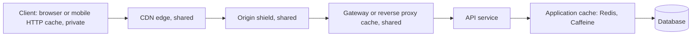
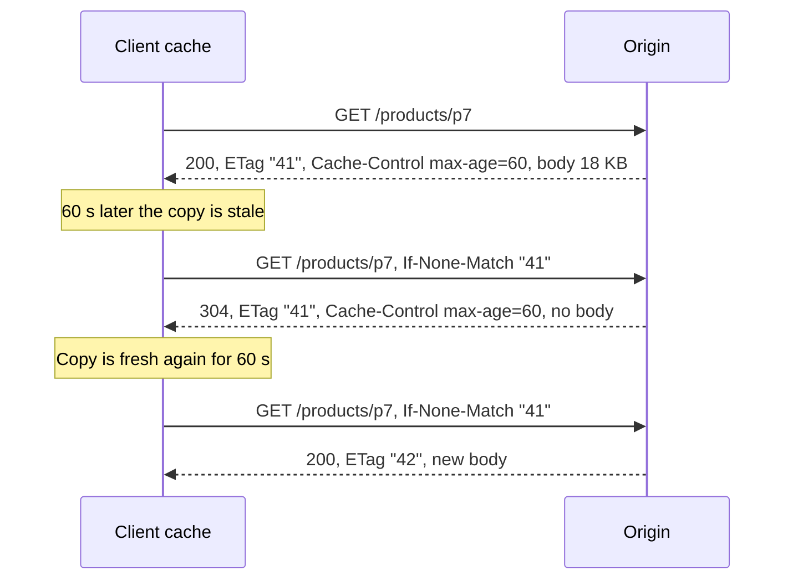
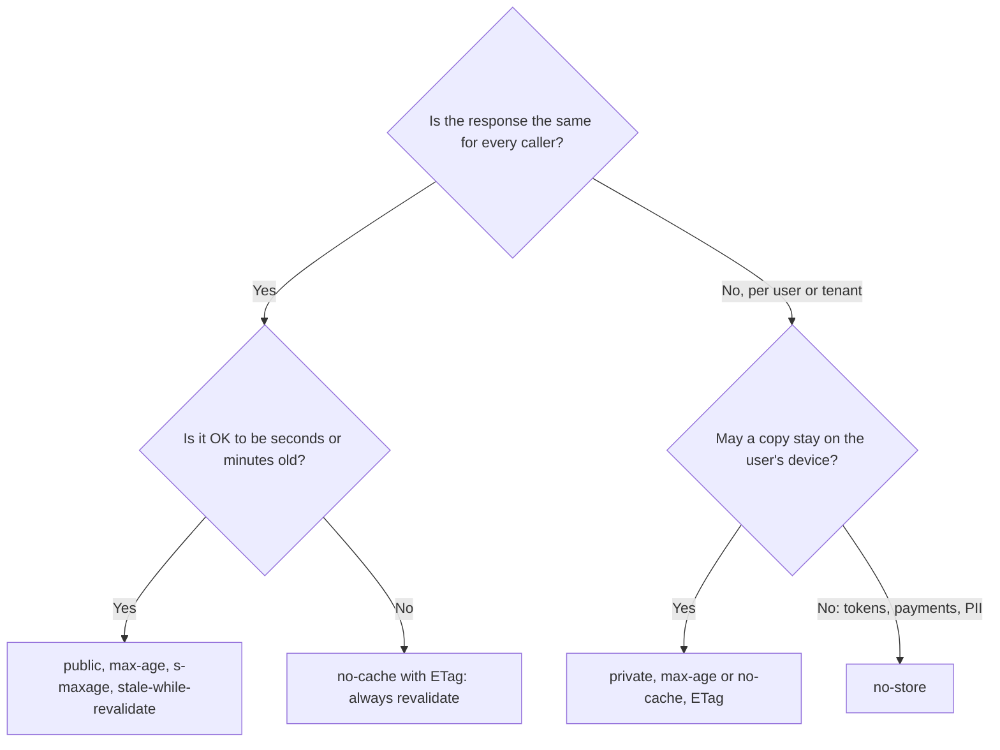
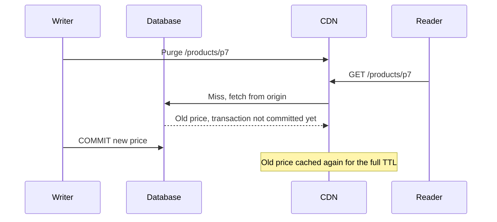

<!-- markdownlint-disable MD001 -->
<!-- markdownlint-disable MD024 -->
<!-- markdownlint-disable MD025 -->
<!-- markdownlint-disable MD026 -->
<!-- markdownlint-disable MD029 -->
<!-- markdownlint-disable MD033 -->
<!-- markdownlint-disable MD036 -->
<!-- markdownlint-disable MD040 -->
<!-- markdownlint-disable MD056 -->
<!-- markdownlint-disable MD060 -->

# R9. Caching

## Contents

| #     | Sub-topic                                                                                      |
| ----- | ---------------------------------------------------------------------------------------------- |
| R9.1  | [Why cache, and who caches](#r91-why-cache-and-who-caches)                                     |
| R9.2  | [Freshness: `Cache-Control` directives](#r92-freshness-cache-control-directives)               |
| R9.3  | [Validation: conditional `GET` and `304`](#r93-validation-conditional-get-and-304)             |
| R9.4  | [What a cache may store, and under which key](#r94-what-a-cache-may-store-and-under-which-key) |
| R9.5  | [`Vary` and the cache key](#r95-vary-and-the-cache-key)                                        |
| R9.6  | [Private vs shared caches, and personal data](#r96-private-vs-shared-caches-and-personal-data) |
| R9.7  | [CDN and gateway caching](#r97-cdn-and-gateway-caching)                                        |
| R9.8  | [Invalidation](#r98-invalidation)                                                              |
| R9.9  | [Behind the API: application caches](#r99-behind-the-api-application-caches)                   |
| R9.10 | [Choosing a policy per endpoint](#r910-choosing-a-policy-per-endpoint)                         |
| R9.11 | [Code: Spring Boot and Actix Web](#r911-code-spring-boot-and-actix-web)                        |
| R9.12 | [Story: a catalogue on sale day](#r912-story-a-catalogue-on-sale-day)                          |
| -     | [Exercises](#exercises) and [Solutions](#solutions)                                            |
| -     | [Takeaways](#takeaways)                                                                        |

## R9.1 Why cache, and who caches

Caching is the REST constraint (R1) that pays for statelessness: a response marked cacheable can be reused without asking the origin, which cuts latency, origin load and cost.  
Every layer between the user and the database may hold a copy. The origin controls all of them through response headers, so the headers are the caching design.



| Layer                      | Kind               | Controlled by                                               | Notes                                                                     |
| -------------------------- | ------------------ | ----------------------------------------------------------- | ------------------------------------------------------------------------- |
| Browser, `fetch()`         | Private HTTP cache | `Cache-Control`, `ETag`, `Vary`                             | Honours HTTP caching by default                                           |
| Mobile HTTP client         | Private HTTP cache | Same, if a cache is configured (OkHttp `Cache`, `URLCache`) | Off unless configured on many clients                                     |
| Server-side HTTP clients   | Usually none       | n/a                                                         | Java `HttpClient`, Spring `RestClient`, `reqwest` do not cache by default |
| CDN edge and origin shield | Shared HTTP cache  | `Cache-Control`, `s-maxage`, `CDN-Cache-Control`, CDN rules | Many CDNs ignore JSON until a rule enables it                             |
| Reverse proxy, gateway     | Shared HTTP cache  | Same, plus proxy config (nginx `proxy_cache`, Varnish)      | Close to the origin, often the most effective for APIs                    |
| Application cache          | Not HTTP           | Your code                                                   | Caches data, not responses (R9.9)                                         |

Two consequences for API design:

- **Service-to-service calls rarely benefit from `Cache-Control`**, because the callers' clients have no cache. Caching there is a gateway or application concern.

- **Silence is not "do not cache".** A response without explicit caching headers can still be cached heuristically (R9.2). Every API response should state its policy.

## R9.2 Freshness: `Cache-Control` directives

A cached response is **fresh** while its age is below its freshness lifetime; a fresh response may be served without contacting the origin.  
`max-age` (all caches) and `s-maxage` (shared caches only) set the lifetime.  
Once **stale**, the cache must revalidate (R9.3), unless `stale-while-revalidate` or `stale-if-error` allow serving it a little longer.  
`no-store` forbids storing at all; `no-cache` allows storing but requires revalidation on every use.

### The freshness rule (RFC 9111 §4.2)

```text
fresh  ⟺  current_age  <  freshness_lifetime

freshness_lifetime = s-maxage (shared caches) | max-age | Expires − Date | heuristic
current_age        ≈ Age header on arrival + time the response has been in this cache
```

The `Age` header carries the age accumulated in upstream caches, so a response that sat 120 s in the CDN arrives at the browser already 120 s old.

### Response directives

| Directive                  | Meaning                                                                                     | Typical use                            |
| -------------------------- | ------------------------------------------------------------------------------------------- | -------------------------------------- |
| `max-age=N`                | Fresh for N seconds in any cache                                                            | The base lifetime                      |
| `s-maxage=N`               | Overrides `max-age` in shared caches; also implies `proxy-revalidate`                       | Longer at the CDN than in browsers     |
| `public`                   | Shared caches may store it, even for requests with `Authorization`                          | Explicitly public data behind auth     |
| `private`                  | Only the end user's private cache may store it                                              | Per-user data                          |
| `no-cache`                 | May be stored, but must be revalidated with the origin before **every** use                 | Data that must be current but is large |
| `no-store`                 | Must not be stored anywhere                                                                 | Secrets, payments, tokens              |
| `must-revalidate`          | Once stale, must not be served without successful revalidation, even if the origin is down  | Correctness over availability          |
| `proxy-revalidate`         | `must-revalidate` for shared caches only                                                    | Rare                                   |
| `stale-while-revalidate=N` | For N seconds after going stale, serve stale and revalidate in the background (RFC 5861)    | Hide revalidation latency              |
| `stale-if-error=N`         | For N seconds after going stale, serve stale if the origin errors (`5xx`) or is unreachable | Survive origin outages                 |
| `immutable`                | The response will never change while fresh; do not revalidate on reload (RFC 8246)          | Versioned, content-addressed URLs      |
| `no-transform`             | Intermediaries must not change the content (recompress images, minify)                      | Signed or byte-exact payloads          |

### Request directives

| Directive        | Meaning                                                             |
| ---------------- | ------------------------------------------------------------------- |
| `no-cache`       | Revalidate with the origin; do not serve from cache unchecked       |
| `no-store`       | Do not store this request or its response                           |
| `max-age=0`      | Accept only a response whose age is 0, so effectively revalidate    |
| `max-stale=N`    | Accept a response stale by up to N seconds                          |
| `min-fresh=N`    | Accept only a response that stays fresh for at least N more seconds |
| `only-if-cached` | Answer from cache or with `504`; never contact the origin           |

Request directives are hints; caches, CDNs especially, often ignore them to protect the origin. Never depend on a client's `no-cache` for correctness.

### The confusions that cause incidents

| Belief                                           | Reality                                                                                                                                                      |
| ------------------------------------------------ | ------------------------------------------------------------------------------------------------------------------------------------------------------------ |
| `no-cache` means "do not cache"                  | It means "revalidate before each use". `no-store` means "do not cache"                                                                                       |
| No caching headers means no caching              | Heuristic caching applies to `200`, `301`, `404` and other heuristically cacheable codes (R9.4); a common heuristic is 10% of the time since `Last-Modified` |
| `private` means "secure"                         | It only keeps shared caches out; the response still sits on the user's device. Use `no-store` for secrets                                                    |
| `must-revalidate` forces revalidation every time | Only once stale. `no-cache` forces it every time                                                                                                             |
| `Expires` and `Pragma: no-cache` are needed      | `max-age` overrides `Expires`; `Pragma` is HTTP/1.0 legacy for requests. Neither is needed                                                                   |
| `max-age=0` is the same as `no-store`            | `max-age=0` allows storing and revalidating; the copy exists                                                                                                 |

## R9.3 Validation: conditional `GET` and `304`

When a cached response is stale (or marked `no-cache`), the cache asks the origin "has it changed?" by sending the stored validator: `If-None-Match` with the `ETag`, or `If-Modified-Since` with `Last-Modified`.  
If unchanged, the origin answers `304 Not Modified` with no body, and the cache refreshes its copy's freshness.  
Revalidation always costs a round trip; it saves bandwidth and, if the validator is cheap to compute, origin work.



### Rules worth knowing

- `If-None-Match` uses **weak comparison** (R8.7), so weak tags work for revalidation. That is why weak `ETag`s exist.

- `If-None-Match` takes precedence; when it is present, `If-Modified-Since` is ignored (RFC 9110 §13.2.2).

- A `304` must carry the headers a `200` would have sent among `ETag`, `Cache-Control`, `Expires`, `Vary`, `Content-Location` and `Date` (RFC 9110 §15.4.5).  
  A `304` without `Cache-Control` can leave the cache with the old policy or none.

- `Last-Modified` has one-second resolution. Two changes within a second are invisible to `If-Modified-Since`.  
  Prefer `ETag` for APIs; send both if clients already use dates.

- `304` is only for `GET` and `HEAD`. For unsafe methods a false `If-None-Match` yields `412` (R8.7).

### Shallow vs deep `ETag`

| Approach              | How the tag is computed                                  | Saves bandwidth | Saves origin work | Usable for `If-Match` writes         |
| --------------------- | -------------------------------------------------------- | --------------- | ----------------- | ------------------------------------ |
| Shallow (body hash)   | Render the full response, hash it, compare               | Yes             | No                | Only if writes compute the same hash |
| Deep (version lookup) | Read a version or change counter, compare before loading | Yes             | Yes               | Yes (R8)                             |

Spring's `ShallowEtagHeaderFilter` is the shallow kind: useful as a default for read-mostly endpoints, but the database query still runs.  
For hot endpoints, check the version first and return `304` before loading the rest.

### `ETag` for collections

A collection changes when any member is added, changed or removed. Options:

| Technique                                              | Cost                  | Pitfall                                                           |
| ------------------------------------------------------ | --------------------- | ----------------------------------------------------------------- |
| Hash of the rendered page                              | Full query and render | Saves bandwidth only                                              |
| `max(updated_at)` plus `count(*)` for the query        | One aggregate query   | Timestamp resolution; soft deletes must bump `updated_at`         |
| Per-collection change counter                          | One row read          | Must be bumped in the same transaction as every member write      |
| Per-tenant change sequence (`txid` or outbox sequence) | One row read          | Coarse: any change in the tenant invalidates every collection tag |

Include the query parameters that select the page (filter, sort, cursor) in what the tag covers; two pages must never share a tag.

## R9.4 What a cache may store, and under which key

By default only `GET` and `HEAD` responses are cached, keyed by method and full target URI (including the query string), refined by the request headers named in `Vary`.  
Some status codes are cacheable even without explicit headers. Requests carrying `Authorization` are excluded from shared caches unless the response explicitly opts in.

### Methods

| Method                   | Cacheable?                                                                                                                                                       |
| ------------------------ | ---------------------------------------------------------------------------------------------------------------------------------------------------------------- |
| `GET`, `HEAD`            | Yes                                                                                                                                                              |
| `POST`                   | Only with explicit freshness and a `Content-Location` equal to the target; practically no cache implements it. Use `GET` (or `QUERY`, below) for cacheable reads |
| `PUT`, `PATCH`, `DELETE` | No. A successful one **invalidates** the stored response for its target URI in caches it passes through (RFC 9111 §4.4)                                          |

Complex searches that do not fit in a URL are the usual reason for `POST /search`.  
The IETF HTTP working group's `QUERY` method draft defines a safe, idempotent method with a body that caches can key on the body; until it is widely deployed,  
either keep searches in `GET` query strings or create a saved-search resource (`POST /searches` returns `303` to `GET /searches/s1/results`, which is cacheable).

### Status codes cacheable by default (RFC 9110 §15.1)

`200`, `203`, `204`, `206`, `300`, `301`, `308`, `404`, `405`, `410`, `414`, `501`.

These may be cached heuristically when no freshness information is present.  
A `404` for an ID that is about to be created, cached for minutes by a CDN, is a classic incident: create the resource, and clients keep seeing `404`.  
Send `Cache-Control` explicitly on errors too: `no-store`, or a short `max-age` for deliberate negative caching.

### `Authorization` and shared caches (RFC 9111 §3.5)

A shared cache must not reuse a response to a request that carried `Authorization` unless the response contains `public`, `s-maxage` or `must-revalidate`.  
That default protects per-user data behind tokens.  
The flip side: adding `public` or `s-maxage` to an authenticated endpoint makes it shareable across users, which is correct only if the response is identical for everyone allowed to see it.

`Set-Cookie` on a cacheable response is a related hazard: some caches will store and replay the cookie to other users. Never set cookies on shared-cacheable responses.

### The cache key

```
key = method + scheme + host + path + query  (+ values of the request headers listed in Vary)
```

- `?a=1&b=2` and `?b=2&a=1` are different keys unless the CDN normalises the query.  
  Canonicalise links you generate (sorted, consistent casing) and configure query normalisation at the edge.

- Tracking parameters (`utm_source`, `fbclid`) fragment the cache; strip them from the key at the edge.

- Anything that changes the response but is not in the key (an unkeyed header such as `X-Forwarded-Host` used to build links) enables cache poisoning (R9.6).

## R9.5 `Vary` and the cache key

`Vary` lists the request headers whose values select the representation. Caches store one variant per combination of those values.  
Each header listed multiplies the variants, so `Vary` must name exactly the headers that change the response: missing one serves the wrong variant (R4.6),  
adding a high-cardinality one destroys the hit rate.

| `Vary` value      | Effect                                                     | Verdict                                                                        |
| ----------------- | ---------------------------------------------------------- | ------------------------------------------------------------------------------ |
| `Accept-Encoding` | Separate gzip, br and identity copies                      | Required when you compress; CDNs normalise it                                  |
| `Accept`          | Separate JSON and CSV copies                               | Correct with negotiation; normalise to a few media types at the edge           |
| `Accept-Language` | One copy per language string (`en-IN,en;q=0.9` vs `en-IN`) | Normalise to supported languages, or put the language in the URI               |
| `Authorization`   | One copy per token                                         | Pointless in shared caches; use `private`                                      |
| `Cookie`          | One copy per cookie string                                 | Effectively uncacheable at the edge                                            |
| `User-Agent`      | One copy per browser build                                 | Hit rate collapses; never for APIs                                             |
| `Origin`          | One copy per calling origin                                | Required if CORS headers differ by origin and the response is shared-cacheable |
| `*`               | Never matches; uncacheable                                 | Use `no-store` instead, it says what you mean                                  |

Rules:

- **Prefer the URI over `Vary`** for anything that defines the representation and has low cardinality: `/v2/...`, `/tenants/acme/...`, `?lang=hi`.

- **Normalise at the edge** before keying: collapse `Accept-Language` to a supported locale, `Accept` to a known media type.

- **CDN support for `Vary` is uneven.** Some CDNs honour only `Accept-Encoding` and treat other values as "do not cache". Check before relying on it.

- **Send the same `Vary` on every response for the URI**, `304`s included, or caches end up with inconsistent variants.

## R9.6 Private vs shared caches, and personal data

Anything specific to a user or tenant is `private` (per-device copy acceptable) or `no-store` (no copy acceptable).  
Only responses identical for every requester may be shared. The two big caching attacks, web cache deception and cache poisoning,  
both exploit a mismatch between what the cache thinks the key is and what the origin used to build the response.

### Decision



### Web cache deception

The attacker sends a victim a link such as `https://api.acme.com/me/profile/x.css`.  
The origin ignores the suffix and returns the victim's profile; the CDN sees `.css`, applies its "cache static files" rule and stores it publicly.  
The attacker then fetches the same URL from the cache.

Defences:

- Origin returns `404` for unknown path suffixes instead of ignoring them.

- Per-user responses always carry `Cache-Control: private` or `no-store`, and the CDN is configured to **respect origin headers** rather than override them by file extension.

- Do not let edge rules cache by extension on API hostnames.

### Cache poisoning

The attacker sends a request with an **unkeyed** input that the origin uses: `X-Forwarded-Host: evil.example` makes the origin build `Location` or links pointing to the attacker.  
The poisoned response is cached under the normal key and served to everyone.

Defences:

- Overwrite or strip forwarding headers at the edge (R4.6); never build absolute URLs from client-supplied headers.

- Every input that affects the response is either in the URI or in `Vary`.

- Do not cache error responses produced from malformed input for long.

## R9.7 CDN and gateway caching

Shared caches near the user remove latency; caches near the origin remove load.  
Give shared caches longer lifetimes than browsers (`s-maxage` or `CDN-Cache-Control`), collapse concurrent misses into one origin request,  
serve stale while revalidating and when the origin fails, and add an origin shield so a hundred edge locations do not each miss separately.

### Targeting each layer

```
Cache-Control:     public, max-age=30, stale-while-revalidate=30
CDN-Cache-Control: max-age=300, stale-if-error=3600
```

Browsers see 30 s; the CDN keeps it 5 minutes and up to an hour more if the origin fails.  
`CDN-Cache-Control` (RFC 9213) is read by CDNs and not passed to browsers; older CDNs use their own (`Surrogate-Control`, provider-specific headers) or `s-maxage`.

### Techniques

| Technique                   | What it does                                                         | Configured by                                                         |
| --------------------------- | -------------------------------------------------------------------- | --------------------------------------------------------------------- |
| Request collapsing          | Concurrent misses for one key wait for a single origin fetch         | CDN default on many; nginx `proxy_cache_lock on`; Varnish default     |
| `stale-while-revalidate`    | Users never wait for revalidation; one background fetch refreshes    | Header; nginx `proxy_cache_background_update on`                      |
| `stale-if-error`            | Origin outage serves stale content instead of errors                 | Header; nginx `proxy_cache_use_stale error timeout http_500 http_503` |
| Origin shield, tiered cache | Edges miss to a regional parent cache, which misses to the origin    | CDN setting                                                           |
| Negative caching            | Cache `404` and `410` briefly to absorb repeated misses and scraping | `Cache-Control: public, max-age=10` on the `404`                      |
| Cache key normalisation     | Strip tracking params, sort query, normalise `Accept-Language`       | CDN rules                                                             |
| Respect origin headers      | Edge uses the origin's `Cache-Control` instead of extension rules    | CDN rules; essential on API hosts                                     |

### Observing the cache

- `Age` shows how long a response has sat in caches.

- `Cache-Status` (RFC 9211) is the standard way for each cache to report what it did: `Cache-Status: EdgeCache; hit; ttl=240, ShieldCache; fwd=stale`. Older CDNs use `X-Cache: HIT`.

- Track **hit ratio** per route, **origin request rate**, and **bytes served from cache**.  
  A cache with 95% hits still sends 5% of traffic to the origin; at 100k req/s that is 5k req/s, and a purge that drops hits to 0% is a 20× origin spike.

## R9.8 Invalidation

Expiry (TTL) is the only invalidation every cache supports; it bounds staleness to the lifetime.  
Purging by URL or by tag shortens it, but purges are asynchronous, can fail, and race with writes.  
Design for bounded staleness first, use versioned URLs for content that never changes, and treat purges as an optimisation, issued after the write commits.

### Strategies

| Strategy                      | How                                                                                      | Staleness bound                         | Cost / risk                                                                                                      |
| ----------------------------- | ---------------------------------------------------------------------------------------- | --------------------------------------- | ---------------------------------------------------------------------------------------------------------------- |
| TTL only                      | `max-age` short enough to tolerate                                                       | The TTL                                 | None; the default                                                                                                |
| Versioned URLs                | `/assets/app.3f9c1e.js`, `/exports/2026-11-01.csv`, `immutable`                          | Zero (new URL)                          | Clients must learn the new URL                                                                                   |
| Purge by URL                  | CDN API call per changed URL                                                             | Purge latency                           | Misses variants (`?page=2`, other `Accept`), list endpoints                                                      |
| Purge by tag (surrogate keys) | Response carries tags (`Surrogate-Key: product-p7 category-c2`); purge a tag             | Purge latency                           | Vendor-specific header (Fastly `Surrogate-Key`, Cloudflare `Cache-Tag`, Akamai `Edge-Cache-Tag`, Varnish `xkey`) |
| Unsafe-method invalidation    | A successful `PUT`/`PATCH`/`DELETE` through a cache invalidates that URI (RFC 9111 §4.4) | Only in caches the write passed through | Other edges and browsers keep their copies                                                                       |
| Event-driven purge            | Change events from the outbox (R2 DD-3) drive purges                                     | Event lag plus purge                    | Reliable, ordered, retried; the usual production design                                                          |

### The purge race



Fixes:

- **Purge after commit**, driven by the outbox so the purge cannot be skipped by a crash.

- **Delayed second purge** a few seconds later, to catch readers that fetched during replication lag from a read replica.

- **Keep a TTL anyway**, so a lost purge heals itself.

### Write responses and caches

A successful unsafe request invalidates the target URI in caches on its path, and may invalidate the URIs in `Location` and `Content-Location` of the response (same origin only).  
It does not touch list resources (`/products?category=c2`) or other edges.  
Tag the list responses with the member tags if lists must update quickly, and accept TTL-bounded staleness otherwise.

## R9.9 Behind the API: application caches

An application cache (Redis, Memcached, Caffeine) stores data the service needs, not HTTP responses.  
It sits under your control, so it handles per-user and authorised data that HTTP caches cannot share.  
Use cache-aside with TTLs, delete (not update) on write after commit, coalesce concurrent misses, jitter expiries, and cache negative results briefly.

| Pattern       | Read path                                    | Write path                              | Fits                                            |
| ------------- | -------------------------------------------- | --------------------------------------- | ----------------------------------------------- |
| Cache-aside   | Read cache; on miss load from DB, fill cache | Write DB, then delete the cache entry   | Default                                         |
| Read-through  | Cache library loads on miss                  | As cache-aside                          | Caffeine `LoadingCache`, simpler code           |
| Write-through | Read cache                                   | Write cache and DB together             | Read-after-write consistency within the service |
| Write-behind  | Read cache                                   | Write cache; flush to DB asynchronously | Counters, analytics; risks data loss            |

Failure modes and fixes:

| Problem                      | What happens                                                                                | Fix                                                                                                                    |
| ---------------------------- | ------------------------------------------------------------------------------------------- | ---------------------------------------------------------------------------------------------------------------------- |
| Stampede (dogpile)           | A hot key expires; thousands of requests miss and hit the DB at once                        | Single-flight per key (Caffeine coalesces loads per JVM; a short Redis lock across nodes); early probabilistic refresh |
| Synchronised expiry          | Keys filled together expire together                                                        | Add jitter: TTL × (0.9 to 1.1)                                                                                         |
| Stale set after delete       | Reader loads old value, writer commits and deletes, reader then writes old value into cache | Short TTL bounds it; version the entry and refuse older versions; leases as in Facebook's memcache paper (NSDI 2013)   |
| Updating instead of deleting | Two writers update cache in the opposite order to the DB                                    | Delete on write; let the next read fill                                                                                |
| Penetration                  | Requests for IDs that do not exist always miss                                              | Cache "not found" for seconds; a Bloom filter for large ID spaces                                                      |
| Cache as source of truth     | Eviction or failover loses data                                                             | The database is the truth; caches are disposable                                                                       |

## R9.10 Choosing a policy per endpoint

Decide per route, from two questions: is the response the same for everyone, and how stale may it be.  
Then write the header explicitly, including on errors, and default everything else to `no-store`.

| Endpoint                                | Policy                                                                                   | Why                                                    |
| --------------------------------------- | ---------------------------------------------------------------------------------------- | ------------------------------------------------------ |
| `GET /assets/app.3f9c1e.js`             | `public, max-age=31536000, immutable`                                                    | Content-addressed; never changes                       |
| `GET /products/p7` (public catalogue)   | `public, max-age=60, stale-while-revalidate=60, stale-if-error=86400` + `ETag`, CDN tags | Same for all; a minute stale is fine; survives outages |
| `GET /products?category=c2&cursor=...`  | `public, max-age=30` + `ETag`, tag with category                                         | Lists change more; shorter TTL                         |
| `GET /fx-rates/latest`                  | `public, max-age=5, stale-while-revalidate=5`                                            | Very hot, very short; collapse at the edge             |
| `GET /me/orders`                        | `private, no-cache` + `ETag`                                                             | Per user; must be current; `304` saves bandwidth       |
| `GET /me/profile` on a shared kiosk app | `no-store`                                                                               | No copy may remain on the device                       |
| `POST /payments`, `GET /payments/{id}`  | `no-store`                                                                               | Financial data                                         |
| `POST /oauth/token`                     | `no-store` (required by OAuth 2.0)                                                       | Tokens                                                 |
| `404` for a public resource             | `public, max-age=10`                                                                     | Short negative cache                                   |
| `404` for a per-user resource           | `no-store` or `private, max-age=0`                                                       | Do not keep "does not exist" around                    |
| `5xx`                                   | `no-store`                                                                               | Never cache failures                                   |
| Anything else (the default)             | `no-store`                                                                               | Opt in to caching, never opt out                       |

## R9.11 Code: Spring Boot and Actix Web

### Spring Boot

**Public catalogue item with a deep `ETag`: check before loading**

```java
@GetMapping("/v1/products/{id}")
public ResponseEntity<ProductResponse> get(@PathVariable String id, WebRequest request) {
    long version = products.version(id).orElseThrow(NotFound::new);           // one indexed read
    String etag = ETags.of(version);                                          // R8.11 helper: "\"" + version + "\""

    CacheControl policy = CacheControl.maxAge(Duration.ofSeconds(60))
            .cachePublic()
            .staleWhileRevalidate(Duration.ofSeconds(60))
            .staleIfError(Duration.ofDays(1));

    if (request.checkNotModified(etag)) {                                    // sets 304 and ETag on a match
        return ResponseEntity.status(HttpStatus.NOT_MODIFIED).cacheControl(policy).eTag(etag).build();
    }
    Product p = products.load(id);                                            // the expensive part
    return ResponseEntity.ok()
            .cacheControl(policy)
            .eTag(etag)
            .header("Surrogate-Key", "product-" + id + " category-" + p.categoryId())
            .body(ProductResponse.from(p));
}
```

`checkNotModified` applies weak comparison for `If-None-Match` and also handles `If-Modified-Since` if you pass a timestamp.  
Returning a `ResponseEntity` that already has an `ETag` also triggers Spring MVC's automatic `304` for `GET`, but only after the body was built; the explicit check is what saves the database work.

**Per-user data**

```java
@GetMapping("/v1/me/orders")
public ResponseEntity<Page<OrderSummary>> myOrders(@AuthenticationPrincipal Jwt me, WebRequest request) {
    String etag = ETags.of(orders.changeCounter(me.getSubject()));            // bumped in every order write
    if (request.checkNotModified(etag)) {
        return ResponseEntity.status(HttpStatus.NOT_MODIFIED)
                .cacheControl(CacheControl.noCache().cachePrivate()).eTag(etag).build();
    }
    return ResponseEntity.ok()
            .cacheControl(CacheControl.noCache().cachePrivate())                // private, no-cache
            .eTag(etag)
            .body(orders.recentFor(me.getSubject()));
}
```

**Default to `no-store` for every API response that did not choose**

```java
@Component
public class DefaultCachePolicyFilter extends OncePerRequestFilter {
    @Override
    // Bodiless responses (204, 304) never call getOutputStream; set their policy explicitly in the controller.
    protected void doFilterInternal(HttpServletRequest req, HttpServletResponse res, FilterChain chain)
            throws ServletException, IOException {
        chain.doFilter(req, new HttpServletResponseWrapper(res) {
            private boolean set = false;
            @Override public void setHeader(String n, String v) { if (HttpHeaders.CACHE_CONTROL.equalsIgnoreCase(n)) set = true; super.setHeader(n, v); }
            @Override public void addHeader(String n, String v) { if (HttpHeaders.CACHE_CONTROL.equalsIgnoreCase(n)) set = true; super.addHeader(n, v); }
            @Override public ServletOutputStream getOutputStream() throws IOException { defaultIfUnset(); return super.getOutputStream(); }
            @Override public PrintWriter getWriter() throws IOException { defaultIfUnset(); return super.getWriter(); }
            private void defaultIfUnset() { if (!set && !isCommitted()) super.setHeader(HttpHeaders.CACHE_CONTROL, "no-store"); }
        });
    }
}
```

With Spring Security on the classpath you already get a default: its `CacheControlHeadersWriter` adds `Cache-Control: no-cache, no-store, max-age=0, must-revalidate`  
(plus `Pragma` and `Expires`) unless the response has set its own `Cache-Control`.  
That is a safe default; the filter above gives the same guarantee without Spring Security, with a single `no-store`.

**Shallow `ETag` for read-mostly endpoints that are not worth a deep tag**

```java
@Bean
FilterRegistrationBean<ShallowEtagHeaderFilter> shallowEtag() {
    FilterRegistrationBean<ShallowEtagHeaderFilter> reg = new FilterRegistrationBean<>(new ShallowEtagHeaderFilter());
    reg.addUrlPatterns("/v1/reference-data/*");                              // saves bandwidth, not queries
    return reg;
}
```

**Application cache with coalesced loads (Caffeine)**

```java
private final LoadingCache<String, Product> cache = Caffeine.newBuilder()
        .maximumSize(100_000)
        .expireAfterWrite(Duration.ofSeconds(55 + ThreadLocalRandom.current().nextInt(10)))   // per-cache jitter
        .refreshAfterWrite(Duration.ofSeconds(30))                       // refresh hot keys in the background
        .build(products::load);                                          // concurrent misses for one key share one load

public Product product(String id) { return cache.get(id); }

@TransactionalEventListener(phase = TransactionPhase.AFTER_COMMIT)       // delete only after the write commits
public void on(ProductChanged e) { cache.invalidate(e.productId()); }
```

The jitter here is per cache instance; for per-entry jitter use `expireAfter(Expiry)`.  
Across nodes, each JVM still loads once on its own; a shared Redis layer needs its own single-flight lock.

### Actix Web

**Conditional `GET` with typed headers**

```rust
use actix_web::http::header::{CacheControl, CacheDirective, ETag, EntityTag, IfNoneMatch};

fn public_policy() -> CacheControl {
    CacheControl(vec![
        CacheDirective::Public,
        CacheDirective::MaxAge(60),
        CacheDirective::Extension("stale-while-revalidate".into(), Some("60".into())),
        CacheDirective::Extension("stale-if-error".into(), Some("86400".into())),
    ])
}

/// Weak comparison, as RFC 9110 requires for If-None-Match.
fn not_modified(req: &HttpRequest, current: &EntityTag) -> bool {
    match req.get_header::<IfNoneMatch>() {
        Some(IfNoneMatch::Any) => true,
        Some(IfNoneMatch::Items(tags)) => tags.iter().any(|t| t.weak_eq(current)),
        None => false,
    }
}

#[get("/v1/products/{id}")]
async fn get_product(req: HttpRequest, db: web::Data<PgPool>, id: web::Path<String>) -> Result<HttpResponse, ApiError> {
    let id = id.into_inner();
    let version: i64 = sqlx::query_scalar("SELECT version FROM products WHERE id = $1")
        .bind(&id).fetch_optional(db.get_ref()).await?
        .ok_or(ApiError::NotFound)?;
    let tag = EntityTag::new_strong(version.to_string());

    if not_modified(&req, &tag) {
        return Ok(HttpResponse::NotModified()                              // 304 repeats ETag and Cache-Control
            .insert_header(ETag(tag))
            .insert_header(public_policy())
            .finish());
    }

    let p = load_product(&db, &id).await?;                                 // the expensive part
    Ok(HttpResponse::Ok()
        .insert_header(ETag(tag))
        .insert_header(public_policy())
        .insert_header(("Surrogate-Key", format!("product-{} category-{}", p.id, p.category_id)))
        .json(ProductResponse::from(p)))
}
```

`req.get_header::<H>()` (from the `HttpMessage` trait) returns `None` when the header is absent or unparsable, which is the right behaviour for an optional precondition.

**Per-user policy**

```rust
fn private_no_cache() -> CacheControl {
    CacheControl(vec![CacheDirective::Private, CacheDirective::NoCache])
}
```

**Default to `no-store` for every API response that did not choose**

```rust
use actix_web::{body::MessageBody, dev::{ServiceRequest, ServiceResponse}, middleware::Next, http::header};

async fn default_no_store(
    req: ServiceRequest,
    next: Next<impl MessageBody>,
) -> Result<ServiceResponse<impl MessageBody>, actix_web::Error> {
    let mut res = next.call(req).await?;
    if !res.headers().contains_key(header::CACHE_CONTROL) {
        res.headers_mut().insert(header::CACHE_CONTROL, header::HeaderValue::from_static("no-store"));
    }
    Ok(res)
}

// App::new().wrap(actix_web::middleware::from_fn(default_no_store))
```

**Application cache with coalesced loads (`moka`)**

```rust
let cache: moka::future::Cache<String, Arc<Product>> = moka::future::Cache::builder()
    .max_capacity(100_000)
    .time_to_live(Duration::from_secs(60))
    .build();

async fn product(cache: &Cache<String, Arc<Product>>, db: &PgPool, id: &str) -> Result<Arc<Product>, ApiError> {
    cache.try_get_with(id.to_owned(), async { load_product(db, id).await.map(Arc::new) })   // one load per key at a time
        .await
        .map_err(|e: Arc<ApiError>| ApiError::Internal(anyhow::anyhow!("{e}")))
}
```

`try_get_with` runs the loader once for concurrent callers of the same key; the others await its result. Errors are not cached.

## R9.12 Story: a catalogue on sale day

An e-commerce catalogue API at 00:00 on the first day of a festive sale. Traffic is 40× normal.

| #   | Moment                                                  | What the caching design did                                                                                                             | Mechanism        |
| --- | ------------------------------------------------------- | --------------------------------------------------------------------------------------------------------------------------------------- | ---------------- |
| 1   | 2 million users open the home page in one minute        | Product and category responses served from 300 CDN edges; origin shield turned 300 misses per key into 1                                | R9.7             |
| 2   | A hot product's CDN copy expires                        | `stale-while-revalidate` served the old copy; request collapsing sent one revalidation; the origin answered `304` from a version lookup | R9.2, R9.3, R9.7 |
| 3   | Merchandising drops a price at 00:05                    | The outbox event purged tags `product-p7` and `category-c2` after commit, plus a second purge 5 s later                                 | R9.8             |
| 4   | Users check "my orders" repeatedly                      | `private, no-cache` with a per-user change counter: most calls were `304`, no order query ran                                           | R9.3, R9.6       |
| 5   | The pricing database fails over for 90 s                | `stale-if-error` kept product pages up; checkout (`no-store`) degraded with `503` and `Retry-After` instead                             | R9.2, R8.4       |
| 6   | A bot scrapes non-existent product IDs                  | `404` cached publicly for 10 s; the application cache stored "not found" for 5 s; the database saw almost nothing                       | R9.4, R9.9       |
| 7   | A marketing link adds `?utm_source=sms` to product URLs | The edge stripped tracking parameters from the cache key; hit rate unaffected                                                           | R9.4             |

What made it work:

- Every route had an explicit policy, and the default was `no-store`.
- Public and personal data were separated by policy, not by luck.
- Revalidation was cheap because tags were versions, not body hashes.
- Purges were after commit, retried, and backed by TTLs.

## Exercises

**1. Pick the headers.** Give `Cache-Control` (and `ETag`, `Vary` where relevant) for:

- a) `GET /v1/countries` (changes a few times a year)
- b) `GET /v1/me/notifications`
- c) `GET /v1/stock-quotes/INFY` (updates every second; thousands of readers)
- d) `GET /v1/reports/2026-10.pdf` (generated once, never changes)
- e) `GET /v1/products/p7`, served as JSON or CSV via `Accept`
- f) `POST /v1/oauth/token`

**2. Freshness math.** A CDN stored a response with `Cache-Control: max-age=300, stale-while-revalidate=60` and `Age: 0`.  
  A browser fetches it from the CDN 200 s after it was stored; the CDN adds `Age: 200`.

- a) For how long is it fresh in the browser?

- b) At what CDN-side age does the CDN start revalidating, and until when may it serve stale while doing so?

- c) The origin's response also had `s-maxage=600`. Redo a) and b).

**3. Leak.** Users report seeing another user's name and address on `GET /v1/me/profile` in the mobile app, but only on mobile data, not on Wi-Fi.  
  The response had no `Cache-Control` header and the API sits behind a CDN with a rule "cache everything for 5 minutes".  
  Explain the possible causes, and fix the API and the infrastructure.

**4. Purge race.** The price service writes a new price, then calls the CDN purge API, then commits.  
  Reads come from a read replica with up to 2 s of lag.  
  Describe two ways stale prices stay cached for the full TTL, and design a correct flow.

**5. Hit rate collapse.** After a release, the CDN hit ratio on `/v1/products/*` fell from 92% to 4%.  
  The diff shows three changes: responses now include `Vary: Accept-Language, User-Agent`;  
  the web app appends `?t=<timestamp>` to every request "to avoid stale data";  
  and the server now sets a `Set-Cookie: ab_bucket=...` on every response. Explain each effect and fix it.

**6. Cheap `304` for a list.** `GET /v1/tenants/{t}/invoices?status=open&sort=-dueDate` is polled every 10 s by dashboards of 5,000 tenants.  
  Most polls see no change. Design the `ETag` and caching policy so an unchanged poll costs one cheap read and no body.

## Solutions

### Solution 1

| #   | Headers                                                                                                                                                       | Reason                                                                                                                 |
| --- | ------------------------------------------------------------------------------------------------------------------------------------------------------------- | ---------------------------------------------------------------------------------------------------------------------- |
| a   | `public, max-age=86400, stale-while-revalidate=86400` + `ETag`                                                                                                | Same for everyone, rarely changes; a day stale is fine; purge on the rare change                                       |
| b   | `private, no-cache` + `ETag` (or `no-store` if notifications contain sensitive content)                                                                       | Per user and must be current; `304` saves bandwidth                                                                    |
| c   | `public, max-age=1, stale-while-revalidate=1` at the CDN, with request collapsing                                                                             | One origin fetch per second per key, regardless of readers; for true real-time use a stream (SSE or WebSocket) instead |
| d   | `public, max-age=31536000, immutable` if the report is public; `private, max-age=31536000, immutable` if not                                                  | The URL names a fixed month; it never changes                                                                          |
| e   | `public, max-age=60` + per-representation `ETag` (`"42-json"`, `"42-csv"`) + `Vary: Accept`; or move format into the URI (`/products/p7.csv`) and drop `Vary` | Two representations of one URI must not share a cache entry or a strong tag                                            |
| f   | `no-store`                                                                                                                                                    | Tokens must never be stored; OAuth 2.0 requires it                                                                     |

### Solution 2

**a)** The response arrives with `Age: 200`; lifetime 300 s, so it is fresh in the browser for **100 s** more.  
  After that, the browser may serve it stale for up to 60 s while revalidating in the background.

**b)** The CDN's copy goes stale at age **300 s**.  
  From 300 s to **360 s** it serves stale and revalidates in the background. After 360 s, a request must wait for revalidation.

**c)** `s-maxage` applies only to shared caches, so the CDN's copy is fresh until age **600 s** and may be served stale while revalidating until **660 s**.  
  The browser is unchanged: it applies `max-age=300` to the `Age` it receives, so arriving with `Age: 200` it is fresh for **100 s**.

The side effect: once the CDN copy is older than 360 s, every browser receives a response that is already past its own freshness and stale-while-revalidate window on arrival,  
so browsers revalidate on every use. That is cheap (the CDN answers from its fresh copy) but surprising.  
If browsers should count their lifetime from when they received the response, give the CDN its lifetime through `CDN-Cache-Control` and keep `Cache-Control` for browsers.

### Solution 3

Causes:

- The CDN rule overrode the origin's (absent) policy and cached `/v1/me/profile` by URL.  
  The URL is the same for every user, so the first user's profile was served to everyone hitting that edge for 5 minutes.

- Mobile networks often route through carrier proxies or different CDN points of presence, and Wi-Fi users may have hit edges where the rule did not apply, or happened to miss;  
  either way the difference is about which shared cache was in the path.

- Even without the rule, a response with no `Cache-Control` is open to heuristic caching (R9.2).

Fixes:

| Layer    | Fix                                                                                                                         |
| -------- | --------------------------------------------------------------------------------------------------------------------------- |
| API      | `Cache-Control: private, no-cache` (or `no-store`) on every per-user response; default `no-store` filter                    |
| CDN      | Respect origin headers on API hosts; never "cache everything"; never cache requests with `Authorization` or session cookies |
| Purge    | Purge `/v1/me/*` immediately after the fix                                                                                  |
| Test     | A CI check that every route declares a policy; an end-to-end test with two users through the CDN                            |
| Incident | Treat as a data breach: identify the window, the affected users, and notify as required                                     |

### Solution 4

Two ways it stays stale:

1. **Purge before commit.** Between the purge and the commit, a reader misses, the origin reads the old committed price, and the CDN caches it for a full TTL.  
2. **Replica lag.** Even with purge after commit, a reader that misses within 2 s may read the old price from a lagging replica, and the CDN caches that.

Correct flow:

```text
1. Write the new price and an outbox event in one transaction. COMMIT.
2. The outbox relay purges tags product-p7 and category-c2 (retried until it succeeds).
3. The relay schedules a second purge of the same tags after the maximum replica lag (for example, 5 s).
4. Keep TTLs short enough (60 s) that a missed purge heals on its own.
5. Optionally, origin reads for cache fills go to the primary, or wait until the replica has replayed the event's LSN.
```

### Solution 5

| Change                         | Effect                                                                                                      | Fix                                                                                                                          |
| ------------------------------ | ----------------------------------------------------------------------------------------------------------- | ---------------------------------------------------------------------------------------------------------------------------- |
| `Vary: User-Agent`             | One cache entry per browser build string: thousands of variants per URL                                     | Remove; the response does not depend on the user agent                                                                       |
| `Vary: Accept-Language`        | One entry per raw header string (`en-IN,en;q=0.9,hi;q=0.8` and so on)                                       | Normalise to supported locales at the edge, or put the locale in the URI                                                     |
| `?t=<timestamp>`               | Every request has a unique URL, so every request misses                                                     | Remove; if the app needs current data, the API should set the right `max-age` or `no-cache`; or strip `t` from the cache key |
| `Set-Cookie` on every response | Many CDNs refuse to cache responses that set cookies; the ones that do may hand one user's cookie to others | Set the A/B cookie only on HTML or a dedicated endpoint, never on shared-cacheable API responses                             |

### Solution 6

- **Change counter.** Table `tenant_invoice_changes (tenant_id PK, seq bigint)`, incremented in the same transaction as every invoice insert, update or delete for that tenant.
- **Tag.** `ETag: W/"<seq>-<hash of the normalised query>"`.  
  The query hash keeps different filters and sorts from sharing a tag; weak is fine because it is only used for `If-None-Match`.
- **Flow.** Read `seq` by primary key (sub-millisecond), compute the tag, compare with `If-None-Match`; on a match return `304` with the same `ETag` and `Cache-Control`.  
  Only on a mismatch run the list query.
- **Policy.** `Cache-Control: private, no-cache` (tenant data, must be current).  
  Dashboards' browsers revalidate every poll, and almost every poll is a `304` with no body and one key lookup.

- **Optional.** Cache `seq` per tenant in the application cache for 1 s to absorb bursts; replace polling with server-sent events if 10 s is still too slow or too costly.

## Takeaways

- Headers are the caching design. State a policy on every response, errors included, and default to `no-store`; silence invites heuristic caching.

- Freshness (`max-age`, `s-maxage`) lets caches answer without asking; validation (`ETag`, `If-None-Match`, `304`) makes asking cheap.  
  `stale-while-revalidate` hides revalidation; `stale-if-error` hides outages.

- `no-cache` means revalidate, `no-store` means do not store, `private` keeps shared caches out but not the device.

- Deep `ETag`s (versions, change counters) save origin work; shallow body hashes save only bandwidth.  
  A `304` repeats `ETag`, `Cache-Control` and `Vary`.

- The cache key is the URI plus `Vary`.  
  Put representation choices in the URI where possible, normalise what must vary, and never vary on `User-Agent`, `Cookie` or `Authorization` at the edge.

- Per-user data is `private` or `no-store`. Web cache deception and cache poisoning come from edges that ignore origin headers or key on less than the origin uses.

- At the edge: longer shared lifetimes (`s-maxage`, `CDN-Cache-Control`), request collapsing, an origin shield, short negative caching, and `Cache-Status` for observability.

- Invalidation: TTL bounds staleness, versioned URLs avoid it, tag purges shorten it.  
  Purge after commit via the outbox, purge again after replica lag, and keep the TTL.

- Application caches hold data, not responses: cache-aside, delete after commit, single-flight loads, jittered expiry, brief negative caching.

---
