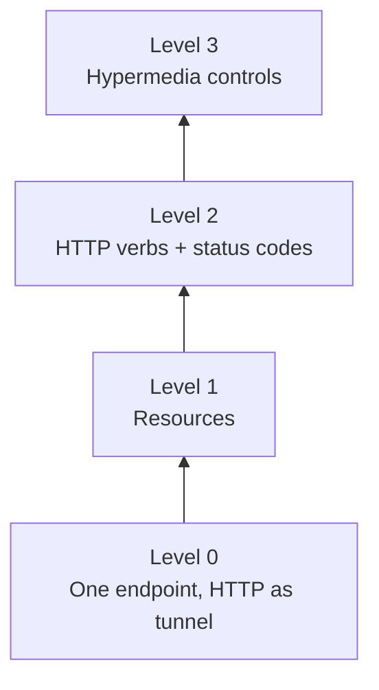

<!-- markdownlint-disable MD001 -->
<!-- markdownlint-disable MD024 -->
<!-- markdownlint-disable MD025 -->
<!-- markdownlint-disable MD026 -->
<!-- markdownlint-disable MD029 -->
<!-- markdownlint-disable MD033 -->
<!-- markdownlint-disable MD036 -->
<!-- markdownlint-disable MD040 -->
<!-- markdownlint-disable MD056 -->
<!-- markdownlint-disable MD060 -->

# R1. Foundations

## Contents

| #    | Sub-topic                                                                                                             |
| ---- | --------------------------------------------------------------------------------------------------------------------- |
| R1.1 | [API contracts; RPC vs REST vs GraphQL vs gRPC](#r11-api-contracts-rpc-vs-rest-vs-graphql-vs-grpc)                    |
| R1.2 | [Fielding's dissertation: REST as an architectural style](#r12-fieldings-dissertation-rest-as-an-architectural-style) |
| R1.3 | [The six constraints](#r13-the-six-constraints)                                                                       |
| R1.4 | [Richardson Maturity Model](#r14-richardson-maturity-model)                                                           |
| R1.5 | [Hello world and the request lifecycle](#r15-hello-world-and-the-request-lifecycle)                                   |
| -    | [Exercises, answers and review](#exercises-answers-and-review)                                                        |

---

## R1.1 API contracts; RPC vs REST vs GraphQL vs gRPC

### The contract

An API contract is everything a client may rely on.

| Layer          | Examples                                                        |
| -------------- | --------------------------------------------------------------- |
| Shape          | Operations, URIs, fields, types, required vs optional           |
| Semantics      | What a call does, error cases, idempotency, ordering            |
| Non-functional | Latency, rate limits, size limits, availability                 |
| Evolution      | What may change silently, how breaking changes are announced    |

Contracts are **explicit** (OpenAPI, `.proto`, GraphQL SDL) or **implicit**.

**Hyrum's Law:** with enough users, every observable behaviour becomes part of the contract, documented or not (field order, timing, error text). Keep the implicit surface small.

### Unit of abstraction per style

- **RPC** (JSON-RPC, SOAP, Thrift): the unit is an *operation* (`getOrder(42)`).  
  Usually everything is `POST /rpc`, so intermediaries see opaque payloads: no caching, no safe retries, no read/write distinction.

- **REST**: the unit is a *resource* manipulated through a fixed, uniform verb set (`GET /orders/42`). Intermediaries understand semantics.  
  Cost: over- and under-fetching.

- **GraphQL**: the unit is a *typed graph*; the client selects fields through one endpoint.  
  Costs: weak HTTP caching (mostly `POST`), `200` with an `errors` array, N+1 resolvers without DataLoader, and the need for query cost and depth limits.

- **gRPC**: RPC over HTTP/2 with protobuf. Binary, generated code, strict schema, four streaming modes, deadline propagation, multiplexing.  
  Costs: gRPC-Web needed for browsers, not human-readable, opaque to gateways and caches.

| Aspect        | RPC              | REST               | GraphQL                 | gRPC                         |
| ------------- | ---------------- | ------------------ | ----------------------- | ---------------------------- |
| Unit          | Operation        | Resource           | Field graph             | Operation                    |
| Use of HTTP   | Tunnel           | Semantics          | Tunnel                  | HTTP/2 framing               |
| HTTP caching  | No               | Yes                | Weak                    | No                           |
| Schema        | Optional         | Optional (OpenAPI) | Mandatory               | Mandatory                    |
| Streaming     | No               | Limited (SSE)      | Subscriptions           | Native                       |
| Best fit      | Simple internal  | Public, domain CRUD| Many client shapes, BFF | Internal service-to-service  |

### Misconceptions

- "REST = JSON over HTTP." REST is a set of constraints; JSON is one representation.

- `POST /api/createOrder` is RPC wearing REST clothes (maturity level 0).

- "gRPC runs on HTTP, so it is RESTful." It uses HTTP/2 as transport, not its method semantics.

### Same read, two styles

```text
RPC:   POST /api/getOrder    {"orderId": "42"}
REST:  GET  /orders/42
```

**Spring Boot**

```java
@RestController
@RequestMapping("/orders")
class OrderController {

    private final OrderService service;

    OrderController(OrderService service) { this.service = service; }

    @GetMapping("/{id}")
    ResponseEntity<OrderDto> get(@PathVariable String id) {
        return service.find(id)
                .map(ResponseEntity::ok)                      // 200 + body
                .orElse(ResponseEntity.notFound().build());   // 404
    }
}
```

**Actix Web**

```rust
#[get("/orders/{id}")]
async fn get_order(id: web::Path<String>, svc: web::Data<OrderService>) -> impl Responder {
    match svc.find(&id) {
        Some(order) => HttpResponse::Ok().json(order),   // Order: serde::Serialize
        None => HttpResponse::NotFound().finish(),
    }
}
// App::new().app_data(web::Data::new(svc)).service(get_order)
```

The handlers are nearly identical.  
The difference is what the rest of the system can infer: every CDN, browser and gateway knows `GET /orders/42` is safe, cacheable and retryable.

### Interview angle

Choose by consumer, not fashion:

- Public or third-party: **REST** (ubiquity, tooling, cacheability).
- Internal, high-throughput, polyglot: **gRPC** (schema, efficiency, streaming, deadlines).
- Many front ends with divergent data needs: **GraphQL** as a BFF.
- Real systems mix them: gRPC inside, REST at the edge, GraphQL for apps.

## R1.2 Fielding's dissertation: REST as an architectural style

### Origin

Roy Fielding, PhD dissertation, UC Irvine, 2000: *Architectural Styles and the Design of Network-based Software Architectures*, chapter 5.  
Fielding co-authored HTTP/1.1 and the URI specs; REST is the model used to guide them.

### Style, not protocol

An **architectural style** is a named set of constraints; each constraint trades freedom for a property. Fielding starts from the null style and adds constraints one by one.

| Property                  | Why the Web needed it                                     |
| ------------------------- | --------------------------------------------------------- |
| Anarchic scalability      | Millions of uncoordinated clients and servers             |
| Independent evolvability  | Clients and servers deploy on separate schedules for decades |
| Latency hiding            | Caches and intermediaries absorb load and distance        |
| Generality of interfaces  | Any client can talk to any server without bespoke code    |
| Visibility                | Intermediaries understand a request without the application |

REST is not a protocol, format or framework. HTTP is its most successful implementation; a system can use HTTP and still violate REST.

### Vocabulary

- **Resource**: any nameable concept. Formally a mapping that can change over time.  
  "Latest release" and "release 1.2" are two resources that may share a value today and diverge tomorrow.

- **Resource identifier**: the URI. It names the concept, not a file or a row.

- **Representation**: bytes plus metadata (media type, language, encoding) capturing state at a moment.  
  One resource, many representations.

- **Representational State Transfer**: clients exchange representations, never resources. Application state advances by following links in representations (HATEOAS, R12).

### Fielding's own trade-off

REST is optimized for **large-grained hypermedia transfer**.  
It is deliberately less efficient for fine-grained, chatty interaction. GraphQL and gRPC attack exactly that cost.

### Misconceptions

- "REST is CRUD over tables." Resources are domain concepts; representations are decoupled from storage.

- "A URI is a file path." It is an opaque identifier; clients should follow links rather than construct URIs.

- Fielding, 2008: *"REST APIs must be hypertext-driven."* Most "REST APIs" are HTTP APIs at maturity level 2. Acceptable, if labelled honestly.

### One resource, two representations

**Spring Boot**

```java
@GetMapping(value = "/orders/{id}", produces = MediaType.APPLICATION_JSON_VALUE)
OrderDto asJson(@PathVariable String id) { return service.get(id); }

@GetMapping(value = "/orders/{id}", produces = "text/csv")
String asCsv(@PathVariable String id) { return CsvMapper.toCsv(service.get(id)); }
// Handler chosen by the Accept header; anything else gets 406
```

**Actix Web**

```rust
#[get("/orders/{id}")]
async fn get_order(req: HttpRequest, id: web::Path<String>, svc: web::Data<OrderService>) -> HttpResponse {
    let order = svc.get(&id);
    let accept = req.headers().get(header::ACCEPT).and_then(|v| v.to_str().ok()).unwrap_or("*/*");
    if accept.contains("text/csv") {
        HttpResponse::Ok().content_type("text/csv").body(order.to_csv())
    } else {
        HttpResponse::Ok().json(order)
    }
}
```

### Interview angle

"Is your API RESTful?" Name the constraints honoured and broken, and why. Example: "Stateless, cacheable, uniform interface, no hypermedia.  
Level 2, because clients are generated SDKs and hypermedia would add payload without changing their behaviour."

## R1.3 The six constraints

| #  | Constraint         | Buys                                                          | Costs                                    |
| -- | ------------------ | ------------------------------------------------------------- | ---------------------------------------- |
| 1  | Client-server      | Independent evolution of UI and backend; simpler servers       | A network hop per interaction            |
| 2  | Stateless          | Horizontal scale, trivial failover, visibility, reliability    | Repeated context per request, larger messages |
| 3  | Cacheable          | Latency hiding, origin offload, scale                         | Staleness risk; correctness needs R9     |
| 4  | Uniform interface  | Generality, visibility to every intermediary                   | Not optimal for any one application      |
| 5  | Layered system     | Insert LB, CDN, gateway, WAF, TLS termination transparently   | A latency hop per layer                  |
| 6  | Code on demand (optional) | Client extensibility after deployment                  | Reduced visibility; rarely used in JSON APIs |

### Stateless, precisely

It forbids **session** state on the server, not **resource** state. Orders in a database are fine; an in-memory cart keyed by session id is not.

Typical violations: sticky sessions, in-memory pagination cursors, server-side wizard state.

### Uniform interface, four sub-constraints

| Sub-constraint                        | Meaning                                                        |
| ------------------------------------- | -------------------------------------------------------------- |
| Identification of resources           | Every resource has a URI                                       |
| Manipulation through representations  | State changes by sending representations, not calling procedures |
| Self-descriptive messages             | Method, status, media type and headers suffice to process the message |
| HATEOAS                               | Representations carry links to next valid actions              |

### How they compound

Stateless makes layering safe, layering makes caching deployable, and the uniform interface makes all of it generic.  
Break statelessness and your load balancer, CDN and retry logic all become application-specific.

### Stateless and cacheable in code

**Spring Boot**

```java
@Bean
SecurityFilterChain api(HttpSecurity http) throws Exception {
    return http
            .sessionManagement(s -> s.sessionCreationPolicy(SessionCreationPolicy.STATELESS))  // no HttpSession
            .oauth2ResourceServer(o -> o.jwt(Customizer.withDefaults()))                      // token on every request
            .build();
}

@GetMapping("/products/{id}")
ResponseEntity<ProductDto> product(@PathVariable String id) {
    return ResponseEntity.ok()
            .cacheControl(CacheControl.maxAge(Duration.ofMinutes(5)).cachePublic())          // labelled cacheable
            .body(service.get(id));
}
```

**Actix Web**

```rust
// AuthUser implements FromRequest: validates Authorization on every call, no server session
#[get("/products/{id}")]
async fn product(_user: AuthUser, id: web::Path<String>, svc: web::Data<Catalog>) -> HttpResponse {
    HttpResponse::Ok()
        .insert_header((header::CACHE_CONTROL, "public, max-age=300"))
        .json(svc.get(&id))
}
```

### Interview angle

"Sessions are in memory; scale from 1 to 10 nodes."  
Name the violated constraint (statelessness), the options (sticky sessions, external session store, self-contained tokens), pick one, and state its price.

## R1.4 Richardson Maturity Model

Leonard Richardson, QCon 2008; popularized by Martin Fowler, 2010. A ladder of how much of the Web's machinery an HTTP API uses.  
Not a definition of REST: by Fielding's definition only level 3 qualifies.



### The ladder on one domain: booking a doctor's slot

**Level 0**

```text
POST /appointmentService   {"action": "openSlots", "doctor": "mjones", "date": "2026-10-20"}
POST /appointmentService   {"action": "book", "slot": 1234, "patient": "jsmith"}
→ 200 OK always; errors in the body
```

**Level 1**

```text
POST /doctors/mjones   {"action": "openSlots", "date": "2026-10-20"}
POST /slots/1234       {"action": "book", "patient": "jsmith"}
```

**Level 2**

```text
GET  /doctors/mjones/slots?date=2026-10-20&status=open   → 200
POST /slots/1234/appointment  {"patient": "jsmith"}      → 201 Created, Location: /appointments/987
                                                         → 409 Conflict if already taken
```

**Level 3**

```json
{
  "slotId": 1234,
  "start": "2026-10-20T14:00",
  "_links": {
    "self": { "href": "/slots/1234" },
    "book": { "href": "/slots/1234/appointment" }
  }
}
```

| Level | Adds                  | Buys                                                              |
| ----- | --------------------- | ----------------------------------------------------------------- |
| 0     | HTTP as transport     | Reachability only                                                 |
| 1     | Resources             | One URI per concept                                               |
| 2     | Verbs, status codes   | Safety, idempotency, caching, generic error handling              |
| 3     | Hypermedia            | Discoverability; no hard-coded URIs or workflow rules in clients  |

### The non-obvious point

At level 3, **link presence encodes state and permission**.  
If the slot is taken or the user may not book, the `book` link is absent.  
The client checks for the link instead of re-implementing business rules, which can then change server-side without a client release.

### Level 3 in code

**Spring Boot (Spring HATEOAS)**

```java
@GetMapping("/slots/{id}")
EntityModel<SlotDto> slot(@PathVariable long id) {
    SlotDto slot = service.get(id);
    EntityModel<SlotDto> model = EntityModel.of(slot,
            linkTo(methodOn(SlotController.class).slot(id)).withSelfRel());
    if (slot.isOpen()) {
        model.add(linkTo(methodOn(AppointmentController.class).book(id, null)).withRel("book"));
    }
    return model;   // rendered as HAL
}
```

**Actix Web**

```rust
#[derive(Serialize)]
struct Link { href: String }

#[derive(Serialize)]
struct SlotView {
    #[serde(flatten)]
    slot: Slot,
    _links: HashMap<&'static str, Link>,
}

#[get("/slots/{id}")]
async fn slot(id: web::Path<u64>, svc: web::Data<Slots>) -> HttpResponse {
    let id = id.into_inner();
    let slot = svc.get(id);
    let mut links = HashMap::from([("self", Link { href: format!("/slots/{id}") })]);
    if slot.open {
        links.insert("book", Link { href: format!("/slots/{id}/appointment") });
    }
    HttpResponse::Ok().json(SlotView { slot, _links: links })
}
```

### Reality check

- Most production APIs (Stripe, GitHub) are **level 2**; GitHub adds partial level 3 (URLs in payloads, `Link` headers for pagination).

- Level 3 pays off with many long-lived clients, workflow-heavy domains, or server-driven UI. It rarely pays off with generated SDKs or one co-deployed client.

### Interview angle

State the level and justify it.  
Spot level 0 and 1 smells in reviews: verbs in URIs, `"action"` fields in bodies, `200` with an error body.

## R1.5 Hello world and the request lifecycle

**Spring Boot**

```java
@SpringBootApplication
public class App {
    public static void main(String[] args) { SpringApplication.run(App.class, args); }
}

@RestController
class HelloController {
    @GetMapping("/hello/{name}")
    Map<String, String> hello(@PathVariable String name) {
        return Map.of("message", "Hello, " + name);
    }
}
```

**Actix Web**

```rust
use actix_web::{get, web, App, HttpServer, Responder};
use serde::Serialize;

#[derive(Serialize)]
struct Greeting { message: String }

#[get("/hello/{name}")]
async fn hello(name: web::Path<String>) -> impl Responder {
    let name = name.into_inner();
    web::Json(Greeting { message: format!("Hello, {name}") })
}

#[actix_web::main]
async fn main() -> std::io::Result<()> {
    HttpServer::new(|| App::new().service(hello))
        .bind(("127.0.0.1", 8080))?
        .run()
        .await
}
```

**On the wire**

```text
GET /hello/umang HTTP/1.1
Host: localhost:8080
Accept: application/json

HTTP/1.1 200 OK
Content-Type: application/json

{"message":"Hello, umang"}
```

### Spring Boot (Web MVC, embedded Tomcat)

1. Tomcat connector accepts and parses; a pool thread takes the request (thread per request; virtual threads via `spring.threads.virtual.enabled=true` on Boot 3.2+).

2. Servlet filter chain: Spring Security, CORS, your `OncePerRequestFilter`.

3. `DispatcherServlet` (front controller).

4. `HandlerMapping` matches the route.

5. `HandlerInterceptor.preHandle`.

6. Argument resolution: `@PathVariable`, `@RequestParam`, `@RequestBody` via `HttpMessageConverter` (Jackson).

7. Controller method runs.

8. Return value serialized by an `HttpMessageConverter` per `Accept` and `produces`.

9. Exceptions via `HandlerExceptionResolver` and `@ControllerAdvice`.

10. Response committed; thread returns to the pool.

### Actix Web

1. `actix-server` runs N workers (default: physical cores), each a single-threaded async runtime. The `App` closure runs once per worker, so shared state goes in `web::Data<T>` (an `Arc`).

2. `actix-http` parses the request.

3. Middleware (`.wrap(...)`) as an onion; the last registered runs outermost.

4. Router matches resource, method and guards.

5. Extractors (`FromRequest`): `Path`, `Query`, `Json`, `Data`, custom. Failure yields an error response before the handler runs.

6. Async handler returns a `Responder`.

7. Errors converted through `ResponseError`.

### Comparison

| Concern             | Spring Boot (MVC)                               | Actix Web                                      |
| ------------------- | ----------------------------------------------- | ---------------------------------------------- |
| Concurrency         | Thread per request (platform or virtual)        | Few workers, async tasks                       |
| Cross-cutting       | Filters, interceptors                           | Middleware                                     |
| Input binding       | Argument resolvers, message converters          | Extractors (`FromRequest`)                     |
| Shared state        | Singleton beans (DI)                            | `web::Data<T>` (`Arc`)                         |
| Error mapping       | `@ControllerAdvice`                             | `ResponseError`                                |
| Classic hazard      | Pool exhaustion under a slow downstream         | Blocking a worker with sync I/O (`web::block`) |

### Interview angle

"Walk me through a request." DNS, TLS, load balancer, gateway, filter chain, dispatch, binding, handler, serialization.  
Then name the thread-model risk and its mitigation: timeouts, bulkheads, virtual threads, `web::block`.

## Exercises, answers and review

### Exercise 1: classify each endpoint

> For each: maturity level, constraint violated, concrete risk.
>
> a) `POST /api/execute {"op": "cancelOrder", "id": 7}` → `200 {"ok": false, "err": "NOT_FOUND"}`
>
> b) `GET /orders/7/cancel`
>
> c) Server keeps each user's current page in memory; client calls `GET /orders/next`

**Your answer (summary)**

- a) `200` while the action failed; endpoint should be specific. Proposed `POST /api/cancel {id}`. Level 0.
- b) Mutation must not use `GET`; use `POST`. Prefer the id in the body in case it contains `/`. Level 0.
- c) Cannot keep the current page in memory; breaks on refresh; `/orders/next` is not descriptive.

**Review**

| Item          | Verdict                  | Notes                                                                                                           |
| ------------- | ------------------------ | --------------------------------------------------------------------------------------------------------------- |
| a) diagnosis  | Correct                  | `200` hides the failure from clients, monitors, retry logic and caches. Level 0 is right.                       |
| a) fix        | Still RPC                | `POST /api/cancel` keeps the verb in the URI and the resource out of it.                                        |
| b) diagnosis  | Partly right             | `GET` must not mutate, correct. Level is **1**, not 0: `/orders/7` is a real resource URI; the verb is misused. |
| b) id in body | Wrong direction          | Moving the id out of the URI breaks identification of resources.                                                |
| c) diagnosis  | Right, reason incomplete | The core violation is statelessness, not refresh.                                                               |

**Model answer**

- **a)** Level 0. Violates the uniform interface (self-descriptive messages): intermediaries cannot tell read from write or success from failure.  
  Model cancellation as a state transition on the resource:

  ```text
  POST  /orders/7/cancellation              → 201 Created (or 202 Accepted if async)
  PATCH /orders/7  {"status": "CANCELLED"}  (alternative)
                                            → 404 if no such order
                                            → 409 if already shipped
  ```

  `DELETE /orders/7` is wrong when the order continues to exist in a cancelled state.

- **b)** Level 1. `GET` is *safe* by contract, so anything may issue it without asking: crawlers, link prefetchers, browser preloading, caches, proxy retries.  
  Google Web Accelerator (2005) deleted user data by prefetching such links. It is also trivially exploitable via CSRF (``). Fix as in (a).

  On `/` in ids: keep the id in the URI. Issue opaque URI-safe ids (UUID, ULID, base62) or percent-encode (`%2F`).  
  Note that Tomcat rejects encoded slashes by default (`encodedSolidusHandling`), another reason to choose URI-safe ids at design time.

- **c)** Violates **statelessness**: the meaning of the request depends on hidden server state. Concrete failures:

  - A different node behind the load balancer has no cursor.
  - A node restart loses every cursor.
  - Two tabs share and corrupt one cursor.
  - A retried `GET /orders/next` silently skips a page, so a "safe" `GET` is no longer idempotent.
  - Not cacheable, not bookmarkable.

  Fix: the client carries the state.

  ```text
  GET /orders?limit=20&cursor=eyJsYXN0SWQiOjEyMzR9   → 200, with a "next" link carrying the next cursor
  ```

### Exercise 2: style per boundary

> Logistics company: public partner tracking API; pricing ↔ routing at ~50k RPS internal; mobile app with 5 screens needing different data slices.

**Your answer (summary)**

- Public: REST.
- Pricing ↔ routing: gRPC for ultra-low latency.
- Mobile: REST, storing endpoints for different slices.

**Review**

| Boundary           | Verdict                     | Notes                                                                                 |
| :----------------- | :-------------------------- | :------------------------------------------------------------------------------------ |
| Public partner API | Correct                     | Add the reasons: ubiquity, tooling, cacheability, low barrier for partner developers. |
| Pricing ↔ routing  | Correct choice, weak reason | Latency gain is real but modest next to network time.                                 |
| Mobile app         | Defensible if named         | One endpoint per screen is the **BFF** pattern; name it.                              |

**Model answer**

- **gRPC internally** for these reasons, in order:

  1. Compact protobuf, so less CPU per call, which dominates at 50k RPS.
  2. HTTP/2 multiplexing over long-lived connections.
  3. A strict, generated contract between two teams.
  4. Deadline propagation across the call chain.

- **Mobile, two strong options:**

  - REST BFF: one screen-shaped endpoint per screen, owned by the mobile team. Few round trips, HTTP caching kept. Cost: endpoints multiply as screens change.
  - GraphQL: each screen queries exactly its slice. Cost: weaker caching, query cost limits, resolver N+1.

  The failure mode to avoid is generic REST resources forcing 4 to 6 calls per screen over a mobile network (latency, battery).

### Exercise 3: scale-out with instant revocation

> Login service stores sessions in a `HashMap` on one node; must run on 6 nodes behind a load balancer; admins must be able to log a user out instantly.

**Your answer (summary)**

- Node crash impacts all its users.
- Redis for sessions, but it becomes a single point of failure.
- Alternative: consistent hashing with in-memory sessions per node.

**Review**

| Point                          | Verdict                  | Notes                                                                                                                                                                                        |
| :----------------------------- | :----------------------- | :------------------------------------------------------------------------------------------------------------------------------------------------------------------------------------------- |
| Crash impact                   | Correct                  |                                                                                                                                                                                              |
| Redis as SPOF                  | Overstated               | Redis Sentinel or Cluster with replicas removes the single point. Real costs: a network hop on every request, an operational dependency, and possible lost writes on async-replica failover. |
| Consistent hashing + in-memory | Reintroduces the problem | This is sticky sessions. A node crash still loses its users' sessions, and scaling out remaps keys, losing more.                                                                             |
| Instant logout                 | Missed                   | The requirement rules out pure stateless JWT, which stays valid until expiry.                                                                                                                |

**Model answer**

- Make app nodes stateless; externalize session state.

- **Option A (cleanest): opaque reference token + replicated Redis.** Every request looks up the token. Revocation is a delete, effective on the next request.
  - Cost: per-request lookup (sub-millisecond), and Redis must be highly available.

- **Option B: short-lived JWT (about 5 minutes) + server-side refresh token + denylist of revoked token ids (`jti`) in Redis**, pushed to nodes via pub/sub and cached locally.  
  Most requests need no remote call.  
  Cost: revocation is near-instant rather than strictly instant, plus more moving parts.

- With "instant" as a hard requirement, choose A and state its price.

## Takeaways

- REST is a set of constraints chosen for properties; know the trade behind each.
- Statelessness is about session state, not resource state.
- `GET` is safe by contract; anything that mutates on `GET` will eventually be triggered by something you did not anticipate.
- Model actions as resources or state transitions, never as verbs in URIs.
- Most real APIs are level 2; say so, and know when level 3 earns its cost.

---
