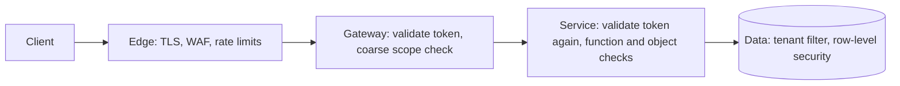
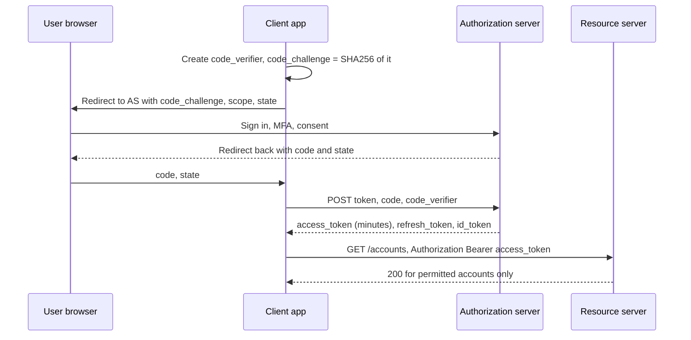

<!-- markdownlint-disable MD001 -->
<!-- markdownlint-disable MD024 -->
<!-- markdownlint-disable MD025 -->
<!-- markdownlint-disable MD026 -->
<!-- markdownlint-disable MD029 -->
<!-- markdownlint-disable MD033 -->
<!-- markdownlint-disable MD036 -->
<!-- markdownlint-disable MD040 -->
<!-- markdownlint-disable MD056 -->
<!-- markdownlint-disable MD060 -->

# R10. Security

## Contents

| #      | Sub-topic                                                                                                                  |
| ------ | -------------------------------------------------------------------------------------------------------------------------- |
| R10.1  | [Authentication, authorization, and where each check lives](#r101-authentication-authorization-and-where-each-check-lives) |
| R10.2  | [Choosing an authentication mechanism](#r102-choosing-an-authentication-mechanism)                                         |
| R10.3  | [OAuth 2.0 and OpenID Connect](#r103-oauth-20-and-openid-connect)                                                          |
| R10.4  | [Access tokens: JWT vs opaque, and JWT pitfalls](#r104-access-tokens-jwt-vs-opaque-and-jwt-pitfalls)                       |
| R10.5  | [Authorization: scopes, roles, attributes, objects](#r105-authorization-scopes-roles-attributes-objects)                   |
| R10.6  | [Transport: TLS and mTLS](#r106-transport-tls-and-mtls)                                                                    |
| R10.7  | [Browsers: CORS and CSRF](#r107-browsers-cors-and-csrf)                                                                    |
| R10.8  | [Service-to-service trust](#r108-service-to-service-trust)                                                                 |
| R10.9  | [OWASP API Security Top 10 (2023)](#r109-owasp-api-security-top-10-2023)                                                   |
| R10.10 | [Hardening: secrets, webhooks, SSRF, headers, logs](#r1010-hardening-secrets-webhooks-ssrf-headers-logs)                   |
| R10.11 | [Code: Spring Boot and Actix Web](#r1011-code-spring-boot-and-actix-web)                                                   |
| R10.12 | [Story: one statement endpoint, one breach](#r1012-story-one-statement-endpoint-one-breach)                                |
| -      | [Exercises](#exercises) and [Solutions](#solutions)                                                                        |
| -      | [Takeaways](#takeaways)                                                                                                    |

## R10.1 Authentication, authorization, and where each check lives

Authentication establishes **who** is calling (a user, a client application, a service).  
Authorization decides **whether that caller may perform this action on this object**.  
Authentication can be centralised at the edge; authorization cannot, because only the service holding the data knows who owns object `acct_42`.  
Most API breaches are authorization failures on authenticated requests.



| Layer   | Checks                                                           | Must not be the only check for                   |
| ------- | ---------------------------------------------------------------- | ------------------------------------------------ |
| Edge    | TLS, IP reputation, request size, rate limits, bot rules         | Anything identity-based                          |
| Gateway | Token signature, expiry, audience; route-level scope             | Object ownership, tenant isolation               |
| Service | Token again (defence in depth), role or policy, object ownership | Data isolation if queries can be written wrongly |
| Data    | `tenant_id` in every query, PostgreSQL row-level security        | Business rules                                   |

Status codes (R3): `401` with `WWW-Authenticate` when credentials are missing or invalid;  
`403` when the caller is known but not allowed;  
`404` when admitting that the object exists would itself leak (another tenant's object).

## R10.2 Choosing an authentication mechanism

For users, use OAuth 2.0 with OpenID Connect and short-lived access tokens.  
For server-to-server integrations, use OAuth client credentials, or API keys when the ecosystem expects them, with mTLS or request signing where the stakes are high.  
Basic authentication and long-lived static secrets belong only in legacy or internal cases.

| Mechanism                                    | How it works                                                | Strengths                                    | Weaknesses                                          | Use for                                       |
| -------------------------------------------- | ----------------------------------------------------------- | -------------------------------------------- | --------------------------------------------------- | --------------------------------------------- |
| API key                                      | Static secret in a header                                   | Simple, easy to issue per integration        | Long-lived, no user context, leaks in code and logs | Partner and developer APIs, usage metering    |
| HTTP Basic                                   | `Authorization: Basic base64(user:pass)` on every call      | Universally supported                        | Password on every request, no scopes, no MFA        | Legacy, internal tools behind other controls  |
| Session cookie                               | Server-side session, cookie in the browser                  | Revocable, `HttpOnly` keeps it from scripts  | CSRF exposure, stateful, browser only               | First-party web apps, the BFF pattern (R10.7) |
| OAuth 2.0 bearer token                       | Short-lived token from an authorization server              | Scopes, delegation, expiry, MFA upstream     | Bearer: whoever holds it can use it                 | User-facing APIs, third-party access          |
| OAuth client credentials                     | Service gets its own token with its own scopes              | No user password, rotatable, auditable       | Client secret still needs protection                | Service-to-service, partner servers           |
| mTLS                                         | Client certificate authenticates the connection             | Strong, no secret on the wire                | Certificate lifecycle, awkward through some proxies | Internal mesh, banks, high-value partners     |
| Request signing (HMAC, AWS SigV4)            | Client signs method, path, headers, body hash and timestamp | Secret never sent; tamper and replay evident | Client complexity; canonicalisation bugs            | Cloud provider style APIs, webhooks           |
| Sender-constrained tokens (DPoP, mTLS-bound) | Token bound to a key the client must prove it holds         | A stolen token is useless without the key    | Client and server complexity                        | High-risk APIs (open banking, health)         |

### API keys done properly

1. **Format**: a public prefix plus a random secret, for example `acme_live_k7Qx...` (256 bits of entropy).  
  The prefix lets secret scanners (GitHub, GitLab) recognise and report leaked keys, and lets support identify the key without seeing it.

2. **Storage**: store only a hash. For high-entropy keys a fast hash (SHA-256, or HMAC-SHA-256 with a server-side pepper) is sufficient; slow password hashes are for low-entropy human passwords.  
  Look up by a key ID, compare in constant time.

3. **Display once**, at creation. Never retrievable afterwards.

4. **Scope and restrict**: per environment (`live`, `test`), per permission set, optionally per source IP range.

5. **Rotate with overlap**: allow two active keys per integration so the client can switch without downtime; record last-used time to find dead keys.

6. **Transport**: `Authorization: Bearer <key>` or a dedicated header, never the query string (logged by proxies, stored in browser history, sent in `Referer`; RFC 6750 says the same for tokens).

7. **An API key identifies a client, not a user.** If the call acts for a user, the user needs their own credential (OAuth).

## R10.3 OAuth 2.0 and OpenID Connect

OAuth 2.0 is a **delegation** protocol: an authorization server issues an access token that lets a client call a resource server with limited scopes.  
OpenID Connect (OIDC) adds **authentication** on top: an ID token that tells the client who the user is.  
Use the authorization code flow with PKCE for every client that involves a user, client credentials for services, and the device flow for input-constrained devices.  
Implicit and password grants are obsolete.

### Roles

| Role                 | In practice                                                   |
| -------------------- | ------------------------------------------------------------- |
| Resource owner       | The user                                                      |
| Client               | The app acting for the user (SPA, mobile app, partner server) |
| Authorization server | Keycloak, Okta, Auth0, Entra ID, Cognito, your own            |
| Resource server      | Your API: validates tokens, enforces scopes and object rules  |

### Grants and when to use them

| Grant                               | Client                                       | Status (RFC 9700, OAuth 2.1 draft)                 |
| ----------------------------------- | -------------------------------------------- | -------------------------------------------------- |
| Authorization code + PKCE           | Web apps, SPAs, mobile, desktop              | Required for any user-facing client                |
| Client credentials                  | Services, partner servers, jobs              | Recommended for machine-to-machine                 |
| Device authorization (RFC 8628)     | TVs, CLIs, IoT without a browser             | Recommended where typing is impractical            |
| Refresh token                       | Any client that holds a session              | Rotate on each use; detect reuse; bind or expire   |
| Token exchange (RFC 8693)           | A service calling another on a user's behalf | Recommended over forwarding the user's token as-is |
| Implicit                            | Old SPAs                                     | Deprecated: tokens in URL fragments leak           |
| Resource owner password credentials | Apps that collect the user's password        | Deprecated: defeats MFA and phishing resistance    |

### Authorization code with PKCE



- **PKCE** (RFC 7636) binds the code to the client that started the flow: an intercepted code is useless without the verifier.  
  Required for public clients, recommended for all.

- **`state`** (or the OIDC `nonce`) defends against CSRF on the redirect.

- **Exact redirect URI matching** at the authorization server; wildcard redirects are a common token-theft path.

### ID token vs access token

| Token         | Audience                       | Purpose                       | Your API should                               |
| ------------- | ------------------------------ | ----------------------------- | --------------------------------------------- |
| ID token      | The client (`aud` = client ID) | Tell the client who signed in | **Reject it.** It was not issued for your API |
| Access token  | The API (`aud` = your API)     | Authorise calls with scopes   | Validate and use                              |
| Refresh token | The authorization server       | Get new access tokens         | Never see it                                  |

### Tokens in the browser

A SPA holding tokens in JavaScript exposes them to any XSS.  
The current recommendation for browser apps (IETF OAuth "browser-based apps" draft) is the **backend-for-frontend (BFF)**: a small server-side component performs the OAuth flow, keeps the tokens,  
and gives the browser only an `HttpOnly`, `Secure`, `SameSite` session cookie.  
The BFF attaches the access token when proxying to APIs.  
This moves the browser into the CSRF model (R10.7) and out of the token-theft model.

## R10.4 Access tokens: JWT vs opaque, and JWT pitfalls

A JWT access token is self-contained: the API validates it locally with the issuer's public keys, so no call per request, but it cannot be revoked before it expires.  
An opaque token is a random reference the API must introspect, so it is revocable and reveals nothing, at the cost of a network call (usually cached).  
Either way, validation is a checklist, and skipping any item is a known exploit.

### JWT vs opaque

| Aspect         | JWT (RFC 9068 profile)                         | Opaque + introspection (RFC 7662)                             |
| -------------- | ---------------------------------------------- | ------------------------------------------------------------- |
| Validation     | Local: signature, claims                       | Call the authorization server (cache briefly)                 |
| Latency        | None per request                               | A call per token per cache period                             |
| Revocation     | Only by expiry, or a denylist you check        | Immediate                                                     |
| Privacy        | Claims readable by anyone holding the token    | Nothing readable                                              |
| Size           | 1 to 2 KB in every request                     | About 40 bytes                                                |
| Typical choice | Internal and first-party APIs, short lifetimes | Third-party clients, high-risk scopes, phantom-token gateways |

The **phantom token** pattern combines them: clients get opaque tokens; the gateway introspects once and forwards a short-lived JWT internally.

### Validation checklist

| #   | Check                                                            | Why                                                            |
| --- | ---------------------------------------------------------------- | -------------------------------------------------------------- |
| 1   | Algorithm in a server-side allowlist (`RS256`, `ES256`, `EdDSA`) | Never trust the token's `alg`; reject `none`                   |
| 2   | Signature with a key from the issuer's JWKS, chosen by `kid`     | Keys come from configuration, never from the token             |
| 3   | `iss` equals the configured issuer exactly                       | Tokens from another tenant's or environment's issuer           |
| 4   | `aud` contains this API's identifier                             | A token issued for API B replayed against API A                |
| 5   | `exp`, `nbf`, `iat` with a small clock leeway (30 to 60 s)       | Expired tokens                                                 |
| 6   | `typ` header is `at+jwt` (RFC 9068) where the issuer sets it     | Stops ID tokens and other JWTs being accepted as access tokens |
| 7   | Required claims present (`sub`, `scope` or `scp`, `client_id`)   | Missing claims treated as "allow"                              |
| 8   | Scopes and claims checked per operation                          | Valid token, wrong permission                                  |

### Pitfalls and attacks

| Pitfall                               | Attack                                                                             | Defence                                                                                |
| ------------------------------------- | ---------------------------------------------------------------------------------- | -------------------------------------------------------------------------------------- |
| Accepting `alg: none`                 | Unsigned token accepted                                                            | Allowlist algorithms in configuration                                                  |
| Algorithm confusion                   | Token signed with `HS256` using the server's RSA **public** key as the HMAC secret | Bind each key to one algorithm; never let the header choose                            |
| `kid` used unsafely                   | `kid` value used as a file path or in SQL                                          | Treat `kid` as a lookup key into a fixed key set only                                  |
| `jku`, `x5u`, embedded `jwk` honoured | Token points to the attacker's key URL                                             | Ignore these headers; keys come only from the configured JWKS                          |
| No `aud` check                        | Token for another API in the same organisation is replayed (confused deputy)       | Per-API audience, always checked                                                       |
| Long lifetimes                        | Stolen token valid for days                                                        | 5 to 15 minute access tokens; refresh tokens rotate                                    |
| PII or secrets in claims              | Base64 is not encryption; tokens end up in logs and browser storage                | Minimal claims; look up details server-side                                            |
| Tokens in `localStorage`              | Any XSS exfiltrates them                                                           | BFF with `HttpOnly` cookies, or in-memory tokens with short lifetimes                  |
| Stale JWKS cache                      | Key rotation breaks validation, or a revoked key stays trusted                     | Cache JWKS; on an unknown `kid` refresh once (rate-limited); honour HTTP cache headers |
| Roles baked into long-lived tokens    | Revoked permissions stay effective                                                 | Short lifetimes, or check sensitive permissions server-side                            |

### Revocation options for JWTs

- **Short lifetime plus refresh token** (the default): revoking the refresh token stops new access tokens within minutes.

- **Denylist by `jti`** for emergencies, with entries expiring at the token's `exp`.

- **Introspection for high-risk operations** (payouts, credential changes) even when other calls use local validation.

- **Sender-constrained tokens** (DPoP, RFC 9449; mTLS-bound, RFC 8705) so theft alone is not enough.

## R10.5 Authorization: scopes, roles, attributes, objects

Scopes say what a **client** may do on the user's behalf; roles and attributes say what the **user** may do; object checks say whether they may touch **this record**.  
All three apply, and the object check is the one most often missing.  
Enforce it where the data is read, deny by default, and make tenant isolation structural rather than a line developers must remember.

### Four layers of decision

| Layer                 | Question                                              | Example                                                | Where it lives                                             |
| --------------------- | ----------------------------------------------------- | ------------------------------------------------------ | ---------------------------------------------------------- |
| Scope (OAuth)         | May this client app use this capability for the user? | `payments:write`                                       | Token; checked at gateway and service                      |
| Role (RBAC)           | Is the user's role allowed this function?             | `support_agent` may refund                             | Directory or authorization server; service                 |
| Attribute (ABAC)      | Do context and attributes allow it?                   | Refund ≤ ₹10,000; agent's region equals order's region | Policy in code or a policy engine (OPA, Cedar)             |
| Object / relationship | Is this caller related to this specific record?       | Account `acct_42` belongs to the caller's customer ID  | Query filter, row-level security, ReBAC (OpenFGA, SpiceDB) |

### The three OWASP authorization failures

| Failure                          | Example                                                                         | Fix                                                                                                  |
| -------------------------------- | ------------------------------------------------------------------------------- | ---------------------------------------------------------------------------------------------------- |
| **BOLA**: object level (API1)    | `GET /accounts/acct_43/statements` returns another customer's data              | Every object read and write filters by the caller's ownership or tenant; never trust the path ID     |
| **BFLA**: function level (API5)  | A customer calls `POST /admin/refunds` and it works                             | Deny by default; role check on every function, admin routes on a separate surface                    |
| **BOPLA**: property level (API3) | `PATCH /users/me {"role": "admin"}` is applied; or `GET` returns `passwordHash` | Separate read and write models per audience (R6); explicit allowlists of writable and visible fields |

### Patterns that make the object check hard to forget

1. **Scope the query, not the result.** `SELECT ... FROM accounts WHERE id = :id AND customer_id = :caller` returns nothing for someone else's account, so the code path naturally produces `404`.  
  Loading by ID and checking afterwards is easy to skip.

2. **Repository methods take the principal.** `accounts.find(principal, id)` instead of `accounts.find(id)`; there is no unscoped method to call by mistake.

3. **Row-level security as a backstop** (PostgreSQL): the database itself filters by a per-transaction setting.

   ```sql
   ALTER TABLE invoices ENABLE ROW LEVEL SECURITY;
   ALTER TABLE invoices FORCE ROW LEVEL SECURITY;          -- applies even to the table owner
   CREATE POLICY tenant_isolation ON invoices
       USING (tenant_id = current_setting('app.tenant_id')::uuid);

   -- per transaction, from the authenticated principal:
   SELECT set_config('app.tenant_id', :tenantId, true);    -- true = local to this transaction
   ```

   Connect as a role without `BYPASSRLS`. With a connection pool, always set the value per transaction, never per connection.

4. **Unguessable IDs are not authorization.** UUIDs make enumeration harder and are good defence in depth, but IDs leak through URLs, logs and shared links.

5. **Deny by default.** A new endpoint without an explicit rule must be unreachable. Test for it: a CI check that every route declares its required scope or role.

6. **Return `404` across tenant boundaries**, `403` within one when the caller can see the object but not act on it (R7.5).

### Policy in code or in an engine?

| Approach                                   | Pros                                                      | Cons                                                         |
| ------------------------------------------ | --------------------------------------------------------- | ------------------------------------------------------------ |
| In code (`@PreAuthorize`, guard functions) | Simple, typed, close to the logic                         | Scattered; hard to audit across services                     |
| Policy engine (OPA/Rego, Cedar)            | Central, auditable, testable, same rules across languages | Extra hop or sidecar; data needed by policies must be fed in |
| Relationship service (Zanzibar-style)      | Models sharing, hierarchies, groups at scale              | Operational weight; consistency between data and tuples      |

Most systems start in code with a strict pattern and move cross-cutting, frequently changing rules (pricing tiers, regional rules) into an engine.

## R10.6 Transport: TLS and mTLS

Every API endpoint is HTTPS only, TLS 1.2 minimum and TLS 1.3 preferred.  
Do not redirect plain HTTP to HTTPS on API hosts: by the time the redirect is sent, the token has already crossed the network in clear text.  
Internally, use mTLS (usually through a service mesh) so service identity does not depend on network location.

- **Reject, do not redirect**: close port 80 on API hosts or answer `403` without processing.  
  Browsers get HSTS (`Strict-Transport-Security: max-age=63072000; includeSubDomains`); API clients do not read HSTS, so configuration matters.

- **Termination and re-encryption**: TLS usually terminates at the CDN or load balancer; encrypt again to the origin.  
  Forwarded headers from that hop are trusted only because the hop is authenticated (R4.6).

- **Certificate pinning** in mobile apps blocks interception but makes certificate rotation an app release.  
  If used, pin the CA or the public key, with backups.

- **mTLS internally**: each workload gets a short-lived certificate (SPIFFE IDs such as `spiffe://acme/ns/payments/sa/api`), and policies say which identity may call which service.

## R10.7 Browsers: CORS and CSRF

CORS does not protect your API; it tells browsers when they may let a page from another origin **read** your responses.  
Non-browser clients ignore it. CSRF matters only when the browser attaches credentials automatically (cookies, Basic, client certificates);  
an API that requires `Authorization: Bearer` set by JavaScript is not CSRF-prone, but the cookie-based BFF is.

### CORS configuration rules

| Rule                                                                         | Why                                                                     |
| ---------------------------------------------------------------------------- | ----------------------------------------------------------------------- |
| Allowlist exact origins (`https://app.acme.com`)                             | Reflecting any `Origin` with credentials lets any site read users' data |
| `Access-Control-Allow-Origin: *` only for truly public, credential-less data | Browsers refuse `*` together with credentials anyway                    |
| Never allow `null` origin                                                    | Sandboxed iframes and `file://` pages send `null`; attackers can too    |
| Validate origins by exact match, not `endsWith("acme.com")`                  | `evilacme.com` matches a suffix check                                   |
| `Vary: Origin` when the response's CORS headers depend on the origin         | Otherwise caches serve one origin's CORS headers to another (R9.5)      |
| Allow only needed methods and headers; expose only needed headers (R4.6)     | Least privilege; preflight caching via `Access-Control-Max-Age`         |

### When CSRF applies

| API authentication                             | CSRF risk | Defence                                                                                        |
| ---------------------------------------------- | --------- | ---------------------------------------------------------------------------------------------- |
| `Authorization: Bearer` added by the client    | None      | Nothing extra; disable framework CSRF for these stateless routes                               |
| Session cookie (first-party web app, BFF)      | Yes       | `SameSite=Lax` or `Strict`, plus a CSRF token or a required custom header, plus `Origin` check |
| HTTP Basic or client certificates in a browser | Yes       | Avoid for browser-facing APIs                                                                  |

A required custom header (`X-CSRF-Token`, or any non-safelisted header) works because a cross-site form cannot set headers and a cross-site `fetch` with custom headers triggers a preflight the server refuses.  
Cookie hygiene for BFF sessions: `HttpOnly; Secure; SameSite=Lax; Path=/`, and the `__Host-` name prefix so the cookie is bound to the exact host.

## R10.8 Service-to-service trust

Inside the network, authenticate every call (zero trust): service identity via mTLS or client-credential tokens, and user context via a token the callee can verify.  
Never accept identity from a plain header such as `X-User-Id` unless the caller is an authenticated gateway and the header is stripped at the edge.

| Pattern                         | How                                                                      | Risk                                                               |
| ------------------------------- | ------------------------------------------------------------------------ | ------------------------------------------------------------------ |
| Forward the user's access token | Service A sends the same token to B                                      | Token's `aud` must include B; A can do anything the user can at B  |
| Token exchange (RFC 8693)       | A exchanges the user token for one scoped to B, with `act` (actor) claim | Preferred: least privilege, auditable chain                        |
| Service token plus user claim   | A calls B with its own token and states "on behalf of user U"            | B must trust A to say the truth: only for tightly coupled services |
| Gateway-asserted headers        | Gateway validates, forwards `X-User-Id`                                  | Safe only with mTLS from the gateway and edge stripping (R4.6)     |

**Confused deputy**: a service with broad privileges performs an action for a caller who should not be able to.  
The defence is to authorise with the **original caller's** identity at each hop, not the intermediate service's.

## R10.9 OWASP API Security Top 10 (2023)

The list is dominated by authorization (three of ten) and by APIs doing more than their designers intended: unlimited consumption, abusable business flows, server-side fetching, forgotten versions.  
Each has a concrete API-level control.

| #     | Risk                                            | What it looks like                                                  | Primary controls                                                                      |
| ----- | ----------------------------------------------- | ------------------------------------------------------------------- | ------------------------------------------------------------------------------------- |
| API1  | Broken Object Level Authorization               | Change the ID in the path, get someone else's object                | Ownership-scoped queries, RLS, tests per endpoint (R10.5)                             |
| API2  | Broken Authentication                           | Weak token validation, credential stuffing, unprotected reset flows | Validation checklist (R10.4), rate limits and lockout on auth endpoints, MFA          |
| API3  | Broken Object Property Level Authorization      | Mass assignment; responses with hidden fields                       | Separate read and write models, field allowlists (R6)                                 |
| API4  | Unrestricted Resource Consumption               | Huge pages, unbounded uploads, expensive queries, SMS cost abuse    | Size limits (`413`, `414`, `431`), max page size, timeouts, quotas, rate limits (R13) |
| API5  | Broken Function Level Authorization             | Customer reaches admin or internal functions                        | Deny by default, role checks per function, separate admin surface                     |
| API6  | Unrestricted Access to Sensitive Business Flows | Bots buy all stock, mass sign-ups, referral abuse                   | Flow-level limits per user and device, bot detection, step-up verification            |
| API7  | Server Side Request Forgery                     | API fetches a URL the user supplied (webhook, avatar URL, import)   | Allowlist, resolve and block private ranges, egress proxy, no redirects (R10.10)      |
| API8  | Security Misconfiguration                       | Verbose errors, open CORS, default credentials, missing TLS         | Hardened defaults, config review, error model (R7)                                    |
| API9  | Improper Inventory Management                   | Old `/v1` or a staging host without the new controls                | API inventory, gateway-only exposure, deprecation and sunset (R11)                    |
| API10 | Unsafe Consumption of APIs                      | Trusting third-party API responses or redirects blindly             | Validate upstream data, TLS, timeouts, size limits, treat as untrusted input          |

## R10.10 Hardening: secrets, webhooks, SSRF, headers, logs

The remaining attack surface is mostly in what the API stores, fetches, sends and logs.  
Keep secrets in a secret manager and rotate them, sign webhooks with a timestamp, treat every user-supplied URL as an SSRF attempt, send defensive headers even on JSON, and never log credentials.

### Webhooks you send: sign them

```text
POST /hooks/acme  (to the customer's endpoint)
Webhook-Id: msg_2Kx9
Webhook-Timestamp: 1730505600
Webhook-Signature: v1,Base64(HMAC-SHA256(secret, "msg_2Kx9.1730505600." + body))
```

The receiver recomputes the HMAC over id, timestamp and raw body, compares in constant time, rejects timestamps older than about 5 minutes (replay), and deduplicates by `Webhook-Id` (R8).  
This is the Standard Webhooks convention; Stripe's `Stripe-Signature: t=...,v1=...` is the same idea.

### URLs you fetch: assume SSRF

| Control                                    | Detail                                                                                       |
| ------------------------------------------ | -------------------------------------------------------------------------------------------- |
| Scheme allowlist                           | `https` only                                                                                 |
| Resolve, then check the IP                 | Block private, loopback, link-local (`169.254.169.254` cloud metadata), and IPv6 equivalents |
| Pin the resolved IP for the connection     | Prevents DNS rebinding between check and connect                                             |
| Do not follow redirects (or re-check each) | A public URL can redirect to an internal one                                                 |
| Egress proxy                               | Outbound fetches leave through a proxy with its own allowlist                                |
| Cloud metadata hardening                   | IMDSv2 (AWS) requires a session token, blunting simple SSRF                                  |

### Defensive response headers for JSON APIs

| Header                      | Value                                        | Purpose                                                    |
| --------------------------- | -------------------------------------------- | ---------------------------------------------------------- |
| `Content-Type`              | `application/json` (exact)                   | Prevents content sniffing into HTML                        |
| `X-Content-Type-Options`    | `nosniff`                                    | Same, enforced                                             |
| `Content-Security-Policy`   | `default-src 'none'; frame-ancestors 'none'` | If a response is ever rendered, nothing loads or frames it |
| `Cache-Control`             | Explicit policy, default `no-store` (R9)     | No accidental caching of personal data                     |
| `Strict-Transport-Security` | On browser-facing hosts                      | HTTPS only in browsers                                     |

### Secrets and logs

- Secrets live in a secret manager (Vault, AWS Secrets Manager, GCP Secret Manager), injected at runtime, rotated on a schedule and on every suspected leak.

- Redact `Authorization`, `Cookie`, `Set-Cookie`, API key headers and token fields in request logs, traces and error reports. Log the key **ID** or token `jti`, not the secret.

- Rate-limit and alert on authentication failures per client, per account and per IP (credential stuffing, R13).

## R10.11 Code: Spring Boot and Actix Web

### Spring Boot: resource server with audience check and object-level authorization

**Configuration**

```properties
spring.security.oauth2.resourceserver.jwt.issuer-uri=https://id.acme.com/realms/retail
acme.security.audience=accounts-api
```

**Security filter chain**

```java
@Configuration
@EnableMethodSecurity
class SecurityConfig {

    @Bean
    SecurityFilterChain api(HttpSecurity http) throws Exception {
        return http
            .securityMatcher("/v1/**")
            .csrf(csrf -> csrf.disable())                                   // bearer tokens only: no ambient credentials
            .sessionManagement(s -> s.sessionCreationPolicy(SessionCreationPolicy.STATELESS))
            .authorizeHttpRequests(auth -> auth
                .requestMatchers(HttpMethod.GET, "/v1/accounts/**").hasAuthority("SCOPE_accounts:read")
                .requestMatchers(HttpMethod.POST, "/v1/orders/*/refunds").hasAuthority("SCOPE_refunds:write")
                .requestMatchers("/v1/admin/**").hasRole("ADMIN")
                .anyRequest().denyAll())                                    // deny by default
            .oauth2ResourceServer(o -> o.jwt(Customizer.withDefaults()))   // 401 + WWW-Authenticate: Bearer
            .build();
    }

    @Bean
    JwtDecoder jwtDecoder(@Value("${spring.security.oauth2.resourceserver.jwt.issuer-uri}") String issuer,
                          @Value("${acme.security.audience}") String audience) {
        NimbusJwtDecoder decoder = NimbusJwtDecoder.withIssuerLocation(issuer)   // JWKS from discovery
                .jwsAlgorithm(SignatureAlgorithm.RS256)                          // algorithm allowlist
                .build();
        OAuth2TokenValidator<Jwt> audienceCheck = new JwtClaimValidator<List<String>>(
                JwtClaimNames.AUD, aud -> aud != null && aud.contains(audience));
        decoder.setJwtValidator(new DelegatingOAuth2TokenValidator<>(
                JwtValidators.createDefaultWithIssuer(issuer),                   // iss, exp, nbf (60 s skew)
                audienceCheck));                                                 // aud
        return decoder;
    }
}
```

- The default `JwtAuthenticationConverter` maps the `scope` or `scp` claim to `SCOPE_` authorities. Map realm roles to `ROLE_` authorities with a custom converter if you use `hasRole`.

- `NimbusJwtDecoder` caches the JWKS and refetches on an unknown `kid`.

- Check the `typ` header (`at+jwt`) too if your issuer sets it, with a custom `JWTClaimsSetVerifier` or a `jwtProcessorCustomizer` that sets a `JOSEObjectTypeVerifier`.

**Object-level authorization in the query**

```java
@GetMapping("/v1/accounts/{id}/statements")
List<StatementResponse> statements(@AuthenticationPrincipal Jwt caller, @PathVariable String id) {
    String customerId = caller.getClaimAsString("customer_id");
    return accounts.findOwned(customerId, id)                      // no unscoped finder exists
            .map(a -> statements.forAccount(a.id()))
            .orElseThrow(NotFound::new);                           // someone else's account: 404, not 403
}

// AccountRepository
Optional<Account> findOwned(String customerId, String accountId) {
    return jdbc.sql("SELECT id, customer_id, status FROM accounts WHERE id = :id AND customer_id = :cust")
            .param("id", accountId).param("cust", customerId)
            .query(Account.class).optional();
}
```

**Attribute rule with method security**

```java
@PreAuthorize("hasRole('SUPPORT') and @refundPolicy.allows(authentication, #orderId, #req.amountMinor())")
@PostMapping("/v1/orders/{orderId}/refunds")
ResponseEntity<RefundResponse> refund(@PathVariable String orderId, @Valid @RequestBody RefundRequest req) { ... }

@Component("refundPolicy")
class RefundPolicy {
    boolean allows(Authentication auth, String orderId, long amountMinor) {
        Jwt jwt = (Jwt) auth.getPrincipal();
        Order o = orders.find(orderId).orElse(null);
        return o != null
            && amountMinor <= 1_000_000                                       // ₹10,000 limit for agents
            && o.region().equals(jwt.getClaimAsString("region"));            // ABAC: same region
    }
}
```

**Problem Details for `401` and `403`**

```java
http.oauth2ResourceServer(o -> o
        .jwt(Customizer.withDefaults())
        .authenticationEntryPoint(problemEntryPoint)          // wraps BearerTokenAuthenticationEntryPoint, adds problem+json body
        .accessDeniedHandler(problemAccessDenied));           // 403 forbidden problem (R7)
```

Keep the `WWW-Authenticate: Bearer error="invalid_token"` header that `BearerTokenAuthenticationEntryPoint` writes (RFC 6750);  
add the R7 problem body beside it, without the validation failure detail.

### Actix Web: JWT validation middleware and scoped handlers

**Key set with refresh on unknown `kid`**

```rust
use jsonwebtoken::{decode, decode_header, jwk::JwkSet, Algorithm, DecodingKey, Validation};

pub struct Jwks {
    url: String,
    http: reqwest::Client,
    keys: tokio::sync::RwLock<JwkSet>,
    last_refresh: tokio::sync::Mutex<std::time::Instant>,
}

impl Jwks {
    async fn key(&self, kid: &str) -> Option<DecodingKey> {
        if let Some(jwk) = self.keys.read().await.find(kid) {
            return DecodingKey::from_jwk(jwk).ok();
        }
        let mut last = self.last_refresh.lock().await;               // at most one refresh per 30 s
        if last.elapsed() > std::time::Duration::from_secs(30) {
            if let Ok(set) = self.fetch().await { *self.keys.write().await = set; }
            *last = std::time::Instant::now();
        }
        self.keys.read().await.find(kid).and_then(|j| DecodingKey::from_jwk(j).ok())
    }

    async fn fetch(&self) -> Result<JwkSet, reqwest::Error> {
        self.http.get(&self.url).send().await?.error_for_status()?.json().await
    }
}
```

**Validation and the principal**

```rust
#[derive(Debug, Deserialize, Clone)]
pub struct Claims {
    pub sub: String,
    pub customer_id: Option<String>,
    #[serde(default)]
    pub scope: String,                                              // space-separated
    pub exp: usize,
}

#[derive(Clone)]
pub struct Principal { pub sub: String, pub customer_id: Option<String>, pub scopes: Vec<String> }

impl Principal {
    pub fn require(&self, scope: &str) -> Result<(), ApiError> {
        if self.scopes.iter().any(|s| s == scope) { Ok(()) } else { Err(ApiError::Forbidden) }
    }
}

pub struct AuthConfig { pub issuer: String, pub audience: String, pub jwks: Jwks }

async fn validate(cfg: &AuthConfig, token: &str) -> Result<Principal, ApiError> {
    let header = decode_header(token).map_err(|_| ApiError::Unauthenticated)?;
    if header.alg != Algorithm::RS256 { return Err(ApiError::Unauthenticated); }      // allowlist, before any key lookup
    let kid = header.kid.ok_or(ApiError::Unauthenticated)?;
    let key = cfg.jwks.key(&kid).await.ok_or(ApiError::Unauthenticated)?;

    let mut v = Validation::new(Algorithm::RS256);                   // only RS256 accepted
    v.set_issuer(&[&cfg.issuer]);
    v.set_audience(&[&cfg.audience]);
    v.set_required_spec_claims(&["exp", "iss", "aud", "sub"]);
    v.leeway = 30;

    let data = decode::<Claims>(token, &key, &v).map_err(|_| ApiError::Unauthenticated)?;
    let c = data.claims;
    Ok(Principal { sub: c.sub, customer_id: c.customer_id, scopes: c.scope.split_whitespace().map(str::to_owned).collect() })
}
```

**Middleware: authenticate every request under `/v1`**

```rust
use actix_web::{body::MessageBody, dev::{ServiceRequest, ServiceResponse}, middleware::Next, HttpMessage};

pub async fn authenticate(
    req: ServiceRequest,
    next: Next<impl MessageBody>,
) -> Result<ServiceResponse<impl MessageBody>, actix_web::Error> {
    let cfg = req.app_data::<web::Data<AuthConfig>>().expect("AuthConfig registered").clone();
    let token = req.headers().get(header::AUTHORIZATION)
        .and_then(|v| v.to_str().ok())
        .and_then(|v| v.strip_prefix("Bearer "))
        .ok_or(ApiError::Unauthenticated)?;
    let principal = validate(&cfg, token).await?;
    req.extensions_mut().insert(principal);                         // read later via web::ReqData<Principal>
    next.call(req).await
}

// App::new().service(web::scope("/v1").wrap(from_fn(authenticate)).service(statements))
```

Add `Unauthenticated` and `Forbidden` variants to R7's `ApiError`: `Unauthenticated` maps to `401` with `WWW-Authenticate: Bearer error="invalid_token"` and an R7 problem body, `Forbidden` to `403`.

**Handler: scope check and ownership in the query**

```rust
#[get("/accounts/{id}/statements")]
async fn statements(
    db: web::Data<PgPool>,
    who: web::ReqData<Principal>,
    id: web::Path<String>,
) -> Result<HttpResponse, ApiError> {
    who.require("accounts:read")?;                                       // scope
    let customer = who.customer_id.as_deref().ok_or(ApiError::Forbidden)?;

    let account: Option<String> = sqlx::query_scalar(
        "SELECT id FROM accounts WHERE id = $1 AND customer_id = $2")    // ownership is part of the lookup
        .bind(id.as_str()).bind(customer)
        .fetch_optional(db.get_ref()).await?;
    let account = account.ok_or(ApiError::NotFound)?;                    // not yours: 404

    let rows = load_statements(&db, &account).await?;
    Ok(HttpResponse::Ok().insert_header((header::CACHE_CONTROL, "private, no-store")).json(rows))
}
```

**Verifying an incoming webhook signature**

```rust
use hmac::{Hmac, Mac};
use sha2::Sha256;

fn verify_webhook(secret: &[u8], id: &str, ts: i64, body: &[u8], sig_b64: &str, now: i64) -> bool {
    if (now - ts).abs() > 300 { return false; }                          // replay window: 5 minutes
    let Ok(sig) = base64::engine::general_purpose::STANDARD.decode(sig_b64) else { return false };
    let mut mac = Hmac::<Sha256>::new_from_slice(secret).expect("any key length");
    mac.update(format!("{id}.{ts}.").as_bytes());
    mac.update(body);                                                    // raw bytes, before JSON parsing
    mac.verify_slice(&sig).is_ok()                                       // constant-time comparison
}
```

`base64::Engine` must be in scope for `decode`. Read the body as `web::Bytes`, verify, and only then deserialise.

## R10.12 Story: one statement endpoint, one breach

A digital bank's mobile API, a composite of real incident patterns.

| #   | What happened                                                                                                         | Root cause                                          | Fix                                                                                |
| --- | --------------------------------------------------------------------------------------------------------------------- | --------------------------------------------------- | ---------------------------------------------------------------------------------- |
| 1   | A researcher changes `acct_1042` to `acct_1043` in `GET /v1/accounts/{id}/statements` and gets a stranger's statement | BOLA: the handler loaded by ID; the token was valid | Ownership in every query; repository methods take the principal; RLS as a backstop |
| 2   | Account IDs were sequential, so the researcher could have walked every account                                        | Enumerable IDs amplified the BOLA                   | Random IDs as defence in depth (not as the fix)                                    |
| 3   | The gateway "already checks auth", so the service skipped token validation                                            | A legacy internal route bypassed the gateway        | Services validate tokens themselves; the internal route closed                     |
| 4   | Old `/v0/statements` was still deployed without the fix                                                               | API9: forgotten version                             | Inventory of every deployed route; `/v0` removed after a sunset notice (R11)       |
| 5   | Logs contained full bearer tokens, so the incident team's log export became sensitive                                 | No redaction                                        | Redact `Authorization`; log `jti` and `client_id`                                  |
| 6   | Statements were cached at the CDN for 60 s because the PDF route matched a "cache static files" rule                  | Edge rule overrode the absent origin policy (R9.6)  | `Cache-Control: private, no-store`; respect origin headers on API hosts            |
| 7   | The investigation needed "who accessed what"                                                                          | No access audit log                                 | Audit event per object access: principal, object ID, decision, request ID          |

What would have caught it before release:

- An automated test per endpoint: user A's token against user B's object must return `404`.

- A route inventory check: every route declares a scope and an ownership rule, or the build fails.

- A threat-modelling review asking one question per endpoint: "what stops a valid user from reading someone else's object here?"

## Exercises

**1. Pick the mechanism.** Choose authentication (and the OAuth grant, if any) for:

- a) A first-party React SPA.

- b) A first-party Android app.

- c) A partner's nightly server job that uploads invoices.

- d) A CLI used by developers.

- e) A smart meter with no screen that posts readings.

- f) The orders service calling the inventory service on behalf of a user.

**2. Review this token and the code that accepts it.** Decoded header and payload of a token the accounts API accepted:

```text
{ "alg": "HS256", "typ": "JWT" }
{ "iss": "https://id.acme.com/realms/retail", "sub": "u_77", "aud": "mobile-app",
  "email": "asha@example.com", "pan": "ABCDE1234F", "roles": ["customer"],
  "iat": 1730000000, "exp": 1732592000 }
```

The API builds its validator from the token's own header (`Validation::new(decode_header(token)?.alg)`) and verifies with a key read from configuration. List every problem.

**3. Classify the flaw.** Name the OWASP API risk and the fix:

- a) `PATCH /v1/users/me` with `{"kycStatus": "VERIFIED"}` marks the caller as verified.

- b) `GET /v1/orders/ord_9` returns another customer's order.

- c) `DELETE /v1/products/p7` works for any authenticated customer.

- d) `POST /v1/imports {"url": "http://169.254.169.254/latest/meta-data/"}` returns cloud credentials.

- e) `GET /v1/search?q=a&pageSize=1000000` takes the database down.

- f) A bot redeems every new-user ₹500 voucher through scripted sign-ups.

**4. CORS review.** The server sets `Access-Control-Allow-Origin` to the request's `Origin` value for any origin, with `Access-Control-Allow-Credentials: true`.  
  Authentication is a session cookie with `SameSite=None`.  
  What can an attacker do, and what is the fixed configuration?

**5. CSRF or not?** For each, say whether CSRF is possible and why:

- a) API authenticated only by `Authorization: Bearer`, token held in memory by the SPA.

- b) BFF with an `HttpOnly; Secure; SameSite=Lax` session cookie; state changes via `POST` with JSON.

- c) Same as b), but one endpoint changes state on `GET /v1/subscriptions/cancel?id=...`.

- d) Internal admin tool using HTTP Basic, opened in employees' browsers.

**6. Multi-tenant isolation.** A B2B SaaS has 2,000 tenants in one PostgreSQL database.  
  Design the layers that guarantee one tenant can never read another's invoices, including what happens when a developer writes a query without a tenant filter.

## Solutions

### Solution 1

| #   | Choice                                                                                                                                                            | Reason                                                                             |
| --- | ----------------------------------------------------------------------------------------------------------------------------------------------------------------- | ---------------------------------------------------------------------------------- |
| a   | BFF: authorization code + PKCE performed server-side; browser gets an `HttpOnly` session cookie; CSRF defences                                                    | Keeps tokens out of JavaScript; current IETF guidance for browser apps             |
| b   | Authorization code + PKCE via the system browser (AppAuth), refresh token in the platform keystore, short access tokens                                           | Native apps are public clients; embedded web views enable phishing                 |
| c   | Client credentials (private-key JWT or mTLS client authentication) with a narrow `invoices:write` scope; or a scoped API key if the partner ecosystem requires it | Machine identity, rotatable, no user involved                                      |
| d   | Device authorization grant (RFC 8628), or authorization code + PKCE with a loopback redirect                                                                      | Developer signs in with SSO and MFA in a browser; the CLI never sees a password    |
| e   | mTLS with a per-device certificate provisioned at manufacture, or client credentials with a device-bound key                                                      | No user, no screen; identity must survive in the field and be revocable per device |
| f   | Token exchange (RFC 8693): orders exchanges the user's token for one with `aud` = inventory, narrow scope, `act` = orders; mTLS between services                  | Least privilege; inventory sees both the user and the acting service               |

### Solution 2

| #   | Problem                                                                                                                                                                   |
| --- | ------------------------------------------------------------------------------------------------------------------------------------------------------------------------- |
| 1   | `HS256` with a key from configuration while the issuer publishes RSA keys: classic algorithm confusion if the "key" is the RSA public key; anyone with it can mint tokens |
| 2   | Trusting the header's `alg` at all (`Validation::new(header.alg)`): pin `RS256` or `ES256` in configuration                                                               |
| 3   | `aud` is `mobile-app`: this is an ID token (or a token for another audience). The accounts API must require `aud` = `accounts-api`                                        |
| 4   | `typ` is `JWT`, not `at+jwt`: another sign that it is not an access token                                                                                                 |
| 5   | `exp` − `iat` = 2,592,000 s = 30 days. Access tokens should live minutes                                                                                                  |
| 6   | `email` and `pan` (a tax ID) in the payload: readable by anyone holding the token, and logged by proxies                                                                  |
| 7   | No `scope` claim: nothing limits what the client app may do                                                                                                               |
| 8   | `roles` inside a 30-day token: revoked roles stay effective for a month                                                                                                   |
| 9   | No `kid`: the API cannot rotate keys or select the right one                                                                                                              |

Fix: validate with the issuer's JWKS, algorithm allowlist, exact `iss`, required `aud`, `typ` check, short expiry; issue minimal claims; look up personal data server-side.

### Solution 3

| #   | Risk                                                 | Fix                                                                                                     |
| --- | ---------------------------------------------------- | ------------------------------------------------------------------------------------------------------- |
| a   | API3 BOPLA (mass assignment)                         | Write model without `kycStatus`; reject unknown or read-only fields with `422`                          |
| b   | API1 BOLA                                            | `WHERE id = :id AND customer_id = :caller`; `404` otherwise                                             |
| c   | API5 BFLA                                            | Role check (`catalogue_admin`), deny by default, admin functions on a separate surface                  |
| d   | API7 SSRF                                            | `https` allowlist, resolve and block private and metadata ranges, no redirects, egress proxy, IMDSv2    |
| e   | API4 Unrestricted Resource Consumption               | Max `pageSize` (for example 100, `422` above it), query timeouts, keyset pagination (R6)                |
| f   | API6 Unrestricted Access to Sensitive Business Flows | Limits per device and payment instrument, phone verification, bot detection, delayed voucher activation |

### Solution 4

Any website the victim visits can run `fetch("https://api.acme.com/v1/me", {credentials: "include"})`.  
The browser sends the session cookie (`SameSite=None` allows it cross-site), the server reflects the attacker's origin and allows credentials,  
so the browser **lets the attacker's script read the response**: profile, balances, anything a `GET` returns.  
It can also make state-changing calls and read their results.

Fixed configuration:

- `Access-Control-Allow-Origin` only for exact allowlisted origins (`https://app.acme.com`), with `Vary: Origin`; no reflection, no `null`.

- `Access-Control-Allow-Credentials: true` only for those origins.

- Session cookie `SameSite=Lax` (or `Strict`), `HttpOnly`, `Secure`, `__Host-` prefix.

- CSRF token or required custom header on state-changing requests, plus an `Origin` check.

### Solution 5

| #   | CSRF possible? | Why                                                                                                                                                                                                                                                        |
| --- | -------------- | ---------------------------------------------------------------------------------------------------------------------------------------------------------------------------------------------------------------------------------------------------------- |
| a   | No             | The browser never attaches the token automatically; a cross-site page cannot read it or add the header                                                                                                                                                     |
| b   | Largely no     | `SameSite=Lax` withholds the cookie on cross-site `POST`; a JSON `fetch` cross-site needs a preflight the server refuses. Still add a CSRF token or custom-header check and an `Origin` check as defence in depth (subdomain takeovers count as same-site) |
| c   | Yes            | `SameSite=Lax` **sends** cookies on top-level cross-site `GET` navigations; a link or redirect cancels the subscription. Also violates `GET` safety (R2). Make it `POST`                                                                                   |
| d   | Yes            | Browsers resend cached Basic credentials automatically to that origin; any page can submit a form to the tool. Use SSO with CSRF-protected sessions                                                                                                        |

### Solution 6

| Layer           | Control                                                                                                                                                                                                                                                                                                                      |
| --------------- | ---------------------------------------------------------------------------------------------------------------------------------------------------------------------------------------------------------------------------------------------------------------------------------------------------------------------------- |
| Identity        | Token carries `tenant_id`, set by the authorization server, never from a request header or body                                                                                                                                                                                                                              |
| URI             | `/v1/tenants/{t}/invoices`; middleware rejects with `404` if `{t}` differs from the token's tenant                                                                                                                                                                                                                           |
| Repository      | Every method takes a `TenantContext`; no method without it exists; code review and an ArchUnit (or Clippy-style lint) rule enforce it                                                                                                                                                                                        |
| Database        | Row-level security on every tenant table, `FORCE ROW LEVEL SECURITY`, app role without `BYPASSRLS`; `set_config('app.tenant_id', ..., true)` at the start of every transaction. A query without a tenant filter returns only the current tenant's rows, and with no tenant set, `current_setting` fails and the query errors |
| Caching         | Tenant data `private` or `no-store`; application cache keys prefixed with the tenant                                                                                                                                                                                                                                         |
| Async work      | Messages carry `tenant_id`; consumers set the RLS context before touching data                                                                                                                                                                                                                                               |
| Tests           | For every endpoint: tenant A's token against tenant B's IDs returns `404`; a test that runs a raw query without context and expects an error                                                                                                                                                                                 |
| Audit           | Cross-tenant access attempts logged and alerted                                                                                                                                                                                                                                                                              |
| Escalation path | Very large or regulated tenants can move to a separate schema or database without code changes, because every access already goes through the tenant context                                                                                                                                                                 |

## Takeaways

- Authentication says who is calling; authorization decides per action and per object.  
  Authenticate at the edge and again in the service; authorise in the service and at the data layer.

- Users: OAuth 2.0 authorization code + PKCE with OIDC; browsers through a BFF with `HttpOnly` cookies.  
  Services: client credentials or mTLS; token exchange for on-behalf-of calls.  
  Implicit and password grants are obsolete (RFC 9700).

- API keys: prefixed, high-entropy, hashed at rest, shown once, scoped, rotated with overlap, never in the query string. They identify clients, not users.

- JWT validation is a checklist: allowlisted algorithm, key from the configured JWKS by `kid`, exact `iss`, required `aud`, `exp` with small leeway, `typ`, scopes. Never trust `alg`, `jku` or embedded keys; never accept ID tokens at an API.

- Short-lived access tokens, rotating refresh tokens, a `jti` denylist for emergencies, and sender-constrained tokens for high-risk APIs.

- BOLA is the top API risk. Put ownership in the query, make repository methods require the principal, add row-level security, deny by default, and test cross-user access on every endpoint.

- Separate read and write models to stop mass assignment and data over-exposure; return `404` across tenant boundaries.

- HTTPS only, no HTTP redirects on API hosts, mTLS inside. CORS is a browser read permission, not server protection; CSRF matters only with ambient credentials such as cookies.

- Sign webhooks with a timestamp, treat fetched URLs as SSRF, send `nosniff` and a locked-down CSP on JSON, keep secrets in a manager, and redact credentials from every log.

---
