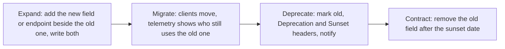
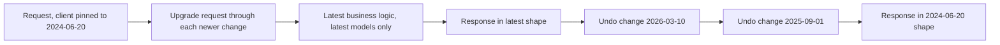
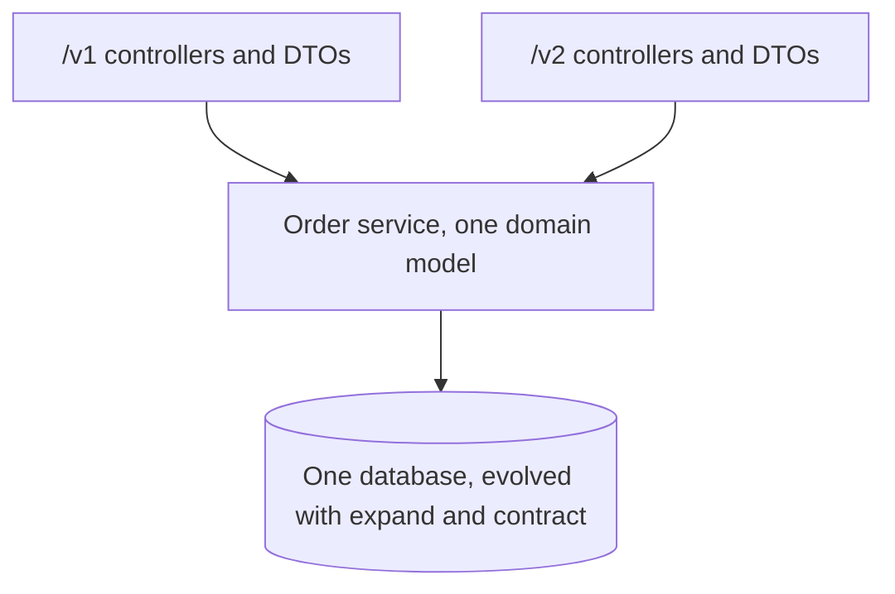
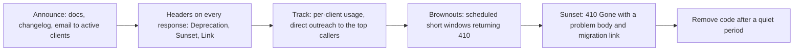

<!-- markdownlint-disable MD001 -->
<!-- markdownlint-disable MD024 -->
<!-- markdownlint-disable MD025 -->
<!-- markdownlint-disable MD026 -->
<!-- markdownlint-disable MD029 -->
<!-- markdownlint-disable MD033 -->
<!-- markdownlint-disable MD036 -->
<!-- markdownlint-disable MD040 -->
<!-- markdownlint-disable MD056 -->
<!-- markdownlint-disable MD060 -->

# R11. Evolution and Versioning

## Contents

| #      | Sub-topic                                                                                                          |
| ------ | ------------------------------------------------------------------------------------------------------------------ |
| R11.1  | [What the contract is, and what "breaking" means](#r111-what-the-contract-is-and-what-breaking-means)              |
| R11.2  | [Breaking vs non-breaking: the catalogue](#r112-breaking-vs-non-breaking-the-catalogue)                            |
| R11.3  | [Tolerant reader, strict writer](#r113-tolerant-reader-strict-writer)                                              |
| R11.4  | [Evolving without a new version](#r114-evolving-without-a-new-version)                                             |
| R11.5  | [Versioning strategies](#r115-versioning-strategies)                                                               |
| R11.6  | [Date-based versions and the transformation chain](#r116-date-based-versions-and-the-transformation-chain)         |
| R11.7  | [Running several versions at once](#r117-running-several-versions-at-once)                                         |
| R11.8  | [Deprecation and sunset](#r118-deprecation-and-sunset)                                                             |
| R11.9  | [Evolving the hard parts: enums, IDs, errors, webhooks](#r119-evolving-the-hard-parts-enums-ids-errors-webhooks)   |
| R11.10 | [Governance: catching breaking changes before release](#r1110-governance-catching-breaking-changes-before-release) |
| R11.11 | [Code: Spring Boot and Actix Web](#r1111-code-spring-boot-and-actix-web)                                           |
| R11.12 | [Story: retiring orders v1](#r1112-story-retiring-orders-v1)                                                       |
| -      | [Exercises](#exercises) and [Solutions](#solutions)                                                                |
| -      | [Takeaways](#takeaways)                                                                                            |

## R11.1 What the contract is, and what "breaking" means

A change is breaking if a client that worked yesterday, without being modified, fails or behaves wrongly today. The contract is not only the documented schema: it is every behaviour clients can observe and have come to rely on. Version numbers are a tool for managing unavoidable breaks; the first goal is to need them rarely.

### The contract has more surface than the schema

| Surface                 | Examples                                                             |
| ----------------------- | -------------------------------------------------------------------- |
| Addressing              | URIs, path parameters, query parameter names                         |
| Request shape           | Field names, types, required fields, accepted formats, size limits   |
| Response shape          | Field names, types, presence, nullability, enum values, ordering     |
| Status codes and errors | Which code for which situation, problem `type` URIs (R7)             |
| Headers                 | `Location`, `ETag`, required request headers, caching policy (R9)    |
| Semantics               | What an operation does, its side effects, idempotency (R8), defaults |
| Non-functional          | Latency, rate limits, page sizes, timeouts                           |
| Security                | Accepted credentials, scopes required per operation (R10)            |

### Hyrum's Law

> With a sufficient number of users of an API, it does not matter what you promise in the contract: all observable behaviours of your system will be depended on by somebody.

Consequences for an API owner:

- Undocumented behaviour (array order, a field that "happens" to be present, an error message string) becomes contract at scale.

- Prevent accidental contracts: document ordering explicitly or randomise it, never let clients parse `detail` (R7), keep responses free of fields you do not intend to support.

- Measure before changing: per-client telemetry tells you who actually uses a field or parameter.

## R11.2 Breaking vs non-breaking: the catalogue

Adding optional things is safe; removing, renaming, retyping, tightening or changing meaning is breaking.  
A few additions are breaking too, because they change what an existing client receives: new enum values, new required inputs, new error codes in old situations, and changed defaults.

### Request side

| Change                                                   | Breaking?  | Why                                                             |
| -------------------------------------------------------- | ---------- | --------------------------------------------------------------- |
| Add an optional field or query parameter                 | No         | Old clients do not send it; the default preserves old behaviour |
| Add a required field or header                           | Yes        | Old requests now fail validation                                |
| Make an optional field required                          | Yes        | Same                                                            |
| Tighten validation (shorter max length, new format rule) | Yes        | Previously valid requests now get `422`                         |
| Loosen validation                                        | Usually no | Unless clients rely on the server rejecting something           |
| Change a default value (page size, sort order)           | Yes        | Same request, different result                                  |
| Rename or remove a field or parameter                    | Yes        | Old clients' input is ignored or rejected                       |
| Accept an additional format (`application/xml` too)      | No         | Additive negotiation                                            |
| Require a new scope for an existing operation            | Yes        | Existing tokens now get `403`                                   |

### Response side

| Change                                                     | Breaking?                                          | Why                                                           |
| ---------------------------------------------------------- | -------------------------------------------------- | ------------------------------------------------------------- |
| Add a field                                                | No*                                                | *Only for tolerant readers; strict deserialisers fail (R11.3) |
| Remove or rename a field                                   | Yes                                                | Clients read `null` or crash                                  |
| Change a type (`"id": 42` → `"id": "42"`, number → string) | Yes                                                | Deserialisation fails                                         |
| Make a non-nullable field nullable                         | Yes                                                | Clients without null handling crash                           |
| Add an enum value                                          | Yes, unless clients were told to expect new values | Exhaustive `switch` statements and strict enum parsing fail   |
| Change number precision or units (major to minor units)    | Yes                                                | Silent wrong values: the worst kind                           |
| Change date format                                         | Yes                                                | Parsing fails or misreads                                     |
| Change array order that was never documented               | Formally no, practically often yes                 | Hyrum's Law                                                   |
| Wrap the body (`[...]` → `{"data": [...]}`)                | Yes                                                | Shape changed                                                 |

### Behaviour, codes, headers

| Change                                                          | Breaking? | Why                                                                                  |
| --------------------------------------------------------------- | --------- | ------------------------------------------------------------------------------------ |
| Different status code for an existing situation (`200` → `202`) | Yes       | Clients branch on status                                                             |
| New error `type` for a situation that used to succeed           | Yes       | That is tightened validation or a new rule                                           |
| New error `type` for a new feature                              | No        | Clients that never use the feature never see it                                      |
| Rename a problem `type` URI                                     | Yes       | Clients branch on it (R7.3)                                                          |
| Add a redirect (`301`/`308`) on an existing URI                 | Often yes | Many clients do not follow redirects for non-`GET`, or drop auth headers on redirect |
| Change idempotency or side effects                              | Yes       | Retries or assumptions now cause harm                                                |
| Lower a rate limit or maximum page size                         | Yes       | Working traffic now gets `429` or truncated results                                  |
| Change caching headers                                          | Can be    | Longer `max-age` serves staler data; `no-store` changes load patterns                |
| Large latency increase                                          | Can be    | Clients with tight timeouts start failing                                            |

## R11.3 Tolerant reader, strict writer

Clients should read only what they need and ignore what they do not understand: unknown fields, unknown enum values, extra headers.  
That single discipline turns most additive changes into non-events.  
Servers, on the other hand, should be precise about what they accept, because silently ignoring a mistyped field is a bug the client never sees.  
RFC 9413 makes the same point about Postel's "be liberal in what you accept": unbounded tolerance turns accidents into permanent contract.

### Client rules (put them in your SDKs and integration guides)

1. Ignore unknown fields.

2. Map unknown enum values to an explicit `UNKNOWN` and handle it gracefully.

3. Do not depend on field order or undocumented array order.

4. Branch on status codes and problem `type`, never on `title` or `detail` (R7).

5. Treat absent optional fields and `null` the same unless documented otherwise.

6. Follow `Location` and links from responses instead of building URIs by string concatenation where the API provides them (R12).

### Framework defaults

| Stack                    | Unknown fields in JSON                                     | Unknown enum values                                                                      |
| ------------------------ | ---------------------------------------------------------- | ---------------------------------------------------------------------------------------- |
| Jackson (plain)          | Fails (`FAIL_ON_UNKNOWN_PROPERTIES` is true)               | Fails, unless `READ_UNKNOWN_ENUM_VALUES_USING_DEFAULT_VALUE` and `@JsonEnumDefaultValue` |
| Jackson in Spring Boot   | Ignored (Boot sets `FAIL_ON_UNKNOWN_PROPERTIES` to false)  | Fails by default                                                                         |
| serde                    | Ignored, unless `#[serde(deny_unknown_fields)]`            | Fails, unless a `#[serde(other)]` unit variant exists                                    |
| Generated SDKs (OpenAPI) | Depends on the generator; many fail on unknown enum values | Configure "unknown default" options before shipping                                      |

### Should the server reject unknown request fields?

| Policy                       | Benefit                                                                       | Cost                                                                                                      | Fits                                                                |
| ---------------------------- | ----------------------------------------------------------------------------- | --------------------------------------------------------------------------------------------------------- | ------------------------------------------------------------------- |
| Reject with `422` (or `400`) | Typos (`emial`) surface immediately; no silent misbehaviour                   | A newer client sending a newer field to an older server fails (mixed versions during rollout or rollback) | Public APIs with versioned SDKs (Stripe rejects unknown parameters) |
| Ignore                       | Forward compatible across mixed deployments                                   | Mistakes are silent                                                                                       | Internal services with rolling deploys                              |
| Ignore, but warn             | Both, partially: a `Warning`-style response header or a log metric per client | Clients must look                                                                                         | Migration periods                                                   |

## R11.4 Evolving without a new version

Most change can ship without a version bump: add instead of change, run old and new side by side (expand, migrate, contract), and give clients an explicit opt-in for new behaviour.  
Version bumps are for the residue that cannot be made additive.

### Expand, migrate, contract (parallel change)



Example: rename `zip` to `postalCode`.

| Phase     | Request                                                                                     | Response                    | Database                         |
| --------- | ------------------------------------------------------------------------------------------- | --------------------------- | -------------------------------- |
| Expand    | Accept either; reject if both differ                                                        | Return both, same value     | New column, dual write, backfill |
| Migrate   | Same; count per client which one they send                                                  | Same                        | Reads from the new column        |
| Deprecate | Same; `zip` marked `deprecated: true` in OpenAPI                                            | Same; changelog and notices | Same                             |
| Contract  | Only `postalCode` (this is the breaking step, so it waits for a version or the sunset date) | Only `postalCode`           | Drop the old column              |

The final "contract" step is still a break; expand-and-contract buys time and data, it does not make removal free.  
In a URI-versioned API the contract step often happens only in the next major version, while the current one keeps both fields forever.

### Other additive techniques

| Technique                            | Example                                                                                    |
| ------------------------------------ | ------------------------------------------------------------------------------------------ |
| New resource instead of changing one | `/v1/payment-intents` beside `/v1/charges` rather than changing charge semantics           |
| New field with new semantics         | Add `amountMinor` (integer) beside `amount` (decimal string); never change `amount` itself |
| Opt-in behaviour per request         | `Prefer: return=minimal` (RFC 7240), `?expand=customer`, `?include=lineItems`              |
| Opt-in per client                    | A client setting or capability flag that enables the new behaviour for that client         |
| Feature flags server-side            | Ship dark, enable per client, measure, then default on for new clients only                |
| Additive enum with documented rule   | "Clients must tolerate unknown values" written in the contract from day one                |

## R11.5 Versioning strategies

The version can live in the URI, a query parameter, a request header, or the media type.  
The URI is the most visible and simplest to route, cache and debug, which is why most public APIs use `/v1`.  
Header and media-type schemes keep URIs stable and allow finer-grained versions, at the cost of visibility and `Vary` handling.  
Whichever you pick, version **rarely** and only for breaking changes; semantic versioning's minor and patch numbers are meaningless on the wire.

| Strategy              | Example                                                             | Used by (examples)    | Pros                                                                 | Cons                                                                                |
| --------------------- | ------------------------------------------------------------------- | --------------------- | -------------------------------------------------------------------- | ----------------------------------------------------------------------------------- |
| URI path, major only  | `/v1/orders`                                                        | Most public APIs      | Visible, trivially routable and cacheable, easy in browsers and logs | Whole-API granularity; same resource gets two URIs; links and IDs embed the version |
| URI path, date        | `/admin/api/2025-10/orders.json`                                    | Shopify               | Visible, frequent releases with a clear support window               | Many live versions to run                                                           |
| Query parameter       | `/orders?api-version=2024-10-01`                                    | Azure                 | Stable path, explicit per request                                    | Easy to omit; must be in every link; cache key includes it                          |
| Custom request header | `Api-Version: 2024-10-01`, `Stripe-Version`, `X-GitHub-Api-Version` | Stripe, GitHub        | Clean URIs; per-request override of a pinned default                 | Invisible in links and browsers; needs `Vary`; proxies may drop it                  |
| Media type            | `Accept: application/vnd.acme.order.v2+json`                        | GitHub (historically) | Versions the **representation**, the most REST-aligned               | Hard to test casually; tooling support weaker; `Vary: Accept`; `406` handling       |
| Hostname              | `api-v2.acme.com`                                                   | Large rewrites        | Full isolation of infrastructure                                     | DNS, TLS, CORS, cookies all per host                                                |

### What to version

| Granularity                | Meaning                                         | Use when                                                  |
| -------------------------- | ----------------------------------------------- | --------------------------------------------------------- |
| Whole API                  | `/v1` → `/v2` for every resource                | Rare, large redesigns                                     |
| Per resource or media type | `vnd.acme.order.v2+json` only for orders        | One resource needs a break, others do not                 |
| Per client pin (date)      | Each client pinned to the version it started on | Frequent small breaks with a transformation layer (R11.6) |

### A defensible default

- **Public API with infrequent breaks**: major version in the URI (`/v1`), additive evolution within it, a new major only for a redesign. Simple for every consumer and every proxy.

- **Platform API with frequent, small breaking changes**: date-based versions in a header, pinned per client, with a transformation chain (R11.6).

- **Internal APIs**: no versions; expand-and-contract with consumer-driven contract tests (R14), because you can see and change every caller.

Fielding's own position is that a REST API evolves through media types and hypermedia rather than URI version numbers; a `/v1` signals that clients are coupled to URI structure.  
In practice the URI major version wins on simplicity; know the argument for interviews and choose deliberately.

## R11.6 Date-based versions and the transformation chain

Stripe popularised a model in which every breaking change gets a dated version, each client is pinned to the version current when it first called the API, and the server runs only the latest code.  
A chain of small "version change" modules transforms requests up and responses down to whatever version the client is pinned to.  
Clients upgrade one dated step at a time, on their own schedule.



| Element               | Detail                                                                                                                        |
| --------------------- | ----------------------------------------------------------------------------------------------------------------------------- |
| Version identifier    | A date, one per release that contains breaking changes                                                                        |
| Pinning               | The client's account records the version at first use; a header (`Stripe-Version`) overrides per request for testing upgrades |
| Version change module | Declares the date, the resources it affects, and functions to transform requests up and responses down                        |
| Core code             | Knows only the latest version: no `if version < X` branches in business logic                                                 |
| Upgrade path          | Client tests with the header, then changes the account's pinned version                                                       |
| Webhooks              | Event payloads rendered in the endpoint's pinned version                                                                      |

What transforms well and what does not:

| Change                            | Transformable? | How                                                              |
| --------------------------------- | -------------- | ---------------------------------------------------------------- |
| Rename a field                    | Yes            | Rename back in the response; accept the old name in the request  |
| Split a field, change a format    | Yes            | Compute the old representation from the new one                  |
| Remove a field                    | Usually        | Recompute or fetch it for old versions, at a cost                |
| New required input                | Partly         | Supply a default for old versions, if a safe one exists          |
| Changed behaviour or side effects | Hard           | Needs a behavioural flag passed into core logic: keep these rare |
| Removed capability                | No             | Old versions must be sunset                                      |

The cost is real: every change needs a module and tests, and the chain grows.  
It pays off when breaking changes are frequent and clients are many and slow to move.

## R11.7 Running several versions at once

Keep one domain model and one database, and put version-specific code only at the edges: request and response mapping.  
Separate deployments per version look simple but drift apart, double fixes, and break when the shared database changes.

| Approach                                             | How                                                            | Verdict                                                                             |
| ---------------------------------------------------- | -------------------------------------------------------------- | ----------------------------------------------------------------------------------- |
| Fork the service per version                         | `orders-v1` and `orders-v2` deployments                        | Bug fixes twice, data model conflicts; only for a true rewrite with a short overlap |
| Version-specific controllers and DTOs, shared domain | `/v1` and `/v2` controllers map to the same service layer      | Default for URI majors                                                              |
| Transformation chain                                 | Latest controllers plus per-version transformers (R11.6)       | Frequent dated versions                                                             |
| Gateway routing to old and new backends              | Gateway sends `/v1` to legacy, `/v2` to new during a migration | Strangler-fig migrations; temporary                                                 |



Rules that keep this cheap:

- **DTOs per version, domain shared.** Never expose JPA entities or database rows directly; a schema change would otherwise leak into every version.

- **Tests per version.** Contract tests for every live version; record real traffic from old clients and replay it against new builds.

- **Database evolution is expand-and-contract too.** The old version must keep working against the new schema until it is sunset.

- **Bound the number of live versions.** Two majors (or a fixed support window for dated versions) is a policy, not an accident.

## R11.8 Deprecation and sunset

Deprecation announces that something will go away; sunset is the date it does.  
Announce both in documentation, in a changelog, directly to the affected clients (found through telemetry), and in-band with the `Deprecation` (RFC 9745) and `Sunset` (RFC 8594) response headers and `Link` relations.  
Give a migration window proportional to the change, run brownouts before the sunset, and after it answer `410 Gone`.

### The headers

```
HTTP/1.1 200 OK
Deprecation: @1793491200
Sunset: Wed, 30 Jun 2027 23:59:59 GMT
Link: <https://developer.acme.com/migrations/orders-v2>; rel="deprecation"; type="text/html",
      <https://developer.acme.com/migrations/orders-v2#timeline>; rel="sunset"; type="text/html"
```

| Header or relation       | Defined in | Value                                                                                            |
| ------------------------ | ---------- | ------------------------------------------------------------------------------------------------ |
| `Deprecation`            | RFC 9745   | A Structured Field Date: `@` plus Unix seconds. Here 2026-11-01T00:00:00Z. May be past or future |
| `Sunset`                 | RFC 8594   | An HTTP-date after which the resource is expected to stop responding                             |
| `Link rel="deprecation"` | RFC 9745   | Human-readable deprecation and migration information                                             |
| `Link rel="sunset"`      | RFC 8594   | Information about the sunset policy                                                              |

Older implementations send `Deprecation: true` or an HTTP-date from earlier drafts; clients should accept any value as "deprecated".  
Remember CORS: browsers can read these headers only if listed in `Access-Control-Expose-Headers` (R4.6).

### The timeline



| Change size                                       | Typical window (policy, not standard)           |
| ------------------------------------------------- | ----------------------------------------------- |
| Deprecated optional field, new one available      | 6 months                                        |
| Endpoint replaced by a new one                    | 6 to 12 months                                  |
| Major version                                     | 12 to 24 months                                 |
| Security-driven removal (weak TLS, insecure auth) | As short as the risk requires, announced loudly |

### Brownouts

Before the sunset date, deliberately fail the deprecated endpoint for short, announced windows (for example 10 minutes, then 1 hour, then a full day), returning the same `410` the sunset will.  
Clients that ignored emails and headers notice in a controlled moment instead of on sunset day.  
GitHub and others have used this for removing old authentication and API versions.

### After the sunset

```text
HTTP/1.1 410 Gone
Content-Type: application/problem+json
Link: <https://developer.acme.com/migrations/orders-v2>; rel="sunset"

{
  "type": "https://api.acme.com/problems/version-sunset",
  "title": "API version retired",
  "status": 410,
  "detail": "Orders v1 was retired on 2027-06-30. Use /v2/orders.",
  "replacement": "/v2/orders"
}
```

`410` says permanently gone, which is precisely the case (R3). Do not silently redirect `/v1` to `/v2` with `308` unless the request and response are truly identical;  
a redirect into a different contract is a break disguised as success.

## R11.9 Evolving the hard parts: enums, IDs, errors, webhooks

Several design decisions are cheap on day one and expensive forever after.  
Make them evolvable from the start: enums documented as open, identifiers as opaque strings, money as integer minor units with a currency,  
timestamps as RFC 3339 UTC, problem types append-only, and webhook payloads versioned.

| Element       | Day-one decision                                                               | Why it matters later                                                                                        |
| ------------- | ------------------------------------------------------------------------------ | ----------------------------------------------------------------------------------------------------------- |
| Enums         | Document "new values may be added; treat unknown as X"                         | Adding `ON_HOLD` is then non-breaking by contract                                                           |
| Identifiers   | Opaque strings (`"ord_7Hk2"`), never integers                                  | You can change ID generation, shard, or prefix without a type change; JavaScript loses precision above 2^53 |
| Money         | `{"amountMinor": 50000, "currency": "INR"}`                                    | Floats lose precision; adding currencies with different minor units is additive                             |
| Time          | RFC 3339 with `Z` or offset (`2026-11-02T10:15:00Z`)                           | No time zone guessing, sortable strings                                                                     |
| Collections   | Always an object with `data` and pagination fields, never a bare array         | Adding `nextCursor` or `totalCount` later is additive                                                       |
| Booleans      | Prefer an enum when a third state is plausible (`status` over `isActive`)      | Turning a boolean into three states is a type change                                                        |
| Problem types | Append-only catalogue (R7.3)                                                   | Clients branch on them                                                                                      |
| Webhooks      | `type` + `apiVersion` in every event; payload in the endpoint's pinned version | Receivers upgrade independently from API callers                                                            |
| SDKs          | Semantic versioning; SDK major tracks wire breaks, minors add features         | The SDK is where semver belongs                                                                             |

### Rolling out a new enum value safely

1. Months earlier: the contract states that unknown values must be tolerated; SDKs map unknown values to `UNKNOWN`.

2. Ship the value behind a per-client flag; enable for clients that declare support (or that are on a newer dated version).

3. Watch error rates per client after enabling.

4. Default it on for everyone after the announced date.

### Comparison: how gRPC and GraphQL evolve

- **Protocol Buffers** evolve by field numbers: add fields freely, never reuse a number, mark removed numbers and names `reserved`.  
  Unknown fields are preserved by parsers.  
  Enum additions are safe in `proto3` because unknown values are kept as integers, but client code must still handle them.

- **GraphQL** avoids versions: add fields, mark old ones `@deprecated(reason: "...")`, and track field-level usage (clients request fields explicitly,  
  so the server knows exactly who uses what) before removing.

Both confirm the same principle as REST: additive evolution plus usage telemetry, with removals as rare, announced events.

## R11.10 Governance: catching breaking changes before release

Breaking changes are caught mechanically, not by reviewers' memory: diff the OpenAPI contract in CI and fail the build on a break,  
run consumer-driven contract tests, lint against a style guide, and require an explicit approval and changelog entry for any intended break.

| Control                        | Tool examples                                          | Catches                                                                |
| ------------------------------ | ------------------------------------------------------ | ---------------------------------------------------------------------- |
| OpenAPI diff in CI             | `oasdiff`, `openapi-diff`                              | Removed fields, new required inputs, type changes, removed enum values |
| Style and design linting       | Spectral rulesets                                      | Bare arrays, integer IDs, missing `deprecated` markers, naming         |
| Consumer-driven contract tests | Pact (R14)                                             | Breaks for the specific fields each consumer actually uses             |
| Traffic replay                 | Recorded production requests against a candidate build | Behaviour changes the schema does not show                             |
| Per-client usage telemetry     | Gateway logs keyed by client ID, field-level counters  | Who still depends on what is being removed                             |
| Changelog and review           | API review board, ADRs                                 | Intent, communication, migration guides                                |

The diff tool knows only the schema. Semantic breaks (changed defaults, new side effects, tightened validation expressed in code) need tests and review.

## R11.11 Code: Spring Boot and Actix Web

### Spring Boot

**URI major versions: version-specific controllers and DTOs, one service**

```java
@RestController
@RequestMapping("/v1/orders")
class OrderControllerV1 {
    private final OrderService orders;
    OrderControllerV1(OrderService orders) { this.orders = orders; }

    @GetMapping("/{id}")
    OrderV1 get(@PathVariable String id) { return OrderV1.from(orders.get(id)); }
}

@RestController
@RequestMapping("/v2/orders")
class OrderControllerV2 {
    private final OrderService orders;
    OrderControllerV2(OrderService orders) { this.orders = orders; }

    @GetMapping("/{id}")
    OrderV2 get(@PathVariable String id) { return OrderV2.from(orders.get(id)); }
}

/** v1: decimal string amount, "customer". Frozen. */
record OrderV1(String id, String status, String amount, String currency, String customer) {
    static OrderV1 from(Order o) {
        return new OrderV1(o.id(), o.status().v1Name(), o.amount().toDecimalString(), o.currency(), o.buyerId());
    }
}

/** v2: integer minor units, "buyer", open enum. */
record OrderV2(String id, String status, long amountMinor, String currency, String buyer) {
    static OrderV2 from(Order o) {
        return new OrderV2(o.id(), o.status().name(), o.amount().minorUnits(), o.currency(), o.buyerId());
    }
}
```

`o.status().v1Name()` maps statuses added after v1 to the closest v1 value, so v1 clients never see a value they were never told about.

**Media-type versioning of one resource**

```java
@GetMapping(path = "/orders/{id}", produces = "application/vnd.acme.order.v2+json")
OrderV2 getV2(@PathVariable String id) { return OrderV2.from(orders.get(id)); }

@GetMapping(path = "/orders/{id}", produces = {"application/vnd.acme.order.v1+json", MediaType.APPLICATION_JSON_VALUE})
OrderV1 getV1(@PathVariable String id) { return OrderV1.from(orders.get(id)); }   // plain JSON = oldest supported
```

Spring does not add `Vary: Accept` for you; set it explicitly (R9.5). An `Accept` matching neither yields `406`.

**Spring Framework 7 (Spring Boot 4): built-in API versioning**

```java
@Configuration
class ApiVersionConfig implements WebMvcConfigurer {
    @Override
    public void configureApiVersioning(ApiVersionConfigurer configurer) {
        configurer.useRequestHeader("API-Version")          // or usePathSegment(1), useQueryParam(...), useMediaTypeParameter(...)
                  .addSupportedVersions("1.0", "2.0")
                  .setDefaultVersion("1.0");
    }
}

@GetMapping(path = "/orders/{id}", version = "2.0")
OrderV2 getV2(@PathVariable String id) { ... }
```

Framework 7 resolves the version from the configured location, matches it against the `version` attribute on mappings, and can emit deprecation headers through a configurable deprecation handler.  
On Spring Boot 3 use one of the two patterns above.  
Check the exact API against your framework version; it is new.

**Deprecation and sunset headers for a whole version (Boot 3 and later)**

```java
@Component
class V1DeprecationFilter extends OncePerRequestFilter {
    private static final String DEPRECATION = "@1793491200";                           // 2026-11-01T00:00:00Z
    private static final String SUNSET = "Wed, 30 Jun 2027 23:59:59 GMT";
    private static final String LINK =
        "<https://developer.acme.com/migrations/orders-v2>; rel=\"deprecation\"; type=\"text/html\"";
    private static final Instant SUNSET_AT = Instant.parse("2027-06-30T23:59:59Z");

    private final MeterRegistry meters;
    V1DeprecationFilter(MeterRegistry meters) { this.meters = meters; }

    @Override
    protected boolean shouldNotFilter(HttpServletRequest req) { return !req.getRequestURI().startsWith("/v1/"); }

    @Override
    protected void doFilterInternal(HttpServletRequest req, HttpServletResponse res, FilterChain chain)
            throws ServletException, IOException {
        meters.counter("api.deprecated.calls", "client", clientId(req), "route", req.getRequestURI()).increment();
        if (Instant.now().isAfter(SUNSET_AT) || brownouts.activeNow()) {                // brownout windows from config
            writeGone(res);                                                              // 410 problem, as in R11.8
            return;
        }
        res.setHeader("Deprecation", DEPRECATION);
        res.setHeader("Sunset", SUNSET);
        res.addHeader(HttpHeaders.LINK, LINK);
        chain.doFilter(req, res);
    }
}
```

Tag the metric with a bounded set of values (client ID from the token, the route template rather than the raw URI) to keep cardinality under control.

**Tolerant reader on the client side**

```java
enum OrderStatus {
    PENDING, PAID, SHIPPED, CANCELLED,
    @JsonEnumDefaultValue UNKNOWN                                     // any value added later lands here
}

JsonMapper mapper = JsonMapper.builder()
        .disable(DeserializationFeature.FAIL_ON_UNKNOWN_PROPERTIES)
        .enable(DeserializationFeature.READ_UNKNOWN_ENUM_VALUES_USING_DEFAULT_VALUE)
        .build();
```

### Actix Web

**Version scopes sharing one service**

```rust
pub fn routes(cfg: &mut web::ServiceConfig) {
    cfg.service(
        web::scope("/v1")
            .wrap(from_fn(v1_deprecation))                            // headers, brownouts, sunset
            .route("/orders/{id}", web::get().to(get_order_v1)),
    )
    .service(
        web::scope("/v2")
            .route("/orders/{id}", web::get().to(get_order_v2)),
    );
}

async fn get_order_v1(svc: web::Data<OrderService>, id: web::Path<String>) -> Result<web::Json<OrderV1>, ApiError> {
    Ok(web::Json(OrderV1::from(svc.get(&id).await?)))
}

async fn get_order_v2(svc: web::Data<OrderService>, id: web::Path<String>) -> Result<web::Json<OrderV2>, ApiError> {
    Ok(web::Json(OrderV2::from(svc.get(&id).await?)))
}
```

**Deprecation middleware with sunset and brownouts**

```rust
const SUNSET_UNIX: i64 = 1_814_399_999;                               // 2027-06-30T23:59:59Z

async fn v1_deprecation(
    req: ServiceRequest,
    next: Next<impl MessageBody + 'static>,
) -> Result<ServiceResponse<BoxBody>, actix_web::Error> {
    let now = chrono::Utc::now().timestamp();
    if now > SUNSET_UNIX || brownout_active(now) {
        let gone = ApiError::VersionSunset { replacement: "/v2".into() }.error_response();   // 410 problem
        return Ok(req.into_response(gone));
    }
    let mut res = next.call(req).await?.map_into_boxed_body();
    let h = res.headers_mut();
    h.insert(HeaderName::from_static("deprecation"), HeaderValue::from_static("@1793491200"));
    h.insert(HeaderName::from_static("sunset"), HeaderValue::from_static("Wed, 30 Jun 2027 23:59:59 GMT"));
    h.append(header::LINK, HeaderValue::from_static(
        "<https://developer.acme.com/migrations/orders-v2>; rel=\"deprecation\"; type=\"text/html\""));
    Ok(res)
}
```

**Header-pinned dated versions with a transformation chain**

```rust
/// One breaking change, expressed as a transformation between adjacent versions.
trait VersionChange: Send + Sync {
    fn date(&self) -> &'static str;                                   // "2026-03-10"
    fn downgrade_order(&self, order: &mut serde_json::Value);         // latest shape → shape before this change
}

struct RenameCustomerToBuyer;
impl VersionChange for RenameCustomerToBuyer {
    fn date(&self) -> &'static str { "2026-03-10" }
    fn downgrade_order(&self, o: &mut serde_json::Value) {
        if let Some(buyer) = o.as_object_mut().and_then(|m| m.remove("buyer")) {
            o["customer"] = buyer;
        }
    }
}

/// Changes sorted newest first; apply every change newer than the client's pinned date.
fn render_order(latest: &OrderLatest, pinned: &str, changes: &[Box<dyn VersionChange>]) -> serde_json::Value {
    let mut v = serde_json::to_value(latest).expect("serialisable");
    for c in changes.iter().take_while(|c| c.date() > pinned) {        // ISO dates compare correctly as strings
        c.downgrade_order(&mut v);
    }
    v
}
```

The handler reads the pinned version from the client's account record, lets an `Api-Version` request header override it,  
validates it against the list of supported dates (`400` for an unknown one), and echoes the version actually used in an `Api-Version` response header so clients can log it.

**Tolerant reader with serde**

```rust
#[derive(Debug, Deserialize)]
#[serde(rename_all = "SCREAMING_SNAKE_CASE")]
enum OrderStatus {
    Pending, Paid, Shipped, Cancelled,
    #[serde(other)]
    Unknown,                                                          // any future value
}

#[derive(Debug, Deserialize)]                                         // no deny_unknown_fields: new fields are ignored
#[serde(rename_all = "camelCase")]
struct Order {
    id: String,
    status: OrderStatus,
    amount_minor: i64,
    currency: String,
    #[serde(default)]
    note: Option<String>,                                             // absent and null treated alike
}
```

## R11.12 Story: retiring orders v1

An orders API launched five years ago with design debts: amounts as JSON floats, a closed status enum, integer IDs, a bare array for lists. A redesign ships as `/v2`.

| #   | Step                                                                                                                                                          | Mechanism     |
| --- | ------------------------------------------------------------------------------------------------------------------------------------------------------------- | ------------- |
| 1   | `/v2` launched beside `/v1`: string IDs, `amountMinor` plus `currency`, open enums, `{"data": [], "nextCursor"}` lists                                        | R11.5, R11.9  |
| 2   | Both versions served by one order service through version-specific DTOs; v1 maps new statuses (`ON_HOLD`) to `PENDING`                                        | R11.7         |
| 3   | Deprecation announced 2026-11-01 with a migration guide; `Deprecation`, `Sunset` and `Link` headers on every v1 response                                      | R11.8         |
| 4   | Gateway telemetry: 312 clients on v1 in month one; the top 20 contacted directly                                                                              | R11.1, R11.10 |
| 5   | Month 4: 41 clients left. A partner's integration breaks in staging on `"id": "ord_7Hk2"` because it parsed IDs as integers; the guide gains a section on IDs | R11.9         |
| 6   | Months 6 to 7: brownouts of 10 minutes, then 1 hour, then 24 hours; 9 forgotten integrations surface                                                          | R11.8         |
| 7   | 2027-06-30: v1 returns `410` with a `version-sunset` problem and the replacement path                                                                         | R11.8         |
| 8   | One month of quiet: v1 controllers, DTOs and the `amount` float column removed (contract step)                                                                | R11.4         |

What made it work:

- One domain model; versions only at the edge.

- Telemetry by client, so outreach was targeted instead of broadcast.

- In-band signals (headers) plus out-of-band ones (email, docs), and brownouts before the real sunset.

- v2 fixed the decisions that had forced the break, so v3 is not needed for the same reasons.

## Exercises

**1. Breaking or not?** For each change to a public API, say breaking or non-breaking, and why.

- a) Add optional `giftMessage` to the create-order request.

- b) Add `REFUNDED` to the `status` enum in responses.

- c) Reduce maximum `pageSize` from 500 to 100.

- d) Add a field `riskScore` to the order response.

- e) Return `202 Accepted` instead of `201 Created` for order creation, because creation becomes asynchronous.

- f) Change `"total": 499.99` to `"total": "499.99"`.

- g) Start requiring `Idempotency-Key` on `POST /orders`.

- h) Add a new problem type `address-unverifiable` returned for addresses that used to be accepted.

- i) Rename the query parameter `sort_by` to `sort`, keeping `sort_by` working.

- j) Move `/v1/orders/{id}/cancel` to `/v1/orders/{id}/cancellations` and return `308` from the old path.

**2. Expand and contract.** Plan the steps to (a) rename response and request field `zip` to `postalCode`, and (b) make `phone` required on customer creation.  
  State what ships in each phase, what the database does, and which step is the actual break.

**3. Choose a strategy.** Pick a versioning strategy and justify it for:

- a) A payments platform with 40,000 merchant integrations and a breaking change roughly every quarter.

- b) An internal inventory service with 6 consumer services owned by your company.

- c) A B2B logistics API with 30 enterprise partners who update integrations once a year.

**4. Deprecation plan.** `/v1/shipments` is being replaced by `/v2/shipments`. Deprecation starts 2026-12-01; sunset is 2027-12-01.  
  Write the response headers for v1 today, the response after sunset, and the communication and brownout plan.

**5. New enum value.** You need to add `ON_HOLD` to order `status`.  
  The original documentation never mentioned that new values could appear, and some clients use exhaustive switches.  
  How do you roll it out without breaking anyone?

**6. Transformation chain.** In a Stripe-style dated API, the 2026-03-10 release changes orders from `"amount": "499.99"` (decimal string, major units) to `"amountMinor": 49999`.  
  Describe the request and response transformations for clients pinned to an earlier date, and one case that cannot be transformed cleanly.

## Solutions

### Solution 1

| #   | Verdict                                          | Reason                                                                                                                                                       |
| --- | ------------------------------------------------ | ------------------------------------------------------------------------------------------------------------------------------------------------------------ |
| a   | Non-breaking                                     | Optional input; old clients do not send it                                                                                                                   |
| b   | Breaking unless the contract said enums are open | Strict enum parsing and exhaustive switches fail; with a documented open enum and tolerant SDKs it is non-breaking                                           |
| c   | Breaking                                         | Requests with `pageSize=300` now fail or return fewer items than the client expects                                                                          |
| d   | Non-breaking for tolerant readers                | Strict deserialisers fail; this is why the tolerant-reader rule is published                                                                                 |
| e   | Breaking                                         | Status code and semantics change; clients expecting the order in the body get a job resource instead. Offer it via `Prefer: respond-async` or a new endpoint |
| f   | Breaking                                         | Type change from number to string                                                                                                                            |
| g   | Breaking                                         | New required input; old requests get `400`. Roll out as optional, measure, then require in a new version or after notice                                     |
| h   | Breaking                                         | Previously successful requests now fail: tightened validation                                                                                                |
| i   | Non-breaking                                     | Additive alias; deprecate `sort_by` later with notice                                                                                                        |
| j   | Breaking in practice                             | Many clients do not follow redirects for `POST`, and some strip `Authorization` on redirect. Keep the old route working until sunset                         |

### Solution 2

**(a) `zip` → `postalCode`**

| Phase     | API                                                                                      | Database                                 |
| --------- | ---------------------------------------------------------------------------------------- | ---------------------------------------- |
| Expand    | Requests accept either (if both differ: `422`); responses return both                    | Add `postal_code`, dual-write, backfill  |
| Migrate   | Count per client which field is sent and read (gateway or SDK telemetry)                 | Reads switch to `postal_code`            |
| Deprecate | OpenAPI `deprecated: true` on `zip`, changelog, notices                                  | Same                                     |
| Contract  | `zip` removed: **the break**, done in the next major version or after a published sunset | Drop `zip` after the last reader is gone |

**(b) Make `phone` required**

| Phase     | API                                                                                                   | Database                                                                               |
| --------- | ----------------------------------------------------------------------------------------------------- | -------------------------------------------------------------------------------------- |
| Expand    | `phone` stays optional; responses include it; customers without phone get `phone: null`               | Column nullable                                                                        |
| Migrate   | Clients start sending it; metric of creations without phone per client; UI prompts existing customers | Backfill where possible                                                                |
| Deprecate | Announce: "phone becomes required on 2027-03-01 in v1 (or now in v2)"                                 | Same                                                                                   |
| Contract  | Requests without `phone` get `422`: **the break**                                                     | `NOT NULL` only after every existing row has a value, or keep nullable for legacy rows |

### Solution 3

| #   | Strategy                                                                                                   | Reason                                                                                              |
| --- | ---------------------------------------------------------------------------------------------------------- | --------------------------------------------------------------------------------------------------- |
| a   | Date-based versions, pinned per merchant account, `Api-Version` header override, transformation chain      | Frequent small breaks, huge and slow-moving client base; each merchant upgrades on its own schedule |
| b   | No versions: additive changes, expand-and-contract, consumer-driven contract tests in CI                   | You can see and change every consumer; versions would only add cost                                 |
| c   | Major version in the URI (`/v1`, `/v2`), long support windows (24 months), additive changes within a major | Few, slow partners value stability and visibility; breaks are batched into rare majors              |

### Solution 4

Today, on every `/v1/shipments` response:

```text
Deprecation: @1796083200
Sunset: Wed, 01 Dec 2027 00:00:00 GMT
Link: <https://developer.acme.com/migrations/shipments-v2>; rel="deprecation"; type="text/html",
      <https://developer.acme.com/migrations/shipments-v2#timeline>; rel="sunset"; type="text/html"
Access-Control-Expose-Headers: Deprecation, Sunset, Link
```

(`@1796083200` is 2026-12-01T00:00:00Z.)

After sunset:

```text
HTTP/1.1 410 Gone
Content-Type: application/problem+json

{ "type": "https://api.acme.com/problems/version-sunset", "title": "API version retired", "status": 410,
  "detail": "Shipments v1 was retired on 2027-12-01. Use /v2/shipments.", "replacement": "/v2/shipments" }
```

Plan:

| When                | Action                                                                                                         |
| ------------------- | -------------------------------------------------------------------------------------------------------------- |
| 2026-12-01          | Changelog, migration guide, email to every client that called v1 in the last 90 days, headers on               |
| Monthly             | Usage report per client; direct contact with the top callers; SDK release that logs a warning on `Deprecation` |
| 2027-09 and 2027-10 | Brownouts: 10 minutes, 1 hour, then 24 hours, each announced a week ahead                                      |
| 2027-11-01          | Final notice to remaining clients                                                                              |
| 2027-12-01          | `410 Gone`                                                                                                     |
| 2028-01             | Remove code after a quiet month                                                                                |

### Solution 5

Because the contract never promised open enums, adding the value is a break for some clients. Options, combined:

1. **Update the contract now**: document that new values may appear and must be tolerated; ship SDK versions that map unknown values to `UNKNOWN`.

2. **Gate per client**: return `ON_HOLD` only to clients that opt in (a client setting, a newer dated version, or `v2`).  
  Everyone else sees the closest existing value (`PENDING`), with an extra field (`holdReason`) that tolerant clients can use.

3. **Measure**: after opting a client in, watch its error rate.

4. **Default on** for new clients immediately and for all clients in the next major or after a published date.

### Solution 6

- **Response, downgrade** for clients pinned before 2026-03-10: compute `amount` as `amountMinor / 10^exponent(currency)` formatted as a decimal string (`49999` with INR exponent 2 → `"499.99"`; JPY exponent 0 → `"49999"`), remove `amountMinor`.

- **Request, upgrade** for those clients: accept `amount`, parse it as a decimal with the currency's exponent, reject more fractional digits than the currency allows with `422`, and produce `amountMinor` for the core.

- **Webhooks**: render events through the same downgrade for endpoints pinned before the date.

- **Cannot transform cleanly**: an old client sending `"amount": "499.995"`. The old API may have rounded silently; the new core requires exact minor units.  
  The transformer must either reproduce the old rounding rule exactly (a behavioural compatibility shim inside the transformer) or reject, which is itself a break for that client.  
  Changes like this are why some breaks are batched and sunset rather than transformed forever.

## Takeaways

- Breaking means "an unmodified client fails or misbehaves". The contract includes semantics, status codes, errors, defaults, limits and every observable behaviour (Hyrum's Law).

- Adding optional inputs and output fields is safe for tolerant readers; removing, renaming, retyping, tightening, changing defaults, adding required inputs and adding enum values to closed enums are breaks.

- Publish tolerant-reader rules for clients (ignore unknown fields, map unknown enums to `UNKNOWN`); be precise about what servers accept.

- Prefer evolution without versions: expand, migrate, deprecate, contract; new fields and resources instead of changed ones; opt-in behaviour.

- When you must version: major in the URI for most public APIs; dated, per-client pinned versions with a transformation chain for high-change platforms; no versions for internal APIs with contract tests. Version rarely.

- Run versions as edge adapters over one domain model and one database; never fork the service.

- Deprecate with `Deprecation` (RFC 9745) and `Sunset` (RFC 8594) headers plus `Link` relations, telemetry-driven outreach, brownouts, and finally `410 Gone` with a problem body.

- Decide the hard parts on day one: open enums, opaque string IDs, integer minor-unit money, RFC 3339 times, object-wrapped collections, versioned webhooks.

- Catch breaks mechanically: OpenAPI diff in CI, linting, consumer-driven contracts, traffic replay.

---
