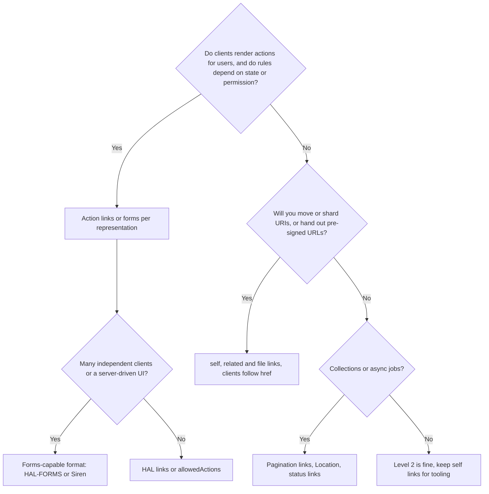
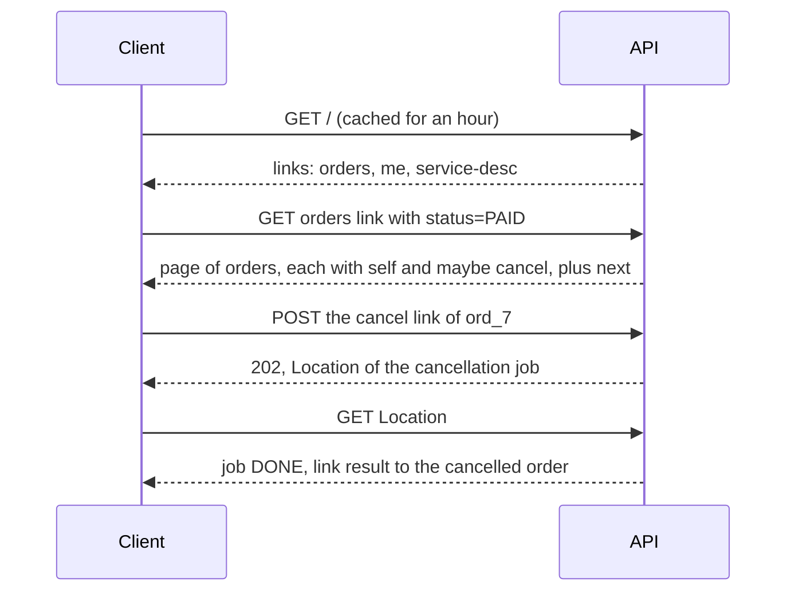
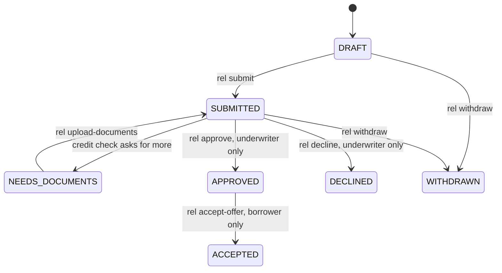

<!-- markdownlint-disable MD001 -->
<!-- markdownlint-disable MD024 -->
<!-- markdownlint-disable MD025 -->
<!-- markdownlint-disable MD026 -->
<!-- markdownlint-disable MD029 -->
<!-- markdownlint-disable MD033 -->
<!-- markdownlint-disable MD036 -->
<!-- markdownlint-disable MD040 -->
<!-- markdownlint-disable MD056 -->
<!-- markdownlint-disable MD060 -->

# R12. HATEOAS and Hypermedia

## Contents

| #      | Sub-topic                                                                                                            |
| ------ | -------------------------------------------------------------------------------------------------------------------- |
| R12.1  | [What HATEOAS actually means](#r121-what-hateoas-actually-means)                                                     |
| R12.2  | [Hypermedia controls: links, relations, templates, forms](#r122-hypermedia-controls-links-relations-templates-forms) |
| R12.3  | [Formats: HAL, HAL-FORMS, JSON:API, Siren and others](#r123-formats-hal-hal-forms-jsonapi-siren-and-others)          |
| R12.4  | [What links buy you](#r124-what-links-buy-you)                                                                       |
| R12.5  | [Why most APIs skip it](#r125-why-most-apis-skip-it)                                                                 |
| R12.6  | [When it pays off, and the pragmatic middle](#r126-when-it-pays-off-and-the-pragmatic-middle)                        |
| R12.7  | [Designing relations and affordances](#r127-designing-relations-and-affordances)                                     |
| R12.8  | [Writing clients that follow links](#r128-writing-clients-that-follow-links)                                         |
| R12.9  | [Spring HATEOAS overview](#r129-spring-hateoas-overview)                                                             |
| R12.10 | [Actix Web: hypermedia by hand](#r1210-actix-web-hypermedia-by-hand)                                                 |
| R12.11 | [Story: a loan app that changed without a release](#r1211-story-a-loan-app-that-changed-without-a-release)           |
| -      | [Exercises](#exercises) and [Solutions](#solutions)                                                                  |
| -      | [Takeaways](#takeaways)                                                                                              |

## R12.1 What HATEOAS actually means

Hypermedia As The Engine Of Application State: the client moves through the application by following controls (links and forms) that the server puts into each representation, the way a person moves through a website by clicking.  
The client knows an entry URI and the media types; it does not know the URI structure or the workflow rules in advance.  
The server decides, per response, what can be done next.

### Two kinds of state

| State             | Lives in | Example                                                   |
| ----------------- | -------- | --------------------------------------------------------- |
| Resource state    | Server   | Order `ord_7` is `PAID`                                   |
| Application state | Client   | "I am looking at order `ord_7` and may cancel or ship it" |

HATEOAS says application state changes are driven by the hypermedia in the last representation received.  
The client's possible next steps are exactly the controls it was given.

### Fielding's rules (2008, paraphrased)

1. A REST API is entered with no prior knowledge beyond the initial URI and a set of standardised media types.

2. The descriptive effort goes into media types and link relations, not into documenting URI paths.

3. The API must not define fixed resource names or hierarchies that clients rely on; servers own their URI space.

4. State transitions are driven by client selection of server-provided choices in representations.

By that definition most "REST APIs" are HTTP APIs at Richardson level 2 (R1.4). That is a legitimate design choice, as long as it is a choice.

### The browser is the proof

A browser renders HTML it has never seen, follows links and submits forms whose meaning it does not understand, and keeps working when sites change their URLs.  
It works because HTML is a hypermedia format and a **human** supplies the semantics: reads the labels, decides which button to press.  
That human is exactly what a typical API client lacks (R12.5).

## R12.2 Hypermedia controls: links, relations, templates, forms

A control has a target (URI), a relation type (`rel`, what the link means), and optionally a method, media type and input fields.  
The relation name, not the URI, is the contract.  
Use registered relations where they fit, URI templates for parameterised links, and a forms-capable format when clients need to know how to submit, not only where.

### Where links can live

| Location                 | Example                                       | Good for                                               |
| ------------------------ | --------------------------------------------- | ------------------------------------------------------ |
| `Link` header (RFC 8288) | `Link: </orders?cursor=eyJ...>; rel="next"`   | Pagination, deprecation, any body format (even binary) |
| `Location` header        | `201` and `202` responses (R6.5)              | "Here is the thing you created or the job you started" |
| Body (format-specific)   | HAL `_links`, JSON:API `links`, Siren `links` | Per-item links, state-dependent controls               |

### Registered relations worth knowing (IANA registry)

| Relation                        | Meaning                                     | Typical use                          |
| ------------------------------- | ------------------------------------------- | ------------------------------------ |
| `self`                          | This resource's canonical URI               | Every representation                 |
| `next`, `prev`, `first`, `last` | Pagination                                  | Collections (R6.3)                   |
| `collection`, `item`            | Membership                                  | Item to its list, list to its items  |
| `up`                            | Parent in a hierarchy                       | Line item to order                   |
| `related`                       | Related resource                            | Order to customer                    |
| `edit`                          | Where to send changes                       | When editing differs from `self`     |
| `alternate`                     | Another representation (CSV, PDF)           | Content negotiation without `Accept` |
| `describedby`                   | A description, such as a JSON Schema        | Validation, documentation            |
| `profile` (RFC 6906)            | Extra semantics this representation follows | "This order follows profile v3"      |
| `service-desc` (RFC 8631)       | Machine-readable API description (OpenAPI)  | From the API root                    |
| `service-doc` (RFC 8631)        | Human documentation                         | From the API root                    |
| `deprecation`, `sunset`         | Deprecation and sunset information          | R11.8                                |
| `search`                        | A search resource or template               | From the root or a collection        |

Domain actions (`cancel`, `approve`, `pay`) are **extension relations**.  
RFC 8288 says extension relation types are URIs (`https://api.acme.com/rels/cancel`); HAL's `curies` let you write them compactly (`acme:cancel`).  
Plain short names (`cancel`) are common in practice; document them in one place.

### URI templates (RFC 6570)

```json
"search": { "href": "/orders{?status,customerId,cursor,limit}", "templated": true }
```

The client fills variables by name; the server still owns the path and the parameter set. Expansion handles encoding (`{?q}` with `q = "a b"` becomes `?q=a%20b`).

### Links vs forms (affordances)

A link says **where**. A form also says **how**: method, content type, fields, constraints.

| Control level            | Client must know in advance                 | Formats                              |
| ------------------------ | ------------------------------------------- | ------------------------------------ |
| Link with `rel` only     | Method, body shape, meaning of the relation | HAL, JSON:API, `Link` header         |
| Link with method hint    | Body shape, meaning                         | Ad hoc (`"method": "POST"`)          |
| Form / action / template | Meaning of the relation only                | HAL-FORMS, Siren actions, HTML forms |

Even with full forms, the client still needs to know what "approve" **means** before deciding to do it. Forms move syntax to runtime; semantics stay in the contract.

## R12.3 Formats: HAL, HAL-FORMS, JSON:API, Siren and others

HAL is the minimal, widely supported choice: `_links` and `_embedded` added to ordinary JSON. HAL-FORMS adds forms.  
JSON:API is a complete convention for resources, relationships, includes, sparse fields and pagination, with hypermedia links as part of it.  
Siren puts actions first. Pick one, declare it with its media type, and use it consistently.

### The same paid order in each format

**HAL** (`application/hal+json`)

```json
{
  "id": "ord_7",
  "status": "PAID",
  "amountMinor": 49999,
  "currency": "INR",
  "_links": {
    "self":     { "href": "/orders/ord_7" },
    "customer": { "href": "/customers/cus_1" },
    "acme:cancel":   { "href": "/orders/ord_7/cancellation" },
    "acme:shipment": { "href": "/orders/ord_7/shipments" },
    "curies": [ { "name": "acme", "href": "https://docs.acme.com/rels/{rel}", "templated": true } ]
  },
  "_embedded": {
    "acme:items": [
      { "sku": "PH-9", "qty": 1, "_links": { "self": { "href": "/orders/ord_7/items/1" } } }
    ]
  }
}
```

**HAL-FORMS** (`application/prs.hal-forms+json`): HAL plus `_templates`

```json
{
  "id": "ord_7",
  "status": "PAID",
  "_links": { "self": { "href": "/orders/ord_7" } },
  "_templates": {
    "cancel": {
      "method": "POST",
      "target": "/orders/ord_7/cancellation",
      "contentType": "application/json",
      "properties": [
        { "name": "reason", "required": true, "options": { "inline": ["CUSTOMER_REQUEST", "FRAUD", "OTHER"] } }
      ]
    }
  }
}
```

**JSON:API** (`application/vnd.api+json`)

```json
{
  "data": {
    "type": "orders",
    "id": "ord_7",
    "attributes": { "status": "PAID", "amountMinor": 49999, "currency": "INR" },
    "relationships": {
      "customer": {
        "data": { "type": "customers", "id": "cus_1" },
        "links": { "related": "/orders/ord_7/customer" }
      }
    },
    "links": { "self": "/orders/ord_7" }
  },
  "included": [
    { "type": "customers", "id": "cus_1", "attributes": { "name": "Asha Rao" } }
  ]
}
```

**Siren** (`application/vnd.siren+json`)

```json
{
  "class": ["order"],
  "properties": { "id": "ord_7", "status": "PAID", "amountMinor": 49999, "currency": "INR" },
  "links": [ { "rel": ["self"], "href": "/orders/ord_7" } ],
  "actions": [
    { "name": "cancel", "method": "POST", "href": "/orders/ord_7/cancellation", "type": "application/json",
      "fields": [ { "name": "reason", "type": "text" } ] }
  ]
}
```

### Comparison

| Format                     | Media type                         | Links                                    | Embedding                       | Forms / actions       | Strengths                                                                       | Weaknesses                                       |
| -------------------------- | ---------------------------------- | ---------------------------------------- | ------------------------------- | --------------------- | ------------------------------------------------------------------------------- | ------------------------------------------------ |
| HAL                        | `application/hal+json`             | `_links`                                 | `_embedded`                     | No                    | Minimal, readable, wide library support (Spring HATEOAS default)                | No forms; the spec stayed an Internet-Draft      |
| HAL-FORMS                  | `application/prs.hal-forms+json`   | `_links`                                 | `_embedded`                     | `_templates`          | Adds method and fields to HAL                                                   | Smaller ecosystem                                |
| JSON:API 1.1               | `application/vnd.api+json`         | `links`                                  | `included` (compound documents) | No (conventions only) | Full spec: relationships, `include`, `fields[type]`, `sort`, pagination, errors | Verbose envelope; opinionated                    |
| Siren                      | `application/vnd.siren+json`       | `links`                                  | `entities`                      | `actions`             | Actions are first class                                                         | Little adoption                                  |
| JSON-LD + Hydra            | `application/ld+json`              | IRIs                                     | Graph                           | Hydra operations      | Linked-data semantics, vocabularies                                             | Complex; niche outside semantic web              |
| OData                      | `application/json` with `@odata.*` | `@odata.nextLink`, navigation properties | `$expand`                       | Actions and functions | Rich query language, Microsoft ecosystem                                        | Heavy; couples clients to a query protocol       |
| Plain JSON + `Link` header | Any                                | Header only                              | No                              | No                    | Zero body changes                                                               | Only top-level links; poor for per-item controls |

## R12.4 What links buy you

Even if clients never "discover" anything, links move three kinds of knowledge from client code to the server:  
**where** things are (URIs), **whether** an action is allowed now (state and permission), and **what comes next** (pagination, async jobs, related data).  
Each removes a class of client releases and bugs.

| Benefit                       | Without links                                                   | With links                                                                                         |
| ----------------------------- | --------------------------------------------------------------- | -------------------------------------------------------------------------------------------------- |
| State-dependent actions       | Client re-implements "cancel allowed if PAID and not shipped"   | Client shows "Cancel" if the `cancel` link is present (R1.4)                                       |
| Permission-aware UI           | Client duplicates role rules; drifts from the server            | Server omits links the caller may not use; buttons match authorisation exactly                     |
| Server-owned URIs             | Moving files to a CDN host or sharding by region breaks clients | Clients follow `href`; the server can point to `https://eu.files.acme.com/...` or a pre-signed URL |
| Pagination                    | Clients build cursors or page numbers                           | `next` link with an opaque cursor (R6.3)                                                           |
| Long-running operations       | Clients guess the status URL                                    | `202` + `Location`, then a `result` link when done (R6.5)                                          |
| Workflow change               | New step means a client release                                 | New link appears; clients that understand the relation use it, others ignore it                    |
| Exploration and documentation | Read docs, build URLs by hand                                   | Start at the root, follow `service-desc` and links in a browser or HAL explorer                    |

The first two rows are the strongest argument.  
Business rules duplicated in mobile apps are a frequent source of bugs and inconsistent behaviour; a link's presence is a single source of truth.

## R12.5 Why most APIs skip it

Because the clients that consume most APIs are programs written by developers against documentation, often through generated SDKs,  
and those programs need to know the meaning of every action in advance anyway.  
Links tell a client where; they cannot tell it why or when.  
Without a human (or very specific domain logic) to supply semantics, full runtime discovery delivers less than it promises, while its costs are concrete.

| Reason                          | Detail                                                                                          |
| ------------------------------- | ----------------------------------------------------------------------------------------------- |
| The semantic gap                | A client cannot decide to `approve` a loan because a link appeared; someone coded that decision |
| SDK and code generation culture | OpenAPI describes static paths and schemas; generated clients call paths directly               |
| Developer expectations          | Integrators read docs and copy URLs; few client libraries follow links                          |
| Payload and noise               | Links per item in large collections add bytes and visual clutter                                |
| Format fragmentation            | HAL vs JSON:API vs Siren vs custom; no single winner                                            |
| Testing and contract tooling    | Breaking-change detectors and mocks reason about paths, not relations                           |
| Little short-term pressure      | Hard-coded URIs work until the day they move                                                    |

What remains true despite all of this: URIs do move, rules do change, and the costs of hard-coding them land on the client team at the worst time.  
That is why the middle ground in R12.6 is worth having.

## R12.6 When it pays off, and the pragmatic middle

Full hypermedia pays off when clients are long-lived and many, when the domain is a workflow whose rules change, and when the server should drive what a UI shows.  
For everything else, adopt the cheap, high-value subset: `self` links, pagination links, `Location` on creates and jobs, and state-dependent action links or an `allowedActions` list.  
Do not make clients discover URIs they will hard-code anyway.



### Decision table

| Situation                                                           | Recommendation                                                                        |
| ------------------------------------------------------------------- | ------------------------------------------------------------------------------------- |
| Workflow domain (loans, claims, orders, approvals) with a UI client | Action links whose presence reflects state and permission                             |
| Server-driven or white-label UIs, many client builds in the field   | HAL-FORMS or Siren: forms rendered from the response                                  |
| Public API consumed via SDKs                                        | `self`, pagination, `Location`, file links; document relations; optional action links |
| Internal service-to-service APIs                                    | Pagination and `Location`; skip the rest                                              |
| Bulk and analytics endpoints                                        | `Link` headers only; no per-item links                                                |
| Files, exports, media                                               | Always links (`download`, pre-signed URLs), never client-built paths                  |

### `allowedActions` vs links

| Approach                        | Example                                            | Pros                                                   | Cons                                       |
| ------------------------------- | -------------------------------------------------- | ------------------------------------------------------ | ------------------------------------------ |
| `allowedActions` field (R5)     | `"allowedActions": ["cancel", "ship"]`             | Trivial for SDKs and typed clients; no format adoption | Client still builds URIs and knows methods |
| Links in `_links`               | `"cancel": {"href": "/orders/ord_7/cancellation"}` | Server owns URIs too; standard tooling                 | Clients must look up by relation           |
| Forms (`_templates`, `actions`) | Method, fields, options                            | Client UI can be generated                             | Most work on both sides                    |

Both of the first two encode the important fact: **what is possible now, decided by the server.** Many teams ship both: `allowedActions` for typed clients, `_links` for URIs.

## R12.7 Designing relations and affordances

Treat relation names as the API contract: registered relations first, then a documented, namespaced set of your own. Document what absence means.  
Generate links from route definitions, not string concatenation, and generate their host from configuration rather than request headers.  
Embed related resources only when clients almost always need them.

### Rules

1. **Relations are the contract; URIs are not.** A client may store `rel` names in code; it should not store URIs (except bookmarks of `self`).

2. **Absence is meaningful.** Document "the `cancel` link is present only when the caller may cancel this order now". Clients then never need the rule.

3. **Do not leak authorisation through links.** Links are computed per caller; a link the caller cannot use is a lie, and a link to another tenant's resource is a leak (R10).

4. **Relative or absolute URIs.** Relative URIs resolve against the request URI and survive proxies unchanged; absolute URIs are clearer for clients.  
  If you generate absolute URIs, build the host from configuration or from forwarding headers set only by your own proxies (R4.6).  
  Generating them from a client-supplied `Host` or `X-Forwarded-Host` enables cache poisoning (R9.6).

5. **Name links, do not describe paths.** `"customer"` not `"getCustomerById"`.

6. **Embed by need.** `_embedded` or JSON:API `included` saves round trips (the N+1 problem) but couples payload size to client needs; prefer opt-in (`?include=customer`, R6.2).

7. **Point to descriptions.** Root resource with `service-desc` (OpenAPI), `service-doc` (human docs); `profile` or `describedby` on representations whose semantics need a pointer.

8. **Keep links cacheable-safe.** Links that differ by caller make the representation per-user: `Cache-Control: private` (R9.6).

### The API root

```json
GET /
{
  "_links": {
    "self":         { "href": "/" },
    "orders":       { "href": "/orders{?status,cursor,limit}", "templated": true },
    "customers":    { "href": "/customers{?q}", "templated": true },
    "me":           { "href": "/me" },
    "service-desc": { "href": "/openapi.json", "type": "application/vnd.oai.openapi+json" },
    "service-doc":  { "href": "https://docs.acme.com/api", "type": "text/html" }
  }
}
```

A root document costs almost nothing, is cacheable (`public, max-age=3600`), and lets tooling and curious developers explore.

## R12.8 Writing clients that follow links

A hypermedia client starts from the root (or from a link it was given), looks up controls by relation name, checks presence before offering an action, and never constructs URIs.  
Test that discipline by changing URIs in a test environment: a client that still works is genuinely link-driven.

| Rule                                                             | Why                                                                  |
| ---------------------------------------------------------------- | -------------------------------------------------------------------- |
| Navigate by `rel`, not by path                                   | URIs can change server-side without a release                        |
| Treat a missing relation as "not available now"                  | That is the server's decision; do not fall back to a hard-coded URI  |
| Ignore unknown relations                                         | New capabilities must not break old clients (tolerant reader, R11.3) |
| Cache the root and stable link targets per their `Cache-Control` | Avoid a root round trip per operation                                |
| Keep `self` URIs as identifiers, not hand-built ones             | They stay valid across URI layout changes                            |
| Follow `Location` and `next` exactly as given                    | Cursors and job URIs are opaque (R6.3, R6.5)                         |

**URI rotation test.** In a staging environment, add a random prefix to every path (`/x7f2/orders/...`) and keep only the root fixed. Run the client's test suite.  
Every failure is a hard-coded URI.



## R12.9 Spring HATEOAS overview

Spring HATEOAS provides representation models (`EntityModel`, `CollectionModel`, `PagedModel`), link builders that derive URIs from controller methods (`linkTo(methodOn(...))`),  
assemblers that keep link logic in one place, affordances that render as HAL-FORMS templates, and a client-side `Traverson` for following links.  
Spring Boot configures HAL by default when the starter is present.

| Building block                            | Purpose                                                                                                                       |
| ----------------------------------------- | ----------------------------------------------------------------------------------------------------------------------------- |
| `RepresentationModel<T>`                  | Base class: a representation that carries links                                                                               |
| `EntityModel<T>`                          | Wraps one domain DTO plus links                                                                                               |
| `CollectionModel<T>`, `PagedModel<T>`     | Collections, with page metadata and navigation links                                                                          |
| `WebMvcLinkBuilder.linkTo(methodOn(...))` | Builds links from controller method mappings: no string paths                                                                 |
| `RepresentationModelAssembler<T, D>`      | One class turns a domain object into its model with all links                                                                 |
| `afford(methodOn(...))`                   | Attaches an affordance (method, input type) to a link; rendered by HAL-FORMS                                                  |
| `@EnableHypermediaSupport`                | Selects media types (`HAL`, `HAL_FORMS`, `COLLECTION_JSON`, `UBER`)                                                           |
| `PagedResourcesAssembler` (Spring Data)   | Builds `PagedModel` with `first`, `prev`, `next`, `last` from a `Page`                                                        |
| `Traverson`                               | Client that follows relations from a root URI                                                                                 |
| `ForwardedHeaderFilter`                   | Uses trusted `Forwarded` / `X-Forwarded-*` headers when building absolute links (`server.forward-headers-strategy=framework`) |

Third-party media types: JSON:API (`spring-hateoas-jsonapi` community module), Siren (community module).  
Spring Data REST builds a full HAL API from repositories automatically; useful for internal admin APIs, risky for public ones because it exposes your persistence model as the contract.

### An assembler with state-dependent links and affordances

```java
@Component
class OrderModelAssembler implements RepresentationModelAssembler<Order, EntityModel<OrderView>> {

    private final OrderPermissions permissions;
    OrderModelAssembler(OrderPermissions permissions) { this.permissions = permissions; }

    @Override
    public EntityModel<OrderView> toModel(Order order) {
        Link self = linkTo(methodOn(OrderController.class).get(order.id())).withSelfRel();

        if (order.status() == OrderStatus.PAID && permissions.canCancel(order)) {
            self = self.andAffordance(afford(methodOn(OrderController.class).cancel(order.id(), null)));   // HAL-FORMS template
        }

        EntityModel<OrderView> model = EntityModel.of(OrderView.from(order), self,
                linkTo(methodOn(CustomerController.class).get(order.customerId())).withRel("customer"));

        if (order.status() == OrderStatus.PAID && permissions.canCancel(order)) {
            model.add(linkTo(methodOn(OrderController.class).cancel(order.id(), null)).withRel("cancel"));
        }
        if (order.status() == OrderStatus.PAID && permissions.canShip(order)) {
            model.add(linkTo(methodOn(ShipmentController.class).create(order.id(), null)).withRel("shipment"));
        }
        return model;
    }
}
```

`permissions` evaluates the same rules the endpoints enforce; the links are a convenience, never the enforcement (R10).  
The `cancel` endpoint must still reject a cancel that is not allowed.

### Controller using the assembler

```java
@RestController
@RequestMapping(value = "/orders", produces = { MediaTypes.HAL_JSON_VALUE, MediaTypes.HAL_FORMS_JSON_VALUE })
class OrderController {

    private final OrderService orders;
    private final OrderModelAssembler assembler;

    OrderController(OrderService orders, OrderModelAssembler assembler) { this.orders = orders; this.assembler = assembler; }

    @GetMapping("/{id}")
    EntityModel<OrderView> get(@PathVariable String id) {
        return assembler.toModel(orders.get(id));
    }

    @PostMapping("/{id}/cancellation")
    ResponseEntity<?> cancel(@PathVariable String id, @RequestBody CancelRequest req) {
        Order cancelled = orders.cancel(id, req.reason());                          // enforces the rule itself
        EntityModel<OrderView> model = assembler.toModel(cancelled);
        return ResponseEntity.ok(model);
    }
}

@Configuration
@EnableHypermediaSupport(type = { HypermediaType.HAL, HypermediaType.HAL_FORMS })
class HypermediaConfig { }
```

### Keyset pagination with HATEOAS

`PagedResourcesAssembler` is built for offset pages. For keyset cursors (R6.3), build the collection yourself:

```java
@GetMapping
CollectionModel<EntityModel<OrderView>> list(@RequestParam(required = false) String cursor,
                                             @RequestParam(defaultValue = "20") int limit) {
    CursorPage<Order> page = orders.page(cursor, limit);                             // own type: items + optional nextCursor
    List<EntityModel<OrderView>> items = page.items().stream().map(assembler::toModel).toList();
    CollectionModel<EntityModel<OrderView>> model = CollectionModel.of(items,
            linkTo(methodOn(OrderController.class).list(cursor, limit)).withSelfRel());
    page.nextCursor().ifPresent(next ->
            model.add(linkTo(methodOn(OrderController.class).list(next, limit)).withRel(IanaLinkRelations.NEXT)));
    return model;
}
```

### Client: `Traverson`

```java
Traverson traverson = new Traverson(URI.create("https://api.acme.com/"), MediaTypes.HAL_JSON);

String firstPaidOrder = traverson
        .follow(rel("orders").withParameter("status", "PAID"))                        // expands the URI template
        .follow("$._embedded.orders[0]._links.self.href")
        .toObject("$.id");
```

`Traverson` resolves templates and follows relations, but it is synchronous and less used than plain `RestClient` plus a small link-lookup helper.  
For HAL-aware typed access, register `HypermediaRestTemplateConfigurer` or `HypermediaWebClientConfigurer` so clients deserialise `EntityModel<T>` with links.

## R12.10 Actix Web: hypermedia by hand

Actix Web has no hypermedia framework; HAL is small enough to model with serde.  
Build links from named routes (`url_for`) or from a configured base URL, never from request headers you do not control, and compute state-dependent links in one place per resource.

### HAL types

```rust
use serde::Serialize;
use std::collections::BTreeMap;

#[derive(Serialize, Clone)]
pub struct Link {
    pub href: String,
    #[serde(skip_serializing_if = "std::ops::Not::not")]
    pub templated: bool,
    #[serde(skip_serializing_if = "Option::is_none")]
    pub title: Option<String>,
}

impl Link {
    pub fn to(href: impl Into<String>) -> Self { Link { href: href.into(), templated: false, title: None } }
    pub fn template(href: impl Into<String>) -> Self { Link { href: href.into(), templated: true, title: None } }
}

#[derive(Serialize)]
pub struct Hal<T: Serialize> {
    #[serde(flatten)]
    pub body: T,
    #[serde(rename = "_links")]
    pub links: BTreeMap<&'static str, Link>,                             // stable key order in output
    #[serde(rename = "_embedded", skip_serializing_if = "BTreeMap::is_empty")]
    pub embedded: BTreeMap<&'static str, Vec<serde_json::Value>>,
}

impl<T: Serialize> Hal<T> {
    pub fn new(body: T, self_href: String) -> Self {
        Hal { body, links: BTreeMap::from([("self", Link::to(self_href))]), embedded: BTreeMap::new() }
    }
    pub fn link(mut self, rel: &'static str, link: Link) -> Self { self.links.insert(rel, link); self }
}
```

### Links from route names, host from configuration

```rust
pub struct ApiBase(pub url::Url);                                         // e.g. https://api.acme.com/, from config

fn path_for(req: &HttpRequest, name: &str, params: &[&str]) -> String {
    req.url_for(name, params)                                             // resolves the named route's pattern
        .map(|u| u.path().to_owned())                                     // keep only the path: host comes from config
        .expect("route registered")
}

fn absolute(base: &ApiBase, path: &str) -> String {
    base.0.join(path.trim_start_matches('/')).expect("valid path").to_string()
}
```

`HttpRequest::url_for` builds the full URL from the connection info, which reads `Host` and forwarding headers;  
taking only the path and joining it to a configured base keeps a spoofed `X-Forwarded-Host` out of your links (R9.6, R10).

### One function owns an order's links

```rust
fn order_model(req: &HttpRequest, base: &ApiBase, who: &Principal, o: Order) -> Hal<OrderView> {
    let id = o.id.clone();
    let mut hal = Hal::new(OrderView::from(&o), absolute(base, &path_for(req, "order", &[&id])))
        .link("customer", Link::to(absolute(base, &path_for(req, "customer", &[&o.customer_id]))));

    if o.status == OrderStatus::Paid && who.may_cancel(&o) {
        hal = hal.link("cancel", Link::to(absolute(base, &path_for(req, "order_cancellation", &[&id]))));
    }
    if o.status == OrderStatus::Paid && who.may_ship(&o) {
        hal = hal.link("shipment", Link::to(absolute(base, &path_for(req, "order_shipments", &[&id]))));
    }
    hal
}

#[get("/orders/{id}", name = "order")]
async fn get_order(
    req: HttpRequest,
    base: web::Data<ApiBase>,
    who: web::ReqData<Principal>,
    svc: web::Data<OrderService>,
    id: web::Path<String>,
) -> Result<HttpResponse, ApiError> {
    let order = svc.get_visible(&who, &id).await?;                        // object-level check (R10.5)
    Ok(HttpResponse::Ok()
        .content_type("application/hal+json")
        .insert_header((header::CACHE_CONTROL, "private, no-cache"))     // links depend on the caller
        .json(order_model(&req, &base, &who, order)))
}
```

Register the other routes with matching names (`#[post("/orders/{id}/cancellation", name = "order_cancellation")]`, and so on).  
A test can render every state of an order for several roles and snapshot the link sets: that table is the documentation of your state machine.

### The API root

```rust
#[get("/", name = "root")]
async fn root(base: web::Data<ApiBase>) -> HttpResponse {
    let hal = Hal::new(serde_json::json!({}), absolute(&base, "/"))
        .link("orders", Link::template(absolute(&base, "/orders{?status,cursor,limit}")))
        .link("me", Link::to(absolute(&base, "/me")))
        .link("service-desc", Link::to(absolute(&base, "/openapi.json")));
    HttpResponse::Ok()
        .content_type("application/hal+json")
        .insert_header((header::CACHE_CONTROL, "public, max-age=3600"))
        .json(hal)
}
```

## R12.11 Story: a loan app that changed without a release

A lender's mobile app shows a loan application and the buttons a borrower or underwriter can press. App store releases take two weeks; regulation changes faster.



| #   | Event                                                                                               | What hypermedia did                                                                                                         |
| --- | --------------------------------------------------------------------------------------------------- | --------------------------------------------------------------------------------------------------------------------------- |
| 1   | Launch: the app renders a button for each link it recognises (`submit`, `withdraw`, `accept-offer`) | No eligibility rules in the app; buttons always matched server rules                                                        |
| 2   | Regulation adds a mandatory `NEEDS_DOCUMENTS` step for loans above a threshold                      | Server started returning `upload-documents` with a HAL-FORMS template; the app's generic form renderer showed it on day one |
| 3   | Underwriters and borrowers use the same app                                                         | Links computed per caller: borrowers never saw `approve`; the endpoint rejected it anyway (R10)                             |
| 4   | Document storage moved to a regional bucket with pre-signed URLs                                    | `document` links pointed to the new host; no client change                                                                  |
| 5   | Credit check became asynchronous                                                                    | `submit` returned `202` with `Location`; the job resource carried a `result` link to the updated application (R6.5)         |
| 6   | An old app build without the form renderer saw `upload-documents`                                   | It ignored the unknown relation and showed "action required on the website" via a generic fallback                          |

What made it work:

- Relation names and the form renderer were the contract; URIs and rules were not.

- Link computation lived in one server function per resource and was snapshot-tested per state and role.

- Enforcement stayed on the endpoints; links only mirrored it.

- Unknown relations were tolerated by design.

## Exercises

**1. HAL with state.** An invoice has statuses `DRAFT`, `ISSUED`, `PAID`, `VOID`. Accountants may issue drafts, void issued invoices and record payments; customers may only pay issued invoices online.  
  Write the HAL `_links` for (a) a `DRAFT` invoice seen by an accountant, (b) an `ISSUED` invoice seen by a customer, (c) a `PAID` invoice seen by anyone.

**2. JSON:API.** Represent the `ISSUED` invoice `inv_9` (amount ₹12,000, customer `cus_4`, two line items) as a JSON:API compound document with the customer included and the line items as a relationship.

**3. Find the hard-coding.** A mobile client does this:

```kotlin
val order = api.get("https://api.acme.com/v2/orders/$id")
if (order.status == "PAID" && user.role == "ADMIN" && order.createdAt > now() - 30.days) {
    showCancelButton { api.post("https://api.acme.com/v2/orders/$id/cancel") }
}
val invoicePdf = "https://files.acme.com/invoices/${order.invoiceId}.pdf"
```

List every piece of knowledge the client should not own, and rewrite it to follow hypermedia.

**4. Hypermedia or not?** Decide the level of hypermedia for:

- a) A public payments API used through SDKs in six languages.

- b) An internal pricing service called by three backend services.

- c) An insurance claims app used by customers, adjusters and supervisors, with rules that change quarterly.

- d) A nightly bulk export endpoint returning 2 million rows as NDJSON.

**5. Relation design.** For the loan workflow in R12.11, list the relations you would define, say which are IANA-registered, how you would name and document the custom ones, and what the documentation says about absence.

**6. Pagination links.** A keyset-paginated `GET /orders?status=PAID&limit=50` is on its third page.  
  Write both the `Link` header and the HAL body links, and explain why `prev` and `last` may be absent.

## Solutions

### Solution 1

**a) `DRAFT`, accountant**

```json
"_links": {
  "self":     { "href": "/invoices/inv_9" },
  "customer": { "href": "/customers/cus_4" },
  "edit":     { "href": "/invoices/inv_9" },
  "issue":    { "href": "/invoices/inv_9/issuance" }
}
```

**b) `ISSUED`, customer**

```json
"_links": {
  "self":     { "href": "/invoices/inv_9" },
  "pdf":      { "href": "https://files.acme.com/inv/9f3c...?sig=...", "type": "application/pdf" },
  "pay":      { "href": "/invoices/inv_9/payments" }
}
```

No `void` (accountant only), no `edit` (issued invoices are immutable), no `customer` link if customers cannot read the customer record as a resource.

**c) `PAID`, anyone**

```json
"_links": {
  "self":     { "href": "/invoices/inv_9" },
  "pdf":      { "href": "https://files.acme.com/inv/9f3c...?sig=...", "type": "application/pdf" },
  "payments": { "href": "/invoices/inv_9/payments" }
}
```

No state-changing links: a paid invoice is terminal in this model. Because links differ by caller, responses are `Cache-Control: private`.

### Solution 2

```json
{
  "data": {
    "type": "invoices",
    "id": "inv_9",
    "attributes": { "status": "ISSUED", "amountMinor": 1200000, "currency": "INR" },
    "relationships": {
      "customer": {
        "data": { "type": "customers", "id": "cus_4" },
        "links": { "related": "/invoices/inv_9/customer" }
      },
      "lineItems": {
        "data": [ { "type": "line-items", "id": "li_1" }, { "type": "line-items", "id": "li_2" } ],
        "links": { "related": "/invoices/inv_9/line-items" }
      }
    },
    "links": { "self": "/invoices/inv_9" }
  },
  "included": [
    { "type": "customers", "id": "cus_4", "attributes": { "name": "Ravi Traders" }, "links": { "self": "/customers/cus_4" } }
  ]
}
```

Requested as `GET /invoices/inv_9?include=customer` with `Accept: application/vnd.api+json`. Line items are referenced by linkage only; `?include=customer,lineItems` would add them to `included`.

### Solution 3

Knowledge the client should not own:

| Hard-coded knowledge                      | Problem                                                                   |
| ----------------------------------------- | ------------------------------------------------------------------------- |
| Base URL and `/v2/orders/{id}` structure  | Breaks on host, version or path changes                                   |
| Cancellation rule (status, role, 30 days) | Duplicates server policy; drifts when the rule changes                    |
| Role check on the client                  | Authorisation belongs to the server; client roles can be stale or spoofed |
| Cancel URL and method                     | Breaks if cancellation becomes `POST /orders/{id}/cancellation`           |
| Invoice PDF URL pattern                   | Breaks when files move or require signed URLs; may bypass authorisation   |

Rewrite:

```kotlin
val order = api.follow(orderLink)                         // a link from a list, a notification, or a stored self URI
order.links["cancel"]?.let { cancel ->                    // present only if this user may cancel now
    showCancelButton { api.post(cancel.href, CancelRequest(reason)) }
}
order.links["invoice-pdf"]?.let { pdf -> showDownload(pdf.href) }
```

The server adds `cancel` only when status, role and age allow it, and the cancel endpoint still enforces the same rule.

### Solution 4

| #   | Decision                                                                                                              | Reason                                                                                 |
| --- | --------------------------------------------------------------------------------------------------------------------- | -------------------------------------------------------------------------------------- |
| a   | Pragmatic subset: `self`, pagination, `Location`, file and receipt links; `allowedActions` on state-machine resources | SDK users code against docs; links still protect against URI and file-location changes |
| b   | Level 2: `Location` and pagination only                                                                               | Three known consumers, deployed together; hypermedia adds cost without benefit         |
| c   | Full hypermedia with forms (HAL-FORMS or Siren); links per role and state                                             | Workflow with changing rules and several roles in UI clients: the strongest case       |
| d   | `Link` header for the next chunk or `Location` of the export file; no per-row links                                   | Per-row links would multiply the payload for no client benefit                         |

### Solution 5

| Relation                       | Registered? | Meaning                                    |
| ------------------------------ | ----------- | ------------------------------------------ |
| `self`                         | Yes         | The application                            |
| `collection`                   | Yes         | The list of the caller's applications      |
| `describedby`                  | Yes         | JSON Schema of the application             |
| `edit`                         | Yes         | Update the draft (present only in `DRAFT`) |
| `acme:submit`                  | No          | Submit for checks                          |
| `acme:withdraw`                | No          | Withdraw                                   |
| `acme:upload-documents`        | No          | Provide requested documents                |
| `acme:approve`, `acme:decline` | No          | Underwriter decisions                      |
| `acme:accept-offer`            | No          | Borrower accepts                           |

Custom relations are URIs (`https://docs.acme.com/rels/submit`) written as `acme:submit` via a HAL `curie`, so the documentation for each relation is at its own URI.  
The documentation states for each: method, request schema (or HAL-FORMS template), responses,  
and **"present only when the current caller may perform this action on this application in its current state; absence means not allowed now, never 'use a default URI'"**.

### Solution 6

```text
Link: </orders?status=PAID&limit=50&cursor=eyJpZCI6Im9yZF8xNTAifQ>; rel="next",
      </orders?status=PAID&limit=50>; rel="first",
      </orders?status=PAID&limit=50&cursor=eyJpZCI6Im9yZF8xMDAifQ>; rel="self"
```

```json
"_links": {
  "self":  { "href": "/orders?status=PAID&limit=50&cursor=eyJpZCI6Im9yZF8xMDAifQ" },
  "first": { "href": "/orders?status=PAID&limit=50" },
  "next":  { "href": "/orders?status=PAID&limit=50&cursor=eyJpZCI6Im9yZF8xNTAifQ" }
}
```

- `prev` is absent because a forward-only keyset cursor knows where to continue, not where the previous page started. Supporting it needs a backward cursor (reverse the sort and the comparison), which many APIs skip.

- `last` is absent because finding the last page means scanning or a reverse query, and with concurrent inserts "last" moves; offset pagination can provide it, keyset usually does not (R6.3).

- `next` is absent on the final page; that absence is the end-of-list signal.

## Takeaways

- HATEOAS means the client advances by following controls the server put into the last representation; the client knows the entry point, media types and relation meanings, not URIs or workflow rules.

- The relation name is the contract. Use IANA-registered relations (`self`, `next`, `collection`, `edit`, `describedby`, `service-desc`) first, and documented, namespaced extension relations for domain actions.

- Links say where; forms (HAL-FORMS `_templates`, Siren `actions`) also say how. Neither says why: clients still need to know what an action means.

- HAL is the minimal format; JSON:API is a full convention with relationships, includes and sparse fields; Siren and HAL-FORMS add actions.

- The biggest wins are state- and permission-dependent action links (no duplicated business rules in clients) and server-owned URIs (moves, sharding, pre-signed files).

- Most APIs skip full hypermedia because SDK-based clients need semantics in code anyway. Ship the pragmatic subset everywhere: `self`, pagination links, `Location`, file links, and action links or `allowedActions` on workflow resources.

- Links are computed per caller, mirror but never replace enforcement, make responses `private` for caching, and must be built from configuration, not spoofable headers.

- Clients navigate by relation, treat absence as "not now", ignore unknown relations, and can be tested by rotating URIs in staging.

- Spring HATEOAS: assemblers plus `linkTo(methodOn(...))` and affordances; in Actix, a small serde HAL type, named routes and one link function per resource.

---
